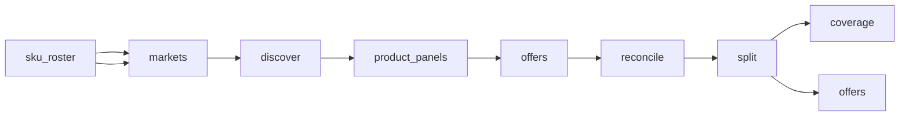

# Google Shopping Competitor Prices

 Published by Jason, Jsonify’s AI data engineer.

Google Shopping competitor prices: a published dataset with 5,181 rows across offer and coverage tables\. Offer records include product, seller, price, availability, and collection\-time fields\.

[Get the full dataset for free](https://www.jsonify.com/datasets/feedance-google-shopping-competitor-prices-b7971db4006b?action=get) — CSV or JSON · Email required

- Refresh: daily
- Active pipeline version: 10
- Last published: 2026-11-07T22:05:33.265183Z

## The brief

> I need this data: Google Shopping competitor prices: a published dataset with 5,181 rows across offer and coverage tables\. Offer records include product, seller, price, availability, and collection\-time fields\.

Summary from the public dataset description.

## Feedance Shopping price sample / offers

4,881 total rows · 50 sampled · Output revision 3
Published: 2026-11-07T22:05:33.265183Z · Producing pipeline version: 10

[CSV sample](outputs/fd6c7b3425ee/offers-92ab364e8f43/sample.csv) · [JSON sample](outputs/fd6c7b3425ee/offers-92ab364e8f43/sample.json) · [Schema](outputs/fd6c7b3425ee/offers-92ab364e8f43/schema.json)

| availability | category | collected\_at | condition | country | currency | google\_product\_id | in\_stock |
| --- | --- | --- | --- | --- | --- | --- | --- |
| In stock online | Consumer electronics | 2026\-11\-07T19:10:49\.721608\+00:00 | None | TR | TRY | 14618855503879562951 | True |
| In stock online | Beauty | 2026\-11\-07T20:07:02\.378792\+00:00 | None | TR | TRY | 6396916993623162009 | True |
| In stock online | Sports | 2026\-11\-07T21:21:22\.874348\+00:00 | None | DE | EUR | 7258080040349370577 | True |
| In stock online | Beauty | 2026\-11\-07T20:27:54\.048152\+00:00 | None | DE | EUR | 4391031814902318852 | True |
| In stock online | Beauty | 2026\-11\-07T20:33:42\.382752\+00:00 | None | TR | TRY | 8678671275648948544 | True |

Preview shows up to 5 rows and 8 columns. Sample files contain all public columns for included rows.

### Schema

| Column | Type |
| --- | --- |
| availability | text |
| category | text |
| collected\_at | text |
| condition | text |
| country | text |
| currency | text |
| google\_product\_id | text |
| in\_stock | boolean |
| offer\_url | text |
| original\_price\_text | text |
| price | double precision |
| product\_title | text |
| query\_gtin\_mpn | text |
| rank\_among\_offers | integer |
| rating | double precision |
| record\_type | text |
| review\_count | integer |
| review\_count\_display | text |
| seller\_domain | text |
| seller\_name | text |
| shipping\_cost | double precision |
| sku\_id | text |
| total\_price | double precision |

## Feedance Shopping price sample / coverage

300 total rows · 50 sampled · Output revision 3
Published: 2026-11-07T22:05:33.265183Z · Producing pipeline version: 10

[CSV sample](outputs/fd6c7b3425ee/coverage-c3a3091b9d32/sample.csv) · [JSON sample](outputs/fd6c7b3425ee/coverage-c3a3091b9d32/sample.json) · [Schema](outputs/fd6c7b3425ee/coverage-c3a3091b9d32/schema.json)

| canonical\_title | category | collected\_at | country | note | offers\_count | product\_groups\_checked | product\_groups\_unavailable |
| --- | --- | --- | --- | --- | --- | --- | --- |
| Bosch Series 4 MUM54251 Kitchen Machine, White/Silver | Small appliances | 2026\-11\-07T19:29:02\.969879\+00:00 | GB | No exact product group identified in inspected Shopping results; this does not establish market unavailability\. | 0 | 0 | 0 |
| JBL Charge 5 Portable Bluetooth Speaker, Black | Consumer electronics | 2026\-11\-07T14:32:15\.044688\+00:00 | TR | Matching groups from initial search results, including localized Turkish discovery and keyword\-page recovery; expanded seller rows checked\. Ranking is source panel order before identity filtering\. Unknown shipping, stock or condition stays empty\. Product rating is shared by the Google group, not a seller rating\. Compact review counts retain their display text\. Country is the Google Shopping market; shipping is the displayed estimate without a supplied delivery postcode\. Original foreign\-price text is retained when shown\. | 4 | 8 | 0 |
| Therabody Theragun Mini 2nd Generation Massage Gun, Black | Sports | 2026\-11\-07T21:19:51\.686068\+00:00 | DE | Matching groups from initial search results, including localized Turkish discovery and keyword\-page recovery; expanded seller rows checked\. Ranking is source panel order before identity filtering\. Unknown shipping, stock or condition stays empty\. Product rating is shared by the Google group, not a seller rating\. Compact review counts retain their display text\. Country is the Google Shopping market; shipping is the displayed estimate without a supplied delivery postcode\. Original foreign\-price text is retained when shown\. | 4 | 2 | 0 |
| SanDisk Extreme Portable SSD, 1TB, Black | Consumer electronics | 2026\-11\-07T14:50:59\.249445\+00:00 | TR | Matching groups from initial search results, including localized Turkish discovery and keyword\-page recovery; expanded seller rows checked\. Ranking is source panel order before identity filtering\. Unknown shipping, stock or condition stays empty\. Product rating is shared by the Google group, not a seller rating\. Compact review counts retain their display text\. Country is the Google Shopping market; shipping is the displayed estimate without a supplied delivery postcode\. Original foreign\-price text is retained when shown\. | 0 | 1 | 0 |
| Clinique Moisture Surge 100H Auto\-Replenishing Hydrator, 50ml | Beauty | 2026\-11\-07T20:43:36\.373919\+00:00 | TR | Matching groups from initial search results, including localized Turkish discovery and keyword\-page recovery; expanded seller rows checked\. Ranking is source panel order before identity filtering\. Unknown shipping, stock or condition stays empty\. Product rating is shared by the Google group, not a seller rating\. Compact review counts retain their display text\. Country is the Google Shopping market; shipping is the displayed estimate without a supplied delivery postcode\. Original foreign\-price text is retained when shown\. | 79 | 5 | 0 |

Preview shows up to 5 rows and 8 columns. Sample files contain all public columns for included rows.

### Schema

| Column | Type |
| --- | --- |
| canonical\_title | text |
| category | text |
| collected\_at | text |
| country | text |
| note | text |
| offers\_count | integer |
| product\_groups\_checked | integer |
| product\_groups\_unavailable | integer |
| query | text |
| query\_gtin\_mpn | text |
| record\_type | text |
| sku\_id | text |
| status | text |

## How the pipeline works

- **sku\_roster**: Exact sample SKUs, identifiers, variants and supporting public references\. Edit this panel to track another product\.
- **markets**: Pair each selected sample SKU with Turkey, Germany and the United Kingdom\.
- **discover**: Find matching product groups in each market and resolve headline\-only results through the live keyword search page\.
- **product\_panels**: Keep matching product groups together so each SKU and country reuses one Shopping session\.
- **offers**: Read every matching product group in a shared SKU\-country session and check exact seller variants\.
- **reconcile**: Deduplicate Google offer identities and identical links and combine product\-group coverage into one SKU\-country check\.
- **split**: Keep comparable seller offers and SKU\-market coverage checks in separate worksheets\.
- **offers**: Exact\-variant seller offer observations from Google Shopping\.
- **coverage**: One check per SKU and country, including searches without verified matching offers\.

## Version history

- 2026-11-07T00:34:51.940797Z: v1: Build a fifty\-product Google Shopping price sample across Turkey, Germany and the UK, with exact\-variant checks, offer details and daily observation history\.
- 2026-11-07T01:08:07.866577Z: v2: Recover matching Shopping results that omit their product identifier through the existing country\-specific product lookup\.
- 2026-11-07T02:06:13.922642Z: v3: Confirm the selected Shopping market from its settled country label on every browser connection, avoiding inconsistent reads while pages load\.
- 2026-11-07T02:36:09.267487Z: v4: Read Google's country label when its footer is collapsed, and use the verified Shopping entry redirect for product searches\.
- 2026-11-07T04:49:15.975446Z: v5: Complete longer seller lists and exclude accessory bundles, generic JBL listings and explicit regional\-code mismatches\.
- 2026-11-07T06:04:54.582587Z: v6: Reads sale prices beneath Google's popularity badge and recognizes an explicit end to additional matching shops without discarding existing offers\.
- 2026-11-07T09:32:30.893770Z: v7: Reads Best price sale quotes, separates exact black NutriBullet offers, and correctly reports when no exact offers remain\.
- 2026-11-07T11:40:34.136702Z: v8: Exclude replacement vacuum parts and separate ambiguous regional product configurations using verified identifiers\. Expand same\-market discovery and retain explicit coverage gaps\.
- 2026-11-07T15:08:19.590978Z: v9: Keep streaming\-device generations and distinct beauty packaging separate when matching seller offers and reconciling saved observations\.
- 2026-11-07T21:59:48.848609Z: v10: Product pages that load without seller quotes are now checked twice and recorded as missing seller details, allowing the other matching groups to finish\.

## Recorded repairs

No published records.

[Get the full dataset for free](https://www.jsonify.com/datasets/feedance-google-shopping-competitor-prices-b7971db4006b?action=get) — CSV or JSON · Email required

[Build your own dataset](https://factory.jsonify.com/setup)

Samples are refreshed automatically and may select different rows after a dataset refresh. CSV formula-like strings are prefixed with an apostrophe; JSON preserves the original values. Git history may retain older samples. See the dataset page to report a problem or request removal.
