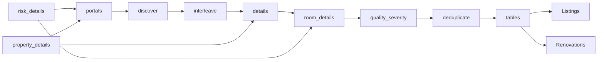

# Finnish Homes and Renovation Events

 Published by Jason, Jsonify’s AI data engineer.

Public Finnish home sale listings from Etuovi and Oikotie, with 315 homes and 8,594 linked renovation events\.

[Get the full dataset for free](https://www.jsonify.com/datasets/finnish-homes-and-renovation-events-2f9eb2b4c803?action=get) — CSV or JSON · Email required

- Refresh: On demand
- Active pipeline version: 21
- Last published: 2026-11-19T22:19:22.544305Z

## The brief

> I need this data: Public Finnish home sale listings from Etuovi and Oikotie, with 315 homes and 8,594 linked renovation events\.

Summary from the public dataset description.

## Finnish homes and renovation events / Listings

315 total rows · 50 sampled · Output revision 14
Published: 2026-11-19T22:19:22.544305Z · Producing pipeline version: Unknown

[CSV sample](outputs/ea9d0e6fad28/listings-5009238dba6b/sample.csv) · [JSON sample](outputs/ea9d0e6fad28/listings-5009238dba6b/sample.json) · [Schema](outputs/ea9d0e6fad28/listings-5009238dba6b/schema.json)

| address | asking\_price\_eur | asking\_price\_eur\_status | building\_construction\_year | building\_type | collected\_at | completed\_renovations\_text | condition\_rating |
| --- | --- | --- | --- | --- | --- | --- | --- |
| Rudolfintie 21 B | 121637\.62 | provided\_from\_price\_section | 1969 | Kerrostalo | 2026\-11\-19T14:16:35\.438801\+00:00 | keittiö ja lattiapinnat 2019  1994 Vesikattojen uusim\.  2002 Piha\-alueiden asfaltointi ja jätekatosten rakentaminen  2004 Lämmönvaihtimen uusim\.  2006 Ikkunasaneeraus  2007 2\- ja 4\-talojen julkisivumuurauksen osittainen uusiminen  2009 Grillipaikan rakentaminen  2013 Tonttijohtojen uusiminen \(sadevesi\- ja viemärijohdot\)  2016 Parvekesaneeraus lasituksineen ja liikuntasaumojen uudistus 2020 Laaja LVIS\-peruskorjaus, saunojen kunnostus, 1\- ja 3\- talojen lukosto 2021 Katon kiirelliset korjaukset, paineenkorotusaseman asennus, pihan istutuksia  2022 2\- ja 4\-talojen lukitusuudistus 2026 "\-talon hissien peruskorjaus  1994 Vesikattojen uusim\.  2002 Piha\-alueiden asfaltointi ja jätekatosten rakentaminen  2004 Lämmönvaihtimen uusim\.  2006 Ikkunasaneeraus  2007 2\- ja 4\-talojen julkisivumuurauksen osittainen uusiminen  2009 Grillipaikan rakentaminen  2013 Tonttijohtojen uusiminen \(sadevesi\- ja viemärijohdot\)  2016 Parvekesaneeraus lasituksineen ja liikuntasaumojen uudistus 2020 Laaja LVIS\-peruskorjaus, saunojen kunnostus, 1\- ja 3\- talojen lukosto 2021 Katon kiirelliset korjaukset, paineenkorotusaseman asennus, pihan istutuksia  2022 2\- ja 4\-talojen lukitusuudistus 2026 "\-talon hissien peruskorjaus | Hyvä |
| Wavulinintie 5 B | 329000 | provided\_from\_price\_section | 1972 | Kerrostalo | 2026\-11\-19T14:16:54\.937445\+00:00 | 2026: täydellinen huoneistoremontti\. TALOYHTIÖSSÄ: 2025 Uima\-allasosaston lämmitysputket uusittiin 2025 Uima\-altaan pinnoite uusittiin 2025 Pihalle istutettiin kolme koristeomenapuuta 2024 Parvekkeet ja julkisivut hankkeelle saatiin rakennuslupa 2024 Toteutettiin linjasaneeraus 2024 Märkätilat peruskorjattiin 2024 Vesikalusteet uusittiin 2024 Sähköjohdotukset, kapeloinnit ja valaistus uusittiin 2024 Antennijärjestelmä uusittiin 2024 Pattereiden perussäätö 2024 Porraskäytävät maalattiin 2024 Ilmanvaihtokoneet uusittiin 2023 ATK\-kaapelointi 2023 Aurinkopaneelit 2023 Sähköpääkeskus 2023 IV\-koneet 2023 Poistoilmalämmöntalteenotto 2023 Maalämpö 2022 Vesikatto uusittiin 2021 A 19 märkätilan vesivahinkokorjaus 2021 IV\-koneita uusittiin 2021 Saunan lauteet uusittiin 2021 Ikkunaylityksien muurauksia korjattiin 2020 Julkisivujen ja parvekkeiden kuntotutkimus 2020 Peruskorjauksen hankesuunnitelma 2020 Peruskorjuksen esiselvityksiä ja tutkimuksia 2019 Kuntoarvio 2019 B 33 ja B 45 märkätilojen 2018 Hissien kunnostus vesivahinkokorjaus 2018 IV selvitys 2018 Lipputanko uusittiin 2018 Vesikaton kuntotarkistus 2017 Kylmäkellarin käyttötarkoituksen muutos 2017 Saunaosaston saneeraus 2016 Kylmäkellarin käyttötarkoituksen suunnittelu 2016 Saunaosaston kunnostuksen suunnittelu 2015 Vaakaviemärin kunnostus pommisuoja/asunto B 25 2015 Pihan kunnostus 2014 Pohjaviemäreiden huuhtelu 2014 Porraskäytävien valaistuksen parantaminen 2014 Putkiston kuntokartoitus 2014 Vesikaton tarvittavat korjaukset 2014 Pihan suunnittelu 2013 Vesikaton kuntokartoitus 2013 Parkkipaikkojen maalaus 2012 Patteriverkoston perussäätö 2012 Parvekkeiden kuntokartoitus 2012 Saunaosaston kuntokartoitus 2011 Aulan maalaus, ovien huoltomaalauksia 2011 Parvekkeiden huoltokorjauksia 2010 Ilmastointilaitteiden huoltoa 2010 Pystyviemärien \(3 kpl\) painehuuhtelu 2010 Putkimiehen huoneistokierros 2009 Takkojen hormit nuohottu 2009 Lämmönsiirrin uusittu 2008 Jätekatoksen laajennus 2008 Asfaltoinnin korjaus 2008 Lukkojen sarjoitus 2008 Huippuimuri 2008 Hissien korjaukset 2008 Katon reunapeltien tukevoittaminen 2008 Kiertovesipumppu 2008 Laattojen kunnostus 2005 Julkisivu korjattu 2005 Taloyhtiössä on tehty palotarkastus 2001 Ilmastointi, perusparannus 1999 Parvekeovet ja \-ikkunat uusittu 1998 Vesikaton pinnoite 1997 Pohjoispuolen ikkunat uusittu 1993 Lämmönvaihdin ja asbestisaneeraus | Hyvä |
| Munkkiluodonkuja 2 | 369623\.61 | provided\_from\_price\_section | 1975 | Kerrostalo | 2026\-11\-19T14:16:47\.691556\+00:00 | 2023 Keittiöremontti, wc:n seinien laatoitus sekä lattialämmitys linjasaneerauksen yhteydessä\.  2015 Parvekkeen maalaus  2012 Parketti on hiottu ja lakattu, sisäovet on vaihdettu ja seinät on maalattu  2009 Kodinhoitohuone  2025 Palovaroitinjärjestelmän päivitys \(etävalvonta, 10v akut\)  2024 LVIS\-hankkeen 1v korjaustyöt  2022\-2023 LVIS\-hankkeen toteutus \(lisää kohdassa 3\.\)  2023 Autolatausselvitys\. Vesikaton kuntotarkastus\. Katon kriittisten kohtien korjaus  2022 Haitta\-ainekartoitus ja rakenneselvitykset sekä viemärikuvaukset\. Aurinkosähköselvitys  2021 Kellaritilojen asbestikartoitus LVIS\-saneerausta varten  2020\-2021 Piha\-alueiden siistimistä ja nurmen uusintaa   2020 Autokatoksen rännien uusiminen\. Kellarikäytävien valaistuksen parantaminen\. Energiansäästökartoitus\. LVIS toteutussuunnitelma  2018\-2020 Ilmanvaihtokoneiden korjausta ja uusintaa  2019 Piha\-asfaltin sekä maannousujen ja \-painumien korjaus\. Sähköauton latausmahdollisuuden asennus  2018 Parvekkeiden uusiminen ja lasitus\. Katon läpivientien korjaus\. Kellarikäytävien maalaus  2016 LVIS hankesuunnitelma  2015 Sokkelin korjaus ja maalaus  2014 Ulkoiluvälinevaraston \(G\) ja puuvaraston \(F\) rakentaminen | Hyvä |
| Piispanpiha 4 C | 250000 | provided\_from\_price\_section | 2011 | Kerrostalo | 2026\-11\-19T14:16:46\.367144\+00:00 | YHTIÖSSÄ SUORITETUT SUURIMMAT KORJAUKSET JA PERUSPARANNUKSET: \- Hisseihin uusittu varavoima\-akut v\. 2025 \- Putkilukon asennus v\. 2025 \- lv\- tuloilmakoneen puhaltimen uusinta v\. 2025 \- Kylpyhuoneiden lattialämmitystermostaattien tark, säätö ja viallisten vaihto v\. 2025 \- Elementtisaumojen puutteiden korjaus v\.2025 \- Kaikkien huoneistojen palovaroittimet tarkistettu v\.2024 \- Ljh uuden paisunta\-astian asennus v\. 2024 \- IV\-koneen tuloilmapuhaltimen laakeri korjattu v\.2024 \- Vesikaton läpivientien tiivistykset v\. 2024 \- Sulanapitokaapelit uusittu v\. 2024 \- VAK automaatio järjestelmän korjaus ja palomuurin asennus v\. 2024 \- D\-portaan koodilaite uusittu v\. 2024 \- Viheralueiden ja yhteispihan kalusteiden ja leikkipaikan kunnostukset v\. 2024 \- Parvekelasi uusittiin C17 huoneistossa ja C22, D35 ja D53 huoneistojen parvekelaseja huollettiin v\. 2024 \- YIT:n 10\-vuotisvastuukorjaukset: sadevesikaivojen painumien ja sadevesiviemäreiden liitosten korjaukset v\. 2023 \(kaivovälit TK l \- TK 3 ja SVTK l ja SVTK 3\) \- YIT:n salaojakorjaustyöt v\. 2023 \- Nurmialueen kunnostus / YIT osana 10\-vuotiskorjauksia v\. 2023 \- Pergoloiden huoltoja maalaus v\. 2023 \- YIT vaihtoi haljenneet käsienpesualtaat ilmoitetuissa huoneistoissa v\. 2023 \- Vesikaton kaasupussien ja läpivientien korjaus YIT:n toimesta v\. 2023 \- Porraskäytävien valaisimien uusinta ledvalaisimiksi v\.2023 \- Pumppukaivon korjaus v\. 2022 \- Väestönsuojan tarkistus ja tiiveyskoe tehty 19\.10\.2022 \- Huoneistojen palovaroittimien vaihto v\. 2021 \- IV\- kanavien puhdistus, ilmamäärien säätö v\. 2019 \- Piha\-alueen muurien liuskekivien korjaus YIT:n suorittamana v\. 2019 \- IV kanavien puhdistus v\.2019 | Tyydyttävä |
| Hepokuja 6 A | 99000 | provided\_from\_price\_section | 1971 | Kerrostalo | 2026\-11\-19T14:16:49\.876873\+00:00 | 2025: Jätealueen asfaltointi\. 2025: AB\-talon Hepokujan puolen sisäänkäyntien portaiden kunnostus\. 2025: Yleinen kuntoarvio\. 2025: Julkisivun rappauskorjausten jatkaminen\. 2024: Katon kuntotutkimus ja huoltotyöt\. 2024: Julkisivun rappauskorjauksia: CDE\-talon takasivu ja eteläsivu sekä AB\-talon eteläsivu ja itä\- ja länsisivut\. 2024: AB\-talon Hepokujan puoleisten ulko\-ovien uusiminen\. 2023: Julkisivujen kuntotutkimus\. 2023: Jätepisteen uusiminen Molok\-jätesäiliöillä yhteisesti Hepokuja 4:n kanssa\. 2023: Kiertovesipumpun uusiminen\. 2022: Pihatason liiketilojen puisten ulko\-ovien uusiminen\. 2021: A–E\-rappujen metalliulko\-ovien uusiminen\. 2021: C\-rapun ilmanvaihtokoneiden uusiminen\. 2021: Mankelin uusiminen\. 2020: Julkisivujen pesu ja suojakäsittely\. 2020: Porraskäytävien yläpuolisten lumiesteiden asennus\. 2020: Parvekekaiteiden huoltomaalaus\. 2019: AB\-talon parvekkeiden pielielementtien elastisten elementtisaumojen uusiminen\. 2019: D\-rapun poistoilmanvaihtokoneen uusiminen\. 2019: Lämmityksen perussäätö\. 2018: Porraskäytävien savunpoiston asentaminen\. 2018: Porraskäytävien sisäänkäyntitasojen ja sisäänkäyntien saneeraus\. 2018: LVIS\-saneeraus: kylpyhuoneiden peruskorjaus, viemärien uusiminen aiemmille paikoilleen ja käyttövesiputkien uusiminen porraskäytävien kautta\. Keittiöiden viemärilinjat sukitettu ja pohjaviemärit saneerattu sisäpuolisesti\. Sähkö\- ja käyttöveden tonttiliittymät uusittu\. Urakoitsija VRJ Etelä\-Suomi Oy\. 2018: Asuntojen ja yleisten tilojen lukituksen uusiminen iLOQ\-lukituksella\. 2018: Hissien saneeraus\. 2016: E\-rapun poistoilmakoneen uusiminen\. 2016: Kanavapaineanturien ja taajuusmuuntimien asentaminen kaikkiin poistoilmakoneisiin\. 2016: CE\-talon katon kaatokorjaukset\. 2015: Kiinteistöautomatiikan uusiminen ja etäyhteyden asentaminen valvontaa ja säätöä varten\. 2013: AB\-talon huippuimurin uusiminen\. 2009: Talopesulan rakentaminen\. 2007: Pihan ja pysäköintialueen asfaltointi\. 2006: Julkisivujen kunnostustyö, parvekkeiden kunnostus ja maalaus sekä huoneistoparvekkeiden ikkunoiden ja parvekeovien uusiminen\. 2002: Porraskäytävien maalaus\. 2001: Leikkialueen peruskunnostus\. 1997: Ikkunoiden uusiminen\. 1997: Vesikattojen korjaus\.  Tehdyt remontit 2025: Jätealueen asfaltointi\. 2025: AB\-talon Hepokujan puolen sisäänkäyntien portaiden kunnostus\. 2025: Yleinen kuntoarvio\. 2025: Julkisivun rappauskorjausten jatkaminen\. 2024: Katon kuntotutkimus ja huoltotyöt\. 2024: Julkisivun rappauskorjauksia: CDE\-talon takasivu ja eteläsivu sekä AB\-talon eteläsivu ja itä\- ja länsisivut\. 2024: AB\-talon Hepokujan puoleisten ulko\-ovien uusiminen\. 2023: Julkisivujen kuntotutkimus\. 2023: Jätepisteen uusiminen Molok\-jätesäiliöillä yhteisesti Hepokuja 4:n kanssa\. 2023: Kiertovesipumpun uusiminen\. 2022: Pihatason liiketilojen puisten ulko\-ovien uusiminen\. 2021: A–E\-rappujen metalliulko\-ovien uusiminen\. 2021: C\-rapun ilmanvaihtokoneiden uusiminen\. 2021: Mankelin uusiminen\. 2020: Julkisivujen pesu ja suojakäsittely\. 2020: Porraskäytävien yläpuolisten lumiesteiden asennus\. 2020: Parvekekaiteiden huoltomaalaus\. 2019: AB\-talon parvekkeiden pielielementtien elastisten elementtisaumojen uusiminen\. 2019: D\-rapun poistoilmanvaihtokoneen uusiminen\. 2019: Lämmityksen perussäätö\. 2018: Porraskäytävien savunpoiston asentaminen\. 2018: Porraskäytävien sisäänkäyntitasojen ja sisäänkäyntien saneeraus\. 2018: LVIS\-saneeraus: kylpyhuoneiden peruskorjaus, viemärien uusiminen aiemmille paikoilleen ja käyttövesiputkien uusiminen porraskäytävien kautta\. Keittiöiden viemärilinjat sukitettu ja pohjaviemärit saneerattu sisäpuolisesti\. Sähkö\- ja käyttöveden tonttiliittymät uusittu\. Urakoitsija VRJ Etelä\-Suomi Oy\. 2018: Asuntojen ja yleisten tilojen lukituksen uusiminen iLOQ\-lukituksella\. 2018: Hissien saneeraus\. 2016: E\-rapun poistoilmakoneen uusiminen\. 2016: Kanavapaineanturien ja taajuusmuuntimien asentaminen kaikkiin poistoilmakoneisiin\. 2016: CE\-talon katon kaatokorjaukset\. 2015: Kiinteistöautomatiikan uusiminen ja etäyhteyden asentaminen valvontaa ja säätöä varten\. 2013: AB\-talon huippuimurin uusiminen\. 2009: Talopesulan rakentaminen\. 2007: Pihan ja pysäköintialueen asfaltointi\. 2006: Julkisivujen kunnostustyö, parvekkeiden kunnostus ja maalaus sekä huoneistoparvekkeiden ikkunoiden ja parvekeovien uusiminen\. 2002: Porraskäytävien maalaus\. 2001: Leikkialueen peruskunnostus\. 1997: Ikkunoiden uusiminen\. 1997: Vesikattojen korjaus\. | Tyydyttävä |

Preview shows up to 5 rows and 8 columns. Sample files contain all public columns for included rows.

### Schema

| Column | Type |
| --- | --- |
| address | text |
| asking\_price\_eur | double precision |
| asking\_price\_eur\_status | text |
| building\_construction\_year | bigint |
| building\_type | text |
| collected\_at | text |
| completed\_renovations\_text | text |
| condition\_rating | text |
| construction\_year | text |
| coordinate\_accuracy | text |
| coordinates\_status | text |
| debt\_free\_price\_eur | double precision |
| debt\_free\_price\_eur\_status | text |
| description | text |
| duplicates\_merged | bigint |
| energy\_class | text |
| heating\_type | text |
| housing\_company | text |
| image\_url | text |
| last\_facade\_renovation\_year | bigint |
| last\_pipe\_renovation\_year | bigint |
| last\_roof\_renovation\_year | bigint |
| latitude | double precision |
| lift | boolean |
| listing\_key | text |
| listing\_url | text |
| listing\_urls | jsonb |
| living\_area\_m2 | double precision |
| living\_area\_m2\_status | text |
| longitude | double precision |
| municipality | text |
| number\_of\_floors | bigint |
| numeric\_field\_status | jsonb |
| ownership\_type | text |
| ownership\_type\_original | text |
| pipe\_renovation\_planned | boolean |
| pipe\_renovation\_planned\_status | text |
| pipe\_renovation\_planned\_year | bigint |
| pipe\_renovation\_recommended | boolean |
| pipe\_renovation\_recommended\_year\_end | bigint |
| pipe\_renovation\_recommended\_year\_start | bigint |
| planned\_renovations\_text | text |
| plot\_ownership | text |
| portal | text |
| portal\_listing\_id | text |
| portals | jsonb |
| postal\_code | text |
| postal\_code\_status | text |
| property\_type\_original | text |
| qa\_reason | text |
| qa\_status | text |
| renovation\_event\_count | bigint |
| renovation\_information\_status | text |
| renovations | jsonb |
| rooms\_text | text |
| source\_listing\_count | bigint |

## Finnish homes and renovation events / Renovations

8,594 total rows · 50 sampled · Output revision 14
Published: 2026-11-19T22:19:22.544305Z · Producing pipeline version: Unknown

[CSV sample](outputs/ea9d0e6fad28/renovations-4a19e68119e2/sample.csv) · [JSON sample](outputs/ea9d0e6fad28/renovations-4a19e68119e2/sample.json) · [Schema](outputs/ea9d0e6fad28/renovations-4a19e68119e2/schema.json)

| address | collected\_at | description\_original | event\_key | event\_text | is\_substantive\_renovation | listing\_key | listing\_url |
| --- | --- | --- | --- | --- | --- | --- | --- |
| Rudolfintie 21 B | 2026\-11\-19T14:16:35\.438801\+00:00 | vuonna 2019, jolloin seinät maalattiin | home:b2dc14fc39c2667ab1501b6c:be93e89fa3e48822 | vuonna 2019, jolloin seinät maalattiin | True | home:b2dc14fc39c2667ab1501b6c | [https://www\.etuovi\.com/kohde/80551256](<https://www.etuovi.com/kohde/80551256>) |
| Rudolfintie 21 B | 2026\-11\-19T14:16:35\.438801\+00:00 | vuonna 2019, jolloin vinyylilattiat asennettiin | home:b2dc14fc39c2667ab1501b6c:0fe06655c06a704c | vuonna 2019, jolloin vinyylilattiat asennettiin | True | home:b2dc14fc39c2667ab1501b6c | [https://www\.etuovi\.com/kohde/80551256](<https://www.etuovi.com/kohde/80551256>) |
| Rudolfintie 21 B | 2026\-11\-19T14:16:35\.438801\+00:00 | vuonna 2019, jolloin keittiö uusittiin | home:b2dc14fc39c2667ab1501b6c:bb1c01be6716062c | vuonna 2019, jolloin keittiö uusittiin | True | home:b2dc14fc39c2667ab1501b6c | [https://www\.etuovi\.com/kohde/80551256](<https://www.etuovi.com/kohde/80551256>) |
| Rudolfintie 21 B | 2026\-11\-19T14:16:35\.438801\+00:00 | Ikkunallinen kylpyhuone ja erillinen wc uusittiin 2020 putkiremontin yhteydessä\. | home:b2dc14fc39c2667ab1501b6c:1c02f88da74ee50f | Ikkunallinen kylpyhuone ja erillinen wc uusittiin 2020 putkiremontin yhteydessä\. | True | home:b2dc14fc39c2667ab1501b6c | [https://www\.etuovi\.com/kohde/80551256](<https://www.etuovi.com/kohde/80551256>) |
| Rudolfintie 21 B | 2026\-11\-19T14:16:35\.438801\+00:00 | 1994 Vesikattojen uusim\. | home:b2dc14fc39c2667ab1501b6c:8ee372cd631296ac | 1994 Vesikattojen uusim\. | True | home:b2dc14fc39c2667ab1501b6c | [https://www\.etuovi\.com/kohde/80551256](<https://www.etuovi.com/kohde/80551256>) |

Preview shows up to 5 rows and 8 columns. Sample files contain all public columns for included rows.

### Schema

| Column | Type |
| --- | --- |
| address | text |
| collected\_at | text |
| description\_original | text |
| event\_key | text |
| event\_text | text |
| is\_substantive\_renovation | boolean |
| listing\_key | text |
| listing\_url | text |
| municipality | text |
| planning\_basis | text |
| portal | text |
| qa\_reason | text |
| qa\_status | text |
| scope | text |
| source\_section | text |
| status | text |
| type | text |
| year\_end | bigint |
| year\_start | bigint |
| year\_text | text |

## How the pipeline works

- **risk\_details**: Optional source\-reconciled risk details for quality\-severity review and matching\.
- **property\_details**: Optional previously collected property details to reconcile again against public source pages\.
- **portals**: Search both public sale portals in Helsinki, Espoo, Vantaa, Tampere and Turku\.
- **discover**: Read city search pages with bounded pagination and keep distinct local listing links\.
- **interleave**: Balance detail collection across all five cities and both portals\.
- **details**: Read public property details, map data, original renovations and building risk fields; retain quality flags\.
- **room\_details**: Reconcile explicit bedroom and living\-room renovation dates from the listing's room details\.
- **quality\_severity**: Check every quality claim against the requested risk fields and distinguish minor notes from material review issues\.
- **deduplicate**: Merge unambiguous cross\-portal address, area and like\-for\-like price matches, retain all quality flags, and balance the final sample\.
- **tables**: Save unique homes and their linked renovation events in two worksheets\.
- **Listings**: One matched home with renovation history, map coordinates, building risk fields and quality reasons\.
- **Renovations**: Original renovation events with standardized type, years and status linked to the matched home\.

## Version history

- 2026-11-19T13:19:44.317788Z: v1: Added Finnish sale listings from Oikotie and Etuovi with linked completed and planned renovation events\.
- 2026-11-19T14:09:31.000384Z: v2: Added cross\-portal home matching, nested and classified renovation histories, postal and map data, and building insurance risk fields\. Expanded sampling to five cities, excluded right\-of\-occupancy homes, and retained quality flags with explanations\.
- 2026-11-19T14:39:16.188076Z: v3: Long renovation histories now complete their quality checks without cutting source text\. Any uncertainty from a split comparison is retained as a visible review reason\.
- 2026-11-19T14:56:04.616298Z: v4: Unrecognised renovation categories now remain in the dataset as other with a review reason, so an uncertain label cannot stop the whole collection\.
- 2026-11-19T15:14:08.828046Z: v5: Genuine listings without a published floor area are now retained with blank values and a review reason, instead of stopping collection\.
- 2026-11-19T16:04:55.816899Z: v6: Handle withdrawn listings, restore explicitly dated room renovations, and distinguish stated work years from undated recommendations\.
- 2026-11-19T16:31:10.629799Z: v7: Recognize withdrawal notices on both portals and leave qualified renovation dates blank instead of treating them as exact years\.
- 2026-11-19T17:45:14.807098Z: v8: Correct price and date meanings, separate pipe recommendations, merge duplicate homes and events, and retain English quality notes by severity\.
- 2026-11-19T18:28:55.339755Z: v9: Correct abbreviated renovation year ranges and recheck quality notes so minor classification concerns and unrequested fields do not inflate material\-review flags\.
- 2026-11-19T18:55:23.539657Z: v10: Correct source\-supported price and renovation issues before publication, including repeated events and date interpretation\. Keep genuine source contradictions visibly marked for review\.
- 2026-11-19T19:19:53.728449Z: v11: Keep homes with unverifiable proposed corrections in the published sample with clear review reasons, instead of stopping the whole update\.
- 2026-11-19T19:39:47.244842Z: v12: Preserve explicit years from renovation headings, improve source\-backed corrections, and remove repeated events and review explanations\.
- 2026-11-19T19:46:44.217253Z: v13: Remove repeated renovation reports while preserving approval conflicts on both the event and its home\.
- 2026-11-19T20:08:49.162773Z: v14: Removed repeated renovation reports whose only difference is a leading date\. Added explicit review explanations when living area cannot be established separately from other area measures\.
- 2026-11-19T20:45:00.264763Z: v15: Read renovation histories containing unusual source characters in smaller portions, preserving full context, dates and original descriptions\.
- 2026-11-19T21:39:20.473649Z: v16: Correct full calendar date ranges so day and month numbers cannot become renovation years\.
- 2026-11-19T21:47:59.553117Z: v17: Exclude pipe\-insulation maintenance from completed pipe\-renovation summaries without removing history\.
- 2026-11-19T21:56:44.462907Z: v18: Correct auction price selection and avoid false conflict flags for latest bids\.
- 2026-11-19T22:05:17.388526Z: v19: Preserve both years in renovation descriptions such as 2006 ja \-07\.
- 2026-11-19T22:15:52.856509Z: v20: Apply quality severity after corrections so incidental notes do not become material review flags\.
- 2026-11-21T16:09:59.085485Z: v21: Removed all explicit large\-model selections, including fallback calls, so affected calls inherit the platform default\.

## Recorded repairs

No published records.

[Get the full dataset for free](https://www.jsonify.com/datasets/finnish-homes-and-renovation-events-2f9eb2b4c803?action=get) — CSV or JSON · Email required

[Build your own dataset](https://factory.jsonify.com/setup)

Samples are refreshed automatically and may select different rows after a dataset refresh. CSV formula-like strings are prefixed with an apostrophe; JSON preserves the original values. Git history may retain older samples. See the dataset page to report a problem or request removal.
