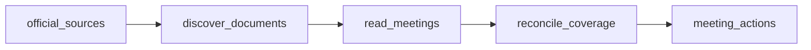

# Georgia County Election Board Meetings, Motions and Votes

 Published by Jason, Jsonify’s AI data engineer.

Georgia county election board motions and votes: 1,269 rows in the published table\. The dataset covers county board meeting actions; see the coverage and limitations for details\.

[Get the full dataset for free](https://www.jsonify.com/datasets/georgia-county-election-board-meetings-and-votes-886d693cbdab?action=get) — CSV or JSON · Email required

- Refresh: On demand
- Active pipeline version: 21
- Last published: 2026-11-02T11:10:55.955034Z

## The brief

> I need this data: Georgia county election board motions and votes: 1,269 rows in the published table\. The dataset covers county board meeting actions; see the coverage and limitations for details\.

Summary from the public dataset description.

## Georgia Elections Board Meetings and Votes / meeting\_actions

1,269 total rows · 50 sampled · Output revision 3
Published: 2026-11-02T11:10:55.955034Z · Producing pipeline version: 21

[CSV sample](outputs/02a6e71cfebc/meeting-actions-7c510d42b127/sample.csv) · [JSON sample](outputs/02a6e71cfebc/meeting-actions-7c510d42b127/sample.json) · [Schema](outputs/02a6e71cfebc/meeting-actions-7c510d42b127/schema.json)

| agenda\_item | board | checked\_at | county | evidence\_quote | meeting\_date | meeting\_location | meeting\_summary |
| --- | --- | --- | --- | --- | --- | --- | --- |
| X\.A\. Hear challenges to the qualifications of voters — August 26, 2026 Bartelski Challenge | Board of Voter Registrations and Elections | 2026\-11\-02T11:07:57\.494370\+00:00 | Forsyth | Vice Chairman Natt with a second from Secretary Tucker made a motion to dismiss from the challenge voter \#19 London Shannon\. Motion carried unanimously\. | 2026\-09\-01 | Forsyth County Voter Registrations &amp; Elections Office, 1201 Sawnee Drive, Cumming, Georgia 30040 | The board adopted its agenda and Augus… |
| Disposition of challenged/provisional ballots \(attached roll\-call chart\) | Board of Voter Registrations and Elections | 2026\-11\-01T21:22:08\.471464\+00:00 | Gwinnett | Code: OP \| Challenged: TIFFANY EBLING … | 2026\-05\-23 | Gwinnett County Voter Registrations &amp; Elections Beauty P\. Baldwin Building, 455 Grayson Hwy, Suite 200, Lawrenceville, Georgia 30046 | The board approved the agenda, voted t… |
| 13\. Adjournment of Board Meeting | Board of Elections and Registration | 2026\-11\-02T10:57:52\.199594\+00:00 | Clayton | A motion was made by Chair Grant and seconded by Vice Chair Walker to adjourn the Regular Board Meeting\. The vote was unanimous, and the motion carried\. | 2026\-05\-12 | 7946 North McDonough Street, Jonesboro, GA 30236 | The board amended and adopted the agen… |
| 10\. Executive Session | Board of Elections and Registration | 2026\-11\-02T10:58:55\.243160\+00:00 | Clayton | Chair Grant made a motion to close the regular session at 5:10 PM and convene into executive session to discuss litigation and personnel matters\. The motion was seconded by Vice Chair Walker and passed by a unanimous vote of 5\-0\. | 2026\-06\-22 | 7946 North McDonough Street, Jonesboro, GA 30236 | The board amended and adopted the agen… |
| V\.D\. Special called meeting of June 19, 2026 \(precinct and polling place changes\) | Board of Voter Registrations and Elections | 2026\-11\-02T11:05:55\.716126\+00:00 | Forsyth | Secretary Tucker with a second from Vice Chairman Natt made a motion to adopt the minutes as prepared by staff\. Motion carried unanimously\. | 2026\-07\-07 | Forsyth County Voter Registrations &amp; Elections Office, 1201 Sawnee Drive, Cumming, Georgia 30040 | The board approved an amended agenda a… |

Preview shows up to 5 rows and 8 columns. Sample files contain all public columns for included rows.

### Schema

| Column | Type |
| --- | --- |
| agenda\_item | text |
| board | text |
| checked\_at | text |
| county | text |
| evidence\_quote | text |
| meeting\_date | text |
| meeting\_location | text |
| meeting\_summary | text |
| meeting\_time | text |
| meeting\_type | text |
| members\_present | jsonb |
| minutes\_status | text |
| minutes\_url | text |
| motion | text |
| motion\_number | integer |
| named\_votes | jsonb |
| outcome | text |
| proposed\_by | text |
| record\_id | text |
| record\_type | text |
| schedule\_url | text |
| seconded\_by | text |
| source\_index\_url | text |
| source\_notes | text |
| state | text |
| video\_timestamp | text |
| video\_url | text |
| vote\_tally\_text | text |
| votes\_abstained | integer |
| votes\_against | integer |
| votes\_for | integer |
| voting\_record\_status | text |

## How the pipeline works

- **official\_sources**: Choose official election\-board records for the selected Georgia counties; default to the ten largest by population\.
- **discover\_documents**: Read each county's complete official archive and follow its observed pagination; distinguish minutes, drafts, summaries, cancellations, and pending records\.
- **read\_meetings**: Read each official PDF or DOCX completely and extract actual motions and explicitly named votes, retaining collective tallies separately\.
- **reconcile\_coverage**: Keep all approved meeting motions and flag scheduled meetings whose minutes are not yet posted; reject duplicate action identities\.
- **meeting\_actions**: One row per recorded motion, plus an explicit status row for meetings with no motions or unposted minutes\.

## Version history

- 2026-10-18T17:04:55.230934Z: v1: Added Fulton County elections board meeting tracking for 2026 to date, with recorded motions, tallies, explicitly named votes, official evidence and pending\-minutes flags\.
- 2026-10-18T17:09:30.238620Z: v2: Corrected reading of complex PDF layouts so meeting motions can be collected without scrambling their source evidence\.
- 2026-10-18T17:14:15.103409Z: v3: Corrected recognition of explicitly recorded abstentions so valid named votes no longer stop collection\.
- 2026-10-18T17:54:13.606104Z: v4: Expands 2026 meeting records to Georgia’s ten largest counties, with approved minutes, drafts, summaries and missing\-minute status clearly distinguished\. Corrects the Fulton narrative agreement that was previously counted as a motion\.
- 2026-10-18T18:02:31.485010Z: v5: Read Gwinnett’s voting charts correctly, preserving every recorded decision and each member’s explicitly recorded vote\.
- 2026-10-18T18:10:38.290702Z: v6: Handle both Gwinnett voting\-chart layouts without duplicating group decisions, and include ballot decisions in meeting summaries\.
- 2026-10-18T18:18:04.447793Z: v7: Read merged voting\-chart cells correctly while avoiding duplicate rows for grouped ballot decisions\.
- 2026-10-18T18:20:28.736279Z: v8: Recognize explicitly recorded votes described as “voted in opposition\.”
- 2026-10-18T18:23:40.490376Z: v9: Preserve corroborated source\-date discrepancies and include the entire selected final day for Cobb meetings\.
- 2026-10-18T18:28:20.153353Z: v10: Recognize corroborating primary\-election wording in Cobb’s minutes while preserving source\-date discrepancy notes\.
- 2026-10-18T20:01:42.406796Z: v11: Process fewer meeting documents at once to reduce processing interruptions without reducing coverage\.
- 2026-10-18T20:08:31.905910Z: v12: Reads board\-identifying headers in Word minutes so valid DeKalb records are retained without weakening source checks\.
- 2026-10-18T20:12:24.776077Z: v13: Preserves brief official\-summary approvals as notes when no formal motion or member vote is recorded, while retaining explicit motions\.
- 2026-10-18T20:17:02.845796Z: v14: Corrects reading order for Chatham’s scanned minutes so sidebar labels no longer interrupt verified motion quotations\.
- 2026-10-18T20:28:56.289467Z: v15: Corrects scanned Chatham motions split by page footers or sidebar headings, while retaining exact\-source and named\-vote checks\.
- 2026-10-18T20:35:50.055440Z: v16: Reads scanned motions continuously across page breaks without treating generated page markers as source text\.
- 2026-10-18T20:47:58.313542Z: v17: Keeps Forsyth motions intact across scanned page breaks while preserving named votes and source checks\.
- 2026-10-18T20:54:14.623966Z: v18: Verifies Forsyth canvassing minutes that omit the county name using the official board name, office address and named officers\.
- 2026-10-18T21:05:00.914289Z: v19: Handles misread page numbers and reads longer scanned minutes in full, preserving motions and named votes across every page\.
- 2026-11-02T10:43:10.498889Z: v20: Scanned minutes now have a complete per\-page visual reading fallback when the usual document reader cannot connect\. Existing motion and vote checks remain in place\.
- 2026-11-02T10:50:36.879953Z: v21: Corrects reading of faint stamp bleed\-through on blank reverse pages so complete meeting records can finish updating\. Unreadable meeting information still stops the update\.

## Recorded repairs

- 2026-10-18T18:32:22.830483Z: temporary blocker
- 2026-11-01T21:25:26.780502Z: no change
- 2026-11-01T21:25:42.443702Z: repaired

[Get the full dataset for free](https://www.jsonify.com/datasets/georgia-county-election-board-meetings-and-votes-886d693cbdab?action=get) — CSV or JSON · Email required

[Build your own dataset](https://factory.jsonify.com/setup)

Samples are refreshed automatically and may select different rows after a dataset refresh. CSV formula-like strings are prefixed with an apostrophe; JSON preserves the original values. Git history may retain older samples. See the dataset page to report a problem or request removal.
