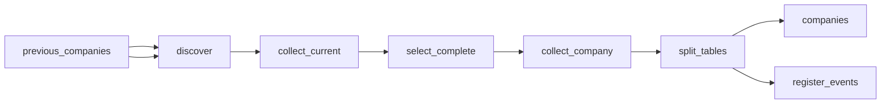

# German Company Register Sample

 Published by Jason, Jsonify’s AI data engineer.

German company register sample with current company details, recent register announcements, and references to register records and PDF evidence\.

[Get the full dataset for free](https://www.jsonify.com/datasets/german-company-register-partnerpal-sample-2d916c5a95b6?action=get) — CSV or JSON · Email required

- Refresh: On demand
- Active pipeline version: 2
- Last published: 2026-11-25T01:54:26.952360Z

## The brief

> I need this data: German company register sample with current company details, recent register announcements, and references to register records and PDF evidence\.

Summary from the public dataset description.

## German Company Register Sample / companies

100 total rows · 10 sampled · Output revision 2
Published: 2026-11-25T01:54:26.952360Z · Producing pipeline version: 2

[CSV sample](outputs/f2802c8c33f5/companies-1701cfb023a1/sample.csv) · [JSON sample](outputs/f2802c8c33f5/companies-1701cfb023a1/sample.json) · [Schema](outputs/f2802c8c33f5/companies-1701cfb023a1/schema.json)

| business\_purpose | chronological\_checked | chronological\_printout\_evidence | chronological\_printout\_url | collected\_at | collection\_notes | company\_id | company\_name |
| --- | --- | --- | --- | --- | --- | --- | --- |
| Maurerarbeiten, Innen\- und Außenputzarbeiten, Fugenarbeiten, Trockenbau, Spachtelarbeiten, WDVS\-Arbeiten, Garten\- und Landschaftsbau\. | True | \{"id": "8e607095d6ba", "kind": "workspace\_file", "sha256": "85aa39a85959718da7a4b7e7b35071df783d74122a7d09317b42df78bca1c666"} | [https://factory\.jsonify\.com/api/workspaces/8860cb27ad86/files/8e607095d6ba/download](<https://factory.jsonify.com/api/workspaces/8860cb27ad86/files/8e607095d6ba/download>) | 2026\-11\-25T01:23:05\.493699\+00:00 | \["Amtsgericht Hamburg, HRB 104418: Current detail attempt 1: Current printout unavailable; Current detail attempt 2: Current printout unavailable; Incomplete current fields: legal\_form, registered\_address, status, share\_capital, officers", "Amtsgericht Hamburg, HRB 174839: Current detail attempt 1: Current printout unavailable; Current detail attempt 2: Current printout unavailable; Incomplete current fields: legal\_form, registered\_address, status, share\_capital, officers", "Amtsgericht Hamburg, HRA 134036: Current detail attempt 1: Current printout unavailable; Current detail attempt 2: Current printout unavailable; Incomplete current fields: legal\_form, registered\_address, status, share\_capital, officers", "Amtsgericht Hamburg, HRA 134129: Current detail attempt 1: Current printout unavailable; Current detail attempt 2: Current printout unavailable; Incomplete current fields: legal\_form, registered\_address, status, share\_capital, officers", "Amtsgericht Hamburg, HRA 134042: Current detail attempt 1: Current printout unavailable; Current detail attempt 2: Current printout unavailable; Incomplete current fields: legal\_form, registered\_address, status, share\_capital, officers", "Amtsgericht Hamburg, HRB 180719: Current detail attempt 1: Current printout unavailable; Current detail attempt 2: Current printout unavailable; Incomplete current fields: legal\_form, registered\_address, status, share\_capital, officers", "Amtsgericht Hamburg, HRB 128368: Current detail attempt 1: Current printout unavailable; Current detail attempt 2: Current printout unavailable; Incomplete current fields: legal\_form, registered\_address, status, share\_capital, officers", "Selected 100 complete companies from 200 attempted candidates; 15 have verified recent officer/address/capital/name changes or new registrations\. Target is at least half; missing source events are never invented\.", "Portal link opens the public search; cite the court/register reference\. PDF evidence links require workspace access\."\] | K1101:HRB:185058 | GWTS Bau GmbH |
| Erwerb, das Halten, Verwalten sowie die Veräußerung von Beteiligungen an anderen Unternehmen\. | True | \{"id": "8d705067b10b", "kind": "workspace\_file", "sha256": "429842485162003005b48d33f956d3530e31c03d2309e6d6509ba4122ba508c8"} | [https://factory\.jsonify\.com/api/workspaces/8860cb27ad86/files/8d705067b10b/download](<https://factory.jsonify.com/api/workspaces/8860cb27ad86/files/8d705067b10b/download>) | 2026\-11\-25T00:40:51\.941306\+00:00 | \["Amtsgericht Frankfurt am Main, HRB 129853: Incomplete current fields: status", "Amtsgericht Frankfurt am Main, HRB 50977: Current detail attempt 1: Handelsregister HTTP 502; Current detail attempt 2: Handelsregister HTTP 502; Incomplete current fields: legal\_form, registered\_address, status, share\_capital, officers", "Amtsgericht Frankfurt am Main, HRB 141330: Current detail attempt 1: Handelsregister HTTP 502; Current detail attempt 2: No unique exact court and register match; Incomplete current fields: legal\_form, registered\_address, status, share\_capital, officers", "Amtsgericht Frankfurt am Main, HRB 31867: Current detail attempt 1: Current printout unavailable; Current detail attempt 2: Current printout unavailable; Incomplete current fields: legal\_form, registered\_address, status, share\_capital, officers", "Selected 100 complete companies from 200 attempted candidates; 15 have verified recent officer/address/capital/name changes or new registrations\. Target is at least half; missing source events are never invented\.", "Portal link opens the public search; cite the court/register reference\. PDF evidence links require workspace access\."\] | M1201:HRB:105465 | Planck Capital UG \(haftungsbeschränkt\) |
| None | True | \{"id": "032c99e087e0", "kind": "workspace\_file", "sha256": "f93ad7fd8a0559ffaf5f5fb519741b4085846571a225422d7af9b63858520787"} | [https://factory\.jsonify\.com/api/workspaces/8860cb27ad86/files/032c99e087e0/download](<https://factory.jsonify.com/api/workspaces/8860cb27ad86/files/032c99e087e0/download>) | 2026\-11\-25T00:06:45\.494987\+00:00 | \["Share capital not applicable or not stated for this HRA entity; left blank\.", "Amtsgericht Hamburg, HRB 104418: Current detail attempt 1: Current printout unavailable; Current detail attempt 2: Current printout unavailable; Incomplete current fields: legal\_form, registered\_address, status, share\_capital, officers", "Amtsgericht Hamburg, HRB 174839: Current detail attempt 1: Current printout unavailable; Current detail attempt 2: Current printout unavailable; Incomplete current fields: legal\_form, registered\_address, status, share\_capital, officers", "Amtsgericht Hamburg, HRA 134036: Current detail attempt 1: Current printout unavailable; Current detail attempt 2: Current printout unavailable; Incomplete current fields: legal\_form, registered\_address, status, share\_capital, officers", "Amtsgericht Hamburg, HRA 134129: Current detail attempt 1: Current printout unavailable; Current detail attempt 2: Current printout unavailable; Incomplete current fields: legal\_form, registered\_address, status, share\_capital, officers", "Amtsgericht Hamburg, HRA 134042: Current detail attempt 1: Current printout unavailable; Current detail attempt 2: Current printout unavailable; Incomplete current fields: legal\_form, registered\_address, status, share\_capital, officers", "Amtsgericht Hamburg, HRB 180719: Current detail attempt 1: Current printout unavailable; Current detail attempt 2: Current printout unavailable; Incomplete current fields: legal\_form, registered\_address, status, share\_capital, officers", "Amtsgericht Hamburg, HRB 128368: Current detail attempt 1: Current printout unavailable; Current detail attempt 2: Current printout unavailable; Incomplete current fields: legal\_form, registered\_address, status, share\_capital, officers", "Selected 100 complete companies from 200 attempted candidates; 15 have verified recent officer/address/capital/name changes or new registrations\. Target is at least half; missing source events are never invented\.", "Portal link opens the public search; cite the court/register reference\. PDF evidence links require workspace access\."\] | K1101:HRA:126051 | IVY &amp; Friends Hamburg GmbH &amp; Co\. KG |
| Die Erbringung von IT\-Dienstleistungen\., insbesondere die Entwicklung von Software und Webdesign, Systembetreuung und Systemverwaltung sowie der Vertrieb und die Vermittlung von Handel mit Software und Hardwareprodukten\. | True | \{"id": "5c27fc5ee4af", "kind": "workspace\_file", "sha256": "73ce3c74b25d34b1ed4b040606349bc11a68f6c10fe422705d75fa36eb02cc5f"} | [https://factory\.jsonify\.com/api/workspaces/8860cb27ad86/files/5c27fc5ee4af/download](<https://factory.jsonify.com/api/workspaces/8860cb27ad86/files/5c27fc5ee4af/download>) | 2026\-11\-25T00:21:37\.934470\+00:00 | \["Amtsgericht Berlin \(Charlottenburg\), HRB 188786: Current detail attempt 1: Current printout unavailable; Current detail attempt 2: Current printout unavailable; Incomplete current fields: legal\_form, registered\_address, status, share\_capital, officers", "Amtsgericht Berlin \(Charlottenburg\), HRA 65875: Current detail attempt 1: Current printout unavailable; Current detail attempt 2: Current printout unavailable; Incomplete current fields: legal\_form, registered\_address, status, share\_capital, officers", "Amtsgericht Berlin \(Charlottenburg\), HRA 65092: Current detail attempt 1: Current printout unavailable; Current detail attempt 2: Current printout unavailable; Incomplete current fields: legal\_form, registered\_address, status, share\_capital, officers", "Amtsgericht Berlin \(Charlottenburg\), HRB 107616: Incomplete current fields: status, share\_capital", "Amtsgericht Berlin \(Charlottenburg\), HRB 145377: Incomplete current fields: officers", "Amtsgericht Berlin \(Charlottenburg\), HRB 195460: Incomplete current fields: officers", "Amtsgericht Berlin \(Charlottenburg\), HRB 269385: Incomplete current fields: status", "Amtsgericht Berlin \(Charlottenburg\), HRB 233599: Current detail attempt 1: Current printout unavailable; Current detail attempt 2: Current printout unavailable; Incomplete current fields: legal\_form, registered\_address, status, share\_capital, officers", "Amtsgericht Berlin \(Charlottenburg\), HRB 108061: Current detail attempt 1: Current printout unavailable; Current detail attempt 2: Current printout unavailable; Incomplete current fields: legal\_form, registered\_address, status, share\_capital, officers", "Selected 100 complete companies from 200 attempted candidates; 15 have verified recent officer/address/capital/name changes or new registrations\. Target is at least half; missing source events are never invented\.", "Portal link opens the public search; cite the court/register reference\. PDF evidence links require workspace access\."\] | F1103:HRB:208688 | Duftar GmbH |
| Der Erwerb von Grundstücken, grundstückseigenen Rechten und von Geschäftsanteilen an Grundstücksgesellschaften sowie deren Veräußerung, Bewirtschaftung und Verwaltung\. Die Gesellschaft übt keine Tätigkeit gem\. § 34 c Gewerbeordnung aus, insbesondere keine Maklertätigkeit\. | True | \{"id": "3b07fe087e10", "kind": "workspace\_file", "sha256": "1a1d5d77ba4a73b26205c08db858f9caae244911db923b4c18da58a30302ba49"} | [https://factory\.jsonify\.com/api/workspaces/8860cb27ad86/files/3b07fe087e10/download](<https://factory.jsonify.com/api/workspaces/8860cb27ad86/files/3b07fe087e10/download>) | 2026\-11\-25T01:35:02\.223876\+00:00 | \["Amtsgericht Berlin \(Charlottenburg\), HRB 188786: Current detail attempt 1: Current printout unavailable; Current detail attempt 2: Current printout unavailable; Incomplete current fields: legal\_form, registered\_address, status, share\_capital, officers", "Amtsgericht Berlin \(Charlottenburg\), HRA 65875: Current detail attempt 1: Current printout unavailable; Current detail attempt 2: Current printout unavailable; Incomplete current fields: legal\_form, registered\_address, status, share\_capital, officers", "Amtsgericht Berlin \(Charlottenburg\), HRA 65092: Current detail attempt 1: Current printout unavailable; Current detail attempt 2: Current printout unavailable; Incomplete current fields: legal\_form, registered\_address, status, share\_capital, officers", "Amtsgericht Berlin \(Charlottenburg\), HRB 107616: Incomplete current fields: status, share\_capital", "Amtsgericht Berlin \(Charlottenburg\), HRB 145377: Incomplete current fields: officers", "Amtsgericht Berlin \(Charlottenburg\), HRB 195460: Incomplete current fields: officers", "Amtsgericht Berlin \(Charlottenburg\), HRB 269385: Incomplete current fields: status", "Amtsgericht Berlin \(Charlottenburg\), HRB 233599: Current detail attempt 1: Current printout unavailable; Current detail attempt 2: Current printout unavailable; Incomplete current fields: legal\_form, registered\_address, status, share\_capital, officers", "Amtsgericht Berlin \(Charlottenburg\), HRB 108061: Current detail attempt 1: Current printout unavailable; Current detail attempt 2: Current printout unavailable; Incomplete current fields: legal\_form, registered\_address, status, share\_capital, officers", "Selected 100 complete companies from 200 attempted candidates; 15 have verified recent officer/address/capital/name changes or new registrations\. Target is at least half; missing source events are never invented\.", "Portal link opens the public search; cite the court/register reference\. PDF evidence links require workspace access\."\] | F1103:HRB:111771 | A\. Eiendom Alt\-Tegel GmbH |

Preview shows up to 5 rows and 8 columns. Sample files contain all public columns for included rows.

### Schema

| Column | Type |
| --- | --- |
| business\_purpose | text |
| chronological\_checked | boolean |
| chronological\_printout\_evidence | jsonb |
| chronological\_printout\_url | text |
| collected\_at | text |
| collection\_notes | jsonb |
| company\_id | text |
| company\_name | text |
| currency | text |
| current\_data\_verified | boolean |
| current\_printout\_evidence | jsonb |
| current\_printout\_url | text |
| has\_recent\_kyb\_change | boolean |
| latest\_announcement\_reference | text |
| latest\_event\_date | text |
| latest\_event\_reference | text |
| latest\_event\_source | text |
| latest\_event\_summary | text |
| latest\_event\_type | text |
| legal\_form | text |
| officers | jsonb |
| recent\_register\_entries | jsonb |
| register\_court | text |
| register\_number | text |
| register\_reference | text |
| register\_type | text |
| registered\_address | text |
| share\_capital | double precision |
| source\_url | text |
| status | text |
| unconfirmed\_fields | jsonb |

## German Company Register Sample / register\_events

102 total rows · 50 sampled · Output revision 2
Published: 2026-11-25T01:54:26.952360Z · Producing pipeline version: 2

[CSV sample](outputs/f2802c8c33f5/register-events-516084203f34/sample.csv) · [JSON sample](outputs/f2802c8c33f5/register-events-516084203f34/sample.json) · [Schema](outputs/f2802c8c33f5/register-events-516084203f34/schema.json)

| announcement\_id | announcement\_reference | announcement\_summary | announcement\_text | collected\_at | company\_id | company\_name | event\_date |
| --- | --- | --- | --- | --- | --- | --- | --- |
| 184239 | Amtsgericht München, HRB 264129, Registerbekanntmachung 2026\-11\-12, ID 184239 | Kyros B AG \(Munich\) has filed a list of supervisory board members with the Munich local court register under § 106 AktG\. The filing alone does not state a new appointment or removal\. | Submission of new documents Kyros B AG Joint\-stock company München Dem Amtsgericht München \-Registergericht\- ist eine Liste der Mitglieder des Aufsichtsrats eingereicht worden, § 106 AktG\. | 2026\-11\-25T01:21:53\.215802\+00:00 | D2601:HRB:264129 | Kyros B AG | 2026\-11\-12 |
| 185394 | Amtsgericht Berlin \(Charlottenburg\), HRB 237492 B, Registerbekanntmachung 2026\-11\-24, ID 185394 | Creditor notice under the Transformation Act for Q Elektroservice GmbH \(Berlin\) regarding a spin\-off: creditors of the participating entities may demand security within six months of the spin\-off's registration if they show their claim is endangered\. Creditors with preferential satisfaction rights from a statutorily protected, state\-supervised cover pool are excluded\. | Cancellation announcement under the Transformation Act 24/11/2026 \(Entry date\) Q Elektroservice GmbH Limited liability company Berlin Zu Eintragungsnummer 8 vom 24\.11\.2026 wird als nicht eingetragen veröffentlicht: Den Gläubigern der an der Spaltung beteiligten Rechtsträger ist, wenn sie binnen sechs Monaten nach dem Tag, an dem die Eintragung der Spaltung in das Register des Sitzes desjenigen Rechtsträgers, dessen Gläubiger sie sind, als bekannt gemacht gilt, ihren Anspruch nach Grund und Höhe schriftlich anmelden, Sicherheit zu leisten, soweit sie nicht Befriedigung verlangen können\. Dieses Recht steht den Gläubigern jedoch nur zu, wenn sie glaubhaft machen, dass durch die Spaltung die Erfüllung ihrer Forderung gefährdet wird\. Das Recht, Sicherheitsleistung zu verlangen, steht Gläubigern nicht zu, die im Falle der Insolvenz ein Recht auf vorzugsweise Befriedigung aus einer Deckungsmasse haben, die nach gesetzlicher Vorschrift zu ihrem Schutz errichtet und staatlich überwacht ist\. | 2026\-11\-25T00:42:13\.383944\+00:00 | F1103:HRB:237492 | Q Elektroservice GmbH | 2026\-11\-24 |
| 185334 | Amtsgericht Frankfurt am Main, HRB 55431, Registerbekanntmachung 2026\-11\-23, ID 185334 | vwd TransactionSolutions AG \(Frankfurt am Main\) has filed a list of supervisory board members with the commercial register due to a change in the supervisory board's composition\. | Submission of new documents vwd TransactionSolutions AG Joint\-stock company Frankfurt am Main Durch eine Änderung in den Personen der Aufsichtsratsmitglieder ist eine Liste der Mitglieder des Aufsichtsrates zum Handelsregister eingereicht worden\. | 2026\-11\-25T01:43:26\.817952\+00:00 | M1201:HRB:55431 | vwd TransactionSolutions AG | 2026\-11\-23 |
| 184812 | Amtsgericht Hamburg, HRB 49671, Registerbekanntmachung 2026\-11\-18, ID 184812 | The register court intends to delete the company Treff Hotel Hamburg\-Bergedorf Betriebsgesellschaft mbH ex officio under § 394 FamFG\. The objection period against the intended deletion is set at 3 months\. | Cancellation announcement Treff Hotel Hamburg\-Bergedorf Betriebsgesellschaft mbH Limited liability company Hamburg Das Registergericht beabsichtigt, die im Handelsregister eingetragene Gesellschaft von Amts wegen nach § 394 FamFG zu löschen\. Die Frist zur Erhebung eines Widerspruchs gegen die beabsichtigte Löschung wird auf 3 Monate festgesetzt\. | 2026\-11\-25T01:50:41\.473658\+00:00 | K1101:HRB:49671 | Treff Hotel Hamburg\-Bergedorf Betriebsgesellschaft mbH | 2026\-11\-18 |
| 185212 | Amtsgericht München, HRB 189428, Registerbekanntmachung 2026\-11\-21, ID 185212 | The register court intends to delete XXL Media &amp; Werbung GmbH from the commercial register ex officio for lack of assets under § 394 FamFG\. The deadline for objections is set at three months\. | Cancellation announcement 20/11/2026 \(Entry date\) XXL Media &amp; Werbung GmbH Limited liability company München Das Registergericht beabsichtigt, die im Handelsregister eingetragene Gesellschaft wegen Vermögenslosigkeit von Amts wegen nach § 394 FamFG zu löschen\.  Die Frist zur Erhebung eines Widerspruchs ist auf drei Monate festgesetzt\. | 2026\-11\-25T00:22:50\.848910\+00:00 | D2601:HRB:189428 | XXL Media &amp; Werbung GmbH | 2026\-11\-21 |

Preview shows up to 5 rows and 8 columns. Sample files contain all public columns for included rows.

### Schema

| Column | Type |
| --- | --- |
| announcement\_id | text |
| announcement\_reference | text |
| announcement\_summary | text |
| announcement\_text | text |
| collected\_at | text |
| company\_id | text |
| company\_name | text |
| event\_date | text |
| event\_type | text |
| register\_court | text |
| register\_number | text |
| register\_reference | text |
| register\_type | text |
| source\_category | text |
| source\_url | text |
| verification\_note | text |

## How the pipeline works

- **previous\_companies**: Previously collected sample; retries incomplete companies and records replacements
- **discover**: Find recent announcements, retain the existing sample for retries, and rank additional same\-court candidates for a useful mix\.
- **collect\_current**: Retrieve current and chronological PDFs slowly; retry transient failures with fresh anonymous sessions and longer pauses\.
- **select\_complete**: Choose up to 100 complete companies across courts, favouring verified recent KYB changes and retaining reasons for replacements\.
- **collect\_company**: Classify each selected company's announcements and join citable references with retained PDF evidence\.
- **split\_tables**: Save one company snapshot and a separate row for each sampled company's recent announcement\.
- **companies**: Current register details for sampled German companies, with explicit unconfirmed\-field flags\.
- **register\_events**: Recent announcements for sampled companies; summaries remain blank if detail access fails\.

## Version history

- 2026-11-24T13:42:28.826313Z: v1: Created a one\-off German company register sample with current company details and a separate announcements table, including explicit missing\-data flags\.
- 2026-11-24T16:55:13.094397Z: v2: Adds meaningful event categories, slower recovery of missing details, complete\-record selection, citable references and retained current/chronological printouts\. Favours companies with verified recent KYB changes\.

## Recorded repairs

No published records.

[Get the full dataset for free](https://www.jsonify.com/datasets/german-company-register-partnerpal-sample-2d916c5a95b6?action=get) — CSV or JSON · Email required

[Build your own dataset](https://factory.jsonify.com/setup)

Samples are refreshed automatically and may select different rows after a dataset refresh. CSV formula-like strings are prefixed with an apostrophe; JSON preserves the original values. Git history may retain older samples. See the dataset page to report a problem or request removal.
