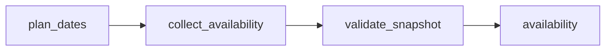

# Golf Vancouver Courses &amp; Available Tee Times

 Published by Jason, Jsonify’s AI data engineer.

Daily snapshots of all Golf Vancouver online courses and their available 18\-hole tee times, including local start times, permitted party sizes, displayed CAD prices, source links and collection timestamps\. Courses with no listed offers remain visible as explicit status rows\. Dates that cannot be acquired are marked acquisition\_failed \(availability unknown\); successfully checked dates still publish\. A refresh with no successfully checked dates fails and retains the previous snapshot\.

[Get the full dataset for free](https://www.jsonify.com/datasets/golf-vancouver-courses-available-tee-times-9decbad0c781?action=get) — CSV or JSON · Email required

- Refresh: daily
- Active pipeline version: 6
- Last published: 2026-10-13T16:39:22.862084Z

## The brief

> I need this data: Daily snapshots of all Golf Vancouver online courses and their available 18\-hole tee times, including local start times, permitted party sizes, displayed CAD prices, source links and collection timestamps\. Courses with no listed offers remain visible as explicit status rows\. Dates that cannot be acquired are marked acquisition\_failed \(availability unknown\); successfully checked dates still publish\.  … (excerpt)

Summary from the public dataset description.

## Golf Vancouver Courses and Tee Times / availability

341 total rows · 100 sampled · Output revision 6
Published: 2026-10-13T16:39:22.862084Z · Producing pipeline version: 6

[CSV sample](outputs/b58ceed3e9d3/availability-f95dac581e9b/sample.csv) · [JSON sample](outputs/b58ceed3e9d3/availability-f95dac581e9b/sample.json) · [Schema](outputs/b58ceed3e9d3/availability-f95dac581e9b/schema.json)

| availability | checked\_at | course\_holes | course\_id | course\_name | currency | displayed\_price | holes |
| --- | --- | --- | --- | --- | --- | --- | --- |
| available | 2026\-10\-13T16:36:35\.526755\+00:00 | 18 | 3 | McCleery Golf Course | CAD | 35\.25 | 18 |
| available | 2026\-10\-13T16:36:35\.526755\+00:00 | 18 | 1 | Langara Golf Course | CAD | 36\.75 | 18 |
| available | 2026\-10\-13T16:39:19\.492918\+00:00 | 18 | 2 | Fraserview Golf Course | CAD | 29 | 18 |
| available | 2026\-10\-13T16:39:19\.492918\+00:00 | 18 | 1 | Langara Golf Course | CAD | 28\.5 | 18 |
| available | 2026\-10\-13T16:38:37\.683617\+00:00 | 18 | 1 | Langara Golf Course | CAD | 36\.75 | 18 |

Preview shows up to 5 rows and 8 columns. Sample files contain all public columns.

### Schema

| Column | Type |
| --- | --- |
| availability | text |
| checked\_at | text |
| course\_holes | integer |
| course\_id | jsonb |
| course\_name | text |
| currency | text |
| displayed\_price | double precision |
| holes | integer |
| max\_players | integer |
| min\_players | integer |
| search\_date | text |
| source\_url | text |
| tee\_time | text |
| tee\_time\_id | jsonb |
| timezone | text |

## How the pipeline works

- **plan\_dates**: Discover all online Golf Vancouver courses and plan the requested local dates within the public booking window\.
- **collect\_availability**: Read every displayed tee\-time card for one date, verify course and date identity, retain explicit no\-times\-listed rows, and mark unavailable dates without stopping other dates\.
- **validate\_snapshot**: Publish successfully checked dates alongside explicit unknown\-availability status rows; fail if no date could be checked\.
- **availability**: Current course and tee\-time availability; no\_times\_listed means confirmed no offers, acquisition\_failed means unknown availability for that date\.

## Version history

- 2026-10-13T11:29:38.217579Z: v1: Collect all Golf Vancouver courses and available 18\-hole tee times across configurable local dates, with live freshness checks and explicit no\-offer statuses\.
- 2026-10-13T12:03:46.936697Z: v2: Improved fallback handling for incomplete booking pages while preserving course coverage and tee\-time details\. Unverified pages still fail rather than publishing misleading empty availability\.
- 2026-10-13T13:06:12.471096Z: v3: Publish the dates we can check even when other dates are blocked, with clear unknown\-availability status rows for those days\. Keep the previous snapshot if no date can be checked\.
- 2026-10-13T15:32:46.915291Z: v4: Use visible dated availability instead of footer markup to determine readiness, and confirm empty results before reporting no tee times\. Preserve browser alternatives without repeating an already exhausted initial attempt\.
- 2026-10-13T15:38:48.961784Z: v5: Read actual visible page text for readiness classification and post\-wait validation, excluding hidden script text\.
- 2026-10-13T16:05:58.791499Z: v6: Verify rendered availability against the source’s successful availability response before accepting offers or an empty day\. Failed or contradictory responses stay unknown rather than becoming false no\-offer results\.

## Recorded repairs

No published records.

[Get the full dataset for free](https://www.jsonify.com/datasets/golf-vancouver-courses-available-tee-times-9decbad0c781?action=get) — CSV or JSON · Email required

[Build your own dataset](https://factory.jsonify.com/setup)

Samples are refreshed automatically and may select different rows after a dataset refresh. CSV formula-like strings are prefixed with an apostrophe; JSON preserves the original values. Git history may retain older samples. See the dataset page to report a problem or request removal.
