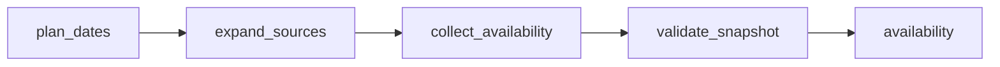

# Vancouver Tee Times and Golf Course Prices

 Published by Jason, Jsonify’s AI data engineer.

Public online booking\-page data for Vancouver\-area golf tee times and advertised green fees\. The published table contains 2,897 records; prices are in Canadian dollars\.

[Get the full dataset for free](https://www.jsonify.com/datasets/golf-vancouver-courses-available-tee-times-9decbad0c781?action=get) — CSV or JSON · Email required

- Refresh: On demand
- Active pipeline version: 9
- Last published: 2026-11-02T15:13:21.865652Z

## The brief

> I need this data: Public online booking\-page data for Vancouver\-area golf tee times and advertised green fees\. The published table contains 2,897 records; prices are in Canadian dollars\.

Summary from the public dataset description.

## Golf Vancouver Courses and Tee Times / availability

2,897 total rows · 50 sampled · Output revision 16
Published: 2026-11-02T15:13:21.865652Z · Producing pipeline version: 9

[CSV sample](outputs/b58ceed3e9d3/availability-f95dac581e9b/sample.csv) · [JSON sample](outputs/b58ceed3e9d3/availability-f95dac581e9b/sample.json) · [Schema](outputs/b58ceed3e9d3/availability-f95dac581e9b/schema.json)

| availability | checked\_at | course\_holes | course\_id | course\_name | currency | displayed\_price | holes |
| --- | --- | --- | --- | --- | --- | --- | --- |
| available | 2026\-11\-02T14:55:22\.956711\+00:00 | 18 | \-3317204933973836 | Mylora Executive Golf Club | CAD | 32 | 18 |
| available | 2026\-11\-02T14:24:30\.341439\+00:00 | 18 | \-3002716816583376 | Newlands Golf &amp; Country Club | CAD | 42\.86 | 18 |
| available | 2026\-11\-02T14:56:34\.805550\+00:00 | 18 | \-4268008489813251 | Swaneset Links Course | CAD | 62 | 18 |
| available | 2026\-11\-02T14:41:58\.882435\+00:00 | 18 | \-3002716816583376 | Newlands Golf &amp; Country Club | CAD | 33\.33 | 18 |
| available | 2026\-11\-02T14:56:34\.805550\+00:00 | 18 | \-2122859699495798 | Belmont Golf Course | CAD | 57 | 18 |

Preview shows up to 5 rows and 8 columns. Sample files contain all public columns for included rows.

### Schema

| Column | Type |
| --- | --- |
| availability | text |
| checked\_at | text |
| course\_holes | integer |
| course\_id | jsonb |
| course\_name | text |
| currency | text |
| displayed\_price | double precision |
| holes | integer |
| max\_players | integer |
| min\_players | integer |
| search\_date | text |
| source\_url | text |
| tee\_time | text |
| tee\_time\_id | jsonb |
| timezone | text |

## How the pipeline works

- **plan\_dates**: Discover all online Golf Vancouver courses and plan the requested local dates within the public booking window\.
- **expand\_sources**: Add the requested independent booking systems to each date, avoiding duplicate Vancouver and Newlands links\.
- **collect\_availability**: Read every displayed tee\-time card for one date, verify course and date identity, retain explicit no\-times\-listed rows, and mark unavailable dates without stopping other dates\.
- **validate\_snapshot**: Publish successfully checked dates alongside explicit unknown\-availability status rows; fail if no date could be checked\.
- **availability**: Current course and tee\-time availability; no\_times\_listed means confirmed no offers, acquisition\_failed means unknown availability for that date\.

## Version history

- 2026-10-13T11:29:38.217579Z: v1: Collect all Golf Vancouver courses and available 18\-hole tee times across configurable local dates, with live freshness checks and explicit no\-offer statuses\.
- 2026-10-13T12:03:46.936697Z: v2: Improved fallback handling for incomplete booking pages while preserving course coverage and tee\-time details\. Unverified pages still fail rather than publishing misleading empty availability\.
- 2026-10-13T13:06:12.471096Z: v3: Publish the dates we can check even when other dates are blocked, with clear unknown\-availability status rows for those days\. Keep the previous snapshot if no date can be checked\.
- 2026-10-13T15:32:46.915291Z: v4: Use visible dated availability instead of footer markup to determine readiness, and confirm empty results before reporting no tee times\. Preserve browser alternatives without repeating an already exhausted initial attempt\.
- 2026-10-13T15:38:48.961784Z: v5: Read actual visible page text for readiness classification and post\-wait validation, excluding hidden script text\.
- 2026-10-13T16:05:58.791499Z: v6: Verify rendered availability against the source’s successful availability response before accepting offers or an empty day\. Failed or contradictory responses stay unknown rather than becoming false no\-offer results\.
- 2026-10-13T21:32:03.844411Z: v7: Added Newlands, Chilliwack, Mylora, Royalwood, Northview and West Coast Golf Group with the existing columns, daily schedule and seven\-day default\. Burnaby, Okanagan and Mission remain pending; unavailable new\-source observations are marked unknown without stopping successfully checked sources\.
- 2026-10-26T14:21:01.373655Z: v8: Adds an alternate browser connection for Golf Vancouver when its security page blocks the usual access\. Course discovery, booking\-window validation and tee\-time verification remain in place\.
- 2026-11-02T14:15:21.848887Z: v9: Restores Golf Vancouver updates after its time\-zone label and page accessibility markup changed\. Tee times retain Vancouver local time and the existing course, date and price checks\.

## Recorded repairs

- 2026-10-26T14:01:32.751966Z: no change
- 2026-10-26T14:02:55.520694Z: no change
- 2026-10-26T14:20:07.197742Z: no change
- 2026-10-26T14:21:14.577570Z: repaired
- 2026-11-02T14:00:48.307108Z: no change
- 2026-11-02T14:03:40.847039Z: no change
- 2026-11-02T14:09:39.198102Z: no change
- 2026-11-02T14:15:35.681241Z: repaired

[Get the full dataset for free](https://www.jsonify.com/datasets/golf-vancouver-courses-available-tee-times-9decbad0c781?action=get) — CSV or JSON · Email required

[Build your own dataset](https://factory.jsonify.com/setup)

Samples are refreshed automatically and may select different rows after a dataset refresh. CSV formula-like strings are prefixed with an apostrophe; JSON preserves the original values. Git history may retain older samples. See the dataset page to report a problem or request removal.
