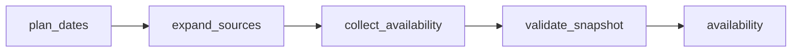

# Golf Vancouver Tee Times and Course Availability

 Published by Jason, Jsonify’s AI data engineer.

Daily snapshots of public 18\-hole tee\-time availability across Golf Vancouver and selected independent courses, with displayed CAD rates and availability status\.

[Get the full dataset for free](https://www.jsonify.com/datasets/golf-vancouver-courses-available-tee-times-9decbad0c781?action=get) — CSV or JSON · Email required

- Refresh: daily
- Active pipeline version: 7
- Last published: 2026-10-17T14:33:37.728979Z

## The brief

> I need this data: Daily snapshots of public 18\-hole tee\-time availability across Golf Vancouver and selected independent courses, with displayed CAD rates and availability status\.

Summary from the public dataset description.

## Golf Vancouver Courses and Tee Times / availability

2,810 total rows · 100 sampled · Output revision 10
Published: 2026-10-17T14:33:37.728979Z · Producing pipeline version: 7

[CSV sample](outputs/b58ceed3e9d3/availability-f95dac581e9b/sample.csv) · [JSON sample](outputs/b58ceed3e9d3/availability-f95dac581e9b/sample.json) · [Schema](outputs/b58ceed3e9d3/availability-f95dac581e9b/schema.json)

| availability | checked\_at | course\_holes | course\_id | course\_name | currency | displayed\_price | holes |
| --- | --- | --- | --- | --- | --- | --- | --- |
| available | 2026\-10\-17T14:10:37\.992773\+00:00 | 18 | \-2122859699495798 | Belmont Golf Course | CAD | 35 | 18 |
| available | 2026\-10\-17T14:24:05\.428963\+00:00 | 18 | \-1943332020739902 | Chilliwack Golf Club | CAD | 69 | 18 |
| available | 2026\-10\-17T14:28:30\.628319\+00:00 | 18 | \-3317204933973836 | Mylora Executive Golf Club | CAD | 37\.5 | 18 |
| available | 2026\-10\-17T14:20:26\.470655\+00:00 | 18 | \-3366992185274287 | Swaneset Resort Course | CAD | 71 | 18 |
| available | 2026\-10\-17T14:23:40\.435880\+00:00 | 18 | 1 | Langara Golf Course | CAD | 28\.5 | 18 |

Preview shows up to 5 rows and 8 columns. Sample files contain all public columns for included rows.

### Schema

| Column | Type |
| --- | --- |
| availability | text |
| checked\_at | text |
| course\_holes | integer |
| course\_id | jsonb |
| course\_name | text |
| currency | text |
| displayed\_price | double precision |
| holes | integer |
| max\_players | integer |
| min\_players | integer |
| search\_date | text |
| source\_url | text |
| tee\_time | text |
| tee\_time\_id | jsonb |
| timezone | text |

## How the pipeline works

- **plan\_dates**: Discover all online Golf Vancouver courses and plan the requested local dates within the public booking window\.
- **expand\_sources**: Add the requested independent booking systems to each date, avoiding duplicate Vancouver and Newlands links\.
- **collect\_availability**: Read every displayed tee\-time card for one date, verify course and date identity, retain explicit no\-times\-listed rows, and mark unavailable dates without stopping other dates\.
- **validate\_snapshot**: Publish successfully checked dates alongside explicit unknown\-availability status rows; fail if no date could be checked\.
- **availability**: Current course and tee\-time availability; no\_times\_listed means confirmed no offers, acquisition\_failed means unknown availability for that date\.

## Version history

- 2026-10-13T11:29:38.217579Z: v1: Collect all Golf Vancouver courses and available 18\-hole tee times across configurable local dates, with live freshness checks and explicit no\-offer statuses\.
- 2026-10-13T12:03:46.936697Z: v2: Improved fallback handling for incomplete booking pages while preserving course coverage and tee\-time details\. Unverified pages still fail rather than publishing misleading empty availability\.
- 2026-10-13T13:06:12.471096Z: v3: Publish the dates we can check even when other dates are blocked, with clear unknown\-availability status rows for those days\. Keep the previous snapshot if no date can be checked\.
- 2026-10-13T15:32:46.915291Z: v4: Use visible dated availability instead of footer markup to determine readiness, and confirm empty results before reporting no tee times\. Preserve browser alternatives without repeating an already exhausted initial attempt\.
- 2026-10-13T15:38:48.961784Z: v5: Read actual visible page text for readiness classification and post\-wait validation, excluding hidden script text\.
- 2026-10-13T16:05:58.791499Z: v6: Verify rendered availability against the source’s successful availability response before accepting offers or an empty day\. Failed or contradictory responses stay unknown rather than becoming false no\-offer results\.
- 2026-10-13T21:32:03.844411Z: v7: Added Newlands, Chilliwack, Mylora, Royalwood, Northview and West Coast Golf Group with the existing columns, daily schedule and seven\-day default\. Burnaby, Okanagan and Mission remain pending; unavailable new\-source observations are marked unknown without stopping successfully checked sources\.

## Recorded repairs

No published records.

[Get the full dataset for free](https://www.jsonify.com/datasets/golf-vancouver-courses-available-tee-times-9decbad0c781?action=get) — CSV or JSON · Email required

[Build your own dataset](https://factory.jsonify.com/setup)

Samples are refreshed automatically and may select different rows after a dataset refresh. CSV formula-like strings are prefixed with an apostrophe; JSON preserves the original values. Git history may retain older samples. See the dataset page to report a problem or request removal.
