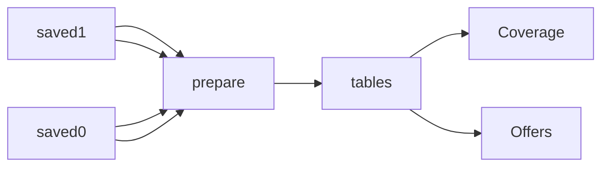

# Google Shopping Competitor Prices by SKU

 Published by Jason, Jsonify’s AI data engineer.

Google Shopping competitor offer observations and coverage for Germany, the United Kingdom, and Turkey, with original observation dates\.

[Get the full dataset for free](https://www.jsonify.com/datasets/google-shopping-competitor-prices-by-sku-de-uk-tr-881884b155d9?action=get) — CSV or JSON · Email required

- Refresh: On demand
- Active pipeline version: 1
- Last published: 2026-11-13T15:56:14.663648Z

## The brief

> I need this data: Google Shopping competitor offer observations and coverage for Germany, the United Kingdom, and Turkey, with original observation dates\.

Summary from the public dataset description.

## Google Shopping Competitor Prices by SKU \(DE, UK, TR\) / Offers

728 total rows · 50 sampled · Output revision 1
Published: 2026-11-13T15:56:14.663648Z · Producing pipeline version: 1

[CSV sample](outputs/0382f3c3e2bf/offers-e98bf0e26046/sample.csv) · [JSON sample](outputs/0382f3c3e2bf/offers-e98bf0e26046/sample.json) · [Schema](outputs/0382f3c3e2bf/offers-e98bf0e26046/schema.json)

| Availability | Condition | Country | Currency | List price | Marketplace seller | Match confidence | Match method |
| --- | --- | --- | --- | --- | --- | --- | --- |
| None | None | DE | None | None | None | 0 | None |
| None | None | TR | None | None | None | 0 | None |
| in stock | None | DE | EUR | None | None | 0\.94 | gtin |
| in stock | None | DE | EUR | None | None | 0\.96 | mpn |
| in stock | None | DE | EUR | None | None | 0\.94 | gtin |

Preview shows up to 5 rows and 8 columns. Sample files contain all public columns for included rows.

### Schema

| Column | Type |
| --- | --- |
| Availability | text |
| Condition | text |
| Country | text |
| Currency | text |
| List price | double precision |
| Marketplace seller | boolean |
| Match confidence | double precision |
| Match method | text |
| Observed at | text |
| Offer URL | text |
| Price | double precision |
| Product | text |
| Promotion | text |
| SKU | text |
| Seller | text |
| Seller domain | text |
| Shipping | double precision |
| Status | text |
| Total price | double precision |
| VAT included | text |

## Google Shopping Competitor Prices by SKU \(DE, UK, TR\) / Coverage

150 total rows · 50 sampled · Output revision 1
Published: 2026-11-13T15:56:14.663648Z · Producing pipeline version: 1

[CSV sample](outputs/0382f3c3e2bf/coverage-523487a5de21/sample.csv) · [JSON sample](outputs/0382f3c3e2bf/coverage-523487a5de21/sample.json) · [Schema](outputs/0382f3c3e2bf/coverage-523487a5de21/schema.json)

| Browser pagination requests | Catalog ID | Comparison summaries excluded | Complete | Country | Discovery required | Empty source placeholders | Mapping status |
| --- | --- | --- | --- | --- | --- | --- | --- |
| \[\] | None | 0 | True | DE | False | 0 | loose\_offer |
| \[\] | None | 0 | True | TR | False | 0 | not\_found |
| \[\] | None | 0 | True | TR | False | 0 | loose\_offer |
| \[\] | None | 0 | True | GB | False | 0 | not\_found |
| \[\{"path": "/async/oapv", "stage": "more\_shops", "transport": "browser", "duration\_ms": 5482\.5, "transfer\_bytes": 19445, "response\_status": 200}, \{"path": "/async/oapv", "stage": "more\_shops", "transport": "browser", "duration\_ms": 5468\.399999999994, "transfer\_bytes": 10745, "response\_status": 200}\] | 10175943622326311824 | 0 | True | TR | False | 0 | ok |

Preview shows up to 5 rows and 8 columns. Sample files contain all public columns for included rows.

### Schema

| Column | Type |
| --- | --- |
| Browser pagination requests | jsonb |
| Catalog ID | text |
| Comparison summaries excluded | integer |
| Complete | boolean |
| Country | text |
| Discovery required | boolean |
| Empty source placeholders | integer |
| Mapping status | text |
| More offers control | boolean |
| Observed at | text |
| Offer count | integer |
| Pagination terminal | text |
| Reason | text |
| Requests | jsonb |
| SKU | text |
| Status | text |

## How the pipeline works

- **saved1**: Existing Coverage worksheet, read without contacting sources\.
- **saved0**: Existing Offers worksheet, read without contacting sources\.
- **prepare**: Copy the existing saved worksheets and sort their rows for the public sample\.
- **tables**: Keep each saved worksheet separate in the public workbook\.
- **Offers**: Existing saved Offers rows\.
- **Coverage**: Existing saved Coverage rows\.

## Version history

- 2026-11-13T15:55:54.633139Z: v1: Make the existing neutral Google Shopping sample publishable without collecting new data\.

## Recorded repairs

No published records.

[Get the full dataset for free](https://www.jsonify.com/datasets/google-shopping-competitor-prices-by-sku-de-uk-tr-881884b155d9?action=get) — CSV or JSON · Email required

[Build your own dataset](https://factory.jsonify.com/setup)

Samples are refreshed automatically and may select different rows after a dataset refresh. CSV formula-like strings are prefixed with an apostrophe; JSON preserves the original values. Git history may retain older samples. See the dataset page to report a problem or request removal.
