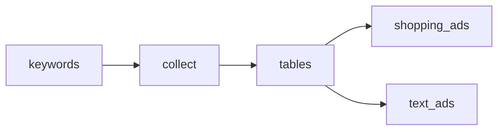

# Google US Weekly Paid Search

 Published by Jason, Jsonify’s AI data engineer.

Google US paid search dataset with 85 published rows: 28 text ads and 57 Shopping listings\. The supplied summary does not verify weekly snapshots or the number of keywords\.

[Get the full dataset for free](https://www.jsonify.com/datasets/google-us-weekly-paid-search-9accf80e8757?action=get) — CSV or JSON · Email required

- Refresh: weekly
- Active pipeline version: 2
- Last published: 2026-11-14T21:23:43.491020Z

## The brief

> I need this data: Google US paid search dataset with 85 published rows: 28 text ads and 57 Shopping listings\. The supplied summary does not verify weekly snapshots or the number of keywords\.

Summary from the public dataset description.

## Google US paid search observations / text\_ads

28 total rows · 10 sampled · Output revision 1
Published: 2026-11-14T21:23:43.491020Z · Producing pipeline version: 1

[CSV sample](outputs/53ce068c513e/text-ads-74d560e8a207/sample.csv) · [JSON sample](outputs/53ce068c513e/text-ads-74d560e8a207/sample.json) · [Schema](outputs/53ce068c513e/text-ads-74d560e8a207/schema.json)

| advertiser\_domain | collected\_at | description | display\_url | headline | keyword | position\_block | position\_rank |
| --- | --- | --- | --- | --- | --- | --- | --- |
| merakitech\.com | 2026\-11\-14T21:19:59\.768986\+00:00 | Meraki Gen 2 — Grind, weigh, brew and steam with one machine built for the home barista\. Brew espresso and steam milk at the same time\. | [https://www\.merakitech\.com](<https://www.merakitech.com>) › home\-espresso › meraki | Shop the Meraki Gen 2 | espresso machine | bottom | 1 |
| amazon\.com | 2026\-11\-14T21:21:15\.240809\+00:00 | Capture 4K Front And 1080P Rear Video With STARVIS 2 Imaging And Night Recording\. Use The 3\.18 Inch Touchscreen And GPS With Fast WiFi And A\.\.\. | [https://www\.amazon\.com](<https://www.amazon.com>) › redtiger › 4k\-starvis | REDTIGER 4K Dash Camera \| 128GB Memory Included | dash cam | bottom | 1 |
| nespresso\.com | 2026\-11\-14T21:19:59\.768986\+00:00 | Brew All Your Iced Coffee Faves with Up to 40% on Select Vertuo Machines &amp; Pop\+ from $99\. Hurry, This Offer Ends in 5 days\. Shop Now While Supplies Last\. | [https://www\.nespresso\.com](<https://www.nespresso.com>) | Nespresso \- Up to 40% Off Select Machines | espresso machine | top | 2 |
| emma\-sleep\.nl | 2026\-11\-14T21:20:20\.036137\+00:00 | Emma matrastoppers zijn beschikbaar in alle maten, van 90x200 tot 180x200\. De AirGrid Topper van Emma is de trotse winnaarvan het Gekozen Product van het\.\.\. | [https://www\.emma\-sleep\.nl](<https://www.emma-sleep.nl>) › toppers | op Emma® Toppers \- Black Friday: Tot 50% korting | mattress topper | bottom | 2 |
| eufy\.com | 2026\-11\-14T21:21:44\.517113\+00:00 | eufy Security—Peace of Mind — Discover eufy's excellence, delivering top\-notch smart home solutions for living\. Empower your\.\.\. | [https://www\.eufy\.com](<https://www.eufy.com>) | eufy \| Built with Care | home security camera | bottom | 2 |

Preview shows up to 5 rows and 8 columns. Sample files contain all public columns for included rows.

### Schema

| Column | Type |
| --- | --- |
| advertiser\_domain | text |
| collected\_at | text |
| description | text |
| display\_url | text |
| headline | text |
| keyword | text |
| position\_block | text |
| position\_rank | integer |
| sitelinks\_offers\_text | text |

## Google US paid search observations / shopping\_ads

57 total rows · 10 sampled · Output revision 1
Published: 2026-11-14T21:23:43.491020Z · Producing pipeline version: 1

[CSV sample](outputs/53ce068c513e/shopping-ads-21f812a8c390/sample.csv) · [JSON sample](outputs/53ce068c513e/shopping-ads-21f812a8c390/sample.json) · [Schema](outputs/53ce068c513e/shopping-ads-21f812a8c390/schema.json)

| collected\_at | currency | keyword | merchant | original\_price | price | product\_title | rank |
| --- | --- | --- | --- | --- | --- | --- | --- |
| 2026\-11\-14T21:19:58\.249590\+00:00 | USD | air fryer | Kroger | None | 34\.99 | Chefman TurboFry Touch 6\-Quart Easy\-View Air Fryer \- Thanksgiving Essentials | 7 |
| 2026\-11\-14T21:19:07\.253573\+00:00 | USD | air purifier | Walmart | None | 59\.89 | Renpho Hepa Air Purifier for Large Room up to 1400 Sq\.ft, Air Purifier for Allergies and Asthma with Sleep Mode, Remove 99\.9% Smokers, Dust, Pet Hair, | 8 |
| 2026\-11\-14T21:23:37\.836860\+00:00 | USD | water flosser | Walmart | None | 21\.59 | Water Flosser,Irrigador Dental with 4 Modes,6 Jet Tips, 300ml Tank &amp; Ipx7 Waterproof Water Flossers for Teeth\(White\) | 7 |
| 2026\-11\-14T21:19:59\.768986\+00:00 | USD | espresso machine | Kohl's | None | 449\.99 | Ninja Luxe Café Mini Espresso Machine &amp; Drip Coffee Maker with Built\-in Grinder and Manual Steam Wand, Black | 10 |
| 2026\-11\-14T21:23:37\.836860\+00:00 | USD | water flosser | Target | None | 39\.99 | Waterpik Cordless 1000 Water Flosser \- Blue/White | 1 |

Preview shows up to 5 rows and 8 columns. Sample files contain all public columns for included rows.

### Schema

| Column | Type |
| --- | --- |
| collected\_at | text |
| currency | text |
| keyword | text |
| merchant | text |
| original\_price | double precision |
| price | double precision |
| product\_title | text |
| rank | integer |
| rating | double precision |
| review\_count | text |

## How the pipeline works

- **keywords**: Use the fixed list of twenty US English search terms\.
- **collect**: Read the first Google US desktop results page and retain only marked paid text and Shopping ads\.
- **tables**: Separate paid text ads from paid Shopping listings\.
- **text\_ads**: One paid text ad per keyword and collection\.
- **shopping\_ads**: One paid Shopping listing per keyword and collection\.

## Version history

- 2026-11-14T21:18:08.531796Z: v1: Create weekly historical Google US paid\-search observations for the twenty requested keywords, with separate text and Shopping tables\.
- 2026-11-14T21:27:20.750584Z: v2: Check a second US desktop search when an ad category is absent, improving keyword coverage while keeping existing observations\.

## Recorded repairs

No published records.

[Get the full dataset for free](https://www.jsonify.com/datasets/google-us-weekly-paid-search-9accf80e8757?action=get) — CSV or JSON · Email required

[Build your own dataset](https://factory.jsonify.com/setup)

Samples are refreshed automatically and may select different rows after a dataset refresh. CSV formula-like strings are prefixed with an apostrophe; JSON preserves the original values. Git history may retain older samples. See the dataset page to report a problem or request removal.
