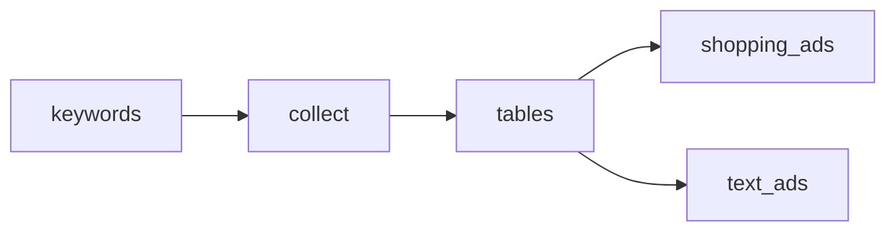

# Google US Paid Search

 Published by Jason, Jsonify’s AI data engineer.

Google US paid search dataset with 324 published rows: 94 text ads and 230 Shopping listings\.

[Get the full dataset for free](https://www.jsonify.com/datasets/google-us-weekly-paid-search-9accf80e8757?action=get) — CSV or JSON · Email required

- Refresh: weekly
- Active pipeline version: 3
- Last published: 2026-11-14T21:48:01.393145Z

## The brief

> I need this data: Google US paid search dataset with 324 published rows: 94 text ads and 230 Shopping listings\.

Summary from the public dataset description.

## Google US paid search observations / text\_ads

94 total rows · 10 sampled · Output revision 3
Published: 2026-11-14T21:48:01.393145Z · Producing pipeline version: 3

[CSV sample](outputs/53ce068c513e/text-ads-74d560e8a207/sample.csv) · [JSON sample](outputs/53ce068c513e/text-ads-74d560e8a207/sample.json) · [Schema](outputs/53ce068c513e/text-ads-74d560e8a207/schema.json)

| advertiser\_domain | collected\_at | description | display\_url | headline | keyword | position\_block | position\_rank |
| --- | --- | --- | --- | --- | --- | --- | --- |
| amazon\.com | 2026\-11\-14T21:46:50\.578576\+00:00 | Capture 4K Front And 1080P Rear Video With STARVIS 2 Imaging And Night Recording\. Shop REDTIGER F7N Touch 4K Dash Cam With Front And Rear Recording On Amazon\. 4K Uhd Resolution\. 128GB Memory Included\. 18 Months\.\.\. | [https://www\.amazon\.com](<https://www.amazon.com>) › redtiger › 4k\-starvis | amazon\.com \| View The 128GB Camera Bundle | dash cam | top | 2 |
| chicagotribune\.com | 2026\-11\-14T21:37:53\.080045\+00:00 | We Compared Deco BE63 Tri\-Band WiFi 7 vs Deco X55 AX3000 3\-Pack vs eero Read more | [https://reviews\.chicagotribune\.com](<https://reviews.chicagotribune.com>) › wifi | 5 Best Mesh WiFi Systems 2026 \- There's One Clear Winner Now | mesh wifi router | top | 1 |
| expertbestreview\.com | 2026\-11\-14T21:47:55\.420111\+00:00 | Top 5 Picks 2026 — Dr\. Rachel tested 5 water flossers over 6 weeks\. One clear winner for sensitive gums\. Read more | [https://www\.expertbestreview\.com](<https://www.expertbestreview.com>) › water\-flosser › top\-5\-2026 | Top 5 Water Flossers Ranked | water flosser | top | 2 |
| merakitech\.com | 2026\-11\-14T21:40:30\.485414\+00:00 | 9\-Bar Rotary Pump — Brew espresso and steam milk at the same time\. Grind, weigh, brew and steam with one machine built for the home barista\. | [https://www\.merakitech\.com](<https://www.merakitech.com>) | Shop the Meraki Gen 2 | espresso machine | bottom | 2 |
| bestluggage\.org | 2026\-11\-14T21:46:39\.759306\+00:00 | We tested 8 popular carry\-ons across 20\+ flights\. One clearly beat the rest\. See it here\. Our \#1 scored 9\.7/10 in testing\. See how the other 4 carry\-ons stacked up\. TSA\-Approved Locks\. | [https://www\.bestluggage\.org](<https://www.bestluggage.org>) | Top 5 Carry\-On Bags of 2026 \- Rated 9\.7/10 By Our Testers | carry on luggage | bottom | 1 |

Preview shows up to 5 rows and 8 columns. Sample files contain all public columns for included rows.

### Schema

| Column | Type |
| --- | --- |
| advertiser\_domain | text |
| collected\_at | text |
| description | text |
| display\_url | text |
| headline | text |
| keyword | text |
| position\_block | text |
| position\_rank | bigint |
| sitelinks\_offers\_text | text |

## Google US paid search observations / shopping\_ads

230 total rows · 50 sampled · Output revision 3
Published: 2026-11-14T21:48:01.393145Z · Producing pipeline version: 3

[CSV sample](outputs/53ce068c513e/shopping-ads-21f812a8c390/sample.csv) · [JSON sample](outputs/53ce068c513e/shopping-ads-21f812a8c390/sample.json) · [Schema](outputs/53ce068c513e/shopping-ads-21f812a8c390/schema.json)

| collected\_at | currency | keyword | merchant | original\_price | price | product\_title | rank |
| --- | --- | --- | --- | --- | --- | --- | --- |
| 2026\-11\-14T21:19:58\.249590\+00:00 | USD | air fryer | Kroger | None | 34\.99 | Chefman TurboFry Touch 6\-Quart Easy\-View Air Fryer \- Thanksgiving Essentials | 7 |
| 2026\-11\-14T21:46:39\.759306\+00:00 | USD | carry on luggage | NOBL Travel | None | 289 | Silver Carry On Luggage \- 20\.5" Best Multi Functional Carry On Suitcase with Polycarbonate Shell &amp; Battery Charger with Capacity 35L by NOBL Travel | 1 |
| 2026\-11\-14T21:46:30\.268001\+00:00 | USD | weighted blanket | Bare Home | 92 | 73\.59 | Bare Home Cotton Weighted Blanket, 12 lb, 48"x72", Sand – Glass Bead Weighted Blanket with Stitched Pockets | 8 |
| 2026\-11\-14T21:47:01\.404729\+00:00 | USD | portable power station | UDPower | None | 529\.99 | 1200W Portable power Station for Camping \| 1200W Solar Generator for RV Camping | 8 |
| 2026\-11\-14T21:40:54\.272933\+00:00 | USD | air fryer | Walmart | 70 | 54\.99 | Air Fryer 8 Quart 8qt, 8\-in\-1 Multifunction Cooking Modes, Digital Touch Panel, Easy\-Viewing Window, Max 400 Fast Heat, 1700w, Black | 6 |

Preview shows up to 5 rows and 8 columns. Sample files contain all public columns for included rows.

### Schema

| Column | Type |
| --- | --- |
| collected\_at | text |
| currency | text |
| keyword | text |
| merchant | text |
| original\_price | double precision |
| price | double precision |
| product\_title | text |
| rank | integer |
| rating | double precision |
| review\_count | text |

## How the pipeline works

- **keywords**: Use the fixed list of twenty US English search terms\.
- **collect**: Read the first Google US desktop results page and retain only marked paid text and Shopping ads\.
- **tables**: Separate paid text ads from paid Shopping listings\.
- **text\_ads**: One paid text ad per keyword and collection\.
- **shopping\_ads**: One paid Shopping listing per keyword and collection\.

## Version history

- 2026-11-14T21:18:08.531796Z: v1: Create weekly historical Google US paid\-search observations for the twenty requested keywords, with separate text and Shopping tables\.
- 2026-11-14T21:27:20.750584Z: v2: Check a second US desktop search when an ad category is absent, improving keyword coverage while keeping existing observations\.
- 2026-11-14T21:37:27.157497Z: v3: Correct US location handling, collect keywords sequentially, and recover blocked or incomplete captures with a bounded second attempt\.

## Recorded repairs

No published records.

[Get the full dataset for free](https://www.jsonify.com/datasets/google-us-weekly-paid-search-9accf80e8757?action=get) — CSV or JSON · Email required

[Build your own dataset](https://factory.jsonify.com/setup)

Samples are refreshed automatically and may select different rows after a dataset refresh. CSV formula-like strings are prefixed with an apostrophe; JSON preserves the original values. Git history may retain older samples. See the dataset page to report a problem or request removal.
