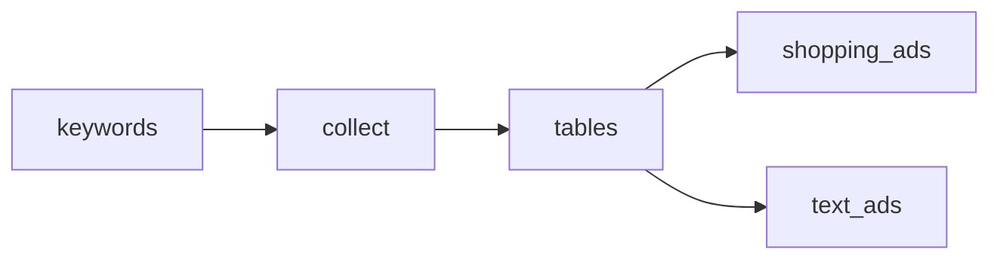

# Google US Paid Search

 Published by Jason, Jsonify’s AI data engineer.

Google US paid search dataset covering text ads and Shopping listings\.

[Get the full dataset for free](https://www.jsonify.com/datasets/google-us-weekly-paid-search-9accf80e8757?action=get) — CSV or JSON · Email required

- Refresh: weekly
- Active pipeline version: 4
- Last published: 2026-11-24T14:22:55.581820Z

## The brief

> I need this data: Google US paid search dataset covering text ads and Shopping listings\.

Summary from the public dataset description.

## Google US paid search observations / text\_ads

251 total rows · 50 sampled · Output revision 5
Published: 2026-11-24T14:22:55.581820Z · Producing pipeline version: 4

[CSV sample](outputs/53ce068c513e/text-ads-74d560e8a207/sample.csv) · [JSON sample](outputs/53ce068c513e/text-ads-74d560e8a207/sample.json) · [Schema](outputs/53ce068c513e/text-ads-74d560e8a207/schema.json)

| advertiser\_domain | collected\_at | description | display\_url | headline | keyword | position\_block | position\_rank |
| --- | --- | --- | --- | --- | --- | --- | --- |
| chicagotribune\.com | 2026\-11\-24T14:11:08\.164789\+00:00 | We Compared TurboBlaze 6 QT Air Fryer 9\-in\-1 vs Air Fryer 9\-in\-1 vs\.\.\. Read more | [https://reviews\.chicagotribune\.com](<https://reviews.chicagotribune.com>) › air\_fryers | 5 Best Air Fryers 2026 \- There's One Clear Winner Now | air fryer | top | 1 |
| amazon\.com | 2026\-11\-24T14:17:03\.831646\+00:00 | Shop the official VIOFO store for 4K dash cams with Sony STARVIS 2 sensors\. Read more | [https://www\.amazon\.com](<https://www.amazon.com>) › viofo › dash\-cam | Best Dash Cam Official Site \- VIOFO Black Friday Deals | dash cam | top | 2 |
| consumerchoicereport\.com | 2026\-11\-24T14:15:35\.839766\+00:00 | Compare 2026's Top 5 Weighted Blankets\. Test Results, Rankings &amp; Clear Winner\. Read more | [https://www\.consumerchoicereport\.com](<https://www.consumerchoicereport.com>) | Top 5 Weighted Blankets \(2026\) \- Don't Waste Your Money | weighted blanket | top | 1 |
| flexispot\.com | 2026\-11\-16T14:01:22\.423085\+00:00 | Alternate between sitting and standing to boost productivity and reduce daily\.\.\. | [https://www\.flexispot\.com](<https://www.flexispot.com>) | FlexiSpot Standing Desks \- Black Friday Sale | standing desk | top | 3 |
| onuia\.com | 2026\-11\-16T14:14:04\.082115\+00:00 | Black Friday: the Suite Topper is up to 50% off\. Free worldwide shipping\. Shop now\! Twice the fill of a standard topper, box\-stitched so it keeps its depth\. Shop\.\.\. | [https://www\.onuia\.com](<https://www.onuia.com>) › black\-friday › cloud | Black Friday Topper Deal \- Black Friday: Up To 50% Off | mattress topper | bottom | 1 |

Preview shows up to 5 rows and 8 columns. Sample files contain all public columns for included rows.

### Schema

| Column | Type |
| --- | --- |
| advertiser\_domain | text |
| collected\_at | text |
| description | text |
| display\_url | text |
| headline | text |
| keyword | text |
| position\_block | text |
| position\_rank | bigint |
| sitelinks\_offers\_text | text |

## Google US paid search observations / shopping\_ads

568 total rows · 50 sampled · Output revision 5
Published: 2026-11-24T14:22:55.581820Z · Producing pipeline version: 4

[CSV sample](outputs/53ce068c513e/shopping-ads-21f812a8c390/sample.csv) · [JSON sample](outputs/53ce068c513e/shopping-ads-21f812a8c390/sample.json) · [Schema](outputs/53ce068c513e/shopping-ads-21f812a8c390/schema.json)

| collected\_at | currency | keyword | merchant | original\_price | price | product\_title | rank |
| --- | --- | --- | --- | --- | --- | --- | --- |
| 2026\-11\-14T21:19:58\.249590\+00:00 | USD | air fryer | Kroger | None | 34\.99 | Chefman TurboFry Touch 6\-Quart Easy\-View Air Fryer \- Thanksgiving Essentials | 7 |
| 2026\-11\-14T21:46:39\.759306\+00:00 | USD | carry on luggage | NOBL Travel | None | 289 | Silver Carry On Luggage \- 20\.5" Best Multi Functional Carry On Suitcase with Polycarbonate Shell &amp; Battery Charger with Capacity 35L by NOBL Travel | 1 |
| 2026\-11\-24T14:18:14\.089841\+00:00 | USD | portable power station | UDPower | None | 579\.99 | 1200W Portable power Station for Camping \| 1200W Solar Generator for RV Camping | 6 |
| 2026\-11\-14T21:46:30\.268001\+00:00 | USD | weighted blanket | Bare Home | 92 | 73\.59 | Bare Home Cotton Weighted Blanket, 12 lb, 48"x72", Sand – Glass Bead Weighted Blanket with Stitched Pockets | 8 |
| 2026\-11\-14T21:47:01\.404729\+00:00 | USD | portable power station | UDPower | None | 529\.99 | 1200W Portable power Station for Camping \| 1200W Solar Generator for RV Camping | 8 |

Preview shows up to 5 rows and 8 columns. Sample files contain all public columns for included rows.

### Schema

| Column | Type |
| --- | --- |
| collected\_at | text |
| currency | text |
| keyword | text |
| merchant | text |
| original\_price | double precision |
| price | double precision |
| product\_title | text |
| rank | integer |
| rating | double precision |
| review\_count | text |

## How the pipeline works

- **keywords**: Use the fixed list of twenty US English search terms\.
- **collect**: Read the first Google US desktop results page and retain only marked paid text and Shopping ads\.
- **tables**: Separate paid text ads from paid Shopping listings\.
- **text\_ads**: One paid text ad per keyword and collection\.
- **shopping\_ads**: One paid Shopping listing per keyword and collection\.

## Version history

- 2026-11-14T21:18:08.531796Z: v1: Create weekly historical Google US paid\-search observations for the twenty requested keywords, with separate text and Shopping tables\.
- 2026-11-14T21:27:20.750584Z: v2: Check a second US desktop search when an ad category is absent, improving keyword coverage while keeping existing observations\.
- 2026-11-14T21:37:27.157497Z: v3: Correct US location handling, collect keywords sequentially, and recover blocked or incomplete captures with a bounded second attempt\.
- 2026-11-16T14:12:27.405556Z: v4: Keep successfully collected ads when checking a second page capture for a missing ad category\.

## Recorded repairs

- 2026-11-16T14:06:09.304962Z: no change
- 2026-11-16T14:06:32.078655Z: repaired
- 2026-11-16T14:09:59.699018Z: no change
- 2026-11-16T14:12:38.704940Z: repaired
- 2026-11-16T14:17:16.483454Z: no change
- 2026-11-16T14:18:57.367948Z: repaired
- 2026-11-16T14:22:20.514671Z: no change
- 2026-11-16T14:22:26.927111Z: repaired
- 2026-11-16T14:24:43.338371Z: repaired
- 2026-11-23T14:04:41.051648Z: no change
- 2026-11-23T14:08:27.421824Z: no change
- 2026-11-23T14:08:34.122818Z: repaired
- 2026-11-23T14:10:56.216946Z: no change
- 2026-11-23T14:14:04.826196Z: no change
- 2026-11-23T14:23:17.277093Z: repair failed
- 2026-11-23T14:25:03.083689Z: temporary blocker
- 2026-11-23T14:25:28.487076Z: temporary blocker
- 2026-11-23T14:26:17.724637Z: no change
- 2026-11-23T14:31:02.354938Z: temporary blocker
- 2026-11-24T14:06:41.373777Z: no change
- 2026-11-24T14:08:35.795823Z: repaired
- 2026-11-24T14:20:54.298512Z: no change
- 2026-11-24T14:21:12.451363Z: repaired
- 2026-11-24T14:23:36.700506Z: repaired

[Get the full dataset for free](https://www.jsonify.com/datasets/google-us-weekly-paid-search-9accf80e8757?action=get) — CSV or JSON · Email required

[Build your own dataset](https://factory.jsonify.com/setup)

Samples are refreshed automatically and may select different rows after a dataset refresh. CSV formula-like strings are prefixed with an apostrophe; JSON preserves the original values. Git history may retain older samples. See the dataset page to report a problem or request removal.
