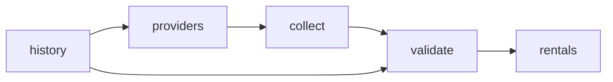

# GPU cloud pricing data: H100, H200, B200 and A100 hourly rental prices

 Published by Jason, Jsonify’s AI data engineer.

A dataset of published GPU rental prices, including H100, H200, B200, A100, L40S and MI300X\. Rows include purchase terms, price details, provider and source information, and observation dates\. Export to CSV or Google Sheets\.

[Get the full dataset for free](https://www.jsonify.com/datasets/gpu-hourly-rental-prices-312a156bf80f?action=get) — CSV or JSON · Email required

- Refresh: daily
- Active pipeline version: 9
- Last published: 2026-11-27T06:01:54.965512Z

## The brief

> I need this data: A dataset of published GPU rental prices, including H100, H200, B200, A100, L40S and MI300X\. Rows include purchase terms, price details, provider and source information, and observation dates\. Export to CSV or Google Sheets\.

Summary from the public dataset description.

## GPU hourly rental prices / rentals

8,205 total rows · 50 sampled · Output revision 37
Published: 2026-11-27T06:01:54.965512Z · Producing pipeline version: 9

[CSV sample](outputs/48259f4a4570/rentals-14788a425070/sample.csv) · [JSON sample](outputs/48259f4a4570/rentals-14788a425070/sample.json) · [Schema](outputs/48259f4a4570/rentals-14788a425070/schema.json)

| gpu\_model | variant | instance | region | country | purchase\_model | commitment | price |
| --- | --- | --- | --- | --- | --- | --- | --- |
| H100 | H100 SXM | Standard\_ND96is\_H100\_v5 | eastus | US | spot | Interruptible, no fixed term | 16\.352582 |
| A100 | NVIDIA A100 80 GB | NVIDIA A100 | Europe | Regional | spot | Interruptible, no fixed term | 9\.51 |
| A100 | A100 PCIe | Pods Secure Cloud | Global | Global | on\_demand | No fixed term | 2\.09 |
| H100 | H100 | p5\.4xlarge | US East \(Ohio\) | US | capacity\_block | Not stated | 5\.97 |
| B200 | NVIDIA HGX B200 | GPU cluster | Global | Global | commitment | 31\-90 days | 7\.79 |

Preview shows up to 5 rows and 8 columns. Sample files contain all public columns for included rows.

### Schema

| Column | Type |
| --- | --- |
| gpu\_model | text |
| variant | text |
| instance | text |
| region | text |
| country | text |
| purchase\_model | text |
| commitment | text |
| price | double precision |
| currency | text |
| price\_basis | text |
| gpu\_count | integer |
| tax\_note | text |
| offer\_note | text |
| evidence\_quote | text |
| provider | text |
| source\_url | text |
| observed\_at | text |
| observed\_date | text |
| price\_status | text |
| per\_gpu\_hour | double precision |
| instance\_hour | double precision |
| observation\_id | text |

## How the pipeline works

- **history**: Saved dated GPU observations, reconciled with fresh offers without duplicate daily prices\.
- **providers**: Select the six requested GPU providers and exact H100/B200 model scope\.
- **collect**: Collect official GPU list rates, preserving machine totals, per\-GPU units, regions and purchase commitments\.
- **validate**: Check provider coverage and retain one dated observation per exact GPU offer\.
- **rentals**: Daily official GPU rental prices and scoped non\-listings\.

## Version history

- 2026-10-30T12:34:27.746768Z: v1: Added daily H100/B200 rental data across six providers, including explicit US and UK cloud prices\.
- 2026-10-30T17:10:46.129543Z: v2: Adds six GPU providers and A100, H200, L40S and MI300X coverage\. Completes Azure per\-GPU calculations and standardizes rental commitments while preserving daily price history\.
- 2026-10-30T17:25:49.479475Z: v3: Corrected Google Cloud billing\-column interpretation so unavailable on\-demand prices cannot inherit a Flex\-start rate\.
- 2026-10-30T18:26:24.970423Z: v4: Moved daily duplicate cleanup into every refresh, preserving saved history and normalizing equivalent numbers and commitment labels\.
- 2026-10-30T18:35:38.991961Z: v5: Corrected marketplace country labels and removed unsupported Google Cloud regional assignments in recurring collection and saved\-history reconciliation\.
- 2026-11-05T06:04:59.062177Z: v6: DigitalOcean prices now match exact GPU names directly from each price card, preventing confusion with other accelerator models\.
- 2026-11-07T06:44:44.602092Z: v7: Oracle GPU prices now come directly from its official price catalog matched to its hardware table, avoiding blank page prices and including all seven relevant offers\.
- 2026-11-13T07:05:30.331104Z: v8: Standardized equivalent no\-commitment labels in new and historical GPU observations, retaining source billing wording\.
- 2026-11-14T06:02:57.783359Z: v9: Fixed Google Cloud GPU count reading when pricing tables contain line breaks\. Price coverage and saved history are preserved\.

## Recorded repairs

- 2026-11-05T06:02:34.072908Z: no change
- 2026-11-05T06:04:19.636622Z: no change
- 2026-11-05T06:05:08.340297Z: repaired
- 2026-11-07T06:02:24.283856Z: no change
- 2026-11-07T06:03:10.030480Z: no change
- 2026-11-07T06:03:14.585458Z: repaired
- 2026-11-14T06:01:09.077205Z: no change
- 2026-11-14T06:01:50.319301Z: no change
- 2026-11-14T06:03:13.397269Z: repaired
- 2026-11-14T06:04:33.312784Z: repaired

[Get the full dataset for free](https://www.jsonify.com/datasets/gpu-hourly-rental-prices-312a156bf80f?action=get) — CSV or JSON · Email required

[Build your own dataset](https://factory.jsonify.com/setup)

Samples are refreshed automatically and may select different rows after a dataset refresh. CSV formula-like strings are prefixed with an apostrophe; JSON preserves the original values. Git history may retain older samples. See the dataset page to report a problem or request removal.
