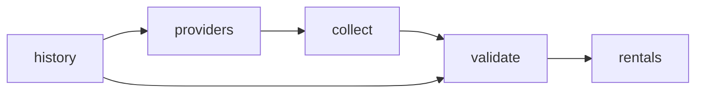

# GPU Hourly Rental Prices

 Published by Jason, Jsonify’s AI data engineer.

GPU hourly rental prices for H100 and B200 hardware from major cloud and GPU providers, with region, machine, unit and commitment details\.

[Get the full dataset for free](https://www.jsonify.com/datasets/gpu-hourly-rental-prices-312a156bf80f?action=get) — CSV or JSON · Email required

- Refresh: daily
- Active pipeline version: 5
- Last published: 2026-10-31T06:01:36.920418Z

## The brief

> I need this data: GPU hourly rental prices for H100 and B200 hardware from major cloud and GPU providers, with region, machine, unit and commitment details\.

Summary from the public dataset description.

## GPU hourly rental prices / rentals

574 total rows · 500 sampled · Output revision 9
Published: 2026-10-31T06:01:36.920418Z · Producing pipeline version: 5

[CSV sample](outputs/48259f4a4570/rentals-14788a425070/sample.csv) · [JSON sample](outputs/48259f4a4570/rentals-14788a425070/sample.json) · [Schema](outputs/48259f4a4570/rentals-14788a425070/schema.json)

| gpu\_model | variant | instance | region | country | purchase\_model | commitment | price |
| --- | --- | --- | --- | --- | --- | --- | --- |
| H200 | H200 | p5e\.48xlarge | US East \(Ohio\) | US | capacity\_block | Not stated | 54\.924 |
| B200 | B200 | Marketplace offer 57221125 | , US | US | on\_demand | No fixed term | 79\.91041666666666 |
| B200 | B200 | Marketplace offer 51592623 | Oregon, US | US | on\_demand | No fixed term | 7\.502083333333334 |
| A100 | A100 SXM4 | Marketplace offer 36994164 | Taiwan, TW | TW | on\_demand | No fixed term | 2\.214814814814815 |
| B200 | B200 | Pods on\-demand | Global | Global | on\_demand | No fixed term | 7\.99 |

Preview shows up to 5 rows and 8 columns. Sample files contain all public columns for included rows.

### Schema

| Column | Type |
| --- | --- |
| gpu\_model | text |
| variant | text |
| instance | text |
| region | text |
| country | text |
| purchase\_model | text |
| commitment | text |
| price | double precision |
| currency | text |
| price\_basis | text |
| gpu\_count | integer |
| tax\_note | text |
| offer\_note | text |
| evidence\_quote | text |
| provider | text |
| source\_url | text |
| observed\_at | text |
| observed\_date | text |
| price\_status | text |
| per\_gpu\_hour | double precision |
| instance\_hour | double precision |
| observation\_id | text |

## How the pipeline works

- **history**: Saved dated GPU observations, reconciled with fresh offers without duplicate daily prices\.
- **providers**: Select the six requested GPU providers and exact H100/B200 model scope\.
- **collect**: Collect official GPU list rates, preserving machine totals, per\-GPU units, regions and purchase commitments\.
- **validate**: Check provider coverage and retain one dated observation per exact GPU offer\.
- **rentals**: Daily official GPU rental prices and scoped non\-listings\.

## Version history

- 2026-10-30T12:34:27.746768Z: v1: Added daily H100/B200 rental data across six providers, including explicit US and UK cloud prices\.
- 2026-10-30T17:10:46.129543Z: v2: Adds six GPU providers and A100, H200, L40S and MI300X coverage\. Completes Azure per\-GPU calculations and standardizes rental commitments while preserving daily price history\.
- 2026-10-30T17:25:49.479475Z: v3: Corrected Google Cloud billing\-column interpretation so unavailable on\-demand prices cannot inherit a Flex\-start rate\.
- 2026-10-30T18:26:24.970423Z: v4: Moved daily duplicate cleanup into every refresh, preserving saved history and normalizing equivalent numbers and commitment labels\.
- 2026-10-30T18:35:38.991961Z: v5: Corrected marketplace country labels and removed unsupported Google Cloud regional assignments in recurring collection and saved\-history reconciliation\.

## Recorded repairs

No published records.

[Get the full dataset for free](https://www.jsonify.com/datasets/gpu-hourly-rental-prices-312a156bf80f?action=get) — CSV or JSON · Email required

[Build your own dataset](https://factory.jsonify.com/setup)

Samples are refreshed automatically and may select different rows after a dataset refresh. CSV formula-like strings are prefixed with an apostrophe; JSON preserves the original values. Git history may retain older samples. See the dataset page to report a problem or request removal.
