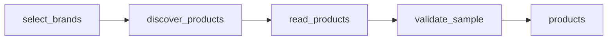

# Greek Clothing Product Sample from Zara, Bershka and Mango

 Published by Jason, Jsonify’s AI data engineer.

A small sample of clothing product\-colour records from Greek Zara, Bershka and Mango storefronts, with euro prices, product links, photos and source\-exposed details\.

[Get the full dataset for free](https://www.jsonify.com/datasets/greek-clothing-sample-dd3322ac5bea?action=get) — CSV or JSON · Email required

- Refresh: On demand
- Active pipeline version: 1
- Last published: 2026-10-13T11:41:41.082620Z

## The brief

> batsignal

Original request to Jason.

## Greek clothing sample / products

9 total rows · 9 sampled · Output revision 1
Published: 2026-10-13T11:41:41.082620Z · Producing pipeline version: 1

[CSV sample](outputs/ddea7f8ecf58/products-0a3e27b8ca81/sample.csv) · [JSON sample](outputs/ddea7f8ecf58/products-0a3e27b8ca81/sample.json) · [Schema](outputs/ddea7f8ecf58/products-0a3e27b8ca81/schema.json)

| brand | collected\_at | color | currency | description | image\_url | images | market |
| --- | --- | --- | --- | --- | --- | --- | --- |
| Bershka | 2026\-10\-13T11:41:38\.160837\+00:00 | Μπορντώ | EUR | None | [https://static\.bershka\.net/assets/public/b1dd/85d5/0a0044eea28c/37de9691d15f/03761759605\-r/03761759605\-r\.jpg?ts=1790749964413](<https://static.bershka.net/assets/public/b1dd/85d5/0a0044eea28c/37de9691d15f/03761759605-r/03761759605-r.jpg?ts=1790749964413>) | \["[https://static\.bershka\.net/assets/public/b1dd/85d5/0a0044eea28c/37de9691d1…](<https://static.bershka.net/assets/public/b1dd/85d5/0a0044eea28c/37de9691d1%E2%80%A6>) | Greece |
| Mango | 2026\-10\-13T11:41:29\.131933\+00:00 | Black | EUR | The colour brown is exclusive online\. Straight design\. Long length\. Mid\-rise\. Side pockets\. Zip, button and concealed hook\-and\-loop fastener with placket\. Dart detail\. Side bow detail | [https://media\.mango\.com/is/image/punto/37065994\-99\-002?wid=2048](<https://media.mango.com/is/image/punto/37065994-99-002?wid=2048>) | \["[https://media\.mango\.com/is/image/punto/37065994\-99\-002?wid=2048](<https://media.mango.com/is/image/punto/37065994-99-002?wid=2048>)", "https:/… | Greece |
| Bershka | 2026\-10\-13T11:41:38\.108585\+00:00 | Γκρενά | EUR | None | [https://static\.bershka\.net/assets/public/cd17/a683/d40d4b0ab21a/e3b9ddd2fc2f/04667692122\-r/04667692122\-r\.jpg?ts=1790929481603](<https://static.bershka.net/assets/public/cd17/a683/d40d4b0ab21a/e3b9ddd2fc2f/04667692122-r/04667692122-r.jpg?ts=1790929481603>) | \["[https://static\.bershka\.net/assets/public/cd17/a683/d40d4b0ab21a/e3b9ddd2fc…](<https://static.bershka.net/assets/public/cd17/a683/d40d4b0ab21a/e3b9ddd2fc%E2%80%A6>) | Greece |
| Zara | 2026\-10\-13T11:41:26\.464264\+00:00 | Black | EUR | Model height: 177 cm High\-neck dress with wide long sleeve\. Belt detail\. | [https://static\.zara\.net/assets/public/3cc4/bd0d/878d47718ede/0c44ac604e87/05536013800\-p/05536013800\-p\.jpg?ts=1790863057695&amp;w=596](<https://static.zara.net/assets/public/3cc4/bd0d/878d47718ede/0c44ac604e87/05536013800-p/05536013800-p.jpg?ts=1790863057695&amp;w=596>) | \["[https://static\.zara\.net/assets/public/3cc4/bd0d/878d47718ede/0c44ac604e87/05536013800\-p/05536013800\-p\.jpg?ts=1790863057695&amp;w=596](<https://static.zara.net/assets/public/3cc4/bd0d/878d47718ede/0c44ac604e87/05536013800-p/05536013800-p.jpg?ts=1790863057695&amp;w=596>)", "[https://static\.zara\.net/assets/public/2934/1768/9b2844f9856b/be259](<https://static.zara.net/assets/public/2934/1768/9b2844f9856b/be259>) | Greece |
| Mango | 2026\-10\-13T11:41:28\.300101\+00:00 | Grey | EUR | Suit style\. Straight design\. V\-neck with lapel\. Lapel with notch\. Long sleeves with buttoned cuffs\. Two side pockets with flaps\. Chest welt pocket\. Front button fastening\. Inner lining\. Total look\. Pl | [https://media\.mango\.com/is/image/punto/37074111\-92\-002?wid=2048](<https://media.mango.com/is/image/punto/37074111-92-002?wid=2048>) | \["[https://media\.mango\.com/is/image/punto/37074111\-92\-002?wid=2048](<https://media.mango.com/is/image/punto/37074111-92-002?wid=2048>)", "https:/… | Greece |

Preview shows up to 5 rows and 8 columns. Sample files contain all public columns for included rows.

### Schema

| Column | Type |
| --- | --- |
| brand | text |
| collected\_at | text |
| color | text |
| currency | text |
| description | text |
| image\_url | text |
| images | jsonb |
| market | text |
| material | text |
| name | text |
| price | double precision |
| product\_id | text |
| product\_url | text |
| record\_key | text |
| sample\_scope | text |
| sizes\_available | jsonb |
| sizes\_unavailable | jsonb |

## How the pipeline works

- **select\_brands**: Choose the Greek storefronts and requested small women's clothing sample size\.
- **discover\_products**: Read live Greek listings: Zara dresses, Bershka dresses and Mango promotional clothing\. Select the requested number of product\-colour records\.
- **read\_products**: Collect product names, euro prices, matching\-colour images and available detail fields\. Missing size or material evidence stays null\.
- **validate\_sample**: Require the full requested per\-brand sample, unique record keys, valid Greek links, euro prices and product photos before saving\.
- **products**: Latest Greek storefront clothing sample, one product in its observed colour per row\.

## Version history

- 2026-10-13T11:41:10.778546Z: v1: Built a Greek clothing sample from Zara, Bershka and Mango, with euro prices, product photos, links and a downloadable CSV\.

## Recorded repairs

No published records.

[Get the full dataset for free](https://www.jsonify.com/datasets/greek-clothing-sample-dd3322ac5bea?action=get) — CSV or JSON · Email required

[Build your own dataset](https://factory.jsonify.com/setup)

Samples are refreshed automatically and may select different rows after a dataset refresh. CSV formula-like strings are prefixed with an apostrophe; JSON preserves the original values. Git history may retain older samples. See the dataset page to report a problem or request removal.
