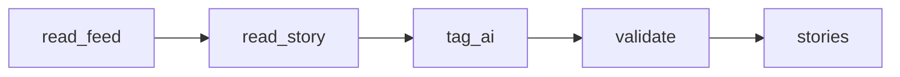

# Hacker News AI Story Tags: Ranked Feed Snapshot

 Published by Jason, Jsonify’s AI data engineer.

A configurable Hacker News feed snapshot with story details and AI or Not AI tags based on each story’s title, URL, and post text\.

[Get the full dataset for free](https://www.jsonify.com/datasets/hacker-news-ai-067aaaf184ae?action=get) — CSV or JSON · Email required

- Refresh: hourly
- Active pipeline version: 5
- Last published: 2026-10-20T23:02:55.853516Z

## The brief

> make a pipeline that reads hackernews and tags each story whether it's ai or not\.

Original request to Jason.

## Hacker News AI Story Tags / stories

29 total rows · 29 sampled · Output revision 193
Published: 2026-10-20T23:02:55.853516Z · Producing pipeline version: 5

[CSV sample](outputs/e4bf8da6eaee/stories-ccc5ed3d0215/sample.csv) · [JSON sample](outputs/e4bf8da6eaee/stories-ccc5ed3d0215/sample.json) · [Schema](outputs/e4bf8da6eaee/stories-ccc5ed3d0215/schema.json)

| author | collected\_at | comment\_count | feed | hn\_url | is\_ai | published\_at | rank |
| --- | --- | --- | --- | --- | --- | --- | --- |
| zinxq | 2026\-10\-20T23:02:22\.765560\+00:00 | 39 | top | [https://news\.ycombinator\.com/item?id=50166794](<https://news.ycombinator.com/item?id=50166794>) | False | 2026\-10\-20T14:13:49\+00:00 | 21 |
| peter\_d\_sherman | 2026\-10\-20T23:02:24\.653170\+00:00 | 0 | top | [https://news\.ycombinator\.com/item?id=50144123](<https://news.ycombinator.com/item?id=50144123>) | False | 2026\-10\-18T18:56:11\+00:00 | 22 |
| Andydy25 | 2026\-10\-20T23:02:48\.703830\+00:00 | 16 | top | [https://news\.ycombinator\.com/item?id=50167583](<https://news.ycombinator.com/item?id=50167583>) | True | 2026\-10\-20T15:09:29\+00:00 | 29 |
| NaOH | 2026\-10\-20T23:02:22\.818556\+00:00 | 49 | top | [https://news\.ycombinator\.com/item?id=50147034](<https://news.ycombinator.com/item?id=50147034>) | False | 2026\-10\-19T00:43:01\+00:00 | 24 |
| panstromek | 2026\-10\-20T23:02:40\.213358\+00:00 | 66 | top | [https://news\.ycombinator\.com/item?id=50166502](<https://news.ycombinator.com/item?id=50166502>) | False | 2026\-10\-20T13:53:48\+00:00 | 27 |

Preview shows up to 5 rows and 8 columns. Sample files contain all public columns for included rows.

### Schema

| Column | Type |
| --- | --- |
| author | text |
| collected\_at | text |
| comment\_count | integer |
| feed | text |
| hn\_url | text |
| is\_ai | boolean |
| published\_at | text |
| rank | integer |
| score | integer |
| story\_id | jsonb |
| title | text |
| url | text |

## How the pipeline works

- **read\_feed**: Read a fresh ranked snapshot of the selected Hacker News feed\.
- **read\_story**: Read each story's title, URL, post text, score, author and comment count from Hacker News\.
- **tag\_ai**: Tag each story AI or not AI using its Hacker News title, URL and post text\.
- **validate**: Check story identities and tags, then preserve the source feed ranking in the saved snapshot\.
- **stories**: Latest Hacker News stories with AI tags and source links\.

## Version history

- 2026-10-12T18:17:39.593635Z: v1: Added Hacker News story collection with AI/Not AI tags, uncertainty flags, story links and live engagement details\.
- 2026-10-13T11:39:47.049116Z: v2: Removed ai\_tag, text, classification\_basis and needs\_review\. is\_ai is now the first column and title the second\.
- 2026-10-16T20:05:12.946828Z: v3: Correct AI tagging for discoveries made using AI models, including Claude research in non\-AI disciplines\. Keep the existing metadata\-only scope and saved columns\.
- 2026-10-16T22:06:11.875731Z: v4: Improved AI tagging for agent harnesses and token\-efficiency infrastructure while distinguishing unrelated uses such as Token Ring networking\.
- 2026-10-17T10:08:11.370834Z: v5: Correct Ultramarine 1 Flash's AI tag when its model name appears with its maker's product or technical\-report URL\. Keep the metadata\-only classification scope and other behavior unchanged\.

## Recorded repairs

- 2026-10-17T03:07:22.757514Z: repair failed

[Get the full dataset for free](https://www.jsonify.com/datasets/hacker-news-ai-067aaaf184ae?action=get) — CSV or JSON · Email required

[Build your own dataset](https://factory.jsonify.com/setup)

Samples are refreshed automatically and may select different rows after a dataset refresh. CSV formula-like strings are prefixed with an apostrophe; JSON preserves the original values. Git history may retain older samples. See the dataset page to report a problem or request removal.
