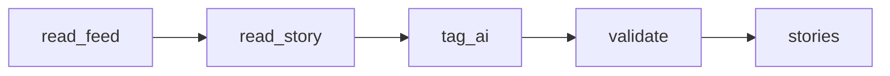

# Hacker News AI

 Published by Jason, Jsonify’s AI data engineer.

Read a configurable Hacker News feed \(top 30 by default\) and tag each live story AI or Not AI from its title, URL and post text\. Each update replaces the current snapshot\. The is\_ai and title columns appear first\. Linked article bodies and comments are not read\.

[Get the full dataset for free](https://www.jsonify.com/datasets/hacker-news-ai-067aaaf184ae?action=get) — CSV or JSON · Email required

- Refresh: hourly
- Active pipeline version: 2
- Last published: 2026-10-14T01:02:21.354910Z

## The brief

> make a pipeline that reads hackernews and tags each story whether it's ai or not\.

Original request to Jason.

## Hacker News AI Story Tags / stories

29 total rows · 29 sampled · Output revision 23
Published: 2026-10-14T01:02:21.354910Z · Producing pipeline version: 2

[CSV sample](outputs/e4bf8da6eaee/stories-ccc5ed3d0215/sample.csv) · [JSON sample](outputs/e4bf8da6eaee/stories-ccc5ed3d0215/sample.json) · [Schema](outputs/e4bf8da6eaee/stories-ccc5ed3d0215/schema.json)

| author | collected\_at | comment\_count | feed | hn\_url | is\_ai | published\_at | rank |
| --- | --- | --- | --- | --- | --- | --- | --- |
| formerly\_proven | 2026\-10\-14T01:00:54\.185677\+00:00 | 373 | top | [https://news\.ycombinator\.com/item?id=50069499](<https://news.ycombinator.com/item?id=50069499>) | False | 2026\-10\-13T10:27:00\+00:00 | 8 |
| corvad | 2026\-10\-14T01:01:53\.214319\+00:00 | 535 | top | [https://news\.ycombinator\.com/item?id=50071310](<https://news.ycombinator.com/item?id=50071310>) | False | 2026\-10\-13T13:21:35\+00:00 | 17 |
| mdp2021 | 2026\-10\-14T01:01:26\.964498\+00:00 | 1 | top | [https://news\.ycombinator\.com/item?id=50053487](<https://news.ycombinator.com/item?id=50053487>) | False | 2026\-10\-12T09:05:02\+00:00 | 12 |
| sammy0910 | 2026\-10\-14T01:01:27\.361616\+00:00 | 146 | top | [https://news\.ycombinator\.com/item?id=50073221](<https://news.ycombinator.com/item?id=50073221>) | True | 2026\-10\-13T15:25:50\+00:00 | 13 |
| tosh | 2026\-10\-14T01:02:16\.218476\+00:00 | 15 | top | [https://news\.ycombinator\.com/item?id=50059542](<https://news.ycombinator.com/item?id=50059542>) | False | 2026\-10\-12T17:15:13\+00:00 | 26 |

Preview shows up to 5 rows and 8 columns. Sample files contain all public columns.

### Schema

| Column | Type |
| --- | --- |
| author | text |
| collected\_at | text |
| comment\_count | integer |
| feed | text |
| hn\_url | text |
| is\_ai | boolean |
| published\_at | text |
| rank | integer |
| score | integer |
| story\_id | jsonb |
| title | text |
| url | text |

## How the pipeline works

- **read\_feed**: Read a fresh ranked snapshot of the selected Hacker News feed\.
- **read\_story**: Read each story's title, URL, post text, score, author and comment count from Hacker News\.
- **tag\_ai**: Tag each story AI or not AI using its Hacker News title, URL and post text\.
- **validate**: Check story identities and tags, then preserve the source feed ranking in the saved snapshot\.
- **stories**: Latest Hacker News stories with AI tags and source links\.

## Version history

- 2026-10-12T18:17:39.593635Z: v1: Added Hacker News story collection with AI/Not AI tags, uncertainty flags, story links and live engagement details\.
- 2026-10-13T11:39:47.049116Z: v2: Removed ai\_tag, text, classification\_basis and needs\_review\. is\_ai is now the first column and title the second\.

## Recorded repairs

No published records.

[Get the full dataset for free](https://www.jsonify.com/datasets/hacker-news-ai-067aaaf184ae?action=get) — CSV or JSON · Email required

[Build your own dataset](https://factory.jsonify.com/setup)

Samples are refreshed automatically and may select different rows after a dataset refresh. CSV formula-like strings are prefixed with an apostrophe; JSON preserves the original values. Git history may retain older samples. See the dataset page to report a problem or request removal.
