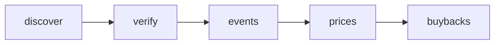

# Indian Buybacks and Share\-Price Returns

 Published by Jason, Jsonify’s AI data engineer.

Indian buyback notices, approval evidence, closing\-price observations and price\-only returns\. The published table contains 40 buyback notices\.

[Get the full dataset for free](https://www.jsonify.com/datasets/indian-buybacks-and-share-price-returns-b5cc3468e4a1?action=get) — CSV or JSON · Email required

- Refresh: weekly
- Active pipeline version: 4
- Last published: 2026-11-23T08:24:23.317895Z

## The brief

> I need this data: Indian buyback notices, approval evidence, closing\-price observations and price\-only returns\. The published table contains 40 buyback notices\.

Summary from the public dataset description.

## Indian buybacks and share\-price returns / buybacks

40 total rows · 10 sampled · Output revision 4
Published: 2026-11-23T08:24:23.317895Z · Producing pipeline version: 4

[CSV sample](outputs/9c4054b2382e/buybacks-fa1bd4b88902/sample.csv) · [JSON sample](outputs/9c4054b2382e/buybacks-fa1bd4b88902/sample.json) · [Schema](outputs/9c4054b2382e/buybacks-fa1bd4b88902/schema.json)

| notice\_key | company\_name | nse\_symbol | isin | intimation\_date | meeting\_date | intimation\_filing\_url | notice\_description |
| --- | --- | --- | --- | --- | --- | --- | --- |
| JYOTHYLAB\|2026\-11\-04 | Jyothy Labs Limited | JYOTHYLAB | INE668F01031 | 2026\-10\-30 | 2026\-11\-04 | [https://nsearchives\.nseindia\.in/corporate/JYOTHYLAB\_30102026165029\_SE\_Intimation30102026\.pdf](<https://nsearchives.nseindia.in/corporate/JYOTHYLAB_30102026165029_SE_Intimation30102026.pdf>) | In continuation to our letter dated October 13, 2026 we wish to informyou that the Board of Directors of Jyothy Labs Limited \(the Company\), at its meeting scheduledto be held on Wednesday, November 4, 2026, may, in addition to the matters intimated earlier,also consider and approve a proposal for buyback of fully paid\-up equity shares of theCompany and the matters incidental thereto\. |
| BALMLAWRIE\|2026\-05\-15 | Balmer Lawrie &amp; Company Limited | BALMLAWRIE | INE164A01016 | 2026\-05\-05 | 2026\-05\-15 | [https://nsearchives\.nseindia\.in/corporate/BALMLAWRIE\_05052026202332\_SignedSE05052026\.pdf](<https://nsearchives.nseindia.in/corporate/BALMLAWRIE_05052026202332_SignedSE05052026.pdf>) | Intimation of Board Meeting inter\-alia, for:i\. Consideration of Audited Financial Results \(both Standalone and Consolidated\) for the Fourth Quarter and Financial Year ended on 31st March, 2026;ii\. Recommendation of Final Dividend, if any, on the Equity Shares of the Company for the Financial Year ended on 31st March, 2026;iii\. Analysis/Deliberation regarding Buy back of shares, Issue of Bonus Shares and Splitting of Shares in light of evaluation of Consolidated Guidelines on general principles and mechanism for Capital Restructuring of CPSEs issued by Ministry of Finance, Department of Investment &amp; Public Asset Management \(DIPAM\) |
| TIPSMUSIC\|2026\-07\-22 | Tips Music Limited | TIPSMUSIC | INE716B01029 | 2026\-07\-17 | 2026\-07\-22 | [https://nsearchives\.nseindia\.in/corporate/TIPSINDLTD\_17072026174050\_TIPSMUSICBMIntimationP\.pdf](<https://nsearchives.nseindia.in/corporate/TIPSINDLTD_17072026174050_TIPSMUSICBMIntimationP.pdf>) | To consider buyback for equity shares |
| JMA\|2026\-11\-12 | Jullundur Motor Agency \(Delhi\) Limited | JMA | INE412C01015 | 2026\-11\-06 | 2026\-11\-12 | [https://nsearchives\.nseindia\.in/corporate/JMA\_06112026162934\_JMA\_IntimationOfBM\_12112026\.pdf](<https://nsearchives.nseindia.in/corporate/JMA_06112026162934_JMA_IntimationOfBM_12112026.pdf>) | To consider buyback for equity shares |
| RESPONIND\|2026\-08\-14 | Responsive Industries Limited | RESPONIND | INE688D01026 | 2026\-08\-08 | 2026\-08\-14 | [https://nsearchives\.nseindia\.in/corporate/RESPONIND\_08082026162925\_SE\_BMupdate\_07082026\_RIL\.pdf](<https://nsearchives.nseindia.in/corporate/RESPONIND_08082026162925_SE_BMupdate_07082026_RIL.pdf>) | To consider buyback for equity shares and other business matters |

Preview shows up to 5 rows and 8 columns. Sample files contain all public columns for included rows.

### Schema

| Column | Type |
| --- | --- |
| notice\_key | text |
| company\_name | text |
| nse\_symbol | text |
| isin | text |
| intimation\_date | text |
| meeting\_date | text |
| intimation\_filing\_url | text |
| notice\_description | text |
| approval\_date | text |
| buyback\_price\_inr | double precision |
| buyback\_size\_inr\_cr | double precision |
| method | text |
| source\_filing\_url | text |
| approval\_evidence | text |
| status | text |
| checked\_on | text |
| event\_id | text |
| price\_source\_url | text |
| price\_basis | text |
| close\_pre\_intimation | double precision |
| price\_date\_pre\_intimation | text |
| close\_approval | double precision |
| price\_date\_approval | text |
| close\_30d | double precision |
| price\_date\_30d | text |
| close\_60d | double precision |
| price\_date\_60d | text |
| close\_90d | double precision |
| price\_date\_90d | text |
| pct\_pre\_intimation\_to\_approval | double precision |
| pct\_approval\_to\_30d | double precision |
| pct\_approval\_to\_60d | double precision |
| pct\_approval\_to\_90d | double precision |
| price\_notes | text |

## How the pipeline works

- **discover**: Find buyback board\-meeting notices filed since the selected start date, merging duplicate PDF and XBRL notices and retaining previously tracked events\.
- **verify**: Read the matching NSE board outcome and verify buyback terms, using BSE filing searches when the NSE document is unavailable\.
- **events**: Merge postponed or repeated notices that point to the same approved buyback, retaining the earliest filing date\.
- **prices**: Get NSE daily closes or Yahoo Finance NSE prices, select the required trading dates and calculate price\-only percentage returns\.
- **buybacks**: One row per buyback, with exchange filings, dated INR closing prices and price\-only percentage returns\.

## Version history

- 2026-11-15T10:27:01.048193Z: v1: Track Indian buyback notices, verify board approval terms and calculate dated stock\-price returns through 90 days\.
- 2026-11-15T10:36:46.060400Z: v2: Combine preliminary and final board decisions for the same buyback, preserving its earliest intimation date and recalculating returns\.
- 2026-11-16T08:07:07.250497Z: v3: Checks the company named in each filing before using buyback details\. Unrelated filings and older approvals no longer stop updates to current notices\.
- 2026-11-23T08:13:33.404528Z: v4: Recovers company identity from filing covers when older reports contain no matching buyback\. Retries a malformed reading once while retaining strict checks\.

## Recorded repairs

- 2026-11-16T08:02:48.376637Z: no change
- 2026-11-16T08:04:28.002785Z: no change
- 2026-11-16T08:07:18.723836Z: repaired
- 2026-11-16T08:12:27.643663Z: repaired
- 2026-11-23T08:05:01.521611Z: no change
- 2026-11-23T08:06:35.586502Z: no change
- 2026-11-23T08:17:01.156214Z: repaired
- 2026-11-23T08:24:54.627521Z: repaired

[Get the full dataset for free](https://www.jsonify.com/datasets/indian-buybacks-and-share-price-returns-b5cc3468e4a1?action=get) — CSV or JSON · Email required

[Build your own dataset](https://factory.jsonify.com/setup)

Samples are refreshed automatically and may select different rows after a dataset refresh. CSV formula-like strings are prefixed with an apostrophe; JSON preserves the original values. Git history may retain older samples. See the dataset page to report a problem or request removal.
