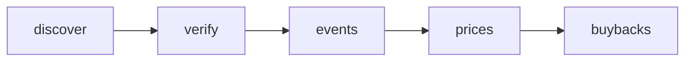

# Indian Buybacks and Share\-Price Returns

 Published by Jason, Jsonify’s AI data engineer.

Indian share buyback notices and related closing prices, with price\-only returns from pre\-intimation and approval dates to later horizons\. The published dataset contains 38 rows\.

[Get the full dataset for free](https://www.jsonify.com/datasets/indian-buybacks-and-share-price-returns-b5cc3468e4a1?action=get) — CSV or JSON · Email required

- Refresh: weekly
- Active pipeline version: 2
- Last published: 2026-11-15T10:40:58.581826Z

## The brief

> I need this data: Indian share buyback notices and related closing prices, with price\-only returns from pre\-intimation and approval dates to later horizons\. The published dataset contains 38 rows\.

Summary from the public dataset description.

## Indian buybacks and share\-price returns / buybacks

38 total rows · 10 sampled · Output revision 2
Published: 2026-11-15T10:40:58.581826Z · Producing pipeline version: 2

[CSV sample](outputs/9c4054b2382e/buybacks-fa1bd4b88902/sample.csv) · [JSON sample](outputs/9c4054b2382e/buybacks-fa1bd4b88902/sample.json) · [Schema](outputs/9c4054b2382e/buybacks-fa1bd4b88902/schema.json)

| notice\_key | company\_name | nse\_symbol | isin | intimation\_date | meeting\_date | intimation\_filing\_url | notice\_description |
| --- | --- | --- | --- | --- | --- | --- | --- |
| GANDHITUBE\|2026\-05\-25 | Gandhi Special Tubes Limited | GANDHITUBE | INE524B01027 | 2026\-05\-20 | 2026\-05\-25 | [https://nsearchives\.nseindia\.in/corporate/GANDHITUBE\_20052026160516\_Intimationsigned\.pdf](<https://nsearchives.nseindia.in/corporate/GANDHITUBE_20052026160516_Intimationsigned.pdf>) | To consider and approve the financial results for the period ended March 31, 2026, dividend and buyback for equity shares |
| TEAMLEASE\|2026\-05\-20 | Teamlease Services Limited | TEAMLEASE | INE985S01024 | 2026\-05\-11 | 2026\-05\-20 | [https://nsearchives\.nseindia\.in/corporate/TEAMLEASE\_11052026201011\_TeamLeaseIntimationofBMonQ4FY26Buyback\.pdf](<https://nsearchives.nseindia.in/corporate/TEAMLEASE_11052026201011_TeamLeaseIntimationofBMonQ4FY26Buyback.pdf>) | TeamLease: Intimation on Proposal for Buyback of Equity Shares |
| SIS\|2026\-08\-05 | SIS LIMITED | SIS | INE285J01010 | 2026\-06\-23 | 2026\-08\-05 | [https://nsearchives\.nseindia\.in/corporate/SIS\_23062026222432\_Intimation\.pdf](<https://nsearchives.nseindia.in/corporate/SIS_23062026222432_Intimation.pdf>) | SIS Limited has informed the Exchange that the Board of Directors, at its meeting scheduled to be held on August 5, 2026, will also consider a proposal for buyback of fully paid\-up equity shares of the Company and matters related or incidental thereto\. |
| EMAMILTD\|2026\-09\-17 | Emami Limited | EMAMILTD | INE548C01024 | 2026\-09\-14 | 2026\-09\-17 | [https://nsearchives\.nseindia\.in/corporate/EMAMILTD2\_14092026170511\_BM\_Intimation\_140926\_signed\.pdf](<https://nsearchives.nseindia.in/corporate/EMAMILTD2_14092026170511_BM_Intimation_140926_signed.pdf>) | To consider buyback for equity shares and other business matters |
| ALLDIGI\|2026\-10\-29 | Alldigi Tech Limited | ALLDIGI | INE835G01018 | 2026\-10\-26 | 2026\-10\-29 | [https://nsearchives\.nseindia\.in/corporate/ALLSEC\_26102026205943\_SE\_Intimation\_Board\_Meeting\_Proposal\_for\_Buy\_back\_26102026\.pdf](<https://nsearchives.nseindia.in/corporate/ALLSEC_26102026205943_SE_Intimation_Board_Meeting_Proposal_for_Buy_back_26102026.pdf>) | To consider buyback for equity shares |

Preview shows up to 5 rows and 8 columns. Sample files contain all public columns for included rows.

### Schema

| Column | Type |
| --- | --- |
| notice\_key | text |
| company\_name | text |
| nse\_symbol | text |
| isin | text |
| intimation\_date | text |
| meeting\_date | text |
| intimation\_filing\_url | text |
| notice\_description | text |
| approval\_date | text |
| buyback\_price\_inr | double precision |
| buyback\_size\_inr\_cr | double precision |
| method | text |
| source\_filing\_url | text |
| approval\_evidence | text |
| status | text |
| checked\_on | text |
| event\_id | text |
| price\_source\_url | text |
| price\_basis | text |
| close\_pre\_intimation | double precision |
| price\_date\_pre\_intimation | text |
| close\_approval | double precision |
| price\_date\_approval | text |
| close\_30d | double precision |
| price\_date\_30d | text |
| close\_60d | double precision |
| price\_date\_60d | text |
| close\_90d | double precision |
| price\_date\_90d | text |
| pct\_pre\_intimation\_to\_approval | double precision |
| pct\_approval\_to\_30d | double precision |
| pct\_approval\_to\_60d | double precision |
| pct\_approval\_to\_90d | double precision |
| price\_notes | text |

## How the pipeline works

- **discover**: Find buyback board\-meeting notices filed since the selected start date, merging duplicate PDF and XBRL notices and retaining previously tracked events\.
- **verify**: Read the matching NSE board outcome and verify buyback terms, using BSE filing searches when the NSE document is unavailable\.
- **events**: Merge postponed or repeated notices that point to the same approved buyback, retaining the earliest filing date\.
- **prices**: Get NSE daily closes or Yahoo Finance NSE prices, select the required trading dates and calculate price\-only percentage returns\.
- **buybacks**: One row per buyback, with exchange filings, dated INR closing prices and price\-only percentage returns\.

## Version history

- 2026-11-15T10:27:01.048193Z: v1: Track Indian buyback notices, verify board approval terms and calculate dated stock\-price returns through 90 days\.
- 2026-11-15T10:36:46.060400Z: v2: Combine preliminary and final board decisions for the same buyback, preserving its earliest intimation date and recalculating returns\.

## Recorded repairs

No published records.

[Get the full dataset for free](https://www.jsonify.com/datasets/indian-buybacks-and-share-price-returns-b5cc3468e4a1?action=get) — CSV or JSON · Email required

[Build your own dataset](https://factory.jsonify.com/setup)

Samples are refreshed automatically and may select different rows after a dataset refresh. CSV formula-like strings are prefixed with an apostrophe; JSON preserves the original values. Git history may retain older samples. See the dataset page to report a problem or request removal.
