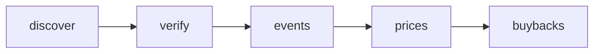

# Indian Buybacks and Share\-Price Returns

 Published by Jason, Jsonify’s AI data engineer.

Indian share buyback notices and related closing prices, with price\-only returns from pre\-intimation and approval dates to later horizons\. The published dataset contains 38 rows\.

[Get the full dataset for free](https://www.jsonify.com/datasets/indian-buybacks-and-share-price-returns-b5cc3468e4a1?action=get) — CSV or JSON · Email required

- Refresh: weekly
- Active pipeline version: 3
- Last published: 2026-11-16T08:12:07.887827Z

## The brief

> I need this data: Indian share buyback notices and related closing prices, with price\-only returns from pre\-intimation and approval dates to later horizons\. The published dataset contains 38 rows\.

Summary from the public dataset description.

## Indian buybacks and share\-price returns / buybacks

38 total rows · 10 sampled · Output revision 3
Published: 2026-11-16T08:12:07.887827Z · Producing pipeline version: 3

[CSV sample](outputs/9c4054b2382e/buybacks-fa1bd4b88902/sample.csv) · [JSON sample](outputs/9c4054b2382e/buybacks-fa1bd4b88902/sample.json) · [Schema](outputs/9c4054b2382e/buybacks-fa1bd4b88902/schema.json)

| notice\_key | company\_name | nse\_symbol | isin | intimation\_date | meeting\_date | intimation\_filing\_url | notice\_description |
| --- | --- | --- | --- | --- | --- | --- | --- |
| RESPONIND\|2026\-08\-14 | Responsive Industries Limited | RESPONIND | INE688D01026 | 2026\-08\-08 | 2026\-08\-14 | [https://nsearchives\.nseindia\.in/corporate/RESPONIND\_08082026162925\_SE\_BMupdate\_07082026\_RIL\.pdf](<https://nsearchives.nseindia.in/corporate/RESPONIND_08082026162925_SE_BMupdate_07082026_RIL.pdf>) | To consider buyback for equity shares and other business matters |
| GESHIP\|2026\-08\-27 | The Great Eastern Shipping Company Limited | GESHIP | INE017A01032 | 2026\-08\-24 | 2026\-08\-27 | [https://nsearchives\.nseindia\.in/corporate/GESHIP\_24082026160830\_Boardintimation\.pdf](<https://nsearchives.nseindia.in/corporate/GESHIP_24082026160830_Boardintimation.pdf>) | To consider a proposal for buyback for equity shares |
| WELSPUNLIV\|2026\-05\-15 | Welspun Living Limited | WELSPUNLIV | INE192B01031 | 2026\-05\-11 | 2026\-05\-15 | [https://nsearchives\.nseindia\.in/corporate/WELSPUNIND\_11052026223657\_NoticeofBMfinalsigned\.pdf](<https://nsearchives.nseindia.in/corporate/WELSPUNIND_11052026223657_NoticeofBMfinalsigned.pdf>) | To consider and approve the financial results for the period ended March 31, 2026, recommendation of dividend, if any and proposal for Buyback of fully paid Equity Shares of the Company\. |
| ALLDIGI\|2026\-10\-29 | Alldigi Tech Limited | ALLDIGI | INE835G01018 | 2026\-10\-26 | 2026\-10\-29 | [https://nsearchives\.nseindia\.in/corporate/ALLSEC\_26102026205943\_SE\_Intimation\_Board\_Meeting\_Proposal\_for\_Buy\_back\_26102026\.pdf](<https://nsearchives.nseindia.in/corporate/ALLSEC_26102026205943_SE_Intimation_Board_Meeting_Proposal_for_Buy_back_26102026.pdf>) | To consider buyback for equity shares |
| SUKHJITS\|2026\-11\-20 | Sukhjit Starch &amp; Chemicals Limited | SUKHJITS | INE450E01011 | 2026\-11\-12 | 2026\-11\-20 | [https://nsearchives\.nseindia\.in/corporate/SUKHJIT1944\_12112026121157\_INTIMATION\_OF\_BOARD\_MEETING\_FOR\_BUYBACK\.pdf](<https://nsearchives.nseindia.in/corporate/SUKHJIT1944_12112026121157_INTIMATION_OF_BOARD_MEETING_FOR_BUYBACK.pdf>) | Sukhjit Starch &amp; Chemicals Ltd\- has informed NSE that the meeting of the Board of Directors of the Company is scheduled on 20/11/2026, inter alia, to consider and approve the proposal for Buyback of the equity shares of the Company having face value of Rs\. 5 each\. |

Preview shows up to 5 rows and 8 columns. Sample files contain all public columns for included rows.

### Schema

| Column | Type |
| --- | --- |
| notice\_key | text |
| company\_name | text |
| nse\_symbol | text |
| isin | text |
| intimation\_date | text |
| meeting\_date | text |
| intimation\_filing\_url | text |
| notice\_description | text |
| approval\_date | text |
| buyback\_price\_inr | double precision |
| buyback\_size\_inr\_cr | double precision |
| method | text |
| source\_filing\_url | text |
| approval\_evidence | text |
| status | text |
| checked\_on | text |
| event\_id | text |
| price\_source\_url | text |
| price\_basis | text |
| close\_pre\_intimation | double precision |
| price\_date\_pre\_intimation | text |
| close\_approval | double precision |
| price\_date\_approval | text |
| close\_30d | double precision |
| price\_date\_30d | text |
| close\_60d | double precision |
| price\_date\_60d | text |
| close\_90d | double precision |
| price\_date\_90d | text |
| pct\_pre\_intimation\_to\_approval | double precision |
| pct\_approval\_to\_30d | double precision |
| pct\_approval\_to\_60d | double precision |
| pct\_approval\_to\_90d | double precision |
| price\_notes | text |

## How the pipeline works

- **discover**: Find buyback board\-meeting notices filed since the selected start date, merging duplicate PDF and XBRL notices and retaining previously tracked events\.
- **verify**: Read the matching NSE board outcome and verify buyback terms, using BSE filing searches when the NSE document is unavailable\.
- **events**: Merge postponed or repeated notices that point to the same approved buyback, retaining the earliest filing date\.
- **prices**: Get NSE daily closes or Yahoo Finance NSE prices, select the required trading dates and calculate price\-only percentage returns\.
- **buybacks**: One row per buyback, with exchange filings, dated INR closing prices and price\-only percentage returns\.

## Version history

- 2026-11-15T10:27:01.048193Z: v1: Track Indian buyback notices, verify board approval terms and calculate dated stock\-price returns through 90 days\.
- 2026-11-15T10:36:46.060400Z: v2: Combine preliminary and final board decisions for the same buyback, preserving its earliest intimation date and recalculating returns\.
- 2026-11-16T08:07:07.250497Z: v3: Checks the company named in each filing before using buyback details\. Unrelated filings and older approvals no longer stop updates to current notices\.

## Recorded repairs

- 2026-11-16T08:02:48.376637Z: no change
- 2026-11-16T08:04:28.002785Z: no change
- 2026-11-16T08:07:18.723836Z: repaired
- 2026-11-16T08:12:27.643663Z: repaired

[Get the full dataset for free](https://www.jsonify.com/datasets/indian-buybacks-and-share-price-returns-b5cc3468e4a1?action=get) — CSV or JSON · Email required

[Build your own dataset](https://factory.jsonify.com/setup)

Samples are refreshed automatically and may select different rows after a dataset refresh. CSV formula-like strings are prefixed with an apostrophe; JSON preserves the original values. Git history may retain older samples. See the dataset page to report a problem or request removal.
