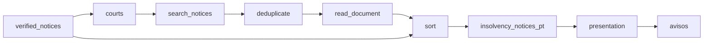

# Portugal Insolvency Notices

 Published by Jason, Jsonify’s AI data engineer.

Public Citius insolvency notices with debtor, court, publication date and published deadline details\.

[Get the full dataset for free](https://www.jsonify.com/datasets/insolvency-notices-pt-5cf39e22f64e?action=get) — CSV or JSON · Email required

- Refresh: daily
- Active pipeline version: 11
- Last published: 2026-11-28T06:38:52.777090Z

## The brief

> I need this data: Public Citius insolvency notices with debtor, court, publication date and published deadline details\.

Summary from the public dataset description.

## Avisos de insolvência / avisos

463 total rows · 50 sampled · Output revision 28
Published: 2026-11-28T06:38:52.777090Z · Producing pipeline version: 11

[CSV sample](outputs/43cb4b753508/avisos-354cde498655/sample.csv) · [JSON sample](outputs/43cb4b753508/avisos-354cde498655/sample.json) · [Schema](outputs/43cb4b753508/avisos-354cde498655/schema.json)

| Distrito | Estado do prazo | NIF ou NIPC | Natureza do devedor | Prazo publicado | Processo | Publicado em | Tipo de anúncio |
| --- | --- | --- | --- | --- | --- | --- | --- |
| Lisboa | Prazo identificado no documento | 236917277 | Pessoa singular | 30 dias, a contar do termo da dilação, que se conta da data da publicação do anúncio eletrónico na Área de Serviços Digitais dos Tribunais | 3787/26\.7T8VFX | 2026\-11\-23 | declaração de insolvência |
| Porto | Prazo identificado no documento | 237352648; 221017291 | Pessoa singular | Trinta dias, findos os dos éditos de cinco dias contados da publicação deste edital, para contestar a ação \(arts\. 146\.º e 148\.º do CIRE\)\. | 2788/26\.0T8STS\-B | 2026\-11\-26 | Outro |
| Porto | Prazo identificado no documento | 235087335 | Pessoa singular | 30 dias, contados a partir do termo da dilação; os prazos para reclamação de créditos começam a correr finda a dilação, que se conta da data da publicação do anúncio eletrónico na Área de Serviços Digitais dos Tribunais \([https://tribunais\.org\.pt](<https://tribunais.org.pt>)\) | 3736/26\.2T8STS | 2026\-11\-25 | declaração de insolvência |
| Porto | Prazo não identificado no documento | 179624466; 182323730 | Pessoa singular | None | 6755/26\.5T8VNG | 2026\-11\-27 | Outro |
| Porto | Prazo não identificado no documento | 504053728 | Empresa | None | 477/13\.4TBMCN | 2026\-11\-24 | encerramento |

Preview shows up to 5 rows and 8 columns. Sample files contain all public columns for included rows.

### Schema

| Column | Type |
| --- | --- |
| Distrito | text |
| Estado do prazo | text |
| NIF ou NIPC | text |
| Natureza do devedor | text |
| Prazo publicado | text |
| Processo | text |
| Publicado em | text |
| Tipo de anúncio | text |
| Tribunal | text |
| Ver anúncio no Citius | text |
| name | text |

## Avisos de insolvência / insolvency\_notices\_pt

463 total rows · 50 sampled · Output revision 28
Published: 2026-11-28T06:38:52.777090Z · Producing pipeline version: 11

[CSV sample](outputs/43cb4b753508/insolvency-notices-pt-0eb817203930/sample.csv) · [JSON sample](outputs/43cb4b753508/insolvency-notices-pt-0eb817203930/sample.json) · [Schema](outputs/43cb4b753508/insolvency-notices-pt-0eb817203930/schema.json)

| claims\_deadline | court | debtor\_name | debtor\_nif | debtor\_type | district | insolvency\_administrator | notice\_type |
| --- | --- | --- | --- | --- | --- | --- | --- |
| O prazo para a reclamação de créditos foi fixado em \_\_20\_\_ dias; os prazos para recurso, embargos e reclamação de créditos começam a correr finda a dilação, que se conta da data da publicação do anúncio eletrónico na Área de Serviços Digitais dos Tribunais \(acessível em [https://tribunais\.org\.pt](<https://tribunais.org.pt>)\)\. | Santo Tirso \- Tribunal Judicial da Comarca do Porto / Juízo de Comércio de Santo Tirso \- Juiz 1 | Paulo Alexandre Araújo Silva | 201794594 | individual | Porto | Paula Maria Ramos Peres Fernandes | declaração de insolvência |
| Prazo de trinta dias, a contar após findos os cinco dias de éditos, contados da publicação deste edital, para os credores da massa insolvente contestarem \(arts\. 146\.º e 148\.º do CIRE\)\. | Comarca do Porto \- Vila Nova de Gaia / Juízo de Comércio de Vila Nova de Gaia \- Juiz 5 | Guestpage Unipessoal, Lda; Massa Insolvente Representada Pela Administradora de Insolvência Maria Isabel Ma | 514564130 | company | Porto | Maria Isabel Mantua Monteiro de Barros do Espírito Santo | other |
| None | Comarca de Lisboa Oeste \- Sintra / Juízo de Comércio de Sintra \- Juiz 4 | Vitor Manuel Pereira Sobral | 189465565 | individual | Lisboa | Emanuel Freire Torres Gamelas | other |
| 30 dias, contados após finda a dilação, que se conta da data da publicação do anúncio eletrónico na Área de Serviços Digitais dos Tribunais \(acessível em [https://tribunais\.org\.pt](<https://tribunais.org.pt>)\) | Comarca do Porto \- Santo Tirso / Juízo de Comércio de Santo Tirso \- Juiz 7 | Ana Raquel Lopes Guerra | 253106460 | individual | Porto | Luís Miguel Araújo Torres Rodrigues | declaração de insolvência |
| None | Comarca do Porto \- Vila Nova de Gaia / Juízo de Comércio de Vila Nova de Gaia \- Juiz 2 | Álvaro Nuno Moura Agante | 204423465 | individual | Porto | António Pessoa Filho | other |

Preview shows up to 5 rows and 8 columns. Sample files contain all public columns for included rows.

### Schema

| Column | Type |
| --- | --- |
| claims\_deadline | text |
| court | text |
| debtor\_name | text |
| debtor\_nif | text |
| debtor\_type | text |
| district | text |
| insolvency\_administrator | text |
| notice\_type | text |
| process\_number | text |
| published\_date | text |
| source | text |
| summary | text |
| url | text |

## How the pipeline works

- **verified\_notices**: Optional saved notice snapshot for presentation\-only rebuilding; leave unset for live collection\.
- **courts**: Find all listed court locations serving the districts of Lisboa and Porto\.
- **search\_notices**: Search each district court for recent notices and follow every results page\.
- **deduplicate**: Keep the newest notice for each process and notice category, as requested\.
- **read\_document**: Read each public notice document for the published credit\-claim deadline and confirm debtor type\.
- **sort**: Sort the final notice dataset by publication date, newest first\.
- **insolvency\_notices\_pt**: Public Citius insolvency notices for Lisboa and Porto in the last seven days\.
- **presentation**: Present debtor\-first Portuguese fields and distinguish published deadlines from unavailable or unverified documents\.
- **avisos**: Vista de leitura dos anúncios, com prazos publicados e lacunas explícitas\.

## Version history

- 2026-11-03T20:18:40.030465Z: v1: Create a daily\-ready Citius collection of recent public insolvency notices for Lisboa and Porto, with debtor details and published claims deadlines\.
- 2026-11-03T20:30:12.769767Z: v2: Recover missing debtor details for ancillary notices from their exact main court process so those notices no longer stop publication\.
- 2026-11-03T21:28:29.970874Z: v3: Added a Portuguese notice reading worksheet with explicit deadline uncertainty and a debtor\-first, newest\-first download\. Preserved the complete original notice records separately\.
- 2026-11-03T22:29:41.581366Z: v4: Rows now use the exact debtor name as their native heading\. The dataset display name is Avisos de insolvência, with original notice data and Portuguese download preserved\.
- 2026-11-10T08:44:28.365557Z: v5: Retain the approved notice when its document is missing, keeping its deadline null and clearly marked unverified\. Read the document normally if Citius restores it\.
- 2026-11-13T06:10:20.221989Z: v6: Fixed updates stopping when Citius lists the same reference twice on one page\. Debtor lookups still stop if an entire results page repeats\.
- 2026-11-14T06:18:51.091945Z: v7: Fixed updates stopping on different name spellings in related court records\. Conflicting names are left unused while the exact notice document supplies missing details\.
- 2026-11-21T06:10:45.424652Z: v8: Recognize limited companies from their published legal names and validated corporate tax numbers when the court category omits debtor type\.
- 2026-11-24T06:06:38.483135Z: v9: Fixed updates stopping when a court search lists the same notice reference more than once\. Searches still check for repeated pages and reconcile every listing entry with the source total\.
- 2026-11-24T06:22:41.568152Z: v10: Confirm the debtor from the main case when a court notice separately lists the insolvent person and the estate\. Keep the deadline marked unverified when the notice has no document\.
- 2026-11-28T06:10:06.146289Z: v11: Recognizes the S\.A\. company designation with a validated corporate tax number\.

## Recorded repairs

- 2026-11-10T06:19:09.875431Z: no change
- 2026-11-10T06:23:14.143851Z: temporary blocker
- 2026-11-13T06:04:29.364410Z: no change
- 2026-11-13T06:05:37.531429Z: no change
- 2026-11-13T06:10:27.344481Z: repaired
- 2026-11-14T06:11:47.627162Z: no change
- 2026-11-14T06:12:40.675800Z: no change
- 2026-11-14T06:19:00.669024Z: repaired
- 2026-11-14T06:35:50.871073Z: repaired
- 2026-11-21T06:03:01.889534Z: no change
- 2026-11-21T06:04:41.300276Z: no change
- 2026-11-21T06:14:02.803192Z: repaired
- 2026-11-21T06:27:52.258514Z: repaired
- 2026-11-24T06:01:36.845323Z: no change
- 2026-11-24T06:03:10.497833Z: no change
- 2026-11-24T06:13:23.531665Z: repaired
- 2026-11-24T06:16:56.333888Z: no change
- 2026-11-24T06:21:38.037688Z: no change
- 2026-11-24T06:22:50.200811Z: repaired
- 2026-11-24T06:39:00.893787Z: repaired
- 2026-11-28T06:03:18.458055Z: no change
- 2026-11-28T06:10:11.885976Z: repaired
- 2026-11-28T06:33:22.342436Z: no change
- 2026-11-28T06:33:47.827809Z: repaired
- 2026-11-28T06:39:22.571850Z: repaired

[Get the full dataset for free](https://www.jsonify.com/datasets/insolvency-notices-pt-5cf39e22f64e?action=get) — CSV or JSON · Email required

[Build your own dataset](https://factory.jsonify.com/setup)

Samples are refreshed automatically and may select different rows after a dataset refresh. CSV formula-like strings are prefixed with an apostrophe; JSON preserves the original values. Git history may retain older samples. See the dataset page to report a problem or request removal.
