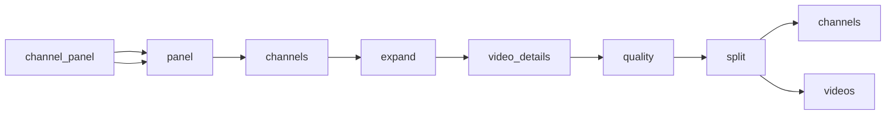

# INTELLIAAI YouTube Placement Sample

 Published by Jason, Jsonify’s AI data engineer.

INTELLIAAI YouTube channel and video observations for contextual placement scoring, with field gaps and coverage information\.

[Get the full dataset for free](https://www.jsonify.com/datasets/intelliaai-youtube-placement-sample-6cd4514c0219?action=get) — CSV or JSON · Email required

- Refresh: On demand
- Active pipeline version: 1
- Last published: 2026-11-08T05:19:30.148851Z

## The brief

> I need this data: INTELLIAAI YouTube channel and video observations for contextual placement scoring, with field gaps and coverage information\.

Summary from the public dataset description.

## INTELLIAAI YouTube placement observations / channels

150 total rows · 50 sampled · Output revision 1
Published: 2026-11-08T05:19:30.148851Z · Producing pipeline version: 1

[CSV sample](outputs/a631404e985d/channels-61ffa9c8c703/sample.csv) · [JSON sample](outputs/a631404e985d/channels-61ffa9c8c703/sample.json) · [Schema](outputs/a631404e985d/channels-61ffa9c8c703/schema.json)

| channel\_created\_at | channel\_id | country | coverage | description | failure\_reason | field\_issues | handle |
| --- | --- | --- | --- | --- | --- | --- | --- |
| None | None | None | \{"videos\_expected": 3000, "videos\_succeeded": 2647, "channels\_selected": 150, "videos\_discovered": 2650, "channels\_succeeded": 142, "videos\_coverage\_pct": 88\.23, "channels\_coverage\_pct": 94\.67, "transcripts\_available": 2514, "transcript\_coverage\_pct": 94\.87} | None | ValueError: youtube\.channel: source returned no usable public record | \{} | @babishculinaryuniverse |
| 2016\-01\-05 | UCnMn36GT\_H0X\-w5\_ckLtlgQ | United States | \{"videos\_expected": 3000, "videos\_succeeded": 2647, "channels\_selected": 150, "videos\_discovered": 2650, "channels\_succeeded": 142, "videos\_coverage\_pct": 88\.23, "channels\_coverage\_pct": 94\.67, "transcripts\_available": 2514, "transcript\_coverage\_pct": 94\.87} | My name is Jeremy Lefebvre and I created the Financial Education Channel as somewhere people from all backgrounds, countries etc can come and learn about Investing, Personal Finance and entrepreneurship\!  Apply to join my private Stock group &amp; Wealth Group with this link  FAQ \*What do you do each day? Now a days I focus most of my time on finding the next home run stocks, running my stock portfolios, help my private stock group members reach 6 figure, 7 figure and 8 figure milestones, and lastly record Youtube videos\! I use to have a real estate marketing company before youtube took off\. Before that I was a manager for a company named Quiktrip\.  \*Wife Kids? Yes I have a beautiful wife and 2 awesome little boys  \*When did you start the Financial Education channel? I started in  2016  \*Any advice to retail investors? Do Research and watch my videos on investing\! | None | \{"language": "Curated expected content language; video caption language is recorded separately"} | @FinancialEducation |
| 2016\-12\-30 | UCO3tlaeZ6Z0ZN5frMZI3\-uQ | United States | \{"videos\_expected": 3000, "videos\_succeeded": 2647, "channels\_selected": 150, "videos\_discovered": 2650, "channels\_succeeded": 142, "videos\_coverage\_pct": 88\.23, "channels\_coverage\_pct": 94\.67, "transcripts\_available": 2514, "transcript\_coverage\_pct": 94\.87} | Hi I'm Nate\. Welcome to my channel\.     | None | \{"language": "Curated expected content language; video caption language is recorded separately"} | @NateOBrien |
| 2017\-02\-02 | UC9OIwUcx\-Uss7xj7s1P5XGw | United Kingdom | \{"videos\_expected": 3000, "videos\_succeeded": 2647, "channels\_selected": 150, "videos\_discovered": 2650, "channels\_succeeded": 142, "videos\_coverage\_pct": 88\.23, "channels\_coverage\_pct": 94\.67, "transcripts\_available": 2514, "transcript\_coverage\_pct": 94\.87} | My name is Ramin Nakisa and I started PensionCraft in 2016 as I felt strongly that I wanted to teach people how to invest well for themselves so they could stop making costly mistakes and losing their money through having to pay unnecessarily high fees\.  Before starting PensionCraft, I worked in investment banking as a strategist and I was a frequent contributor on CNBC and Bloomberg TV\. I have written two books about finance and investment: one for professional investors and one that explains how to buy and sell volatility using exchange\-traded products\.  I publish a new video on YouTube every Saturday and you can join me for a live Q&amp;A on the 1st Thursday of every month at 7pm UK time\.  If you want to learn how to become a better investor then why not join our friendly membership at pensioncraft\.com?  | None | \{"language": "Curated expected content language; video caption language is recorded separately"} | @Pensioncraft |
| 2010\-01\-07 | UC1CVzH\-XVr3E\-kTT6D8hhfg | Australia | \{"videos\_expected": 3000, "videos\_succeeded": 2647, "channels\_selected": 150, "videos\_discovered": 2650, "channels\_succeeded": 142, "videos\_coverage\_pct": 88\.23, "channels\_coverage\_pct": 94\.67, "transcripts\_available": 2514, "transcript\_coverage\_pct": 94\.87} | Hybrid Calisthenics with Physio Daniel Vadnal\.  | None | \{"language": "Curated expected content language; video caption language is recorded separately"} | @FitnessFAQs |

Preview shows up to 5 rows and 8 columns. Sample files contain all public columns for included rows.

### Schema

| Column | Type |
| --- | --- |
| channel\_created\_at | text |
| channel\_id | text |
| country | text |
| coverage | jsonb |
| description | text |
| failure\_reason | text |
| field\_issues | jsonb |
| handle | text |
| keywords\_topics | jsonb |
| language | text |
| links | jsonb |
| observation\_id | text |
| observed\_at | text |
| record\_type | text |
| status | text |
| subscriber\_count | integer |
| title | text |
| total\_views | bigint |
| uploads\_status | text |
| verified | boolean |
| vertical | text |
| video\_count | integer |
| videos\_discovered | integer |

## INTELLIAAI YouTube placement observations / videos

2,650 total rows · 50 sampled · Output revision 1
Published: 2026-11-08T05:19:30.148851Z · Producing pipeline version: 1

[CSV sample](outputs/a631404e985d/videos-26760e7ce5a5/sample.csv) · [JSON sample](outputs/a631404e985d/videos-26760e7ce5a5/sample.json) · [Schema](outputs/a631404e985d/videos-26760e7ce5a5/schema.json)

| caption\_language | category | channel\_id | channel\_language | comment\_count | coverage | description | duration |
| --- | --- | --- | --- | --- | --- | --- | --- |
| en | Gaming | UC\-2Y8dQb0S6DtpxNgAKoJKA | en | 0 | \{"videos\_expected": 3000, "videos\_succeeded": 2647, "channels\_selected": 150, "videos\_discovered": 2650, "channels\_succeeded": 142, "videos\_coverage\_pct": 88\.23, "channels\_coverage\_pct": 94\.67, "transcripts\_available": 2514, "transcript\_coverage\_pct": 94\.87} | [https://store\.playstation\.com/en\-us/concept/10017939](<https://store.playstation.com/en-us/concept/10017939>)  STRANGER THAN HEAVEN \- Suzy Day \(Portrayed by Tori Kelly\) “Mr\. Bee” In\-Game Performance  Suzy Day is a talented singer who dreams of making it big\. This is a song she creates together with Daito in postwar Atami, during a time when foreign cultures and people from overseas were beginning to flow into Japan and a new culture was taking shape\.  STRANGER THAN HEAVEN launches January 15, 2027 on PlayStation®5\. Pre\-Order or Wishlist now\.  [https://store\.playstation\.com/en\-us/product/JP0177\-PPSA34972\_00\-MAINGAME00000000/](<https://store.playstation.com/en-us/product/JP0177-PPSA34972_00-MAINGAME00000000/>)  \#ps5 \#ps5games \#strangerthanheaven | 118 |
| en | Howto &amp; Style | UCXIJ2\-RSIGn53HA\-x9RDevA | en | 0 | \{"videos\_expected": 3000, "videos\_succeeded": 2647, "channels\_selected": 150, "videos\_discovered": 2650, "channels\_succeeded": 142, "videos\_coverage\_pct": 88\.23, "channels\_coverage\_pct": 94\.67, "transcripts\_available": 2514, "transcript\_coverage\_pct": 94\.87} | Download the FREE HASfit app:  Android [http://bit\.ly/HASfitAndroid](<http://bit.ly/HASfitAndroid>) \-\- iPhone [http://bit\.ly/HASfitiOS](<http://bit.ly/HASfitiOS>) Instructions for 20 Min Full Body Weight Training at Home with Dumbbells Workout \- Resistance Strength Training: [https://hasfit\.com/workouts/home/strength\-weight\-training/20\-min\-full\-body\-weight\-training/](<https://hasfit.com/workouts/home/strength-weight-training/20-min-full-body-weight-training/>)  Donate on Patreon: [https://www\.patreon\.com/hasfit](<https://www.patreon.com/hasfit>) Shop HASfit Tribe store: [https://hasfit\.myshopify\.com/](<https://hasfit.myshopify.com/>)  Get up to 2x Faster Results by following a Fitness Program Calendar: Which program is right for me? [http://bit\.ly/2E16cng](<http://bit.ly/2E16cng>) Foundation Beginner Program: [http://bit\.ly/2AnjffQ](<http://bit.ly/2AnjffQ>) 30 Day Muscle Building: [http://bit\.ly/2RqYBoO](<http://bit.ly/2RqYBoO>) 30 Day Torch \(weight loss\): [http://bit\.ly/2VjavR5](<http://bit.ly/2VjavR5>) Motive Home Athlete’s Plan \(intermediate\): [http://bit\.ly/2s09waU](<http://bit.ly/2s09waU>) Warrior 90 2\.0 \(advanced\): [http://bit\.ly/2QX3IxQ](<http://bit.ly/2QX3IxQ>) More programs to choose from here: [http://bit\.ly/2E16cng](<http://bit.ly/2E16cng>)  Buy Coach Kozak's book, Stay Fit For Life: [http://amzn\.to/2uSUJPN](<http://amzn.to/2uSUJPN>)  Here are the Adjustable Dumbbells we use: [https://amzn\.to/328sAWD](<https://amzn.to/328sAWD>) Here are the Color Coded Dumbbells we use: [https://amzn\.to/3wP0g9D](<https://amzn.to/3wP0g9D>)  Get our Diet Guide: Eating For Life [https://goo\.gl/7qnHn4](<https://goo.gl/7qnHn4>)  Personal Training Services: [http://hasfitpersonaltrainer\.com](<http://hasfitpersonaltrainer.com>)  Follow us for more\! Facebook: [https://www\.facebook\.com/HASFitness/](<https://www.facebook.com/HASFitness/>) Instagram: [https://www\.instagram\.com/hasfit\_official/](<https://www.instagram.com/hasfit_official/>) Snapchat: @hasfit Twitter: [https://twitter\.com/HeartSoulFit](<https://twitter.com/HeartSoulFit>)  Disclaimer: You should consult your physician or other health care professional before starting a HASfit program or any other fitness program to determine if it is right for your needs\. This is particularly true if you \(or your family\) have a history of high blood pressure or heart disease, or if you have ever experienced chest pain when exercising or have experienced chest pain in the past month when not engaged in physical activity, smoke, have high cholesterol, are obese, or have a bone or joint problem that could be made worse by a change in physical activity\. Do not start this fitness program if your physician or health care provider advises against it\. If you experience faintness, dizziness, pain or shortness of breath at any time while exercising you should stop immediately\.   HASfit offers health, fitness and nutritional information and is designed for educational purposes only\. You should not rely on this information as a substitute for, nor does it replace, professional medical advice, diagnosis, or treatment\. If you have any concerns or questions about your health, you should always consult with a physician or other health\-care professional\. Do not disregard, avoid or delay obtaining medical or health related advice from your health\-care professional because of something you may have read on this site\. The use of any information provided on this site is solely at your own risk\.   HASfit makes no warrants, promises, or claims regarding accuracy of the calories burned estimate\. It is provided only as a general reference and each person should use an indirect calorimetry system for a more accurate estimate\.   Developments in medical research may impact the health, fitness and nutritional advice that appears here\. No assurance can be given that the advice contained on HASfit will always include the most recent findings or developments with respect to the particular material\. | 1725 |
| en | Education | UCT3EznhW\_CNFcfOlyDNTLLw | en | 0 | \{"videos\_expected": 3000, "videos\_succeeded": 2647, "channels\_selected": 150, "videos\_discovered": 2650, "channels\_succeeded": 142, "videos\_coverage\_pct": 88\.23, "channels\_coverage\_pct": 94\.67, "transcripts\_available": 2514, "transcript\_coverage\_pct": 94\.87} | Download the FREE Upside App here [https://yt\.link/VVWIzlb](<https://yt.link/VVWIzlb>) and use code mindset to get an extra 25 cents back per gallon on your first tank of gas\! Thank you Upside for sponsoring this video\! \*This is an advertiser\. Minority Mindset is paid by this company\.    ✅ Register for my investing Livestream &amp; get Market Briefs as a bonus: [https://get\.briefs\.co/live\-event/?utm\_campaign=live\_event&amp;utm\_livetype=livestream&amp;utm\_livedate=november2026&amp;utm\_medium=organic&amp;utm\_source=yt&amp;utm\_placement=youtube\_description&amp;utm\_term=mm&amp;utm\_content=OeoZ53d2Hz8&amp;utm\_funnel\_type=livestream\_reg&amp;utm\_owner=as](<https://get.briefs.co/live-event/?utm_campaign=live_event&amp;utm_livetype=livestream&amp;utm_livedate=november2026&amp;utm_medium=organic&amp;utm_source=yt&amp;utm_placement=youtube_description&amp;utm_term=mm&amp;utm_content=OeoZ53d2Hz8&amp;utm_funnel_type=livestream_reg&amp;utm_owner=as>)   Recommended:  This Is A Stock Market Warning \- Get Ready Before It's Too Late \| Graham Stephan [https://youtu\.be/iaDwiehwAac](<https://youtu.be/iaDwiehwAac>)   What Is The Minority Mindset? "The Minority Mindset has nothing to do with the way you look\. It's the mindset of thinking differently than the majority of people" \~Jaspreet Singh    Follow me: Instagram: [https://www\.Instagram\.com/MinorityMindset](<https://www.Instagram.com/MinorityMindset>) Website: [https://www\.TheMinorityMindset\.com](<https://www.TheMinorityMindset.com>)   Want More 🥑🥑? Briefs Finance website: [https://www\.briefs\.co](<https://www.briefs.co>) Minority Mindset Clips: [https://www\.youtube\.com/minoritymindsetclips](<https://www.youtube.com/minoritymindsetclips>) Minority Mindset En Español: [https://www\.youtube\.com/minoritymindsetenespanol](<https://www.youtube.com/minoritymindsetenespanol>)  0:00 \- 5 Big Threats Hitting the US Economy Right Now 2:52 \- Why the Fed Is Raising Interest Rates in 2026 6:01 \- How Higher Interest Rates Hit the Average Person 7:29 \- Why Low Interest Rates Make You Poorer 9:50 \- What Are Treasury Bonds and Why Yields Are Rising 11:38 \- Why High Treasury Yields Pull Money From Stocks 16:16 \- Emerging Market Bonds Backed by the US Government 19:42 \- Why Oil Prices Are Driving Inflation 22:18 \- How the $40T National Debt Fuels Inflation 23:16 \- Why Inflation May Not Return to 2% Soon 25:39 \- Fed vs Government: Fighting Over Inflation 26:58 \- How Tariffs Push Japan to Invest in the US 28:30 \- US Debt Is Now 125% of GDP: What It Means 31:02 \- Is AI Single\-Handedly Propping Up the Economy 34:04 \- Will Higher Interest Rates Pop the AI Bubble 36:31 \- AI vs the Dot\-Com Bubble: The Key Difference 37:53 \- Can AI Keep Growing During an Energy Shock 39:38 \- When Higher Energy Costs Will Hit Stocks 42:00 \- UK Gilts at 7%: A Warning for the US Economy 44:28 \- Where to Invest: Brazil, Indonesia and the AI Trade 46:23 \- 3 Ways to Build Wealth in Any Market 47:47 \- The Good News for Investors Right Now  Video host: Jaspreet Singh  DISCLAIMER: This description may contain links from our affiliates, sponsors, and partners\. If you use these products, we will get compensated \- but there's no additional cost to you\.   DISCLAIMER CONT'D: I'm just a random guy on YouTube so do your own research\! Jaspreet Singh is not a licensed financial advisor\. He is a licensed attorney, but is he is not providing you with legal advice in these videos\. This video, the topics discussed, and ideas presented are Jaspreet's opinions and presented for entertainment purposes only\. The information presented should not be construed as financial or legal advice\. Always do your own due diligence\. | 3056 |
| en | Howto &amp; Style | UCxD2E\-bVoUbaVFL0Q3PvJTg | en | 0 | \{"videos\_expected": 3000, "videos\_succeeded": 2647, "channels\_selected": 150, "videos\_discovered": 2650, "channels\_succeeded": 142, "videos\_coverage\_pct": 88\.23, "channels\_coverage\_pct": 94\.67, "transcripts\_available": 2514, "transcript\_coverage\_pct": 94\.87} | Pure salmon flavor, juicy on the inside and lightly crisp on the outside\.  You’ll need: 910 g Salmon fillets, skin and boneless 2 Egg yolks 4\.5 g Kosher salt, 0\.5% weight of salmon Hamburger buns Mayonnaise 1 recipe Fresh and Bright Instant\-Pickled Lemons Bibb lettuce leaves  Great form:  Cut salmon, straight from fridge, into 1 1/2\- to 2\-inch pieces\. Transfer to food processor with egg yolks and 4\.5g salt\. Pulse 6\-8 times\. Can also hand chop and mix in yolks and salt\.  TIP: If the mixture has warmed up too much to form patties, transfer bowl to refrigerator and chill for 15 minutes\.  Spray four 6\-inch cooking parchment squares with cooking spray\. Place 4 equal portions of salmon onto parchment\. It’s easiest to measure portions with measuring cup\.  One portion at a time, on parchment square, form 1/2\-inch\-thick patty, 5 inch diameter\. Repeat with remaining portions\. Watch for complete walkthrough\. Fridge 1hr to overnight\.  Prepare two\-zone grill \- fill one side of grill with gray ash hot coals\. Set grill grate in place, cover grill, and open lid vents completely\. Heat for 5 mins\.  Heat and spray skillet with cooking spray\. Season top side of patty with salt and transfer to skillet, seasoned\-side down\. Cook, undisturbed, 30 secs to 1 min\. Flip and cook, same time\. Transfer burger to cool side\. Repeat with remaining patties\.  Return to hot side, cook until burgers are lightly charred on bottom, 30 secs to 1 min\. Flip and cook on second side until lightly charred, 30 secs to 1 min\. Meanwhile, add closed buns on cool side\.  Once burgers are lightly charred on second side, transfer to cool side\. Split buns and transfer to hot side of the grill, cut\-side down\. Toast 15 to 30 secs, then transfer back to cool side\. Cook burgers on cool side of the grill until they register 135°F / 57°C\.  Spread mayo to toasted buns, place burgers on bottom buns and top with pickled lemons and lettuce\. Serve and enjoy\!  For more fishy favorites, head to chefsteps\.com\. | 176 |
| ar | Autos &amp; Vehicles | UCey\_c7U86mJGz1VJWH5CYPA | en | 101 | \{"videos\_expected": 3000, "videos\_succeeded": 2647, "channels\_selected": 150, "videos\_discovered": 2650, "channels\_succeeded": 142, "videos\_coverage\_pct": 88\.23, "channels\_coverage\_pct": 94\.67, "transcripts\_available": 2514, "transcript\_coverage\_pct": 94\.87} | New PROLED MacBook — which one is nano texture?\! | 38 |

Preview shows up to 5 rows and 8 columns. Sample files contain all public columns for included rows.

### Schema

| Column | Type |
| --- | --- |
| caption\_language | text |
| category | text |
| channel\_id | text |
| channel\_language | text |
| comment\_count | integer |
| coverage | jsonb |
| description | text |
| duration | double precision |
| failure\_reason | text |
| field\_issues | jsonb |
| handle | text |
| has\_captions | boolean |
| like\_count | integer |
| made\_for\_kids | text |
| observation\_id | text |
| observed\_at | text |
| published\_at | text |
| record\_type | text |
| status | text |
| tags | jsonb |
| thumbnail\_url | text |
| title | text |
| transcript\_captions\_text | text |
| transcript\_status | text |
| upload\_rank | integer |
| vertical | text |
| video\_id | text |
| view\_count | integer |

## How the pipeline works

- **channel\_panel**: Curated channel handles, advertiser verticals and expected content languages; resolve every handle against YouTube before using it\.
- **panel**: Load the 150\-channel panel across the five advertiser verticals and three content languages\.
- **channels**: Resolve each public channel, read live statistics and its About information, and keep explicit failures\.
- **expand**: Retain one channel row and expand its newest public uploads into video work items\.
- **video\_details**: Collect video metadata and public engagement counts, then retrieve complete captions when available\.
- **quality**: Calculate channel, video and transcript coverage and attach auditable observation keys and failure reasons\.
- **split**: Separate channel observations and video observations into the two requested worksheets\.
- **channels**: Daily channel observations with explicit metadata and upload\-collection issues\.
- **videos**: Daily latest\-upload observations, engagement counts and complete available caption text\.

## Version history

- 2026-11-07T14:21:12.790900Z: v1: Build daily YouTube channel and video observations for the INTELLIAAI demo, including captions, engagement counts and coverage reporting\.

## Recorded repairs

No published records.

[Get the full dataset for free](https://www.jsonify.com/datasets/intelliaai-youtube-placement-sample-6cd4514c0219?action=get) — CSV or JSON · Email required

[Build your own dataset](https://factory.jsonify.com/setup)

Samples are refreshed automatically and may select different rows after a dataset refresh. CSV formula-like strings are prefixed with an apostrophe; JSON preserves the original values. Git history may retain older samples. See the dataset page to report a problem or request removal.
