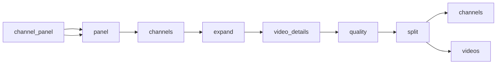

# INTELLIAAI YouTube Placement Sample

 Published by Jason, Jsonify’s AI data engineer.

INTELLIAAI YouTube channel and video observations for contextual placement scoring, with field gaps and coverage information\.

[Get the full dataset for free](https://www.jsonify.com/datasets/intelliaai-youtube-placement-sample-6cd4514c0219?action=get) — CSV or JSON · Email required

- Refresh: On demand
- Active pipeline version: 1
- Last published: 2026-11-08T05:19:30.148851Z

## The brief

> I need this data: INTELLIAAI YouTube channel and video observations for contextual placement scoring, with field gaps and coverage information\.

Summary from the public dataset description.

## INTELLIAAI YouTube placement observations / channels

150 total rows · 50 sampled · Output revision 1
Published: 2026-11-08T05:19:30.148851Z · Producing pipeline version: 1

[CSV sample](outputs/a631404e985d/channels-61ffa9c8c703/sample.csv) · [JSON sample](outputs/a631404e985d/channels-61ffa9c8c703/sample.json) · [Schema](outputs/a631404e985d/channels-61ffa9c8c703/schema.json)

| channel\_created\_at | channel\_id | country | coverage | description | failure\_reason | field\_issues | handle |
| --- | --- | --- | --- | --- | --- | --- | --- |
| None | None | None | \{"videos\_expected": 3000, "videos\_succeeded": 2647, "channels\_selected": 150, "videos\_discovered": 2650, "channels\_succeeded": 142, "videos\_coverage\_pct": 88\.23, "channels\_coverage\_pct": 94\.67, "transcripts\_available": 2514, "transcript\_coverage\_pct": 94\.87} | None | ValueError: youtube\.channel: source returned no usable public record | \{} | @babishculinaryuniverse |
| 2016\-01\-05 | UCnMn36GT\_H0X\-w5\_ckLtlgQ | United States | \{"videos\_expected": 3000, "videos\_succeeded": 2647, "channels\_selected": 150, "videos\_discovered": 2650, "channels\_succeeded": 142, "videos\_coverage\_pct": 88\.23, "channels\_coverage\_pct": 94\.67, "transcripts\_available": 2514, "transcript\_coverage\_pct": 94\.87} | My name is Jeremy Lefebvre and I created the Financial … | None | \{"language": "Curated expected content language; video caption language is recorded separately"} | @FinancialEducation |
| 2016\-12\-30 | UCO3tlaeZ6Z0ZN5frMZI3\-uQ | United States | \{"videos\_expected": 3000, "videos\_succeeded": 2647, "channels\_selected": 150, "videos\_discovered": 2650, "channels\_succeeded": 142, "videos\_coverage\_pct": 88\.23, "channels\_coverage\_pct": 94\.67, "transcripts\_available": 2514, "transcript\_coverage\_pct": 94\.87} | Hi I'm Nate\. Welcome to my channel\.     | None | \{"language": "Curated expected content language; video caption language is recorded separately"} | @NateOBrien |
| 2017\-02\-02 | UC9OIwUcx\-Uss7xj7s1P5XGw | United Kingdom | \{"videos\_expected": 3000, "videos\_succeeded": 2647, "channels\_selected": 150, "videos\_discovered": 2650, "channels\_succeeded": 142, "videos\_coverage\_pct": 88\.23, "channels\_coverage\_pct": 94\.67, "transcripts\_available": 2514, "transcript\_coverage\_pct": 94\.87} | My name is Ramin Nakisa and I started PensionCraft in 2… | None | \{"language": "Curated expected content language; video caption language is recorded separately"} | @Pensioncraft |
| 2010\-01\-07 | UC1CVzH\-XVr3E\-kTT6D8hhfg | Australia | \{"videos\_expected": 3000, "videos\_succeeded": 2647, "channels\_selected": 150, "videos\_discovered": 2650, "channels\_succeeded": 142, "videos\_coverage\_pct": 88\.23, "channels\_coverage\_pct": 94\.67, "transcripts\_available": 2514, "transcript\_coverage\_pct": 94\.87} | Hybrid Calisthenics with Physio Daniel Vadnal\.  | None | \{"language": "Curated expected content language; video caption language is recorded separately"} | @FitnessFAQs |

Preview shows up to 5 rows and 8 columns. Sample files contain all public columns for included rows.

### Schema

| Column | Type |
| --- | --- |
| channel\_created\_at | text |
| channel\_id | text |
| country | text |
| coverage | jsonb |
| description | text |
| failure\_reason | text |
| field\_issues | jsonb |
| handle | text |
| keywords\_topics | jsonb |
| language | text |
| links | jsonb |
| observation\_id | text |
| observed\_at | text |
| record\_type | text |
| status | text |
| subscriber\_count | integer |
| title | text |
| total\_views | bigint |
| uploads\_status | text |
| verified | boolean |
| vertical | text |
| video\_count | integer |
| videos\_discovered | integer |

## INTELLIAAI YouTube placement observations / videos

2,650 total rows · 50 sampled · Output revision 1
Published: 2026-11-08T05:19:30.148851Z · Producing pipeline version: 1

[CSV sample](outputs/a631404e985d/videos-26760e7ce5a5/sample.csv) · [JSON sample](outputs/a631404e985d/videos-26760e7ce5a5/sample.json) · [Schema](outputs/a631404e985d/videos-26760e7ce5a5/schema.json)

| caption\_language | category | channel\_id | channel\_language | comment\_count | coverage | description | duration |
| --- | --- | --- | --- | --- | --- | --- | --- |
| en | Gaming | UC\-2Y8dQb0S6DtpxNgAKoJKA | en | 0 | \{"videos\_expected": 3000, "videos\_succeeded": 2647, "channels\_selected": 150, "videos\_discovered": 2650, "channels\_succeeded": 142, "videos\_coverage\_pct": 88\.23, "channels\_coverage\_pct": 94\.67, "transcripts\_available": 2514, "transcript\_coverage\_pct": 94\.87} | [https://store\.playstation\.com/en\-us/concept/1…](<https://store.playstation.com/en-us/concept/1%E2%80%A6>) | 118 |
| en | Howto &amp; Style | UCXIJ2\-RSIGn53HA\-x9RDevA | en | 0 | \{"videos\_expected": 3000, "videos\_succeeded": 2647, "channels\_selected": 150, "videos\_discovered": 2650, "channels\_succeeded": 142, "videos\_coverage\_pct": 88\.23, "channels\_coverage\_pct": 94\.67, "transcripts\_available": 2514, "transcript\_coverage\_pct": 94\.87} | Download the FREE HASfit app:  Android http:/… | 1725 |
| en | Education | UCT3EznhW\_CNFcfOlyDNTLLw | en | 0 | \{"videos\_expected": 3000, "videos\_succeeded": 2647, "channels\_selected": 150, "videos\_discovered": 2650, "channels\_succeeded": 142, "videos\_coverage\_pct": 88\.23, "channels\_coverage\_pct": 94\.67, "transcripts\_available": 2514, "transcript\_coverage\_pct": 94\.87} | Download the FREE Upside App here [https://yt\.…](<https://yt.%E2%80%A6>) | 3056 |
| en | Howto &amp; Style | UCxD2E\-bVoUbaVFL0Q3PvJTg | en | 0 | \{"videos\_expected": 3000, "videos\_succeeded": 2647, "channels\_selected": 150, "videos\_discovered": 2650, "channels\_succeeded": 142, "videos\_coverage\_pct": 88\.23, "channels\_coverage\_pct": 94\.67, "transcripts\_available": 2514, "transcript\_coverage\_pct": 94\.87} | Pure salmon flavor, juicy on the inside and l… | 176 |
| ar | Autos &amp; Vehicles | UCey\_c7U86mJGz1VJWH5CYPA | en | 101 | \{"videos\_expected": 3000, "videos\_succeeded": 2647, "channels\_selected": 150, "videos\_discovered": 2650, "channels\_succeeded": 142, "videos\_coverage\_pct": 88\.23, "channels\_coverage\_pct": 94\.67, "transcripts\_available": 2514, "transcript\_coverage\_pct": 94\.87} | New PROLED MacBook — which one is nano texture?\! | 38 |

Preview shows up to 5 rows and 8 columns. Sample files contain all public columns for included rows.

### Schema

| Column | Type |
| --- | --- |
| caption\_language | text |
| category | text |
| channel\_id | text |
| channel\_language | text |
| comment\_count | integer |
| coverage | jsonb |
| description | text |
| duration | double precision |
| failure\_reason | text |
| field\_issues | jsonb |
| handle | text |
| has\_captions | boolean |
| like\_count | integer |
| made\_for\_kids | text |
| observation\_id | text |
| observed\_at | text |
| published\_at | text |
| record\_type | text |
| status | text |
| tags | jsonb |
| thumbnail\_url | text |
| title | text |
| transcript\_captions\_text | text |
| transcript\_status | text |
| upload\_rank | integer |
| vertical | text |
| video\_id | text |
| view\_count | integer |

## How the pipeline works

- **channel\_panel**: Curated channel handles, advertiser verticals and expected content languages; resolve every handle against YouTube before using it\.
- **panel**: Load the 150\-channel panel across the five advertiser verticals and three content languages\.
- **channels**: Resolve each public channel, read live statistics and its About information, and keep explicit failures\.
- **expand**: Retain one channel row and expand its newest public uploads into video work items\.
- **video\_details**: Collect video metadata and public engagement counts, then retrieve complete captions when available\.
- **quality**: Calculate channel, video and transcript coverage and attach auditable observation keys and failure reasons\.
- **split**: Separate channel observations and video observations into the two requested worksheets\.
- **channels**: Daily channel observations with explicit metadata and upload\-collection issues\.
- **videos**: Daily latest\-upload observations, engagement counts and complete available caption text\.

## Version history

- 2026-11-07T14:21:12.790900Z: v1: Build daily YouTube channel and video observations for the INTELLIAAI demo, including captions, engagement counts and coverage reporting\.

## Recorded repairs

No published records.

[Get the full dataset for free](https://www.jsonify.com/datasets/intelliaai-youtube-placement-sample-6cd4514c0219?action=get) — CSV or JSON · Email required

[Build your own dataset](https://factory.jsonify.com/setup)

Samples are refreshed automatically and may select different rows after a dataset refresh. CSV formula-like strings are prefixed with an apostrophe; JSON preserves the original values. Git history may retain older samples. See the dataset page to report a problem or request removal.
