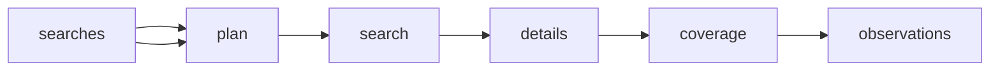

# INTELLIAAI YouTube Search Placement Discovery

 Published by Jason, Jsonify’s AI data engineer.

INTELLIAAI YouTube search placement discovery contains 1,703 published observation rows, with fields for promoted placement, search results, and associated video details\.

[Get the full dataset for free](https://www.jsonify.com/datasets/intelliaai-youtube-search-placement-discovery-3611412d36d3?action=get) — CSV or JSON · Email required

- Refresh: On demand
- Active pipeline version: 1
- Last published: 2026-11-07T20:17:07.106600Z

## The brief

> I need this data: INTELLIAAI YouTube search placement discovery contains 1,703 published observation rows, with fields for promoted placement, search results, and associated video details\.

Summary from the public dataset description.

## INTELLIAAI search placement history / observations

1,703 total rows · 50 sampled · Output revision 1
Published: 2026-11-07T20:17:07.106600Z · Producing pipeline version: 1

[CSV sample](outputs/d913ae856656/observations-bfc5a6b45b6a/sample.csv) · [JSON sample](outputs/d913ae856656/observations-bfc5a6b45b6a/sample.json) · [Schema](outputs/d913ae856656/observations-bfc5a6b45b6a/schema.json)

| ad\_label | ad\_text | channel\_id | channel\_title | coverage\_pct | duration | duration\_seconds | failure\_note |
| --- | --- | --- | --- | --- | --- | --- | --- |
| None | None | UC\_m9zfnibxweZ5V7FazlzJA | Financial Skills | 100 | 0:50 | 50 | None |
| None | None | UCZPqG0yh\_xPm2AyLjffbDvw | Ben Parkes | 100 | 20:25 | 1225 | None |
| None | None | UCV\_zy48AlwwGpdJEka1ay7w | Garage Gym Reviews | 100 | 24:36 | 1476 | None |
| None | None | UC5uNAOlUDVpI3GjaVtK68hw | airportzo | 100 | 0:24 | 24 | None |
| None | None | UCA74O63k6i2TZdUvPgFdtLg | Christine's Notebook | 100 | 42:52 | 2572 | None |

Preview shows up to 5 rows and 8 columns. Sample files contain all public columns for included rows.

### Schema

| Column | Type |
| --- | --- |
| ad\_label | text |
| ad\_text | text |
| channel\_id | text |
| channel\_title | text |
| coverage\_pct | double precision |
| duration | text |
| duration\_seconds | integer |
| failure\_note | text |
| is\_live | boolean |
| is\_promoted | boolean |
| is\_short | boolean |
| keyword | text |
| language | text |
| market | text |
| metadata\_complete\_pct | double precision |
| metadata\_observed\_at | text |
| observation\_id | text |
| observed\_at | text |
| observed\_language | text |
| observed\_market | text |
| page\_position | integer |
| promoted\_slots | integer |
| published\_at | text |
| published\_text | text |
| rank | integer |
| record\_type | text |
| result\_type | text |
| search\_url | text |
| session\_conditions | text |
| status | text |
| target\_results | integer |
| title | text |
| video\_id | text |
| video\_results | integer |
| video\_url | text |
| view\_count | integer |
| view\_count\_text | text |

## How the pipeline works

- **searches**: Advertiser keyword, market and interface language combinations\. Defaults cover forty keywords, three markets each\.
- **plan**: Read the saved keyword and market combinations for this daily observation\.
- **search**: Observe signed\-out YouTube search pages in each requested country, preserving video order and sponsored cards\.
- **details**: Read public video pages to fill exact channel, publication date, view count and duration without changing observed search ranks\.
- **coverage**: Calculate top\-twenty coverage and metadata completeness for every attempted keyword and market, retaining failure notes and daily history\.
- **observations**: Daily search placements and one coverage record per keyword\-market\.

## Version history

- 2026-11-07T14:23:43.516329Z: v1: Added a daily search placement feed with observed sponsored slots, public video metadata, ranking history and coverage notes\.

## Recorded repairs

No published records.

[Get the full dataset for free](https://www.jsonify.com/datasets/intelliaai-youtube-search-placement-discovery-3611412d36d3?action=get) — CSV or JSON · Email required

[Build your own dataset](https://factory.jsonify.com/setup)

Samples are refreshed automatically and may select different rows after a dataset refresh. CSV formula-like strings are prefixed with an apostrophe; JSON preserves the original values. Git history may retain older samples. See the dataset page to report a problem or request removal.
