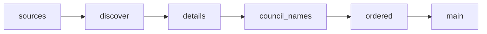

# Irish Planning Applications and EIA Notices: Energy, Grid and Large Developments

 Published by Jason, Jsonify’s AI data engineer.

Ireland\-wide dataset of 199 planning application and EIA notice records covering energy, grid works and large developments\. Applicant names taken from council planning register pages remain subject to each council's terms and are not covered by CC BY 4\.0; see applicant\_licence\_note on each row\.

[Get the full dataset for free](https://www.jsonify.com/datasets/irish-planning-applications-and-eia-notices-energy-grid-and-bb56b2ca6961?action=get) — CSV or JSON · Email required

- Refresh: On demand
- Active pipeline version: 4
- Last published: 2026-11-19T11:37:54.150703Z

## The brief

> I need this data: Ireland\-wide dataset of 199 planning application and EIA notice records covering energy, grid works and large developments\. Applicant names taken from council planning register pages remain subject to each council's terms and are not covered by CC BY 4\.0; see applicant\_licence\_note on each row\.

Summary from the public dataset description.

## Irish Planning Applications and EIA Notices: Energy, Grid and Large Developments / main

199 total rows · 50 sampled · Output revision 5
Published: 2026-11-19T11:37:54.150703Z · Producing pipeline version: 4

[CSV sample](outputs/41f1dd9a16cd/main-0d6e4079e367/sample.csv) · [JSON sample](outputs/41f1dd9a16cd/main-0d6e4079e367/sample.json) · [Schema](outputs/41f1dd9a16cd/main-0d6e4079e367/schema.json)

| applicant | applicant\_licence\_note | applicant\_source | authority | authority\_reference | captured\_date | decision | decision\_date |
| --- | --- | --- | --- | --- | --- | --- | --- |
| Boolyvannanan Renewable Ltd | EIA Portal \(open licence\) | EIA Portal | Carlow County Council | None | 2026\-11\-19 | None | None |
| None | Not available: council page not accessible | None | Cork County Council | None | 2026\-11\-19 | None | None |
| Darcoll Limited | Council planning register page; public statutory record, open reuse licence not confirmed | Council planning register page | Clare County Council | None | 2026\-11\-19 | None | None |
| Uisce Éireann | Council planning register page; public statutory record, open reuse licence not confirmed | Council planning register page | Cavan County Council | None | 2026\-11\-19 | None | None |
| None | Not available: council page not accessible | None | Cork County Council | None | 2026\-11\-19 | None | None |

Preview shows up to 5 rows and 8 columns. Sample files contain all public columns for included rows.

### Schema

| Column | Type |
| --- | --- |
| applicant | text |
| applicant\_licence\_note | text |
| applicant\_source | text |
| authority | text |
| authority\_reference | text |
| captured\_date | text |
| decision | text |
| decision\_date | text |
| decision\_due\_date | text |
| description | text |
| grant\_date | text |
| location | text |
| notes | text |
| received\_date | text |
| record\_type | text |
| reference | text |
| sector | text |
| source | text |
| source\_updated\_date | text |
| status | text |
| uploaded\_date | text |
| url | text |

## How the pipeline works

- **sources**: Select the national planning database and EIA Portal open\-data feeds\.
- **discover**: Read current official feeds and select 150 sector\-balanced planning applications and 50 newest EIA notices\.
- **details**: Use official planning and EIA records for applicant names and retain correctly labelled EIA upload dates\.
- **council\_names**: Restore applicants from accessible public council pages without attempting Cork or rejected Agile pages\.
- **ordered**: Redact all\-natural\-person applicants and merge duplicate EIA project notices, retaining all merged references in notes\.
- **main**: Irish planning applications and EIA notice sample in the original schema\.

## Version history

- 2026-11-19T09:59:08.589773Z: v1: Refresh the 200\-row Irish sample using official open\-licensed feeds, recover names from South Dublin and Galway registers and exact EIA matches, and preserve EIA upload\-date meaning\.
- 2026-11-19T10:11:04.509647Z: v2: Corrected a conflicting Cork applicant match and recovered names explicitly stated in the planning descriptions\. EIA matches now also require corroborating locations\.
- 2026-11-19T10:19:41.615591Z: v3: Excluded a single\-home application whose floor\-area value incorrectly repeated its reference number\. Added notes clarifying that grid records may include ancillary substation works\.
- 2026-11-19T11:30:45.412682Z: v4: Restored applicants from accessible public council registers and added per\-row source licence notes\. All\-private\-individual applicants use the requested redaction text, mixed applicants remain as published, and identical EIA project notifications are consolidated\.

## Recorded repairs

No published records.

[Get the full dataset for free](https://www.jsonify.com/datasets/irish-planning-applications-and-eia-notices-energy-grid-and-bb56b2ca6961?action=get) — CSV or JSON · Email required

[Build your own dataset](https://factory.jsonify.com/setup)

Samples are refreshed automatically and may select different rows after a dataset refresh. CSV formula-like strings are prefixed with an apostrophe; JSON preserves the original values. Git history may retain older samples. See the dataset page to report a problem or request removal.
