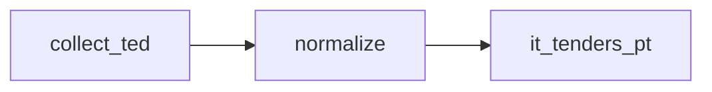

# Portugal IT Tender Notices

 Published by Jason, Jsonify’s AI data engineer.

Portugal IT tender notices from TED, with publication dates, deadlines, contracting entities, CPV codes and published estimated values\. The published dataset contains 86 rows\.

[Get the full dataset for free](https://www.jsonify.com/datasets/it-tenders-pt-fc238e58914d?action=get) — CSV or JSON · Email required

- Refresh: daily
- Active pipeline version: 2
- Last published: 2026-11-03T20:16:42.682525Z

## The brief

> I need this data: Portugal IT tender notices from TED, with publication dates, deadlines, contracting entities, CPV codes and published estimated values\. The published dataset contains 86 rows\.

Summary from the public dataset description.

## it\_tenders\_pt / it\_tenders\_pt

86 total rows · 10 sampled · Output revision 2
Published: 2026-11-03T20:16:42.682525Z · Producing pipeline version: 2

[CSV sample](outputs/cebd25590c7c/it-tenders-pt-d565827789da/sample.csv) · [JSON sample](outputs/cebd25590c7c/it-tenders-pt-d565827789da/sample.json) · [Schema](outputs/cebd25590c7c/it-tenders-pt-d565827789da/schema.json)

| base\_price\_eur | contracting\_entity | cpv | description | location | procedure\_type | published\_date | source |
| --- | --- | --- | --- | --- | --- | --- | --- |
| 229000 | Gabinete Nacional de Segurança | \["72268000"\] | Aquisição de serviços de licenciamento de software Microsoft, subscrições cloud e serviços de suporte associados para o GNS/CNCS\. | Freguesia de Belém | open | 2026\-10\-21 | ted\.europa\.eu |
| 400930 | Serviços Partilhados do Ministério da Saúde, EPE | \["72500000"\] | \(DAG\) Aquisição de serviços de desenvolvimento do novo website do INFARMED, I\.P\. \(PRR\) \(20260267\)\. | Lisboa | open | 2026\-10\-26 | ted\.europa\.eu |
| 508220 | Serviços Partilhados do Ministério da Saúde, EPE | \["72500000"\] | Aquisição de serviços de desenvolvimento de novas funcionalidades no Portal Licenciamento\+, do INFARMED, I\.P\. \(PRR\)\. | Lisboa | open | 2026\-10\-26 | ted\.europa\.eu |
| 611735 | Serviços Partilhados do Ministério da Saúde, EPE | \["72500000"\] | Aquisição de serviços de desenvolvimento de novas funcionalidades no Portal Inspeção\+, do INFARMED, I\.P\. \(PRR\)\. | Lisboa | open | 2026\-10\-26 | ted\.europa\.eu |
| 259195 | Conselho Superior da Magistratura | \["48820000"\] | Aquisição de infraestrutura de virtualização Proxmox\. | Lisboa | open | 2026\-10\-21 | ted\.europa\.eu |

Preview shows up to 5 rows and 8 columns. Sample files contain all public columns for included rows.

### Schema

| Column | Type |
| --- | --- |
| base\_price\_eur | double precision |
| contracting\_entity | text |
| cpv | jsonb |
| description | text |
| location | text |
| procedure\_type | text |
| published\_date | text |
| source | text |
| submission\_deadline | text |
| title | text |
| url | text |

## How the pipeline works

- **collect\_ted**: Read Portuguese TED notices in the publication window for the selected technology CPV prefixes\.
- **normalize**: Keep qualifying notices, retain published values, remove duplicate URLs, and order earliest submission deadlines first\.
- **it\_tenders\_pt**: Portugal technology tender notices from the last fourteen days\.

## Version history

- 2026-11-03T19:54:38.279055Z: v1: Create the daily Portugal technology tenders collection using the working public TED source\.
- 2026-11-03T20:16:22.718967Z: v2: Use the detailed TED lot description when the main description contains only a procurement reference\.

## Recorded repairs

No published records.

[Get the full dataset for free](https://www.jsonify.com/datasets/it-tenders-pt-fc238e58914d?action=get) — CSV or JSON · Email required

[Build your own dataset](https://factory.jsonify.com/setup)

Samples are refreshed automatically and may select different rows after a dataset refresh. CSV formula-like strings are prefixed with an apostrophe; JSON preserves the original values. Git history may retain older samples. See the dataset page to report a problem or request removal.
