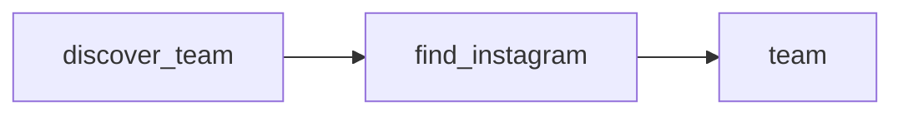

# Jivamukti Yoga Barcelona Team and Instagram Directory

 Published by Jason, Jsonify’s AI data engineer.

A directory of Jivamukti Yoga Barcelona team members, with profile details and Instagram account information where identified\.

[Get the full dataset for free](https://www.jsonify.com/datasets/jivamukti-barcelona-team-instagram-5f425fa222f9?action=get) — CSV or JSON · Email required

- Refresh: On demand
- Active pipeline version: 1
- Last published: 2026-10-23T15:24:45.459748Z

## The brief

> I need this data: A directory of Jivamukti Yoga Barcelona team members, with profile details and Instagram account information where identified\.

Summary from the public dataset description.

## Jivamukti Barcelona Team / team

8 total rows · 8 sampled · Output revision 1
Published: 2026-10-23T15:24:45.459748Z · Producing pipeline version: 1

[CSV sample](outputs/6844053b9c68/team-ca8b22d0db83/sample.csv) · [JSON sample](outputs/6844053b9c68/team-ca8b22d0db83/sample.json) · [Schema](outputs/6844053b9c68/team-ca8b22d0db83/schema.json)

| checked\_at | evidence\_url | full\_name | instagram\_handle | instagram\_source | instagram\_url | match\_note | name |
| --- | --- | --- | --- | --- | --- | --- | --- |
| 2026\-10\-23T15:24:09\.025285\+00:00 | [https://jivamuktiyogabarcelona\.com/team/karina/](<https://jivamuktiyogabarcelona.com/team/karina/>) | Karina | @karina\_seainside | studio profile | [https://www\.instagram\.com/karina\_seainside/](<https://www.instagram.com/karina_seainside/>) | Personal Instagram linked from the studio biography\. | Karina |
| 2026\-10\-23T15:24:22\.676705\+00:00 | [https://jivamuktiyogabarcelona\.com/team/gianni/](<https://jivamuktiyogabarcelona.com/team/gianni/>) | Gianni | @giannisarracino | studio profile | [https://www\.instagram\.com/giannisarracino/](<https://www.instagram.com/giannisarracino/>) | Personal Instagram linked from the studio biography\. | Gianni |
| 2026\-10\-23T15:24:36\.169574\+00:00 | [https://jivamuktiyogabarcelona\.com/team/carlota/](<https://jivamuktiyogabarcelona.com/team/carlota/>) | Carlota | @anandayoga\.\_\_\_ | studio profile | [https://www\.instagram\.com/anandayoga\.\_\_\_/](<https://www.instagram.com/anandayoga.___/>) | Personal Instagram linked from the studio biography\. | Carlota |
| 2026\-10\-23T15:24:18\.766163\+00:00 | [https://www\.instagram\.com/olga\.oskorbina?hl=en](<https://www.instagram.com/olga.oskorbina?hl=en>) | Olga Oskorbina | @olga\.oskorbina | web search | [https://www\.instagram\.com/olga\.oskorbina/](<https://www.instagram.com/olga.oskorbina/>) | The account is named Olga Oskorbina and its bio identifies her as a yoga practitioner with Jivamukti and \#yogabarcelona context, matching the teacher\. | Olga |
| 2026\-10\-23T15:24:20\.209508\+00:00 | [https://jivamuktiyogabarcelona\.com/team/mitch/](<https://jivamuktiyogabarcelona.com/team/mitch/>) | Mitch | @mitch\_burnett | studio profile | [https://www\.instagram\.com/mitch\_burnett/](<https://www.instagram.com/mitch_burnett/>) | Personal Instagram linked from the studio biography\. | Mitch |

Preview shows up to 5 rows and 8 columns. Sample files contain all public columns for included rows.

### Schema

| Column | Type |
| --- | --- |
| checked\_at | text |
| evidence\_url | text |
| full\_name | text |
| instagram\_handle | text |
| instagram\_source | text |
| instagram\_url | text |
| match\_note | text |
| name | text |
| profile\_url | text |
| qualification | text |
| team\_url | text |

## How the pipeline works

- **discover\_team**: Follow the studio homepage's Team link and read every teacher card on its team page\.
- **find\_instagram**: Check each teacher biography for a personal Instagram, then search the web for missing accounts with identity matching\.
- **team**: Current studio team members with their personal Instagram links and supporting evidence\.

## Version history

- 2026-10-23T15:22:23.070383Z: v1: Added the Barcelona studio team list with personal Instagram links, using web search when the biography has no link\.

## Recorded repairs

No published records.

[Get the full dataset for free](https://www.jsonify.com/datasets/jivamukti-barcelona-team-instagram-5f425fa222f9?action=get) — CSV or JSON · Email required

[Build your own dataset](https://factory.jsonify.com/setup)

Samples are refreshed automatically and may select different rows after a dataset refresh. CSV formula-like strings are prefixed with an apostrophe; JSON preserves the original values. Git history may retain older samples. See the dataset page to report a problem or request removal.
