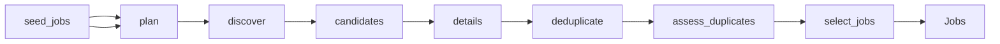

# Job Postings and Stated Salaries

 Published by Jason, Jsonify’s AI data engineer.

Job postings and stated salaries with source links, salary periods, and annualised pay fields\.

[Get the full dataset for free](https://www.jsonify.com/datasets/job-postings-and-stated-salaries-09031248db8e?action=get) — CSV or JSON · Email required

- Refresh: On demand
- Active pipeline version: 2
- Last published: 2026-11-10T23:01:24.664973Z

## The brief

> I need this data: Job postings and stated salaries with source links, salary periods, and annualised pay fields\.

Summary from the public dataset description.

## ValuMe stated\-salary job benchmarks / Jobs

454 total rows · 50 sampled · Output revision 3
Published: 2026-11-10T23:01:24.664973Z · Producing pipeline version: Unknown

[CSV sample](outputs/2bc6358e576d/jobs-2f17a0f8d518/sample.csv) · [JSON sample](outputs/2bc6358e576d/jobs-2f17a0f8d518/sample.json) · [Schema](outputs/2bc6358e576d/jobs-2f17a0f8d518/schema.json)

| annualisation\_basis | annualised\_salary\_max | annualised\_salary\_min | canonical\_job\_id | collected\_at | company | compensation\_notes | country |
| --- | --- | --- | --- | --- | --- | --- | --- |
| Stated annual salary | 85000 | 60000 | e58f5d28d9b3c13f90a6477b | 2026\-11\-10T18:59:51\.064566\+00:00 | Orizon GmbH | The page also displays an estimated net salary of €37,561 to €50,675 net/year · Tax class I; this is an estimate based on the advertised gross salary\. | DE |
| Stated annual salary | 70000 | 45000 | 78c11e242946953d9d38fc3c | 2026\-11\-10T18:59:57\.529872\+00:00 | Vereinigte Hagelversicherung VVaG | Direct employer posting; salary fields displayed by the board\. Posting date unavailable; activation and creation dates are not substituted\. | DE |
| Stated annual salary | 90000 | 70000 | a66b24da14281e296cea4ed8 | 2026\-11\-10T19:01:51\.619330\+00:00 | ING Deutschland | Direct employer posting; salary fields displayed by the board\. Posting date unavailable; activation and creation dates are not substituted\. | DE |
| Stated annual salary | 68000 | 50000 | a324d64027691c7394adfcd0 | 2026\-11\-10T19:00:26\.900428\+00:00 | KontextWork | None | DE |
| Stated annual salary | 100000 | 70000 | b2179ed42c14431246ee67a3 | 2026\-11\-10T19:18:25\.662401\+00:00 | GermanTechJobs Talents | Direct employer posting; salary fields displayed by the board\. Posting date unavailable; activation and creation dates are not substituted\. | DE |

Preview shows up to 5 rows and 8 columns. Sample files contain all public columns for included rows.

### Schema

| Column | Type |
| --- | --- |
| annualisation\_basis | text |
| annualised\_salary\_max | double precision |
| annualised\_salary\_min | double precision |
| canonical\_job\_id | text |
| collected\_at | text |
| company | text |
| compensation\_notes | text |
| country | text |
| currency | text |
| employer\_job\_url | text |
| job\_id | text |
| location | text |
| period | text |
| posted\_date | text |
| requisition\_id | text |
| role\_family | text |
| salary\_basis | text |
| salary\_evidence | text |
| salary\_evidence\_url | text |
| salary\_max | double precision |
| salary\_min | double precision |
| salary\_payments\_per\_year | numeric |
| salary\_period\_evidence | text |
| seniority | text |
| skills | jsonb |
| source | text |
| source\_urls | jsonb |
| title | text |
| url | text |
| work\_arrangement | text |

## How the pipeline works

- **seed\_jobs**: The original sample supplies all source domains and seed links\. Every job is recollected; old salary values are never reused\.
- **plan**: Build discovery tasks for every source in the saved sample and five UK role searches\.
- **discover**: Read live salary\-board inventories, Reed search pages, and public search results for the remaining sample sources\.
- **candidates**: Combine freshly discovered links with the sample seeds, remove repeated URLs, and interleave sources for balanced checking\.
- **details**: Reopen each exact posting, reject estimated or undisclosed pay, and capture the advertised salary, skills and identity evidence\.
- **deduplicate**: Identify bounded duplicate candidates using employer, country, exact references, titles, locations and description overlap\.
- **assess\_duplicates**: Resolve each potential duplicate using matching distinctive source facts, preserving ambiguous or genuinely different vacancies\.
- **select\_jobs**: Merge verified reposts, retain their source links and compensation differences, and select the requested balanced sample\.
- **Jobs**: Distinct current jobs with stated salary, raw and annualised pay, and source evidence\.

## Version history

- 2026-11-10T18:57:24.094216Z: v1: Added a saved all\-source job collection with stated\-salary checks, raw and annualised pay, skills and cross\-board duplicate handling\.
- 2026-11-10T23:00:38.963775Z: v2: Excludes paid training programmes, corrects salary and location conflicts, and merges corroborated reposts while preserving distinct jobs and source links\.

## Recorded repairs

No published records.

[Get the full dataset for free](https://www.jsonify.com/datasets/job-postings-and-stated-salaries-09031248db8e?action=get) — CSV or JSON · Email required

[Build your own dataset](https://factory.jsonify.com/setup)

Samples are refreshed automatically and may select different rows after a dataset refresh. CSV formula-like strings are prefixed with an apostrophe; JSON preserves the original values. Git history may retain older samples. See the dataset page to report a problem or request removal.
