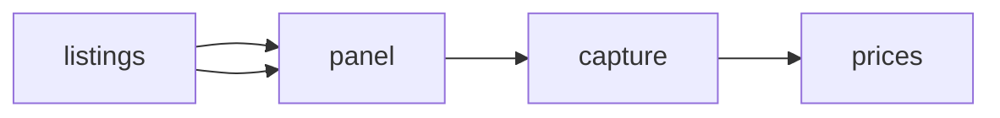

# K\-Beauty Daily Price Tracker

 Published by Jason, Jsonify’s AI data engineer.

K\-beauty price records with capture dates, retailer, product, price, advertised discount, and stock fields\. The published dataset contains 29 price observations\.

[Get the full dataset for free](https://www.jsonify.com/datasets/k-beauty-daily-price-tracker-05b714f9dbe0?action=get) — CSV or JSON · Email required

- Refresh: daily
- Active pipeline version: 3
- Last published: 2026-11-21T21:16:46.007291Z

## The brief

> I need this data: K\-beauty price records with capture dates, retailer, product, price, advertised discount, and stock fields\. The published dataset contains 29 price observations\.

Summary from the public dataset description.

## K\-beauty Daily Price History / prices

29 total rows · 10 sampled · Output revision 3
Published: 2026-11-21T21:16:46.007291Z · Producing pipeline version: 3

[CSV sample](outputs/36aefab1c219/prices-fe81f9390ffe/sample.csv) · [JSON sample](outputs/36aefab1c219/prices-fe81f9390ffe/sample.json) · [Schema](outputs/36aefab1c219/prices-fe81f9390ffe/schema.json)

| advertised\_discount\_pct | brand | capture\_date | capture\_time | currency | current\_price | in\_stock | list\_price |
| --- | --- | --- | --- | --- | --- | --- | --- |
| None | Anua | 2026\-11\-21 | 2026\-11\-21T21:10:36\+00:00 | USD | 17 | True | 20 |
| 37 | Anua | 2026\-11\-21 | 2026\-11\-21T21:11:19\+00:00 | USD | 12\.6 | True | None |
| 20 | Anua | 2026\-11\-21 | 2026\-11\-21T21:10:37\+00:00 | USD | 22\.99 | True | 28\.88 |
| None | Round Lab | 2026\-11\-21 | 2026\-11\-21T21:10:36\+00:00 | USD | 19\.6 | True | 28 |
| 30 | Round Lab | 2026\-11\-21 | 2026\-11\-21T21:10:32\+00:00 | USD | 19\.6 | True | 28 |

Preview shows up to 5 rows and 8 columns. Sample files contain all public columns for included rows.

### Schema

| Column | Type |
| --- | --- |
| advertised\_discount\_pct | double precision |
| brand | text |
| capture\_date | text |
| capture\_time | text |
| currency | text |
| current\_price | double precision |
| in\_stock | boolean |
| list\_price | double precision |
| observation\_key | text |
| product | text |
| product\_key | text |
| product\_url | text |
| retailer | text |
| size | text |

## How the pipeline works

- **listings**: Exact product and size pages selected from the twelve\-product panel\.
- **panel**: Load the selected single\-unit product pages\.
- **capture**: Read fresh public product pages, reject size and product mismatches, and capture displayed prices and stock\.
- **prices**: Daily single\-unit displayed prices\. Advertised discounts are retailer claims, not verified savings versus historical prices\.

## Version history

- 2026-11-21T20:24:23.995084Z: v1: Created daily exact\-size K\-beauty price tracking with retained history and brand\-seller checks on Amazon\.
- 2026-11-21T20:35:45.876798Z: v2: Excluded first\-order coupon banners from advertised product discounts\.
- 2026-11-21T21:10:23.903213Z: v3: Replaced Round Lab Dokdo toner in future captures with Birch Juice sunscreen and added exact UTC capture times\. Existing history is retained\.

## Recorded repairs

No published records.

[Get the full dataset for free](https://www.jsonify.com/datasets/k-beauty-daily-price-tracker-05b714f9dbe0?action=get) — CSV or JSON · Email required

[Build your own dataset](https://factory.jsonify.com/setup)

Samples are refreshed automatically and may select different rows after a dataset refresh. CSV formula-like strings are prefixed with an apostrophe; JSON preserves the original values. Git history may retain older samples. See the dataset page to report a problem or request removal.
