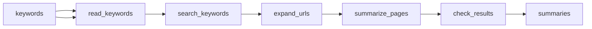

# Keyword Search Results and Page Summaries

 Published by Jason, Jsonify’s AI data engineer.

Explore keyword search results with page titles, URLs, summaries, search ranks, and status fields, including records for unavailable pages and keywords with no results\.

[Get the full dataset for free](https://www.jsonify.com/datasets/keyword-search-and-url-summaries-3630558f97ed?action=get) — CSV or JSON · Email required

- Refresh: On demand
- Active pipeline version: 1
- Last published: 2026-10-29T11:31:03.092480Z

## The brief

> I need this data: Explore keyword search results with page titles, URLs, summaries, search ranks, and status fields, including records for unavailable pages and keywords with no results\.

Summary from the public dataset description.

## Keyword search summaries / summaries

2 total rows · 2 sampled · Output revision 1
Published: 2026-10-29T11:31:03.092480Z · Producing pipeline version: 1

[CSV sample](outputs/d4d28abd141a/summaries-c626a992e31b/sample.csv) · [JSON sample](outputs/d4d28abd141a/summaries-c626a992e31b/sample.json) · [Schema](outputs/d4d28abd141a/summaries-c626a992e31b/schema.json)

| keyword | result\_url | result\_title | search\_rank | summary | status | error |
| --- | --- | --- | --- | --- | --- | --- |
| urban gardening | [https://www\.frontiersin\.org/journals/horticulture/articles/10\.3389/fhort\.2025\.1651999/full](<https://www.frontiersin.org/journals/horticulture/articles/10.3389/fhort.2025.1651999/full>) | Environmental and social drivers of urban garden biodiversity: a PRISMA\-ScR review | 1 | This scoping review synthesizes 30 studies on how environmental conditions and gardeners’ social and management choices shape biodiversity in urban gardens\. Larger, structurally diverse gardens with varied plants and connections to natural habitats often support more species, while intensive maintenance and pesticide use can harm biodiversity; the authors note geographic and taxonomic gaps and call for integrated, inclusive garden planning and further research\. | summarized |  |
| urban gardening | [https://www\.climatehubs\.usda\.gov/hubs/international/topic/urban\-agriculture](<https://www.climatehubs.usda.gov/hubs/international/topic/urban-agriculture>) | Urban Agriculture | 2 | The USDA Climate Hubs page describes urban agriculture—from community gardens and rooftop farms to indoor growing—as a way to supplement local food supplies and support climate resilience\. It can shorten food supply chains and emissions, store carbon, reduce urban heat, improve food access and biodiversity, and strengthen community education, though land costs and limited city guidance can hinder its growth\. | summarized |  |

Preview shows up to 5 rows and 8 columns. Sample files contain all public columns for included rows.

### Schema

| Column | Type |
| --- | --- |
| keyword | text |
| result\_url | text |
| result\_title | text |
| search\_rank | integer |
| summary | text |
| status | text |
| error | text |

## How the pipeline works

- **keywords**: Editable dataset with a keyword column\. Blank rows are ignored and duplicate keywords are searched once\.
- **read\_keywords**: Read the keyword column, remove blank entries and combine duplicate keywords\.
- **search\_keywords**: Search the web for each keyword and keep up to the selected number of distinct result URLs\.
- **expand\_urls**: Turn search results into individual pages while keeping a visible record of keywords with no results\.
- **summarize\_pages**: Read each result page and write a concise summary grounded in that page, marking inaccessible pages clearly\.
- **check\_results**: Confirm that at least one discovered page was summarized and preserve unavailable\-page and no\-results records\.
- **summaries**: Latest keyword search results and source\-grounded page summaries, including explicit unavailable and no\-results records\.

## Version history

- 2026-10-29T11:30:23.476913Z: v1: Created an on\-demand keyword search pipeline with an editable keyword dataset, adjustable result counts and page summaries\. Unavailable pages and searches without results are shown explicitly\.

## Recorded repairs

No published records.

[Get the full dataset for free](https://www.jsonify.com/datasets/keyword-search-and-url-summaries-3630558f97ed?action=get) — CSV or JSON · Email required

[Build your own dataset](https://factory.jsonify.com/setup)

Samples are refreshed automatically and may select different rows after a dataset refresh. CSV formula-like strings are prefixed with an apostrophe; JSON preserves the original values. Git history may retain older samples. See the dataset page to report a problem or request removal.
