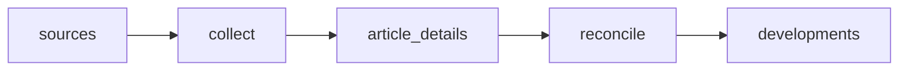

# KLM Public Developments Tracker

 Published by Jason, Jsonify’s AI data engineer.

Public KLM developments from official announcements, social posts and linked aviation press coverage\.

[Get the full dataset for free](https://www.jsonify.com/datasets/klm-public-developments-tracker-acce4cc9d302?action=get) — CSV or JSON · Email required

- Refresh: On demand
- Active pipeline version: 2
- Last published: 2026-11-28T11:13:48.978980Z

## The brief

> I need this data: Public KLM developments from official announcements, social posts and linked aviation press coverage\.

Summary from the public dataset description.

## KLM Public Developments Tracker / developments

144 total rows · 50 sampled · Output revision 3
Published: 2026-11-28T11:13:48.978980Z · Producing pipeline version: 2

[CSV sample](outputs/a30c17ca7933/developments-64a3d89bb490/sample.csv) · [JSON sample](outputs/a30c17ca7933/developments-64a3d89bb490/sample.json) · [Schema](outputs/a30c17ca7933/developments-64a3d89bb490/schema.json)

| event\_id | status | importance | source\_url | title | summary | category | published |
| --- | --- | --- | --- | --- | --- | --- | --- |
| 7f0f8d8dbe0514aba9017f80 | Material update | Medium | [https://news\.klm\.com/statement\-situation\-middle\-east/](<https://news.klm.com/statement-situation-middle-east/>) | KLM extends Dubai flight cancellations through March 27 and Riyadh and Dammam cancellations through November 27 | KLM will not operate flights between Amsterdam and Dubai through March 27, 2027, covering the entire winter season\. Flights to Riyadh and Dammam are cancelled through November 27, 2026\. KLM will notify affected passengers\. | Operations | 2026\-10\-26 |
| 00e4c7d18200b4acbd555c78 | Material update | Medium | [https://news\.klm\.com/statement\-situation\-middle\-east/](<https://news.klm.com/statement-situation-middle-east/>) | KLM extends flight cancellations to Riyadh and Dammam through March 14 | KLM extended cancellations of flights to Riyadh and Dammam from March 12 through March 14, inclusive\. | Operations | 2026\-03\-12 |
| 0f1f546f8e0deb19353ac3ab | New | Medium | [https://news\.klm\.com/klm\-welcomes\-passengers\-to\-grand\-cafe\-klm/](<https://news.klm.com/klm-welcomes-passengers-to-grand-cafe-klm/>) | KLM introduces Grand Café KLM onboard service concept on European flights | Starting in October, KLM will introduce Grand Café KLM, a new onboard service concept on European flights\. Passengers can pre\-order meals before departure, such as a poke bowl or Caesar salad, or select items from an onboard menu during the flight, such as a salmon egg wrap or yogurt with fruit and seeds\. KLM's complimentary offering remains available and includes coffee, tea, water, orange juice, and a stroopwafel\. KLM says the concept responds to a broader trend among European full\-service airlines and to travelers' growing desire for more choice and flexibility\. Earlier, KLM had said it was exploring a new catering model for Economy Class, and it has since run multiple testing phases at various destinations, evaluating both the product assortment and the supporting operational processes\. Bas Gerressen, EVP Inflight Services, said the concept gives passengers greater choice, more flexibility, and an offering that better reflects a wide range of preferences and needs\. The new food and drink options are for Economy Class passengers\. | Customer experience | 2026\-08\-10 |
| 5878ad96d9c8758ecceb6d68 | New | Medium | [https://news\.klm\.com/statement\-situation\-middle\-east/](<https://news.klm.com/statement-situation-middle-east/>) | KLM to resume Amsterdam–Tel Aviv flights on August 25 | KLM will resume flights between Amsterdam and Tel Aviv on August 25, with a technical stop in Larnaca where the crew will stay overnight\. Bookings opened August 6\. | Operations | 2026\-08\-07 |
| 72d61355dbeaca823689762e | Material update | Low | [https://news\.klm\.com/statement\-situation\-middle\-east/](<https://news.klm.com/statement-situation-middle-east/>) | Ministry of Foreign Affairs opens registration and will assign seats for KLM’s next repatriation flight | KLM and the Ministry of Foreign Affairs are preparing another repatriation flight to the Netherlands\. Stranded travelers who live in the Netherlands can register through the ministry’s Crisis Contact Form\. The ministry will determine eligibility and contact selected travelers, who should go to the airport only after receiving confirmation\. Flight details have not yet been announced, and the flight will operate only if conditions permit\. | Operations | 2026\-03\-04 |

Preview shows up to 5 rows and 8 columns. Sample files contain all public columns for included rows.

### Schema

| Column | Type |
| --- | --- |
| event\_id | text |
| status | text |
| importance | text |
| source\_url | text |
| title | text |
| summary | text |
| category | text |
| published | text |
| related\_event | text |
| earnings\_issuer | text |
| earnings\_identity | text |
| bulletin\_order | integer |
| evidence | jsonb |
| original\_text | text |
| importance\_reason | text |
| source\_type | text |
| publisher | text |

## How the pipeline works

- **sources**: List KLM's news feeds, official social accounts and aviation news searches\.
- **collect**: Read official posts and list article headlines, dates and links\.
- **article\_details**: Read the public article itself to detect edits even if the listing headline does not change\.
- **reconcile**: Compare changed reports with saved facts\. Link supporting coverage and distinguish material updates\.
- **developments**: sink

## Version history

- 2026-11-28T10:19:18.707462Z: v1: Track KLM public developments across news and social sources, group repeats and assign importance\.
- 2026-11-28T11:11:18.595826Z: v2: Keeps outside journalism as links with short original summaries and keeps full text for official sources\. Applies source labels to every row and strips stored press previews from the saved discovery catalog\.

## Recorded repairs

No published records.

[Get the full dataset for free](https://www.jsonify.com/datasets/klm-public-developments-tracker-acce4cc9d302?action=get) — CSV or JSON · Email required

[Build your own dataset](https://factory.jsonify.com/setup)

Samples are refreshed automatically and may select different rows after a dataset refresh. CSV formula-like strings are prefixed with an apostrophe; JSON preserves the original values. Git history may retain older samples. See the dataset page to report a problem or request removal.
