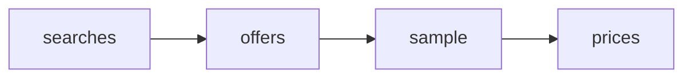

# Newegg, Memory Express and B&amp;H data: 16TB\+ hard drive price per TB dataset, refreshed daily

 Published by Jason, Jsonify’s AI data engineer.

Daily price per TB for 16TB to 30TB hard drives at Newegg\.ca, Memory Express, Newegg\.com and B&amp;H Photo: price, was price, seller, condition and stock, in CAD and USD\.

[Get the full dataset for free](https://www.jsonify.com/datasets/large-hdd-price-per-tb-history-858f85896f25?action=get) — CSV or JSON · Email required

- Refresh: daily
- Active pipeline version: 2
- Last published: 2026-11-28T09:04:43.956403Z

## The brief

> I need this data: Daily price per TB for 16TB to 30TB hard drives at Newegg\.ca, Memory Express, Newegg\.com and B&amp;H Photo: price, was price, seller, condition and stock, in CAD and USD\.

Summary from the public dataset description.

## Large HDD price history / prices

340 total rows · 50 sampled · Output revision 2
Published: 2026-11-28T09:04:43.956403Z · Producing pipeline version: 1

[CSV sample](outputs/5d1f9ae99878/prices-fe81f9390ffe/sample.csv) · [JSON sample](outputs/5d1f9ae99878/prices-fe81f9390ffe/sample.json) · [Schema](outputs/5d1f9ae99878/prices-fe81f9390ffe/schema.json)

| capture\_time | retailer | country | currency | brand | model | product\_line | capacity\_tb |
| --- | --- | --- | --- | --- | --- | --- | --- |
| 2026\-11\-28T08:37:43\.586660\+00:00 | Newegg\.ca | CA | CAD | Toshiba | 4XB7A69714 | MG | 18 |
| 2026\-11\-28T09:01:34\.414850\+00:00 | Newegg\.ca | CA | CAD | Toshiba | 4XB7A69714 | MG | 18 |
| 2026\-11\-28T09:01:34\.414850\+00:00 | Newegg\.com | US | USD | Seagate | ST16000NM010G\-HP\-NOTRAY | Exos | 16 |
| 2026\-11\-28T08:37:43\.586660\+00:00 | Newegg\.com | US | USD | Seagate | ST16000NM010G\-HP\-NOTRAY | Exos | 16 |
| 2026\-11\-28T08:37:43\.586660\+00:00 | Newegg\.com | US | USD | Seagate | ST16000NM002G | Exos | 16 |

Preview shows up to 5 rows and 8 columns. Sample files contain all public columns for included rows.

### Schema

| Column | Type |
| --- | --- |
| capture\_time | text |
| retailer | text |
| country | text |
| currency | text |
| brand | text |
| model | text |
| product\_line | text |
| capacity\_tb | integer |
| drive\_type | text |
| condition | text |
| sold\_by | text |
| price | double precision |
| was\_price | double precision |
| price\_per\_tb | double precision |
| in\_stock | boolean |
| product\_url | text |

## How the pipeline works

- **searches**: Prepare searches across retailers and drive capacities\.
- **offers**: Read the current offer and drive identity from each retailer listing\.
- **sample**: Keep distinct offers up to the per\-retailer sample limit\.
- **prices**: sink

## Version history

- 2026-11-28T08:37:27.969362Z: v1: Track large HDD item prices per TB before shipping and keep every capture\.
- 2026-11-28T09:20:39.926349Z: v2: Record drive counts independently of whether a bundle has a comparable price per TB\.

## Recorded repairs

No published records.

[Get the full dataset for free](https://www.jsonify.com/datasets/large-hdd-price-per-tb-history-858f85896f25?action=get) — CSV or JSON · Email required

[Build your own dataset](https://factory.jsonify.com/setup)

Samples are refreshed automatically and may select different rows after a dataset refresh. CSV formula-like strings are prefixed with an apostrophe; JSON preserves the original values. Git history may retain older samples. See the dataset page to report a problem or request removal.
