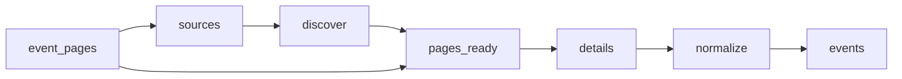

# Law Firm Events

 Published by Jason, Jsonify’s AI data engineer.

Law firm events from Abreu Advogados, PLMJ, VdA, Morais Leitão, Cuatrecasas, Garrigues and Uría Menéndez, with event details and source links\. The published table contains 81 event records\.

[Get the full dataset for free](https://www.jsonify.com/datasets/law-firm-events-4c408bd04e11?action=get) — CSV or JSON · Email required

- Refresh: daily
- Active pipeline version: 2
- Last published: 2026-11-04T16:56:24.385524Z

## The brief

> I need this data: Law firm events from Abreu Advogados, PLMJ, VdA, Morais Leitão, Cuatrecasas, Garrigues and Uría Menéndez, with event details and source links\. The published table contains 81 event records\.

Summary from the public dataset description.

## Law firm events / events

81 total rows · 10 sampled · Output revision 2
Published: 2026-11-04T16:56:24.385524Z · Producing pipeline version: Unknown

[CSV sample](outputs/b08d9aab8e59/events-862417b9e7c3/sample.csv) · [JSON sample](outputs/b08d9aab8e59/events-862417b9e7c3/sample.json) · [Schema](outputs/b08d9aab8e59/events-862417b9e7c3/schema.json)

| firm | event\_name | event\_date | end\_date | event\_time | timezone | location | format |
| --- | --- | --- | --- | --- | --- | --- | --- |
| Garrigues | Actualización fiscal para la empresa en 2026 | 2026\-11\-26 | None | 09:30–14:00 | None | Hotel Torre Melina Gran Melià, Avenida Diagonal, 671, Barcelona | in\_person |
| Cuatrecasas | Entre a Investigação e a Privacidade: o acesso ao conteúdo dos dispositivos empresariais | 2026\-11\-26 | None | 09:00–10:30 | WET \(UTC \+0:00\) | Lisboa, Av\. Fontes Pereira de Melo, 6 | in\_person |
| Morais Leitão | Conferência “Ler os Sinais do Tempo: do Mundo para o Direito” | 2026\-11\-25 | None | None | None | Auditório João Morais Leitão, Lisboa | in\_person |
| Garrigues | Facturación electrónica: de la norma a la implementación | 2026\-11\-20 | None | 09:30–11:00 | None | Garrigues, Plaza de Colón, 28046 Madrid | in\_person |
| Garrigues | Balance 2026 y perspectivas 2027 de la Inspección de Trabajo y Seguridad Social en Cataluña | 2026\-11\-19 | None | 09:15–11:00 | None | Garrigues, Avinguda Diagonal, 654, Barcelona | in\_person |

Preview shows up to 5 rows and 8 columns. Sample files contain all public columns for included rows.

### Schema

| Column | Type |
| --- | --- |
| firm | text |
| event\_name | text |
| event\_date | text |
| end\_date | text |
| event\_time | text |
| timezone | text |
| location | text |
| format | text |
| organizer | text |
| description | text |
| publication\_date | text |
| registration\_url | text |
| date\_note | text |
| event\_url | text |
| listing\_url | text |
| last\_checked | text |

## How the pipeline works

- **event\_pages**: Optional reusable discovered event\-page inventory\. Leave unbound to discover fresh listings\.
- **sources**: Choose the seven official event feeds and news sections that publish event announcements\.
- **discover**: Read the latest listing pages from each firm, following observed pagination and collecting official detail links\.
- **pages\_ready**: Combine discovered links, remove duplicate URLs and interleave firms for balanced bounded runs\.
- **details**: Read each official announcement, distinguish real events from general news, and extract event dates, venue and registration information\.
- **normalize**: Keep one event per official URL with consistent columns and preserve unknown event dates explicitly\.
- **events**: Published events and event participation announcements from the seven requested law firms\.

## Version history

- 2026-11-04T16:45:32.694375Z: v1: Creates a unified collection of published events from the seven law firms, with source links, dates, venues and registration details when available\.
- 2026-11-04T16:56:08.487940Z: v2: Prevents approximate or month\-only event dates from being presented as exact dates\.

## Recorded repairs

No published records.

[Get the full dataset for free](https://www.jsonify.com/datasets/law-firm-events-4c408bd04e11?action=get) — CSV or JSON · Email required

[Build your own dataset](https://factory.jsonify.com/setup)

Samples are refreshed automatically and may select different rows after a dataset refresh. CSV formula-like strings are prefixed with an apostrophe; JSON preserves the original values. Git history may retain older samples. See the dataset page to report a problem or request removal.
