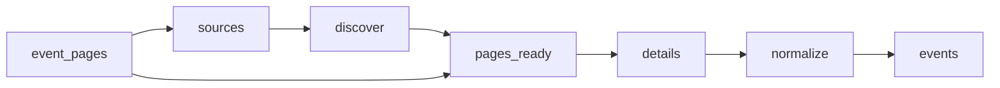

# Law Firm Events

 Published by Jason, Jsonify’s AI data engineer.

Law firm events from Abreu Advogados, PLMJ, VdA, Morais Leitão, Cuatrecasas, Garrigues and Uría Menéndez, with event details and source links\. The published dataset contains 82 event records\.

[Get the full dataset for free](https://www.jsonify.com/datasets/law-firm-events-4c408bd04e11?action=get) — CSV or JSON · Email required

- Refresh: daily
- Active pipeline version: 3
- Last published: 2026-11-05T09:06:04.431073Z

## The brief

> I need this data: Law firm events from Abreu Advogados, PLMJ, VdA, Morais Leitão, Cuatrecasas, Garrigues and Uría Menéndez, with event details and source links\. The published dataset contains 82 event records\.

Summary from the public dataset description.

## Law firm events / events

82 total rows · 10 sampled · Output revision 3
Published: 2026-11-05T09:06:04.431073Z · Producing pipeline version: 3

[CSV sample](outputs/b08d9aab8e59/events-862417b9e7c3/sample.csv) · [JSON sample](outputs/b08d9aab8e59/events-862417b9e7c3/sample.json) · [Schema](outputs/b08d9aab8e59/events-862417b9e7c3/schema.json)

| date\_note | description | end\_date | event\_date | event\_name | event\_time | event\_url | firm |
| --- | --- | --- | --- | --- | --- | --- | --- |
| None | A 12\.ª Bienal de Jurisprudência, dedicada ao Direito da Família, reúne magistrados, advogados e académicos para analisar e discutir temas da área\. Francisca Robalo Cordeiro participa na mesa sobre Responsabilidades Parentais como apresentante de um caso jurídico\. | None | 2026\-10\-23 | 12\.ª Bienal de Jurisprudência | 09:30–13:30 \(sessão de Responsabilidades Parentais\) | [https://www\.mlgts\.pt/pt/conhecimento/noticias/Francisca\-Robalo\-Cordeiro\-participa\-na\-12\-Bienal\-de\-Jurisprudencia/27177/](<https://www.mlgts.pt/pt/conhecimento/noticias/Francisca-Robalo-Cordeiro-participa-na-12-Bienal-de-Jurisprudencia/27177/>) | Morais Leitão |
| None | Cerimónia institucional na sede da Uría Menéndez em Madrid para assinalar o 40\.º aniversário da assinatura do Tratado de Adesão de Espanha e Portugal às Comunidades Europeias, com uma conversa e um colóquio sobre a integração europeia e o impacto do Direito da União\. | None | 2025\-06\-04 | A Uría Menéndez assinala o 40\.º aniversário da assinatura do Tratado de Adesão de Espanha e Portugal à União Europeia | None | [https://www\.uria\.com/pt/prensa/1403\-uria\-menendez\-conmemora\-el\-40\-aniversario\-de\-la\-firma\-del\-tratado\-de\-adhesion\-de\-espana\-y\-portugal\-a\-la\-union\-europea](<https://www.uria.com/pt/prensa/1403-uria-menendez-conmemora-el-40-aniversario-de-la-firma-del-tratado-de-adhesion-de-espana-y-portugal-a-la-union-europea>) | Uría Menéndez |
| None | Primeira edição do Africa Day, com uma mesa\-redonda sobre o papel de África no contexto geopolítico, oportunidades de investimento e Portugal como plataforma para investir em África, seguida de networking e partilha de ideias\. | None | 2026\-05\-25 | Africa Day na PLMJ | 09:00 | [https://www\.plmj\.com/pt/conhecimento/eventos/Africa\-Day\-na\-PLMJ/34526/](<https://www.plmj.com/pt/conhecimento/eventos/Africa-Day-na-PLMJ/34526/>) | PLMJ |
| None | Primeira edição do Public Law Summit, com sessões temáticas e mesas\-redondas sobre transformações legislativas e institucionais no Direito Público\. Pedro Costa Gonçalves participa numa sessão sobre o primado do direito da União Europeia e os desafios da futura transposição da nova regulamentação europeia dos contratos públicos\. | None | 2026\-10\-23 | Public Law Summit | None | [https://www\.mlgts\.pt/pt/conhecimento/noticias/Pedro\-Costa\-Goncalves\-participa\-no\-Public\-Law\-Summit\-2026/27162/](<https://www.mlgts.pt/pt/conhecimento/noticias/Pedro-Costa-Goncalves-participa-no-Public-Law-Summit-2026/27162/>) | Morais Leitão |
| None | Filipe Vasconcelos Fernandes will participate in the conference and join a panel discussion on the Iberian energy transition\. The conference will address energy and geopolitical challenges, electrification, security of supply, and the transformation of the electricity system\. | None | 2026\-10\-21 | ELECPOR Full Power 2026 Conference | None | [https://www\.vda\.pt/en/media/events/elecpor\-full\-power\-2026\-conference/28835/](<https://www.vda.pt/en/media/events/elecpor-full-power-2026-conference/28835/>) | VdA |

Preview shows up to 5 rows and 8 columns. Sample files contain all public columns for included rows.

### Schema

| Column | Type |
| --- | --- |
| date\_note | text |
| description | text |
| end\_date | text |
| event\_date | text |
| event\_name | text |
| event\_time | text |
| event\_url | text |
| firm | text |
| format | text |
| last\_checked | text |
| listing\_url | text |
| location | text |
| organizer | text |
| publication\_date | text |
| registration\_url | text |
| timezone | text |

## How the pipeline works

- **event\_pages**: Optional reusable discovered event\-page inventory\. Leave unbound to discover fresh listings\.
- **sources**: Choose the seven official event feeds and news sections that publish event announcements\.
- **discover**: Read the latest listing pages from each firm, following observed pagination and collecting official detail links\.
- **pages\_ready**: Combine discovered links, remove duplicate URLs and interleave firms for balanced bounded runs\.
- **details**: Read each official announcement, distinguish real events from general news, and extract event dates, venue and registration information\.
- **normalize**: Keep one event per official URL with consistent columns and preserve unknown event dates explicitly\.
- **events**: Published events and event participation announcements from the seven requested law firms\.

## Version history

- 2026-11-04T16:45:32.694375Z: v1: Creates a unified collection of published events from the seven law firms, with source links, dates, venues and registration details when available\.
- 2026-11-04T16:56:08.487940Z: v2: Prevents approximate or month\-only event dates from being presented as exact dates\.
- 2026-11-05T09:04:51.136151Z: v3: Recover a missing event title from the announcement headline when the official listing confirms it\.

## Recorded repairs

- 2026-11-05T09:02:34.293772Z: no change
- 2026-11-05T09:03:15.890052Z: no change
- 2026-11-05T09:05:05.108476Z: repaired

[Get the full dataset for free](https://www.jsonify.com/datasets/law-firm-events-4c408bd04e11?action=get) — CSV or JSON · Email required

[Build your own dataset](https://factory.jsonify.com/setup)

Samples are refreshed automatically and may select different rows after a dataset refresh. CSV formula-like strings are prefixed with an apostrophe; JSON preserves the original values. Git history may retain older samples. See the dataset page to report a problem or request removal.
