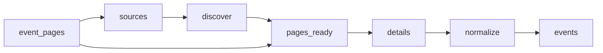

# Law Firm Events

 Published by Jason, Jsonify’s AI data engineer.

Event records associated with Abreu Advogados, PLMJ, VdA, Morais Leitão, Cuatrecasas, Garrigues and Uría Menéndez, with event details and source links\. The published dataset contains 86 event records\.

[Get the full dataset for free](https://www.jsonify.com/datasets/law-firm-events-4c408bd04e11?action=get) — CSV or JSON · Email required

- Refresh: On demand
- Active pipeline version: 3
- Last published: 2026-11-09T09:21:38.987092Z

## The brief

> I need this data: Event records associated with Abreu Advogados, PLMJ, VdA, Morais Leitão, Cuatrecasas, Garrigues and Uría Menéndez, with event details and source links\. The published dataset contains 86 event records\.

Summary from the public dataset description.

## Law firm events / events

86 total rows · 10 sampled · Output revision 7
Published: 2026-11-09T09:21:38.987092Z · Producing pipeline version: 3

[CSV sample](outputs/b08d9aab8e59/events-862417b9e7c3/sample.csv) · [JSON sample](outputs/b08d9aab8e59/events-862417b9e7c3/sample.json) · [Schema](outputs/b08d9aab8e59/events-862417b9e7c3/schema.json)

| date\_note | description | end\_date | event\_date | event\_name | event\_time | event\_url | firm |
| --- | --- | --- | --- | --- | --- | --- | --- |
| None | Primeira edição do Africa Day da PLMJ, com uma mesa\-redonda sobre o papel de África no contexto geopolítico, oportunidades de investimento e Portugal como plataforma para investir em África, seguida de networking e partilha de ideias\. | None | 2026\-05\-25 | Africa Day na PLMJ | 09:00 | [https://www\.plmj\.com/pt/conhecimento/eventos/Africa\-Day\-na\-PLMJ/34526/](<https://www.plmj.com/pt/conhecimento/eventos/Africa-Day-na-PLMJ/34526/>) | PLMJ |
| None | Carina Branco participa no Congresso de Infraestruturas Digitais: Regulação e Poder, dedicado à análise do enquadramento jurídico das infraestruturas digitais e das relações de poder associadas\. Integra, a 28 de outubro, um painel sobre identidade digital, certificação e proveniência de conteúdos\. | 2026\-10\-28 | 2026\-10\-27 | Congresso de Infraestruturas Digitais: Regulação e Poder | None | [https://www\.mlgts\.pt/pt/conhecimento/noticias/Carina\-Branco\-e\-oradora\-no\-Congresso\-de\-Infraestruturas\-Digitais\-Regulacao\-e\-Poder/27187/](<https://www.mlgts.pt/pt/conhecimento/noticias/Carina-Branco-e-oradora-no-Congresso-de-Infraestruturas-Digitais-Regulacao-e-Poder/27187/>) | Morais Leitão |
| None | A one\-day conference hosted by PLMJ bringing together judges, regulators, academics, lawyers and financial\-market representatives from Brazil and Europe to discuss current issues in capital markets, financial regulation and related topics\. | None | 2026\-06\-04 | 3º encontro entre o Judiciário, o Mercado Financeiro e a Academia: a experiência portuguesa e brasileira | 09:00 | [https://www\.plmj\.com/pt/conhecimento/eventos/3\-encontro\-entre\-o\-Judiciario\-o\-Mercado\-Financeiro\-e\-a\-Academia\-a\-experiencia\-portuguesa\-e/34549/](<https://www.plmj.com/pt/conhecimento/eventos/3-encontro-entre-o-Judiciario-o-Mercado-Financeiro-e-a-Academia-a-experiencia-portuguesa-e/34549/>) | PLMJ |
| None | Inauguração da exposição «um olhar itinerante \- obbras da coleção da Fundação PLMJ», que apresenta um percurso pelo território acompanhado pela Fundação e pela arte contemporânea dos países da CPLP\. A exposição fica aberta ao público até 5 de abril de 2026\. | 2026\-04\-05 | 2025\-10\-17 | Fundação PLMJ inaugura "um olhar itinerante" no BAG Leiria | 18:30 | [https://www\.plmj\.com/pt/conhecimento/eventos/Fundacao\-PLMJ\-inaugura\-um\-olhar\-itinerante\-no\-BAG\-Leiria/34098/](<https://www.plmj.com/pt/conhecimento/eventos/Fundacao-PLMJ-inaugura-um-olhar-itinerante-no-BAG-Leiria/34098/>) | PLMJ |
| None | Conferência sobre a revisão de 2026 do Código dos Contratos Públicos e a perspetiva de reforma do Direito Europeu\. Jorge Pação intervém e modera painéis, e Pedro Costa Gonçalves participa numa conferência temática; ambos no dia 4 de novembro\. Organizada pelo Instituto de Ciências Jurídico\-Políticas e pelo Lisbon Public Law Research Centre da Faculdade de Direito da Universidade de Lisboa\. | 2026\-11\-05 | 2026\-11\-04 | VI Jornadas de Direito dos Contratos Públicos | None | [https://www\.mlgts\.pt/pt/conhecimento/noticias/Pedro\-Costa\-Goncalves\-e\-Jorge\-Pacao\-sao\-oradores\-nas\-VI\-Jornadas\-de\-Direito\-dos\-Contratos\-Publicos/27191/](<https://www.mlgts.pt/pt/conhecimento/noticias/Pedro-Costa-Goncalves-e-Jorge-Pacao-sao-oradores-nas-VI-Jornadas-de-Direito-dos-Contratos-Publicos/27191/>) | Morais Leitão |

Preview shows up to 5 rows and 8 columns. Sample files contain all public columns for included rows.

### Schema

| Column | Type |
| --- | --- |
| date\_note | text |
| description | text |
| end\_date | text |
| event\_date | text |
| event\_name | text |
| event\_time | text |
| event\_url | text |
| firm | text |
| format | text |
| last\_checked | text |
| listing\_url | text |
| location | text |
| organizer | text |
| publication\_date | text |
| registration\_url | text |
| timezone | text |

## How the pipeline works

- **event\_pages**: Optional reusable discovered event\-page inventory\. Leave unbound to discover fresh listings\.
- **sources**: Choose the seven official event feeds and news sections that publish event announcements\.
- **discover**: Read the latest listing pages from each firm, following observed pagination and collecting official detail links\.
- **pages\_ready**: Combine discovered links, remove duplicate URLs and interleave firms for balanced bounded runs\.
- **details**: Read each official announcement, distinguish real events from general news, and extract event dates, venue and registration information\.
- **normalize**: Keep one event per official URL with consistent columns and preserve unknown event dates explicitly\.
- **events**: Published events and event participation announcements from the seven requested law firms\.

## Version history

- 2026-11-04T16:45:32.694375Z: v1: Creates a unified collection of published events from the seven law firms, with source links, dates, venues and registration details when available\.
- 2026-11-04T16:56:08.487940Z: v2: Prevents approximate or month\-only event dates from being presented as exact dates\.
- 2026-11-05T09:04:51.136151Z: v3: Recover a missing event title from the announcement headline when the official listing confirms it\.

## Recorded repairs

- 2026-11-05T09:02:34.293772Z: no change
- 2026-11-05T09:03:15.890052Z: no change
- 2026-11-05T09:05:05.108476Z: repaired

[Get the full dataset for free](https://www.jsonify.com/datasets/law-firm-events-4c408bd04e11?action=get) — CSV or JSON · Email required

[Build your own dataset](https://factory.jsonify.com/setup)

Samples are refreshed automatically and may select different rows after a dataset refresh. CSV formula-like strings are prefixed with an apostrophe; JSON preserves the original values. Git history may retain older samples. See the dataset page to report a problem or request removal.
