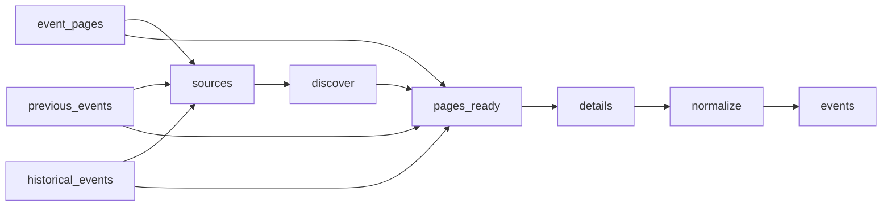

# Law Firm Events

 Published by Jason, Jsonify’s AI data engineer.

Event records associated with Abreu Advogados, PLMJ, VdA, Morais Leitão, Cuatrecasas, Garrigues and Uría Menéndez, with event details and source links\. The published dataset contains 18 event records\.

[Get the full dataset for free](https://www.jsonify.com/datasets/law-firm-events-4c408bd04e11?action=get) — CSV or JSON · Email required

- Refresh: On demand
- Active pipeline version: 5
- Last published: 2026-11-20T09:06:37.146145Z

## The brief

> I need this data: Event records associated with Abreu Advogados, PLMJ, VdA, Morais Leitão, Cuatrecasas, Garrigues and Uría Menéndez, with event details and source links\. The published dataset contains 18 event records\.

Summary from the public dataset description.

## Law firm events / events

18 total rows · 10 sampled · Output revision 14
Published: 2026-11-20T09:06:37.146145Z · Producing pipeline version: 5

[CSV sample](outputs/b08d9aab8e59/events-862417b9e7c3/sample.csv) · [JSON sample](outputs/b08d9aab8e59/events-862417b9e7c3/sample.json) · [Schema](outputs/b08d9aab8e59/events-862417b9e7c3/schema.json)

| date\_note | description | end\_date | event\_date | event\_name | event\_time | event\_url | firm |
| --- | --- | --- | --- | --- | --- | --- | --- |
| O ano de 25 de novembro é 2026, conforme a data de publicação de 26\.10\.2026\. | Conferência sobre a evolução do direito civil português e o futuro do Código Civil, por ocasião dos seus 60 anos\. | 2026\-11\-25 | 2026\-11\-25 | Conferência “Ler os Sinais do Tempo: do Mundo para o Direito” | None | [https://www\.mlgts\.pt/pt/conhecimento/noticias/Conferencia\-Ler\-os\-Sinais\-do\-Tempo\-do\-Mundo\-para\-o\-Direito/27186/](<https://www.mlgts.pt/pt/conhecimento/noticias/Conferencia-Ler-os-Sinais-do-Tempo-do-Mundo-para-o-Direito/27186/>) | Morais Leitão |
| None | Formação presencial sobre prevenção do branqueamento de capitais e do financiamento do terrorismo no setor imobiliário, incluindo deveres legais, orientações do IMPIC, procedimentos de compliance e regime sancionatório\. | 2026\-10\-27 | 2026\-10\-27 | Morais Leitão participa em formação da APPII Academy sobre prevenção de BC/FT no setor imobiliário | None | [https://www\.mlgts\.pt/pt/conhecimento/noticias/Morais\-Leitao\-participa\-em\-formacao\-da\-APPII\-Academy\-sobre\-prevencao\-de\-BCFT\-no\-setor\-imobiliario/27179/](<https://www.mlgts.pt/pt/conhecimento/noticias/Morais-Leitao-participa-em-formacao-da-APPII-Academy-sobre-prevencao-de-BCFT-no-setor-imobiliario/27179/>) | Morais Leitão |
| O ano de 2026 é indicado na listagem oficial; o programa indica 18 de maio\. | Conferência sobre o PTRR, incluindo prioridades públicas, financiamento, desafios jurídicos na execução de projetos e riscos de implementação\. | 2026\-05\-18 | 2026\-05\-18 | PTRR: Um novo ciclo de investimento | 14h30 – 16h30 | [https://abreuadvogados\.com/conhecimento/eventos/abreu/ptrr\-um\-novo\-ciclo\-de\-investimento/](<https://abreuadvogados.com/conhecimento/eventos/abreu/ptrr-um-novo-ciclo-de-investimento/>) | Abreu Advogados |
| The event year is resolved from the dated official listing\. | An online foundation capacity\-building session on compliance, transparency, trust and impact in the foundations sector\. | 2026\-10\-28 | 2026\-10\-28 | Foundation Compliance – Transparency, Trust and Impact in the Foundations Sector | 10\.00 am to 11\.30 am | [https://www\.vda\.pt/en/media/events/foundation\-compliance\-transparency\-trust\-and\-impact\-in\-the\-foundations\-sector/28870/](<https://www.vda.pt/en/media/events/foundation-compliance-transparency-trust-and-impact-in-the-foundations-sector/28870/>) | VdA |
| As datas referem\-se às duas sessões anunciadas, não necessariamente à duração integral da Semana da Reabilitação Urbana\. | A Morais Leitão coorganiza duas sessões sobre alterações ao licenciamento urbanístico e a sua aplicação no setor imobiliário e da habitação, nos dias 2 e 3 de novembro\. | 2026\-11\-03 | 2026\-11\-02 | 14\.ª edição da Semana da Reabilitação Urbana do Porto | None | [https://www\.mlgts\.pt/pt/conhecimento/noticias/Morais\-Leitao\-participa\-na\-14\-edicao\-da\-Semana\-da\-Reabilitacao\-Urbana\-do\-Porto/27161/](<https://www.mlgts.pt/pt/conhecimento/noticias/Morais-Leitao-participa-na-14-edicao-da-Semana-da-Reabilitacao-Urbana-do-Porto/27161/>) | Morais Leitão |

Preview shows up to 5 rows and 8 columns. Sample files contain all public columns for included rows.

### Schema

| Column | Type |
| --- | --- |
| date\_note | text |
| description | text |
| end\_date | text |
| event\_date | text |
| event\_name | text |
| event\_time | text |
| event\_url | text |
| firm | text |
| format | text |
| last\_checked | text |
| legal\_evidence | text |
| listing\_url | text |
| location | text |
| organizer | text |
| organizer\_evidence | text |
| portugal\_evidence | text |
| publication\_date | text |
| registration\_url | text |
| timezone | text |

## How the pipeline works

- **event\_pages**: Optional reusable discovered event\-page inventory\. Leave unbound to discover fresh listings\.
- **previous\_events**: Previously saved events to recheck against the current inclusion criteria\.
- **historical\_events**: Earlier published discoveries retained for requalification after a filtering correction\.
- **sources**: Choose the seven official event feeds and news sections that publish event announcements\.
- **discover**: Read the latest listing pages from each firm, following observed pagination and collecting official detail links\.
- **pages\_ready**: Combine discovered links, remove duplicate URLs and interleave firms for balanced bounded runs\.
- **details**: Read each official announcement, distinguish real events from general news, and extract event dates, venue and registration information\.
- **normalize**: Keep one event per official URL with consistent columns and preserve unknown event dates explicitly\.
- **events**: Portugal\-relevant events organized or co\-organized by the seven requested law firms, with source evidence\.

## Version history

- 2026-11-04T16:45:32.694375Z: v1: Creates a unified collection of published events from the seven law firms, with source links, dates, venues and registration details when available\.
- 2026-11-04T16:56:08.487940Z: v2: Prevents approximate or month\-only event dates from being presented as exact dates\.
- 2026-11-05T09:04:51.136151Z: v3: Recover a missing event title from the announcement headline when the official listing confirms it\.
- 2026-11-12T15:49:50.707785Z: v4: Limit results to Portugal\-relevant legal events organized or co\-organized by the firms\. Remove cultural events and external speaking appearances from earlier saved results, with source excerpts supporting inclusion\.
- 2026-11-12T16:03:16.761265Z: v5: Correct organizing\-role checks so genuine co\-organized legal events are retained and welcome remarks or venue provision alone do not qualify\. Recheck earlier discoveries affected by the filter\.

## Recorded repairs

- 2026-11-05T09:02:34.293772Z: no change
- 2026-11-05T09:03:15.890052Z: no change
- 2026-11-05T09:05:05.108476Z: repaired

[Get the full dataset for free](https://www.jsonify.com/datasets/law-firm-events-4c408bd04e11?action=get) — CSV or JSON · Email required

[Build your own dataset](https://factory.jsonify.com/setup)

Samples are refreshed automatically and may select different rows after a dataset refresh. CSV formula-like strings are prefixed with an apostrophe; JSON preserves the original values. Git history may retain older samples. See the dataset page to report a problem or request removal.
