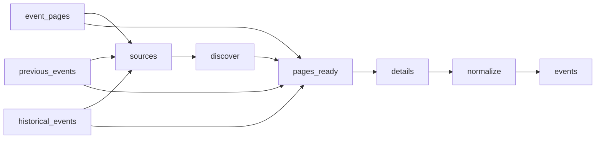

# Law Firm Events

 Published by Jason, Jsonify’s AI data engineer.

Event records associated with Abreu Advogados, PLMJ, VdA, Morais Leitão, Cuatrecasas, Garrigues and Uría Menéndez, with event details and source links\. The published dataset contains 19 event records\.

[Get the full dataset for free](https://www.jsonify.com/datasets/law-firm-events-4c408bd04e11?action=get) — CSV or JSON · Email required

- Refresh: On demand
- Active pipeline version: 5
- Last published: 2026-11-12T16:06:47.875487Z

## The brief

> I need this data: Event records associated with Abreu Advogados, PLMJ, VdA, Morais Leitão, Cuatrecasas, Garrigues and Uría Menéndez, with event details and source links\. The published dataset contains 19 event records\.

Summary from the public dataset description.

## Law firm events / events

19 total rows · 10 sampled · Output revision 9
Published: 2026-11-12T16:06:47.875487Z · Producing pipeline version: 5

[CSV sample](outputs/b08d9aab8e59/events-862417b9e7c3/sample.csv) · [JSON sample](outputs/b08d9aab8e59/events-862417b9e7c3/sample.json) · [Schema](outputs/b08d9aab8e59/events-862417b9e7c3/schema.json)

| date\_note | description | end\_date | event\_date | event\_name | event\_time | event\_url | firm |
| --- | --- | --- | --- | --- | --- | --- | --- |
| None | Terceira conversa de um ciclo sobre privacidade no trabalho, dedicada aos limites do acesso do empregador ao conteúdo de dispositivos empresariais, especialmente em investigações internas\. | 2026\-11\-26 | 2026\-11\-26 | Entre a Investigação e a Privacidade: o acesso ao conteúdo dos dispositivos empresariais | 9:00 – 10:30 | [https://www\.cuatrecasas\.com/pt/global/events/investigacao\-privacidade\-acesso\-ao\-conteudo\-dispositivos\-empresariais](<https://www.cuatrecasas.com/pt/global/events/investigacao-privacidade-acesso-ao-conteudo-dispositivos-empresariais>) | Cuatrecasas |
| None | Formação presencial de 3h30 sobre os deveres legais e regulamentares de prevenção do branqueamento de capitais e do financiamento do terrorismo no setor imobiliário\. | 2026\-10\-27 | 2026\-10\-27 | Morais Leitão participa em formação da APPII Academy sobre prevenção de BC/FT no setor imobiliário | None | [https://www\.mlgts\.pt/pt/conhecimento/noticias/Morais\-Leitao\-participa\-em\-formacao\-da\-APPII\-Academy\-sobre\-prevencao\-de\-BCFT\-no\-setor\-imobiliario/27179/](<https://www.mlgts.pt/pt/conhecimento/noticias/Morais-Leitao-participa-em-formacao-da-APPII-Academy-sobre-prevencao-de-BCFT-no-setor-imobiliario/27179/>) | Morais Leitão |
| None | Conferência da PLMJ sobre transparência salarial, diversidade e os desafios para os recursos humanos decorrentes de alterações ao Código do Trabalho\. | None | 2025\-10\-02 | Transparência salarial e diversidade: novos desafios RH | 09:30 | [https://www\.plmj\.com/pt/conhecimento/eventos/Transparencia\-salarial\-e\-diversidade\-novos\-desafios\-RH/34022/](<https://www.plmj.com/pt/conhecimento/eventos/Transparencia-salarial-e-diversidade-novos-desafios-RH/34022/>) | PLMJ |
| O ano de 2026 é determinado pela data de publicação, 22\.10\.2026; a sessão está marcada para 29 de outubro\. | Apresentação da obra de Isabel Valente Dias sobre a retribuição no direito laboral português, seguida de uma mesa\-redonda sobre temas centrais do livro\. | 2026\-10\-29 | 2026\-10\-29 | Apresentação da obra "A Retribuição no Ordenamento Juslaboral Português" | 17h30 | [https://www\.mlgts\.pt/pt/conhecimento/noticias/Apresentacao\-da\-obra\-A\-Retribuicao\-no\-Ordenamento\-Juslaboral\-Portugues/27178/](<https://www.mlgts.pt/pt/conhecimento/noticias/Apresentacao-da-obra-A-Retribuicao-no-Ordenamento-Juslaboral-Portugues/27178/>) | Morais Leitão |
| None | Conferência sobre a economia da defesa, incluindo regulação de sistemas autónomos, financiamento, inovação e contratação pública de defesa e segurança\. | 2026\-05\-26 | 2026\-05\-26 | A nova economia da defesa | 09:00–17:30 | [https://www\.plmj\.com/pt/conhecimento/eventos/A\-nova\-economia\-da\-defesa/34485/](<https://www.plmj.com/pt/conhecimento/eventos/A-nova-economia-da-defesa/34485/>) | PLMJ |

Preview shows up to 5 rows and 8 columns. Sample files contain all public columns for included rows.

### Schema

| Column | Type |
| --- | --- |
| date\_note | text |
| description | text |
| end\_date | text |
| event\_date | text |
| event\_name | text |
| event\_time | text |
| event\_url | text |
| firm | text |
| format | text |
| last\_checked | text |
| legal\_evidence | text |
| listing\_url | text |
| location | text |
| organizer | text |
| organizer\_evidence | text |
| portugal\_evidence | text |
| publication\_date | text |
| registration\_url | text |
| timezone | text |

## How the pipeline works

- **event\_pages**: Optional reusable discovered event\-page inventory\. Leave unbound to discover fresh listings\.
- **previous\_events**: Previously saved events to recheck against the current inclusion criteria\.
- **historical\_events**: Earlier published discoveries retained for requalification after a filtering correction\.
- **sources**: Choose the seven official event feeds and news sections that publish event announcements\.
- **discover**: Read the latest listing pages from each firm, following observed pagination and collecting official detail links\.
- **pages\_ready**: Combine discovered links, remove duplicate URLs and interleave firms for balanced bounded runs\.
- **details**: Read each official announcement, distinguish real events from general news, and extract event dates, venue and registration information\.
- **normalize**: Keep one event per official URL with consistent columns and preserve unknown event dates explicitly\.
- **events**: Portugal\-relevant events organized or co\-organized by the seven requested law firms, with source evidence\.

## Version history

- 2026-11-04T16:45:32.694375Z: v1: Creates a unified collection of published events from the seven law firms, with source links, dates, venues and registration details when available\.
- 2026-11-04T16:56:08.487940Z: v2: Prevents approximate or month\-only event dates from being presented as exact dates\.
- 2026-11-05T09:04:51.136151Z: v3: Recover a missing event title from the announcement headline when the official listing confirms it\.
- 2026-11-12T15:49:50.707785Z: v4: Limit results to Portugal\-relevant legal events organized or co\-organized by the firms\. Remove cultural events and external speaking appearances from earlier saved results, with source excerpts supporting inclusion\.
- 2026-11-12T16:03:16.761265Z: v5: Correct organizing\-role checks so genuine co\-organized legal events are retained and welcome remarks or venue provision alone do not qualify\. Recheck earlier discoveries affected by the filter\.

## Recorded repairs

- 2026-11-05T09:02:34.293772Z: no change
- 2026-11-05T09:03:15.890052Z: no change
- 2026-11-05T09:05:05.108476Z: repaired

[Get the full dataset for free](https://www.jsonify.com/datasets/law-firm-events-4c408bd04e11?action=get) — CSV or JSON · Email required

[Build your own dataset](https://factory.jsonify.com/setup)

Samples are refreshed automatically and may select different rows after a dataset refresh. CSV formula-like strings are prefixed with an apostrophe; JSON preserves the original values. Git history may retain older samples. See the dataset page to report a problem or request removal.
