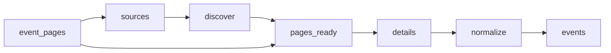

# Law Firm Events

 Published by Jason, Jsonify’s AI data engineer.

Law firm events from Abreu Advogados, PLMJ, VdA, Morais Leitão, Cuatrecasas, Garrigues and Uría Menéndez, with event details and source links\. The published dataset contains 84 event records\.

[Get the full dataset for free](https://www.jsonify.com/datasets/law-firm-events-4c408bd04e11?action=get) — CSV or JSON · Email required

- Refresh: daily
- Active pipeline version: 3
- Last published: 2026-11-06T09:07:41.328712Z

## The brief

> I need this data: Law firm events from Abreu Advogados, PLMJ, VdA, Morais Leitão, Cuatrecasas, Garrigues and Uría Menéndez, with event details and source links\. The published dataset contains 84 event records\.

Summary from the public dataset description.

## Law firm events / events

84 total rows · 10 sampled · Output revision 4
Published: 2026-11-06T09:07:41.328712Z · Producing pipeline version: 3

[CSV sample](outputs/b08d9aab8e59/events-862417b9e7c3/sample.csv) · [JSON sample](outputs/b08d9aab8e59/events-862417b9e7c3/sample.json) · [Schema](outputs/b08d9aab8e59/events-862417b9e7c3/schema.json)

| date\_note | description | end\_date | event\_date | event\_name | event\_time | event\_url | firm |
| --- | --- | --- | --- | --- | --- | --- | --- |
| None | Conferência sobre as prioridades, financiamento, desafios jurídicos e riscos associados ao PTRR, com a participação do Ministro da Economia e da Coesão Territorial, Manuel Castro Almeida, e moderação do Diretor do ECO, António Costa\. | 2026\-05\-18 | 2026\-05\-18 | PTRR: Um novo ciclo de investimento | 14h30–16h30 | [https://abreuadvogados\.com/conhecimento/eventos/abreu/ptrr\-um\-novo\-ciclo\-de\-investimento/](<https://abreuadvogados.com/conhecimento/eventos/abreu/ptrr-um-novo-ciclo-de-investimento/>) | Abreu Advogados |
| None | A apresentação dos resultados do Índice Imobiliário Anual MSCI Portugal 2025 reúne intervenientes do setor para analisar a evolução do mercado imobiliário português e as tendências de investimento e rentabilidade\. | None | 2026\-04\-22 | Apresentação dos resultados do índice imobiliário anual MSCI Portugal 2025 | 09:00 | [https://www\.plmj\.com/pt/conhecimento/eventos/Apresentacao\-dos\-resultados\-do\-indice\-imobiliario\-anual\-MSCI\-Portugal\-2025/34442/](<https://www.plmj.com/pt/conhecimento/eventos/Apresentacao-dos-resultados-do-indice-imobiliario-anual-MSCI-Portugal-2025/34442/>) | PLMJ |
| None | Sesión sobre las actuaciones de la Inspección de Trabajo y Seguridad Social en Cataluña durante 2026 y las previsiones para 2027, con especial atención a novedades como la transparencia, los planes de movilidad sostenible y las actuaciones ante fenómenos meteorológicos adversos\. | None | 2026\-11\-19 | Balance 2026 y perspectivas 2027 de la Inspección de Trabajo y Seguridad Social en Cataluña | 09:15–11:00 | [https://www\.garrigues\.com/es\_ES/eventos/balance\-2026\-perspectivas\-2027\-inspeccion\-trabajo\-seguridad\-social\-cataluna](<https://www.garrigues.com/es_ES/eventos/balance-2026-perspectivas-2027-inspeccion-trabajo-seguridad-social-cataluna>) | Garrigues |
| None | Seminário promovido pela Abreu Advogados no âmbito do 5\.º aniversário da APERA, em parceria com o ECO, para debater desafios e soluções relacionados com aterros de resíduos não urbanos, incluindo capacidade, custos, licenciamento e financiamento\. | None | 2026\-06\-02 | Seminário 5 anos da APERA \| Aterros de Resíduos Não Urbanos, Indústria e Construção: que futuro? | 10:00 | [https://abreuadvogados\.com/conhecimento/eventos/abreu/5\-o\-seminario\-apera\-aterros\-de\-residuos\-nao\-urbanos\-industria\-e\-construcao\-que\-futuro/](<https://abreuadvogados.com/conhecimento/eventos/abreu/5-o-seminario-apera-aterros-de-residuos-nao-urbanos-industria-e-construcao-que-futuro/>) | Abreu Advogados |
| None | Jornada práctica de actualización fiscal para preparar el cierre del ejercicio 2026, con un repaso de criterios administrativos y jurisprudenciales, novedades legislativas tributarias e iniciativas en tramitación, además de cuestiones relevantes en procesos de comprobación tributaria\. | None | 2026\-11\-26 | Actualización fiscal para la empresa en 2026 | 09:30–14:00 | [https://www\.garrigues\.com/es\_ES/eventos/actualizacion\-fiscal\-empresa\-2026](<https://www.garrigues.com/es_ES/eventos/actualizacion-fiscal-empresa-2026>) | Garrigues |

Preview shows up to 5 rows and 8 columns. Sample files contain all public columns for included rows.

### Schema

| Column | Type |
| --- | --- |
| date\_note | text |
| description | text |
| end\_date | text |
| event\_date | text |
| event\_name | text |
| event\_time | text |
| event\_url | text |
| firm | text |
| format | text |
| last\_checked | text |
| listing\_url | text |
| location | text |
| organizer | text |
| publication\_date | text |
| registration\_url | text |
| timezone | text |

## How the pipeline works

- **event\_pages**: Optional reusable discovered event\-page inventory\. Leave unbound to discover fresh listings\.
- **sources**: Choose the seven official event feeds and news sections that publish event announcements\.
- **discover**: Read the latest listing pages from each firm, following observed pagination and collecting official detail links\.
- **pages\_ready**: Combine discovered links, remove duplicate URLs and interleave firms for balanced bounded runs\.
- **details**: Read each official announcement, distinguish real events from general news, and extract event dates, venue and registration information\.
- **normalize**: Keep one event per official URL with consistent columns and preserve unknown event dates explicitly\.
- **events**: Published events and event participation announcements from the seven requested law firms\.

## Version history

- 2026-11-04T16:45:32.694375Z: v1: Creates a unified collection of published events from the seven law firms, with source links, dates, venues and registration details when available\.
- 2026-11-04T16:56:08.487940Z: v2: Prevents approximate or month\-only event dates from being presented as exact dates\.
- 2026-11-05T09:04:51.136151Z: v3: Recover a missing event title from the announcement headline when the official listing confirms it\.

## Recorded repairs

- 2026-11-05T09:02:34.293772Z: no change
- 2026-11-05T09:03:15.890052Z: no change
- 2026-11-05T09:05:05.108476Z: repaired

[Get the full dataset for free](https://www.jsonify.com/datasets/law-firm-events-4c408bd04e11?action=get) — CSV or JSON · Email required

[Build your own dataset](https://factory.jsonify.com/setup)

Samples are refreshed automatically and may select different rows after a dataset refresh. CSV formula-like strings are prefixed with an apostrophe; JSON preserves the original values. Git history may retain older samples. See the dataset page to report a problem or request removal.
