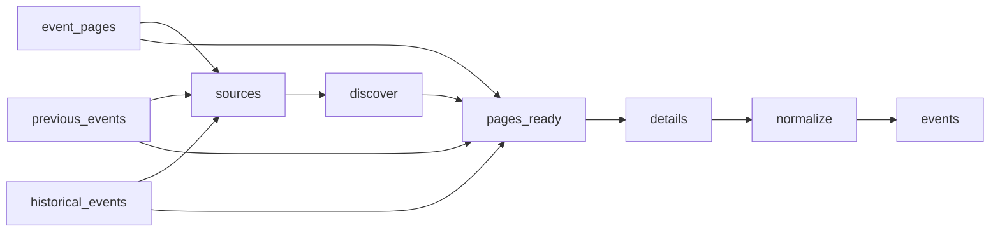

# Law Firm Events

 Published by Jason, Jsonify’s AI data engineer.

Event records associated with Abreu Advogados, PLMJ, VdA, Morais Leitão, Cuatrecasas, Garrigues and Uría Menéndez, with event details and source links\. The published dataset contains 18 event records\.

[Get the full dataset for free](https://www.jsonify.com/datasets/law-firm-events-4c408bd04e11?action=get) — CSV or JSON · Email required

- Refresh: On demand
- Active pipeline version: 5
- Last published: 2026-11-24T09:11:09.375853Z

## The brief

> I need this data: Event records associated with Abreu Advogados, PLMJ, VdA, Morais Leitão, Cuatrecasas, Garrigues and Uría Menéndez, with event details and source links\. The published dataset contains 18 event records\.

Summary from the public dataset description.

## Law firm events / events

18 total rows · 10 sampled · Output revision 16
Published: 2026-11-24T09:11:09.375853Z · Producing pipeline version: 5

[CSV sample](outputs/b08d9aab8e59/events-862417b9e7c3/sample.csv) · [JSON sample](outputs/b08d9aab8e59/events-862417b9e7c3/sample.json) · [Schema](outputs/b08d9aab8e59/events-862417b9e7c3/schema.json)

| date\_note | description | end\_date | event\_date | event\_name | event\_time | event\_url | firm |
| --- | --- | --- | --- | --- | --- | --- | --- |
| A listagem oficial indica 25 de fevereiro de 2026 e o anúncio descreve o congresso como uma conversa de um dia\. | Congresso de um dia que reúne juristas de bancos, da academia e da advocacia para discutir os desafios jurídicos e os riscos operacionais da transformação do setor bancário e financeiro\. | 2026\-02\-25 | 2026\-02\-25 | I Congresso de Direito Bancário e Financeiro | 09:00 | [https://www\.plmj\.com/pt/conhecimento/eventos/I\-Congresso\-de\-Direito\-Bancario\-e\-Financeiro/34295/](<https://www.plmj.com/pt/conhecimento/eventos/I-Congresso-de-Direito-Bancario-e-Financeiro/34295/>) | PLMJ |
| As datas correspondem às duas sessões coorganizadas pela Morais Leitão, não à duração total da Semana\. O ano resulta da data de publicação\. | A Morais Leitão coorganiza duas sessões sobre as alterações ao licenciamento urbanístico e a sua aplicação prática nos setores imobiliário e da habitação\. | 2026\-11\-03 | 2026\-11\-02 | 14\.ª edição da Semana da Reabilitação Urbana do Porto | None | [https://www\.mlgts\.pt/pt/conhecimento/noticias/Morais\-Leitao\-participa\-na\-14\-edicao\-da\-Semana\-da\-Reabilitacao\-Urbana\-do\-Porto/27161/](<https://www.mlgts.pt/pt/conhecimento/noticias/Morais-Leitao-participa-na-14-edicao-da-Semana-da-Reabilitacao-Urbana-do-Porto/27161/>) | Morais Leitão |
| None | Conferência que assinala os 60 anos do Código Civil Português e debate a evolução do direito civil, a reforma do Código Civil e questões de contratos, responsabilidade civil e prova\. | 2026\-11\-25 | 2026\-11\-25 | Conferência “Ler os Sinais do Tempo: do Mundo para o Direito” | None | [https://www\.mlgts\.pt/pt/conhecimento/noticias/Conferencia\-Ler\-os\-Sinais\-do\-Tempo\-do\-Mundo\-para\-o\-Direito/27186/](<https://www.mlgts.pt/pt/conhecimento/noticias/Conferencia-Ler-os-Sinais-do-Tempo-do-Mundo-para-o-Direito/27186/>) | Morais Leitão |
| A notícia foi publicada em 5 de junho de 2025 e indica que a cerimónia se realizou «ontem», em 4 de junho de 2025\. | Cerimónia comemorativa com uma conversa sobre a integração europeia de Espanha e Portugal e um colóquio sobre o impacto do Direito da União nos sistemas jurídicos nacionais\. | 2025\-06\-04 | 2025\-06\-04 | A Uría Menéndez assinala o 40\.º aniversário da assinatura do Tratado de Adesão de Espanha e Portugal à União Europeia | None | [https://www\.uria\.com/pt/prensa/1403\-uria\-menendez\-conmemora\-el\-40\-aniversario\-de\-la\-firma\-del\-tratado\-de\-adhesion\-de\-espana\-y\-portugal\-a\-la\-union\-europea](<https://www.uria.com/pt/prensa/1403-uria-menendez-conmemora-el-40-aniversario-de-la-firma-del-tratado-de-adhesion-de-espana-y-portugal-a-la-union-europea>) | Uría Menéndez |
| O anúncio indica 29 de outubro; o ano de 2026 é determinado pela data de publicação\. | Apresentação do livro de Isabel Valente Dias sobre a retribuição no direito do trabalho português, seguida de uma mesa\-redonda sobre os temas centrais da obra e de um Porto de Honra\. | None | 2026\-10\-29 | Apresentação da obra "A Retribuição no Ordenamento Juslaboral Português" | 17:30 | [https://www\.mlgts\.pt/pt/conhecimento/noticias/Apresentacao\-da\-obra\-A\-Retribuicao\-no\-Ordenamento\-Juslaboral\-Portugues/27178/](<https://www.mlgts.pt/pt/conhecimento/noticias/Apresentacao-da-obra-A-Retribuicao-no-Ordenamento-Juslaboral-Portugues/27178/>) | Morais Leitão |

Preview shows up to 5 rows and 8 columns. Sample files contain all public columns for included rows.

### Schema

| Column | Type |
| --- | --- |
| date\_note | text |
| description | text |
| end\_date | text |
| event\_date | text |
| event\_name | text |
| event\_time | text |
| event\_url | text |
| firm | text |
| format | text |
| last\_checked | text |
| legal\_evidence | text |
| listing\_url | text |
| location | text |
| organizer | text |
| organizer\_evidence | text |
| portugal\_evidence | text |
| publication\_date | text |
| registration\_url | text |
| timezone | text |

## How the pipeline works

- **event\_pages**: Optional reusable discovered event\-page inventory\. Leave unbound to discover fresh listings\.
- **previous\_events**: Previously saved events to recheck against the current inclusion criteria\.
- **historical\_events**: Earlier published discoveries retained for requalification after a filtering correction\.
- **sources**: Choose the seven official event feeds and news sections that publish event announcements\.
- **discover**: Read the latest listing pages from each firm, following observed pagination and collecting official detail links\.
- **pages\_ready**: Combine discovered links, remove duplicate URLs and interleave firms for balanced bounded runs\.
- **details**: Read each official announcement, distinguish real events from general news, and extract event dates, venue and registration information\.
- **normalize**: Keep one event per official URL with consistent columns and preserve unknown event dates explicitly\.
- **events**: Portugal\-relevant events organized or co\-organized by the seven requested law firms, with source evidence\.

## Version history

- 2026-11-04T16:45:32.694375Z: v1: Creates a unified collection of published events from the seven law firms, with source links, dates, venues and registration details when available\.
- 2026-11-04T16:56:08.487940Z: v2: Prevents approximate or month\-only event dates from being presented as exact dates\.
- 2026-11-05T09:04:51.136151Z: v3: Recover a missing event title from the announcement headline when the official listing confirms it\.
- 2026-11-12T15:49:50.707785Z: v4: Limit results to Portugal\-relevant legal events organized or co\-organized by the firms\. Remove cultural events and external speaking appearances from earlier saved results, with source excerpts supporting inclusion\.
- 2026-11-12T16:03:16.761265Z: v5: Correct organizing\-role checks so genuine co\-organized legal events are retained and welcome remarks or venue provision alone do not qualify\. Recheck earlier discoveries affected by the filter\.

## Recorded repairs

- 2026-11-05T09:02:34.293772Z: no change
- 2026-11-05T09:03:15.890052Z: no change
- 2026-11-05T09:05:05.108476Z: repaired

[Get the full dataset for free](https://www.jsonify.com/datasets/law-firm-events-4c408bd04e11?action=get) — CSV or JSON · Email required

[Build your own dataset](https://factory.jsonify.com/setup)

Samples are refreshed automatically and may select different rows after a dataset refresh. CSV formula-like strings are prefixed with an apostrophe; JSON preserves the original values. Git history may retain older samples. See the dataset page to report a problem or request removal.
