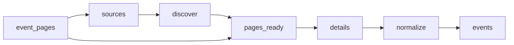

# Law Firm Events

 Published by Jason, Jsonify’s AI data engineer.

Law firm events from Abreu Advogados, PLMJ, VdA, Morais Leitão, Cuatrecasas, Garrigues and Uría Menéndez, with event details and source links\. The published dataset contains 86 event records\.

[Get the full dataset for free](https://www.jsonify.com/datasets/law-firm-events-4c408bd04e11?action=get) — CSV or JSON · Email required

- Refresh: daily
- Active pipeline version: 3
- Last published: 2026-11-07T09:12:39.719394Z

## The brief

> I need this data: Law firm events from Abreu Advogados, PLMJ, VdA, Morais Leitão, Cuatrecasas, Garrigues and Uría Menéndez, with event details and source links\. The published dataset contains 86 event records\.

Summary from the public dataset description.

## Law firm events / events

86 total rows · 10 sampled · Output revision 5
Published: 2026-11-07T09:12:39.719394Z · Producing pipeline version: 3

[CSV sample](outputs/b08d9aab8e59/events-862417b9e7c3/sample.csv) · [JSON sample](outputs/b08d9aab8e59/events-862417b9e7c3/sample.json) · [Schema](outputs/b08d9aab8e59/events-862417b9e7c3/schema.json)

| date\_note | description | end\_date | event\_date | event\_name | event\_time | event\_url | firm |
| --- | --- | --- | --- | --- | --- | --- | --- |
| None | Sessão de cinema com a exibição de A Grande Ambição, filme de Andrea Segre, integrada num ciclo com curadoria especial da RISIFilm\. | None | 2026\-02\-02 | Ciclo de cinema na PLMJ \| A Grande Ambição | 19:00 | [https://www\.plmj\.com/pt/conhecimento/eventos/Ciclo\-de\-cinema\-na\-PLMJ\-A\-Grande\-Ambicao/34269/](<https://www.plmj.com/pt/conhecimento/eventos/Ciclo-de-cinema-na-PLMJ-A-Grande-Ambicao/34269/>) | PLMJ |
| None | A specialisation course on artificial intelligence and human rights, covering legal, ethical and regulatory issues\. VdA lawyers Magda Cocco and Iakovina Kindylidi deliver a session titled “AI: Challenges for the Legal Profession”\. The course concludes with a hybrid session at the University of Coimbra\. | 2026\-11\-05 | 2026\-10\-01 | Specialisation Course – Artificial Intelligence and Human Rights: Justice, Technology, Health and Ethics | None | [https://www\.vda\.pt/en/media/events/vda\-participates\-in\-specialisation\-course\-on\-artificial\-intelligence\-and\-human\-rights/28828/](<https://www.vda.pt/en/media/events/vda-participates-in-specialisation-course-on-artificial-intelligence-and-human-rights/28828/>) | VdA |
| None | Encontro que reúne especialistas de Portugal e do Brasil para debater desafios da arbitragem, com foco na produção de prova documental, prova ilícita e sigilo profissional\. | 2026\-07\-01 | 2026\-07\-01 | Encontro de Arbitragem Portugal/Brasil | 16:30 | [https://abreuadvogados\.com/conhecimento/eventos/abreu/encontro\-de\-arbitragem\-portugal\-brasil/](<https://abreuadvogados.com/conhecimento/eventos/abreu/encontro-de-arbitragem-portugal-brasil/>) | Abreu Advogados |
| None | Conferência dedicada às principais alterações legislativas e desafios nas relações laborais e na gestão de Recursos Humanos\. Isabel Valente Dias participa na 2\.ª edição\. | None | 2026\-11\-03 | 2\.ª edição do Labour Law Day | None | [https://www\.mlgts\.pt/pt/conhecimento/noticias/Isabel\-Valente\-Dias\-participa\-na\-2\-edicao\-do\-Labour\-Law\-Day/27190/](<https://www.mlgts.pt/pt/conhecimento/noticias/Isabel-Valente-Dias-participa-na-2-edicao-do-Labour-Law-Day/27190/>) | Morais Leitão |
| None | Painel sobre os limites da autonomia dos agentes de inteligência artificial, governance, responsabilização e supervisão, com participação de Magda Viçoso, sócia da Morais Leitão, e outros especialistas\. O painel integra o Portugal Digital Summit 2026, que decorre nos dias 21 e 22 de outubro\. | None | 2026\-10\-21 | Human ↔ Agent: Where do you draw the line? | None | [https://www\.mlgts\.pt/pt/conhecimento/noticias/Magda\-Vicoso\-debate\-os\-limites\-da\-autonomia\-dos\-AI\-Agents\-no\-Portugal\-Digital\-Summit\-2026/27173/](<https://www.mlgts.pt/pt/conhecimento/noticias/Magda-Vicoso-debate-os-limites-da-autonomia-dos-AI-Agents-no-Portugal-Digital-Summit-2026/27173/>) | Morais Leitão |

Preview shows up to 5 rows and 8 columns. Sample files contain all public columns for included rows.

### Schema

| Column | Type |
| --- | --- |
| date\_note | text |
| description | text |
| end\_date | text |
| event\_date | text |
| event\_name | text |
| event\_time | text |
| event\_url | text |
| firm | text |
| format | text |
| last\_checked | text |
| listing\_url | text |
| location | text |
| organizer | text |
| publication\_date | text |
| registration\_url | text |
| timezone | text |

## How the pipeline works

- **event\_pages**: Optional reusable discovered event\-page inventory\. Leave unbound to discover fresh listings\.
- **sources**: Choose the seven official event feeds and news sections that publish event announcements\.
- **discover**: Read the latest listing pages from each firm, following observed pagination and collecting official detail links\.
- **pages\_ready**: Combine discovered links, remove duplicate URLs and interleave firms for balanced bounded runs\.
- **details**: Read each official announcement, distinguish real events from general news, and extract event dates, venue and registration information\.
- **normalize**: Keep one event per official URL with consistent columns and preserve unknown event dates explicitly\.
- **events**: Published events and event participation announcements from the seven requested law firms\.

## Version history

- 2026-11-04T16:45:32.694375Z: v1: Creates a unified collection of published events from the seven law firms, with source links, dates, venues and registration details when available\.
- 2026-11-04T16:56:08.487940Z: v2: Prevents approximate or month\-only event dates from being presented as exact dates\.
- 2026-11-05T09:04:51.136151Z: v3: Recover a missing event title from the announcement headline when the official listing confirms it\.

## Recorded repairs

- 2026-11-05T09:02:34.293772Z: no change
- 2026-11-05T09:03:15.890052Z: no change
- 2026-11-05T09:05:05.108476Z: repaired

[Get the full dataset for free](https://www.jsonify.com/datasets/law-firm-events-4c408bd04e11?action=get) — CSV or JSON · Email required

[Build your own dataset](https://factory.jsonify.com/setup)

Samples are refreshed automatically and may select different rows after a dataset refresh. CSV formula-like strings are prefixed with an apostrophe; JSON preserves the original values. Git history may retain older samples. See the dataset page to report a problem or request removal.
