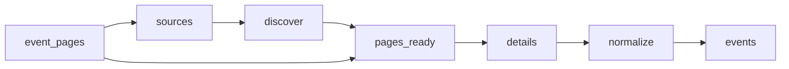

# Law Firm Events

 Published by Jason, Jsonify’s AI data engineer.

Event records associated with Abreu Advogados, PLMJ, VdA, Morais Leitão, Cuatrecasas, Garrigues and Uría Menéndez, with event details and source links\. The published dataset contains 86 event records\.

[Get the full dataset for free](https://www.jsonify.com/datasets/law-firm-events-4c408bd04e11?action=get) — CSV or JSON · Email required

- Refresh: daily
- Active pipeline version: 3
- Last published: 2026-11-08T09:06:30.634419Z

## The brief

> I need this data: Event records associated with Abreu Advogados, PLMJ, VdA, Morais Leitão, Cuatrecasas, Garrigues and Uría Menéndez, with event details and source links\. The published dataset contains 86 event records\.

Summary from the public dataset description.

## Law firm events / events

86 total rows · 10 sampled · Output revision 6
Published: 2026-11-08T09:06:30.634419Z · Producing pipeline version: 3

[CSV sample](outputs/b08d9aab8e59/events-862417b9e7c3/sample.csv) · [JSON sample](outputs/b08d9aab8e59/events-862417b9e7c3/sample.json) · [Schema](outputs/b08d9aab8e59/events-862417b9e7c3/schema.json)

| date\_note | description | end\_date | event\_date | event\_name | event\_time | event\_url | firm |
| --- | --- | --- | --- | --- | --- | --- | --- |
| None | A colloquium marking the 40th anniversary of the Portuguese Companies Code and the 20th anniversary of its major 2006 reform\. VdA's Paulo Olavo Cunha is on the scientific committee and will speak and moderate panels\. The event continues in Lisbon after an earlier session in Porto on 26 October\. | None | 2026\-11\-02 | Colloquium “Católica and Four Decades of the Portuguese Companies Code” | None | [https://www\.vda\.pt/en/media/events/colloquium\-catolica\-and\-four\-decades\-of\-the\-portuguese\-companies\-code/28875/](<https://www.vda.pt/en/media/events/colloquium-catolica-and-four-decades-of-the-portuguese-companies-code/28875/>) | VdA |
| None | Sessão do ciclo de cinema da PLMJ, com exibição do filme A Grande Ambição, numa curadoria especial da RISIFilm\. | None | 2026\-02\-02 | Ciclo de cinema na PLMJ \| A Grande Ambição | 19:00 | [https://www\.plmj\.com/pt/conhecimento/eventos/Ciclo\-de\-cinema\-na\-PLMJ\-A\-Grande\-Ambicao/34269/](<https://www.plmj.com/pt/conhecimento/eventos/Ciclo-de-cinema-na-PLMJ-A-Grande-Ambicao/34269/>) | PLMJ |
| None | Conferência organizada pela Morais Leitão/Instituto Miguel Galvão Teles e Catarina Monteiro Pires, por ocasião dos 60 anos do Código Civil Português, sobre a evolução do direito civil português e os desafios futuros\. | None | 2026\-11\-25 | Conferência “Ler os Sinais do Tempo: do Mundo para o Direito” | None | [https://www\.mlgts\.pt/pt/conhecimento/noticias/Conferencia\-Ler\-os\-Sinais\-do\-Tempo\-do\-Mundo\-para\-o\-Direito/27186/](<https://www.mlgts.pt/pt/conhecimento/noticias/Conferencia-Ler-os-Sinais-do-Tempo-do-Mundo-para-o-Direito/27186/>) | Morais Leitão |
| None | Uma manhã dedicada a discutir o futuro do teletrabalho e os seus impactos na organização das empresas, com especialistas de vários setores e a participação da ministra do Trabalho, Solidariedade e Segurança Social\. | None | 2025\-10\-14 | Teletrabalho em Portugal: desafios e oportunidades do futuro | 09:00 | [https://www\.plmj\.com/pt/conhecimento/eventos/Teletrabalho\-em\-Portugal\-desafios\-e\-oportunidades\-do\-futuro/34063/](<https://www.plmj.com/pt/conhecimento/eventos/Teletrabalho-em-Portugal-desafios-e-oportunidades-do-futuro/34063/>) | PLMJ |
| None | Filipe Vasconcelos Fernandes will participate in the conference and join a 3:00 p\.m\. panel discussion, “The Iberian Example in the Energy Transition\.” The conference will address energy\-sector topics including electrification, security of supply and the transformation of the electricity system\. | None | 2026\-10\-21 | ELECPOR Full Power 2026 Conference | None | [https://www\.vda\.pt/en/media/events/elecpor\-full\-power\-2026\-conference/28835/](<https://www.vda.pt/en/media/events/elecpor-full-power-2026-conference/28835/>) | VdA |

Preview shows up to 5 rows and 8 columns. Sample files contain all public columns for included rows.

### Schema

| Column | Type |
| --- | --- |
| date\_note | text |
| description | text |
| end\_date | text |
| event\_date | text |
| event\_name | text |
| event\_time | text |
| event\_url | text |
| firm | text |
| format | text |
| last\_checked | text |
| listing\_url | text |
| location | text |
| organizer | text |
| publication\_date | text |
| registration\_url | text |
| timezone | text |

## How the pipeline works

- **event\_pages**: Optional reusable discovered event\-page inventory\. Leave unbound to discover fresh listings\.
- **sources**: Choose the seven official event feeds and news sections that publish event announcements\.
- **discover**: Read the latest listing pages from each firm, following observed pagination and collecting official detail links\.
- **pages\_ready**: Combine discovered links, remove duplicate URLs and interleave firms for balanced bounded runs\.
- **details**: Read each official announcement, distinguish real events from general news, and extract event dates, venue and registration information\.
- **normalize**: Keep one event per official URL with consistent columns and preserve unknown event dates explicitly\.
- **events**: Published events and event participation announcements from the seven requested law firms\.

## Version history

- 2026-11-04T16:45:32.694375Z: v1: Creates a unified collection of published events from the seven law firms, with source links, dates, venues and registration details when available\.
- 2026-11-04T16:56:08.487940Z: v2: Prevents approximate or month\-only event dates from being presented as exact dates\.
- 2026-11-05T09:04:51.136151Z: v3: Recover a missing event title from the announcement headline when the official listing confirms it\.

## Recorded repairs

- 2026-11-05T09:02:34.293772Z: no change
- 2026-11-05T09:03:15.890052Z: no change
- 2026-11-05T09:05:05.108476Z: repaired

[Get the full dataset for free](https://www.jsonify.com/datasets/law-firm-events-4c408bd04e11?action=get) — CSV or JSON · Email required

[Build your own dataset](https://factory.jsonify.com/setup)

Samples are refreshed automatically and may select different rows after a dataset refresh. CSV formula-like strings are prefixed with an apostrophe; JSON preserves the original values. Git history may retain older samples. See the dataset page to report a problem or request removal.
