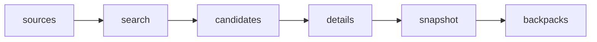

# Leather Backpack Prices: Gusti Leder and Amazon

 Published by Jason, Jsonify’s AI data engineer.

A published dataset of leather backpack listings from Gusti Leder Germany and Amazon Germany, France and Italy\. The published table contains 56 rows\. Prices are displayed in euros; shipping and conditional coupons are excluded\.

[Get the full dataset for free](https://www.jsonify.com/datasets/leather-backpack-prices-gusti-leder-shop-vs-amazon-de-fr-it-e57e10e2e1b5?action=get) — CSV or JSON · Email required

- Refresh: On demand
- Active pipeline version: 1
- Last published: 2026-11-09T08:13:10.547866Z

## The brief

> I need this data: A published dataset of leather backpack listings from Gusti Leder Germany and Amazon Germany, France and Italy\. The published table contains 56 rows\. Prices are displayed in euros; shipping and conditional coupons are excluded\.

Summary from the public dataset description.

## Leather backpack prices: Gusti Leder shop vs Amazon DE/FR/IT / backpacks

56 total rows · 10 sampled · Output revision 2
Published: 2026-11-09T08:13:10.547866Z · Producing pipeline version: 1

[CSV sample](outputs/2a8b5246fae2/backpacks-3ad734d4decb/sample.csv) · [JSON sample](outputs/2a8b5246fae2/backpacks-3ad734d4decb/sample.json) · [Schema](outputs/2a8b5246fae2/backpacks-3ad734d4decb/schema.json)

| source | url | item | variant\_qty | price | currency | fetched\_at\_utc | notes |
| --- | --- | --- | --- | --- | --- | --- | --- |
| amazon\.de | [https://www\.amazon\.de/dp/B00XVSG3GS](<https://www.amazon.de/dp/B00XVSG3GS>) | Gusti Cityrucksack Leder \- Lena kleiner Rucksack Vintage Braun Leder Damen | 1 | 63\.85 | EUR | 2026\-11\-09T08:07:45\.555693\+00:00 | \{"ASIN": "B00XVSG3GS", "strike\_through\_RRP": null, "outlet": null, "stock": "in\_stock", "variant\_qty\_basis": "Distinct reported selectable ASINs including current listing; minimum observed count when no siblings reported", "outlet\_basis": "Not provided by Amazon; null is unknown", "price\_basis": "Regional product displayed offer; shipping and conditional coupons excluded", "brand": "Gusti"} |
| amazon\.de | [https://www\.amazon\.de/dp/B07RBTWJ48](<https://www.amazon.de/dp/B07RBTWJ48>) | STILORD Charlie Vintage Lederrucksack Braun Mittelgroßer Daypack für Damen Herren 13,3 Zoll Laptop Rucksack aus Echtem Leder Farbe:Cognac \- braun | 6 | 119\.9 | EUR | 2026\-11\-09T08:08:18\.405934\+00:00 | \{"ASIN": "B07RBTWJ48", "strike\_through\_RRP": null, "outlet": null, "stock": "in\_stock", "variant\_qty\_basis": "Distinct reported selectable ASINs including current listing; minimum observed count when no siblings reported", "outlet\_basis": "Not provided by Amazon; null is unknown", "price\_basis": "Regional product displayed offer; shipping and conditional coupons excluded", "brand": "STILORD"} |
| gusti\-leder\.de | [https://gusti\-leder\.de/products/lederrucksack\-rucksack\-cityrucksack\-2m39\-20\-2wp](<https://gusti-leder.de/products/lederrucksack-rucksack-cityrucksack-2m39-20-2wp>) | Gusti Leder Alena \(2M39\-20\-2wp\) | 1 | 99\.95 | EUR | 2026\-11\-09T08:06:12\.326994\+00:00 | \{"ASIN": null, "strike\_through\_RRP": 164\.95, "outlet": false, "stock": "in\_stock", "variant\_qty\_basis": "Shopify selectable variants on this listing", "price\_basis": "German storefront displayed price; shipping excluded"} |
| amazon\.fr | [https://www\.amazon\.fr/dp/B0D86YR14Z](<https://www.amazon.fr/dp/B0D86YR14Z>) | Gusti Valja Sac à dos en cuir pour homme et femme Noir, marron, taille unique | 1 | 104\.95 | EUR | 2026\-11\-09T08:09:16\.445000\+00:00 | \{"ASIN": "B0D86YR14Z", "strike\_through\_RRP": null, "outlet": null, "stock": "in\_stock", "variant\_qty\_basis": "Distinct reported selectable ASINs including current listing; minimum observed count when no siblings reported", "outlet\_basis": "Not provided by Amazon; null is unknown", "price\_basis": "Regional product displayed offer; shipping and conditional coupons excluded", "brand": "Gusti"} |
| amazon\.it | [https://www\.amazon\.it/dp/B01AT48ZUS](<https://www.amazon.it/dp/B01AT48ZUS>) | Gusti Zaino in pelle Leder da donna e da uomo – Zaino vintage realizzato a mano in vera pelle di capra, versatile come zaino per laptop in pelle, ampio spazio di stivaggio, design boho retrò | 1 | 99\.95 | EUR | 2026\-11\-09T08:11:12\.536975\+00:00 | \{"ASIN": "B01AT48ZUS", "strike\_through\_RRP": null, "outlet": null, "stock": "in\_stock", "variant\_qty\_basis": "Distinct reported selectable ASINs including current listing; minimum observed count when no siblings reported", "outlet\_basis": "Not provided by Amazon; null is unknown", "price\_basis": "Regional product displayed offer; shipping and conditional coupons excluded", "brand": "Gusti"} |

Preview shows up to 5 rows and 8 columns. Sample files contain all public columns for included rows.

### Schema

| Column | Type |
| --- | --- |
| source | text |
| url | text |
| item | text |
| variant\_qty | integer |
| price | double precision |
| currency | text |
| fetched\_at\_utc | text |
| notes | text |

## How the pipeline works

- **sources**: Set up the four requested leather backpack searches in Germany, France and Italy\.
- **search**: Read Gusti Germany search cards and Amazon market results, retaining the requested brands and original search membership\.
- **candidates**: Deduplicate search listings and balance the candidate pool across all four sources before checking each product\.
- **details**: Verify backpack material and category on each product, then read its regional price, selectable variant count and availability\.
- **snapshot**: Keep a balanced snapshot of 40\-60 distinct verified leather backpack listings, requiring all four markets and German competitor coverage\.
- **backpacks**: Current verified leather backpack prices from Gusti Germany and Amazon Germany, France and Italy\.

## Version history

- 2026-11-02T10:26:23.865795Z: v1: Created the weekly leather backpack price comparison across Gusti Germany and Amazon DE, FR and IT, including named German competitors and material exclusions\.

## Recorded repairs

No published records.

[Get the full dataset for free](https://www.jsonify.com/datasets/leather-backpack-prices-gusti-leder-shop-vs-amazon-de-fr-it-e57e10e2e1b5?action=get) — CSV or JSON · Email required

[Build your own dataset](https://factory.jsonify.com/setup)

Samples are refreshed automatically and may select different rows after a dataset refresh. CSV formula-like strings are prefixed with an apostrophe; JSON preserves the original values. Git history may retain older samples. See the dataset page to report a problem or request removal.
