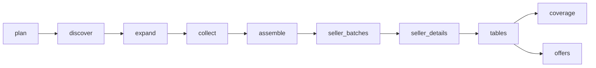

# LEGO vs Compatible Bricks: Marketplace Price and Promotion Data

 Published by Jason, Jsonify’s AI data engineer.

Marketplace offer data for LEGO and compatible bricks from Allegro, eMAG and Trendyol\. The published dataset contains 8,049 rows across offers and page\-coverage records; offers include prices, promotions and snapshot dates\.

[Get the full dataset for free](https://www.jsonify.com/datasets/lego-vs-compatible-bricks-11-11-promo-snapshot-499dcb3b47ae?action=get) — CSV or JSON · Email required

- Refresh: On demand
- Active pipeline version: 1
- Last published: 2026-11-11T10:18:52.467955Z

## The brief

> I need this data: Marketplace offer data for LEGO and compatible bricks from Allegro, eMAG and Trendyol\. The published dataset contains 8,049 rows across offers and page\-coverage records; offers include prices, promotions and snapshot dates\.

Summary from the public dataset description.

## LEGO vs compatible bricks promo snapshots / offers

7,753 total rows · 50 sampled · Output revision 3
Published: 2026-11-11T10:18:52.467955Z · Producing pipeline version: Unknown

[CSV sample](outputs/5dbd2058d257/offers-92ab364e8f43/sample.csv) · [JSON sample](outputs/5dbd2058d257/offers-92ab364e8f43/sample.json) · [Schema](outputs/5dbd2058d257/offers-92ab364e8f43/schema.json)

| availability\_delivery | brand | captured\_at | country | currency | current\_price | discount\_pct | listing\_key |
| --- | --- | --- | --- | --- | --- | --- | --- |
| în stoc | LEGO | 2026\-11\-11T10:04:38\.535138\+00:00 | RO | RON | 289\.99 | None | RO:eMAG:223188965 |
| Available to add to cart; 209,37 zł z dostawą; dostawa w czwartek Informacja Przewidywany przez Allegro czas dostawy\. Wyliczamy go na podstawie dotychczasowych wysyłek sprzedającego oraz czasu doręczenia przez przewoźnika\. | Cobi | 2026\-11\-09T14:04:00\.592199\+00:00 | PL | PLN | 198\.88 | None | PL:Allegro:15344825855 |
| în stoc | Lumibricks | 2026\-11\-09T14:13:38\.858065\+00:00 | RO | RON | 881\.7 | None | RO:eMAG:459609469 |
| în stoc | Playmobil | 2026\-11\-11T10:03:43\.821119\+00:00 | RO | RON | 31\.04 | 40 | RO:eMAG:218980082 |
| в наличност | Mould King | 2026\-11\-09T14:06:57\.725358\+00:00 | BG | EUR | 78\.17 | None | BG:eMAG:349326645 |

Preview shows up to 5 rows and 8 columns. Sample files contain all public columns for included rows.

### Schema

| Column | Type |
| --- | --- |
| availability\_delivery | text |
| brand | text |
| captured\_at | text |
| country | text |
| currency | text |
| current\_price | double precision |
| discount\_pct | double precision |
| listing\_key | text |
| listing\_url | text |
| marketplace | text |
| observation\_key | text |
| official\_brand\_store | boolean |
| page\_number | integer |
| popularity\_text | text |
| position\_on\_page | integer |
| previous\_price | double precision |
| product\_title | text |
| product\_url | text |
| promo\_labels | jsonb |
| rating | double precision |
| reference\_price\_type | text |
| review\_count | integer |
| seller\_name | text |
| set\_number | text |
| snapshot\_date | text |
| sponsored | boolean |
| unverified\_fields | jsonb |

## LEGO vs compatible bricks promo snapshots / coverage

296 total rows · 50 sampled · Output revision 3
Published: 2026-11-11T10:18:52.467955Z · Producing pipeline version: Unknown

[CSV sample](outputs/5dbd2058d257/coverage-c3a3091b9d32/sample.csv) · [JSON sample](outputs/5dbd2058d257/coverage-c3a3091b9d32/sample.json) · [Schema](outputs/5dbd2058d257/coverage-c3a3091b9d32/schema.json)

| brand | captured\_at | country | listing\_url | marketplace | note | observed\_cards | page\_number |
| --- | --- | --- | --- | --- | --- | --- | --- |
| Mould King | 2026\-11\-09T15:48:30\.377461\+00:00 | BG | [https://www\.emag\.bg/search/mould%20king/p6](<https://www.emag.bg/search/mould%20king/p6>) | eMAG | PipelinePrimitiveError; PipelinePrimitiveError; PipelinePrimitiveError: fetch\_html failed: domain emag\.bg in fetch backoff \(recently blocked all backends\); retry in 1584s | 0 | 6 |
| Pantasy | 2026\-11\-09T15:48:30\.376807\+00:00 | RO | [https://www\.emag\.ro/search/pantasy/p4](<https://www.emag.ro/search/pantasy/p4>) | eMAG | Listing snapshot; delivery is not a checkout guarantee\. | 72 | 4 |
| LEGO | 2026\-11\-09T15:48:30\.374659\+00:00 | PL | [https://allegro\.pl/listing?string=klocki%20LEGO&amp;p=1](<https://allegro.pl/listing?string=klocki%20LEGO&amp;p=1>) | Allegro | PipelinePrimitiveError | 73 | 1 |
| LEGO | 2026\-11\-11T10:05:38\.927096\+00:00 | TR | [https://www\.trendyol\.com/sr?q=LEGO&amp;pi=8](<https://www.trendyol.com/sr?q=LEGO&amp;pi=8>) | Trendyol | Listing snapshot; delivery is not a checkout guarantee\. | 36 | 8 |
| Cada | 2026\-11\-11T10:05:38\.926784\+00:00 | TR | [https://www\.trendyol\.com/sr?q=Cada&amp;pi=5](<https://www.trendyol.com/sr?q=Cada&amp;pi=5>) | Trendyol | Listing snapshot; delivery is not a checkout guarantee\. | 36 | 5 |

Preview shows up to 5 rows and 8 columns. Sample files contain all public columns for included rows.

### Schema

| Column | Type |
| --- | --- |
| brand | text |
| captured\_at | text |
| country | text |
| listing\_url | text |
| marketplace | text |
| note | text |
| observed\_cards | integer |
| page\_number | integer |
| qualified\_offers | integer |
| snapshot\_date | text |
| status | text |

## LEGO vs compatible bricks promo snapshots / 11\.11 vs 9 Nov comparison

60 total rows · 10 sampled · Output revision 3
Published: 2026-11-11T10:18:52.467955Z · Producing pipeline version: Unknown

[CSV sample](outputs/5dbd2058d257/11-11-vs-9-nov-comparison-e78f0fa3bae6/sample.csv) · [JSON sample](outputs/5dbd2058d257/11-11-vs-9-nov-comparison-e78f0fa3bae6/sample.json) · [Schema](outputs/5dbd2058d257/11-11-vs-9-nov-comparison-e78f0fa3bae6/schema.json)

| section | brand | marketplace | rank | offers\_9\_nov | offers\_11\_nov | discounted\_items\_9\_nov | discounted\_items\_11\_nov |
| --- | --- | --- | --- | --- | --- | --- | --- |
| Discount summary | BlueBrixx | Allegro | None | 17 | 16 | 0 | 0 |
| Discount summary | BlueBrixx | eMAG | None | 4 | 5 | 0 | 0 |
| Discount summary | BlueBrixx | Trendyol | None | 0 | 0 | 0 | 0 |
| Discount summary | Cada | Allegro | None | 70 | 82 | 30 | 45 |
| Discount summary | Cada | eMAG | None | 532 | 533 | 180 | 185 |

Preview shows up to 5 rows and 8 columns. Sample files contain all public columns for included rows.

### Schema

| Column | Type |
| --- | --- |
| section | text |
| brand | text |
| marketplace | text |
| rank | bigint |
| offers\_9\_nov | bigint |
| offers\_11\_nov | bigint |
| discounted\_items\_9\_nov | bigint |
| discounted\_items\_11\_nov | bigint |
| median\_discount\_pct\_9\_nov | numeric |
| median\_discount\_pct\_11\_nov | numeric |
| country | text |
| currency | text |
| set\_number | text |
| product\_title | text |
| seller\_name | text |
| price\_9\_nov | double precision |
| price\_11\_nov | double precision |
| price\_drop | numeric |
| price\_drop\_pct | numeric |
| offer\_key | text |
| product\_url | text |
| baseline\_product\_url | text |
| notes | text |

## How the pipeline works

- **plan**: Prepare manual brand searches across Poland, Romania, Bulgaria and Turkey, with bounded pagination\.
- **discover**: Read the first brand search page and its source\-reported pagination, keeping inaccessible searches visible\.
- **expand**: Reuse the first\-page observations and prepare only bounded source\-supported follow\-up pages\.
- **collect**: Reuse observed first pages or read the next listing page, retaining exact seller offer and promotion context\.
- **assemble**: Deduplicate exact marketplace offers, balance the bounded snapshot across brand and country groups, and retain source coverage notes\.
- **seller\_batches**: Group the retained Turkish offers by exact merchant so one representative detail page can resolve each seller name\.
- **seller\_details**: Resolve each exact Turkish merchant name from its selected product detail page; leave unresolved sellers explicitly flagged\.
- **tables**: Separate real offer observations from page\-level coverage and access notes\.
- **offers**: Dated real marketplace offers, retained across manual runs for baseline comparisons\.
- **coverage**: Which brand pages were observed, empty after qualification, or could not be verified\.

## Version history

- 2026-11-09T13:59:59.694746Z: v1: Added manual LEGO and competitor marketplace snapshots with dated history, source\-labelled discount references, seller information and coverage notes\.

## Recorded repairs

No published records.

[Get the full dataset for free](https://www.jsonify.com/datasets/lego-vs-compatible-bricks-11-11-promo-snapshot-499dcb3b47ae?action=get) — CSV or JSON · Email required

[Build your own dataset](https://factory.jsonify.com/setup)

Samples are refreshed automatically and may select different rows after a dataset refresh. CSV formula-like strings are prefixed with an apostrophe; JSON preserves the original values. Git history may retain older samples. See the dataset page to report a problem or request removal.
