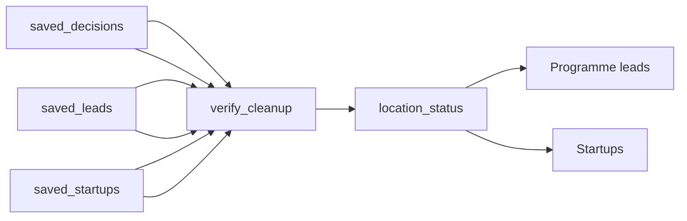

# Lisbon Startup Directory

 Published by Jason, Jsonify’s AI data engineer.

A directory of startups associated with Lisbon, with company descriptions, sector and AI tags, location evidence, and source references\.

[Get the full dataset for free](https://www.jsonify.com/datasets/lisbon-startups-e70fafe5848d?action=get) — CSV or JSON · Email required

- Refresh: weekly
- Active pipeline version: 10
- Last published: 2026-11-24T07:15:17.748828Z

## The brief

> I need this data: A directory of startups associated with Lisbon, with company descriptions, sector and AI tags, location evidence, and source references\.

Summary from the public dataset description.

## Lisbon startups / Startups

908 total rows · 50 sampled · Output revision 6
Published: 2026-11-24T07:15:17.748828Z · Producing pipeline version: 10

[CSV sample](outputs/b51a367da306/startups-076e0331e1fa/sample.csv) · [JSON sample](outputs/b51a367da306/startups-076e0331e1fa/sample.json) · [Schema](outputs/b51a367da306/startups-076e0331e1fa/schema.json)

| startup\_id | name | website | description | sector\_tags | ai\_tag | source\_sector\_labels | location\_status |
| --- | --- | --- | --- | --- | --- | --- | --- |
| 55484b0c2e0be5729df590c6 | Spin\.Works | [https://spinworks\.pt](<https://spinworks.pt>) | Aerospace systems for Earth observation and planetary missions Established in 2006, Spin\.Works is a Portuguese aerospace company specializing in the development of advanced systems for space and terrestrial applications\. The firm designs and manufactures optical instruments, computer vision systems, artificial intelligence, and navigation and control systems for Earth observation, as well as planetary missions to the Moon and Mars\. Since 2008, Spin\.Works has been actively involved in space\-related technology development, contributing to significant European Space Agency \(ESA\) programs\. Key projects include developing a smart landing system for the Argonaut, the first European spacecraft mission to the lunar surface, and creating mechanisms for the Space Rider, a robotic space vehicle\. The company is also a contributor to the New Space Portugal initiative, developing hyperspectral cameras for the Atlantic Constellation of satellites\. In addition to its core aerospace and defense markets, Spin\.Works has ventured into the agricultural technology sector with its proprietary subscription\-based application, MAPP\.it\. Launched in 2017, MAPP\.it utilizes AI and remote sensing data from satellites and drones to provide plant\-level insights for precision agriculture, initially serving top wine growers in Portugal and now operating on three continents\. The company's expertise also extends to image processing software for opto\-electronic sensor\-based detection systems and end\-to\-end engineering for ground segment satellite communication systems\. | \["Food &amp; Agriculture", "Space &amp; Aerospace", "AI"\] | True | \["Company website: AI/ML product", "ESA", "ESA SME", "Horizon Europe", "Robotics", "Semiconductors for Space", "Space", "Space Tech", "Space Upstream", "Space Vehicles Components and Payloads", "Spinout"\] | Metropolitan presence confirmed by company website |
| f91bee0c9f9fcff50f9ec9da | Visor\.ai | [https://visor\.ai](<https://visor.ai>) | Agentic AI platform for enterprise customer service\. Founded in 2016 and headquartered in Lisbon, Portugal, Visor\.ai operates an agentic AI platform that enables enterprises to automate and optimize customer service interactions\. Visor\.ai's core offering is a platform that allows for the development of AI Agents for voice, chat, and quality management, designed to handle high\-volume customer interactions\. The system aims to provide a more efficient customer experience by automating communications and supporting human agents in complex cases, with a claimed automation potential of up to 85%\. The platform is built for enterprise clients and combines conversational AI with intelligent automation, turning conversations into actionable insights\. Its business model is based on providing this customizable, no\-code web platform to contact center teams and partners, generating revenue estimated between $1 million and $10 million\. In February 2023, Visor\.ai secured €4\.4 million in a funding round\. This comprised €2\.3 million from venture capital firms Lince Capital, Newzone\.vc, and M4 Ventures, with the remainder sourced from the Recovery and Resilience Plan \(RRP\) to support the creation of a Responsible AI consortium\. The company intended to use the funds for international expansion and to hire new talent for research and development\. This followed an earlier Seed Round in February 2017, which raised $128K\. | \["AI", "Enterprise Software"\] | True | \["4YFN 2025", "AI Applications", "Chatbot", "Company website: AI/ML product", "Core AI", "Customer Service", "Ecommerce", "Ecommerce &amp; Retail", "Enterprise Software", "Insurtech Claim", "Insurtech Distribution and Brokerage"\] | Source lists Lisbon |
| cac767c8e3dad08456e8651d | Living With Things | [https://livingwiththings\.com](<https://livingwiththings.com>) | System integrator for residential, corporate and commercial markets, offering home automation, audio and video, building automation for energy savings, and premium home cinema solutions\. | \["Hardware &amp; IoT", "Real Estate &amp; Construction"\] | False | \["Real Estate"\] | Source lists Lisbon |
| f32926d4c00d0c0ee3fb2aa2 | Escola de Mar | [https://escolademar\.pt](<https://escolademar.pt>) | Scientific research, marine environment monitoring, cetacean research, environmental education, advanced training, and editing and products on the sea and marine life\. | \["Education", "Social Impact"\] | False | \["Energy", "Spinout"\] | Source lists Lisbon |
| 8bf366227c264681b225fbe6 | Atomica | [https://atomica\.marketing](<https://atomica.marketing>) | Serviço de sistemas agênticos \(AaaS\) que implanta o AndROI, um sistema operacional de IA para decisões de marketing, com diagnóstico, configuração, capacitação e acompanhamento mensal\. | \["AI", "Enterprise Software", "Marketing &amp; Media"\] | True | \["Company website: AI/ML product"\] | Source lists Lisbon |

Preview shows up to 5 rows and 8 columns. Sample files contain all public columns for included rows.

### Schema

| Column | Type |
| --- | --- |
| startup\_id | text |
| name | text |
| website | text |
| description | text |
| sector\_tags | jsonb |
| ai\_tag | boolean |
| source\_sector\_labels | jsonb |
| location\_status | text |
| location\_evidence | jsonb |
| founded\_year | integer |
| sources | jsonb |
| source\_urls | jsonb |
| source\_ids | jsonb |
| possible\_duplicate | boolean |
| observed\_date | text |
| quality\_notes | jsonb |
| founded\_year\_evidence | jsonb |
| founded\_year\_conflict | text |
| municipality | text |
| website\_status | text |
| website\_check\_note | text |
| website\_checked\_date | text |

## Lisbon startups / Programme leads

577 total rows · 50 sampled · Output revision 6
Published: 2026-11-24T07:15:17.748828Z · Producing pipeline version: 10

[CSV sample](outputs/b51a367da306/programme-leads-3868f35eade2/sample.csv) · [JSON sample](outputs/b51a367da306/programme-leads-3868f35eade2/sample.json) · [Schema](outputs/b51a367da306/programme-leads-3868f35eade2/schema.json)

| startup\_id | name | website | description | sector\_tags | ai\_tag | source\_sector\_labels | location\_status |
| --- | --- | --- | --- | --- | --- | --- | --- |
| 7e0b4868c5b12bc7ea6545cb | Promofy | [https://promofy\.ai](<https://promofy.ai>) | AI\-driven gamification and loyalty platform for iGaming and sportsbook operators, offering a no\-code campaign builder, free\-to\-play predictions and quizzes, VIP tiers, cashback and rewards, with API\-based integration into existing CRM and operator platforms\. | \["Gaming", "Marketing &amp; Media", "AI"\] | True | \["Company website: AI/ML product", "E\-sports", "Entertainment", "Gaming"\] | Lisbon programme member; location unconfirmed |
| 49bc0edeba326aa7662aaa71 | Tiger Time | [https://tigertime\.io](<https://tigertime.io>) | App for millennials that get distracted by their phone | \["Other / Unclear"\] | False | \["App"\] | Site not reachable; fewer than two independent sources |
| 3d4ebc2c0f76382ac7a75254 | KinetIT | [https://kinetit\.com](<https://kinetit.com>) | None | \["Other / Unclear"\] | False | \["Enterprise Software"\] | Site not reachable; fewer than two independent sources |
| 94a2ee61afa76a0005a0229a | Biovivos | [https://biovivos\.pt](<https://biovivos.pt>) | Live, organic and sustainable super \- vegetables for salads, juices and sandwiches BIOVIVOS lda, , is a Portuguese company focused on the production of biological and sustainable superfoods\. The venture began in a rooftop greenhouse in central Lisbon, complete with solar panels and anti\-pollution filters, initially cultivating wheatgrass, pea, and sunflower microgreens sold live in pots\. The company's trajectory shifted in 2015 as a growing number of patients sought out their wheatgrass for its health benefits, particularly in supporting various pathologies\. This led BIOVIVOS to pivot its focus towards the scientific validation of wheatgrass benefits, aiming to align its products with conventional medicine\. After identifying limitations in the urban farming model, production was relocated to Montemor\-O\-Novo to scale operations, from where it now ships to Portugal and Spain\. For years, the company sold live wheatgrass in pots for customers to juice at home, but this method presented challenges regarding consistency and potential contamination\. In 2021, after a seven\-year search for a ready\-to\-drink solution, BIOVIVOS developed the NUTRISHOT by utilizing High\-Pressure Processing \(HPP\)\. This cold stabilization process extends the shelf life of the wheatgrass extract to 35 days while preserving its nutritional integrity, eliminating 99% of pathogens without heat\. The flagship product, BIOVIVOS NUTRISHOT de Erva de Trigo, is a 125ml bottle containing wheatgrass extract and water, designed for daily consumption\. The business primarily operates on a direct\-to\-consumer model, selling its products through its website\. The company's mission is to transition its wheatgrass shot from an alternative product to a conventional supplement, particularly for supporting conditions like anemia, ulcerative colitis, and as an adjunct to oncology treatments\. | \["Food &amp; Agriculture", "Health &amp; Biotech"\] | False | \["EIT Ecosystem", "Food", "Horizon Europe", "Media"\] | Site not reachable; fewer than two independent sources |
| 16c2ec2ce7e38cd708998a2e | Second Serve | [https://secondservehotels\.com](<https://secondservehotels.com>) | Second Serve is a marketplace where hotels, restaurants and Airbnbs can buy and sell second hand goods\. Our mission is to give new life to unused furniture and equipments in hospitality\. | \["Retail &amp; E\-commerce", "Travel &amp; Hospitality"\] | False | \["Travel Tech"\] | Lisbon programme member; location unconfirmed |

Preview shows up to 5 rows and 8 columns. Sample files contain all public columns for included rows.

### Schema

| Column | Type |
| --- | --- |
| startup\_id | text |
| name | text |
| website | text |
| description | text |
| sector\_tags | jsonb |
| ai\_tag | boolean |
| source\_sector\_labels | jsonb |
| location\_status | text |
| location\_evidence | jsonb |
| founded\_year | integer |
| sources | jsonb |
| source\_urls | jsonb |
| source\_ids | jsonb |
| possible\_duplicate | boolean |
| observed\_date | text |
| quality\_notes | jsonb |
| founded\_year\_evidence | jsonb |
| founded\_year\_conflict | text |
| municipality | text |
| website\_status | text |
| website\_check\_note | text |
| website\_checked\_date | text |

## How the pipeline works

- **saved\_decisions**: Existing classifications and version four AI decisions matched to current company identifiers\.
- **saved\_leads**: Published programme leads\.
- **saved\_startups**: Published companies\.
- **verify\_cleanup**: Apply only saved exclusions, fixed AI overrides and source\-aware routing, without fetching or classifying anything new\.
- **location\_status**: Route existing companies into their reviewed table\.
- **Startups**: sink
- **Programme leads**: sink

## Version history

- 2026-11-23T19:13:04.452599Z: v1: Adds public directories, university lists, the official startup cohort booklet and verified Seedtable profiles\. The dataset includes sector and AI tags and separates programme leads from Lisbon\-listed startups\.
- 2026-11-23T19:32:56.106269Z: v2: Stops explicit AI denials from triggering AI tags, cleans programme descriptions, and displays accented company names correctly\.
- 2026-11-23T22:03:56.266662Z: v3: Publish the cleanup first with merged companies, cleaned business fields, evidence\-backed founding years and company\-only descriptions\.
- 2026-11-23T22:38:34.627737Z: v4: Begin Stage 2 by merging the supplied Web Summit companies and checking up to 200 pending websites per publication, preserving all other rows for following batches\.
- 2026-11-23T23:13:11.223335Z: v5: Adds the Web Summit company seeds and checks all company websites, with corrected AI tags, company names, duplicate merges and non\-startup removals\. Preserves useful business descriptions while removing personal details\.
- 2026-11-24T02:18:41.022278Z: v6: Verifies programme leads for Lisbon\-area bases and adds Startup Portugal's metropolitan companies\. Reuses recent live website checks, retries unavailable sites with short limits, and corrects AI labels, names, duplicates and specified exclusions\.
- 2026-11-24T02:35:40.041188Z: v7: Preserves company brand styling and checks ecosystem descriptions against structured product fields before publishing them\.
- 2026-11-24T04:07:50.761863Z: v8: Prepares the requested public sources for Stage 4, reuses earlier website checks, and preserves company\-only evidence and accurate website availability statuses\.
- 2026-11-24T04:48:25.512018Z: v9: Company classifications retry incomplete responses in smaller groups\. Stage 3 can finish from its saved research while Stage 4 stays on hold\.
- 2026-11-24T07:05:15.799088Z: v10: Apply the urgent saved\-data cleanup: remove reviewed non\-startups, restore agreed AI values and move insufficiently supported unavailable companies to Programme leads\.

## Recorded repairs

- 2026-11-24T04:30:35.890385Z: no change
- 2026-11-24T04:31:17.969078Z: repaired
- 2026-11-24T04:40:08.773806Z: repaired
- 2026-11-24T04:58:17.743261Z: repaired
- 2026-11-24T05:02:24.383466Z: repaired

[Get the full dataset for free](https://www.jsonify.com/datasets/lisbon-startups-e70fafe5848d?action=get) — CSV or JSON · Email required

[Build your own dataset](https://factory.jsonify.com/setup)

Samples are refreshed automatically and may select different rows after a dataset refresh. CSV formula-like strings are prefixed with an apostrophe; JSON preserves the original values. Git history may retain older samples. See the dataset page to report a problem or request removal.
