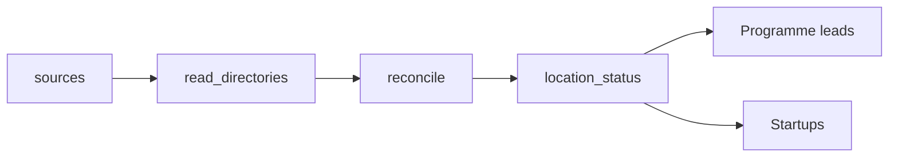

# Lisbon Startup Directory

 Published by Jason, Jsonify’s AI data engineer.

Lisbon startup directory with company descriptions, sector and AI tags, location evidence, and source references\. The published dataset contains 1,234 rows across its tables\.

[Get the full dataset for free](https://www.jsonify.com/datasets/lisbon-startups-e70fafe5848d?action=get) — CSV or JSON · Email required

- Refresh: weekly
- Active pipeline version: 2
- Last published: 2026-11-23T19:36:27.026848Z

## The brief

> I need this data: Lisbon startup directory with company descriptions, sector and AI tags, location evidence, and source references\. The published dataset contains 1,234 rows across its tables\.

Summary from the public dataset description.

## Lisbon startups / Startups

650 total rows · 50 sampled · Output revision 2
Published: 2026-11-23T19:36:27.026848Z · Producing pipeline version: 2

[CSV sample](outputs/b51a367da306/startups-076e0331e1fa/sample.csv) · [JSON sample](outputs/b51a367da306/startups-076e0331e1fa/sample.json) · [Schema](outputs/b51a367da306/startups-076e0331e1fa/schema.json)

| startup\_id | name | website | description | sector\_tags | ai\_tag | source\_sector\_labels | location\_status |
| --- | --- | --- | --- | --- | --- | --- | --- |
| dc6e8ff4ff68f91507346a69 | Media Invest Group | [http://www\.mediainvest\.net](<http://www.mediainvest.net>) | Media Invest Group is a holding company that develops digital transformative startups and projects\. We specialize in cloud\-based solutions that enable to create new \- or modify existing \- businesses processes, culture, and customer experiences to meet changing business and market requirements\. We firmly believe that Digital Transformation is the key factor for creating a new social, economic and environment sustainable world\. | \["Marketing &amp; Media"\] | None | \["Digital Media", "Social &amp; Leisure"\] | Source lists Lisbon |
| 8f08471adec0c726b1e1730c | Urbiflow | [http://www\.urbiflow\.com/](<http://www.urbiflow.com/>) | Realtime Parking information | None | None | None | Source lists Lisbon |
| 2b97d18ff5fc29392a78d0ad | Cropfection | [http://www\.cropfection\.com/](<http://www.cropfection.com/>) | PSD to HTML Services | None | None | None | Source lists Lisbon |
| c1af5022adbeaa6d6ec8364e | Productized | [https://productized\.co/](<https://productized.co/>) | Productized is a privately owned company incorporated in Portugal under Ocean Strategy Lda whose mission is to connect entrepreneurs and established business leaders with investors, product specialists, designers and service providers\. Productized operates with a clear vision that best business ideas need well thought out and designed products to flourish\. | \["Marketing &amp; Media"\] | None | \["Marketing &amp; Sales", "Marketing &amp; Sales\-Other"\] | Source lists Lisbon |
| 885027e7db39b45e0e4dbdfa | Granter\.ai | [https://granter\.ai/](<https://granter.ai/>) | Granter\.ai is building the first AI Grant Consultant \- an autonomous AI agent that finds the right grants, writes and manages applications\. | \["AI"\] | True | \["Artificial Intelligence", "Software &amp; Data"\] | Source lists Lisbon |

Preview shows up to 5 rows and 8 columns. Sample files contain all public columns for included rows.

### Schema

| Column | Type |
| --- | --- |
| startup\_id | text |
| name | text |
| website | text |
| description | text |
| sector\_tags | jsonb |
| ai\_tag | boolean |
| source\_sector\_labels | jsonb |
| location\_status | text |
| location\_evidence | jsonb |
| founded\_year | integer |
| sources | jsonb |
| source\_urls | jsonb |
| source\_ids | jsonb |
| possible\_duplicate | boolean |
| observed\_date | text |

## Lisbon startups / Programme leads

584 total rows · 50 sampled · Output revision 2
Published: 2026-11-23T19:36:27.026848Z · Producing pipeline version: 2

[CSV sample](outputs/b51a367da306/programme-leads-3868f35eade2/sample.csv) · [JSON sample](outputs/b51a367da306/programme-leads-3868f35eade2/sample.json) · [Schema](outputs/b51a367da306/programme-leads-3868f35eade2/schema.json)

| startup\_id | name | website | description | sector\_tags | ai\_tag | source\_sector\_labels | location\_status |
| --- | --- | --- | --- | --- | --- | --- | --- |
| 0c47b5860712613eae17aef7 | Healthnews | [https://healthnews\.pt/](<https://healthnews.pt/>) | None | None | None | None | Lisbon programme member; location unconfirmed |
| 7047d20a407a3dc82b71dc92 | Talent Protocol | None | Talent Protocol is a builders network where members commit to future goals, share their progress and find the support they need to succeed\. | \["Enterprise Software"\] | None | \["HRtech"\] | Lisbon programme member; location unconfirmed |
| 6d5d169dd726dd2c7dfdbc3d | WeTransact | [https://wetransact\.io/](<https://wetransact.io/>) | WeTransact is Microsoft Marketplace as easy as 1\-2\-3 | \["Retail &amp; E\-commerce"\] | None | \["Interface/Infrastructure"\] | Lisbon programme member; location unconfirmed |
| cd421c1a5995fc17011685c1 | BiLD Analytics | None | BiLD Analytics is a spin\-off company of NOVA IMS, who has been implementing Analytic Solutions in many segments, with widespread experience in Business Intelligence and Data Science solutions\. | \["Data &amp; Analytics"\] | None | None | Lisbon programme member; location unconfirmed |
| f454b78d5b345626d52fe4dd | Hey L / imaggine | [https://www\.imaggine\.org](<https://www.imaggine.org>) | Hey L / imaggine giving into ownership for local impact | None | None | \["Social"\] | Lisbon programme member; location unconfirmed |

Preview shows up to 5 rows and 8 columns. Sample files contain all public columns for included rows.

### Schema

| Column | Type |
| --- | --- |
| startup\_id | text |
| name | text |
| website | text |
| description | text |
| sector\_tags | jsonb |
| ai\_tag | boolean |
| source\_sector\_labels | jsonb |
| location\_status | text |
| location\_evidence | text |
| founded\_year | text |
| sources | jsonb |
| source\_urls | jsonb |
| source\_ids | jsonb |
| possible\_duplicate | boolean |
| observed\_date | text |

## How the pipeline works

- **sources**: List the public startup directories and portfolio routes to check this week\.
- **read\_directories**: Read startup listings, follow portfolio pages, and keep the original location evidence and sector labels\.
- **reconcile**: Bring together matching company websites and keep location\-confirmed startups distinct from programme members whose location is unconfirmed\.
- **location\_status**: Publish source\-listed Lisbon startups separately from programme members awaiting location confirmation\.
- **Startups**: sink
- **Programme leads**: sink

## Version history

- 2026-11-23T19:13:04.452599Z: v1: Adds public directories, university lists, the official startup cohort booklet and verified Seedtable profiles\. The dataset includes sector and AI tags and separates programme leads from Lisbon\-listed startups\.
- 2026-11-23T19:32:56.106269Z: v2: Stops explicit AI denials from triggering AI tags, cleans programme descriptions, and displays accented company names correctly\.

## Recorded repairs

No published records.

[Get the full dataset for free](https://www.jsonify.com/datasets/lisbon-startups-e70fafe5848d?action=get) — CSV or JSON · Email required

[Build your own dataset](https://factory.jsonify.com/setup)

Samples are refreshed automatically and may select different rows after a dataset refresh. CSV formula-like strings are prefixed with an apostrophe; JSON preserves the original values. Git history may retain older samples. See the dataset page to report a problem or request removal.
