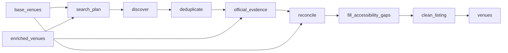

# Lisbon Venue Accessibility

 Published by Jason, Jsonify’s AI data engineer.

Lisbon venue accessibility data with public\-source evidence about wheelchair entrances, step\-free access, toilets, parking and other facilities\. The published tables contain 298 rows in total, with 149 venue rows in each table\.

[Get the full dataset for free](https://www.jsonify.com/datasets/lisbon-venue-accessibility-14d9f76469c1?action=get) — CSV or JSON · Email required

- Refresh: On demand
- Active pipeline version: 10
- Last published: 2026-11-11T12:59:22.049505Z

## The brief

> I need this data: Lisbon venue accessibility data with public\-source evidence about wheelchair entrances, step\-free access, toilets, parking and other facilities\. The published tables contain 298 rows in total, with 149 venue rows in each table\.

Summary from the public dataset description.

## Lisbon venue accessibility / venues

149 total rows · 50 sampled · Output revision 7
Published: 2026-11-11T12:59:22.049505Z · Producing pipeline version: 10

[CSV sample](outputs/9c92faad7d64/venues-bc318ecbb352/sample.csv) · [JSON sample](outputs/9c92faad7d64/venues-bc318ecbb352/sample.json) · [Schema](outputs/9c92faad7d64/venues-bc318ecbb352/schema.json)

| venue\_id | venue\_name | category | area | address | website | latitude | longitude |
| --- | --- | --- | --- | --- | --- | --- | --- |
| google:ChIJYzupcIUxGQ0RQi6E3FtfRhw | MEO Arena | Event &amp; concert venues | Parque das Nações / Web Summit area | MEO Arena, Rossio dos Olivais 2\.13\.01, 1990\-231 Lisboa | [http://arena\.meo\.pt/](<http://arena.meo.pt/>) | 38\.7685312 | \-9\.0940297 |
| google:ChIJBe6WcoY1GQ0RBYrn\_F0o\_xc | Brazilian Concept Baixa Chiado | Restaurants &amp; cafés | City centre | Brazilian Concept Baixa Chiado, R\. do Crucifixo 126 128, 1100\-185 Lisboa | [http://brazilianconcept\.pt/](<http://brazilianconcept.pt/>) | 38\.7112039 | \-9\.139069899999999 |
| google:ChIJ7wPpVGEzGQ0Rpt1XNNNvVrk | Casa Fernando Pessoa | Museums &amp; attractions | City centre | Casa Fernando Pessoa, R\. Coelho da Rocha 16 18, 1250\-088 Lisboa | [http://casafernandopessoa\.pt/](<http://casafernandopessoa.pt/>) | 38\.7167116 | \-9\.162497 |
| google:ChIJbfjS9yE1GQ0RYVAg3QgzcmI | Dear Breakfast | Restaurants &amp; cafés | City centre | Dear Breakfast, Calçada de São Francisco 35, 1200\-201 Lisboa | [http://dearbreakfast\.com/](<http://dearbreakfast.com/>) | 38\.709007 | \-9\.139505999999999 |
| google:ChIJOZ4WNN0xGQ0RRqH3VIm6J30 | Dote Parque das Nações | Restaurants &amp; cafés | Parque das Nações / Web Summit area | Dote Parque das Nações, Av\. Dom João II 43e, 1990\-083 Lisboa | [http://dote\.pt/](<http://dote.pt/>) | 38\.771864199999996 | \-9\.0977702 |

Preview shows up to 5 rows and 8 columns. Sample files contain all public columns for included rows.

### Schema

| Column | Type |
| --- | --- |
| venue\_id | text |
| venue\_name | text |
| category | text |
| area | text |
| address | text |
| website | text |
| latitude | double precision |
| longitude | double precision |
| wheelchair\_entrance | text |
| step\_free\_access | text |
| accessible\_toilet | text |
| accessible\_parking | text |
| accessible\_seating | text |
| hearing\_loop | text |
| accessibility\_notes | jsonb |
| source\_ids | jsonb |
| listing\_urls | jsonb |
| all\_observations | jsonb |
| attribute\_sources | jsonb |
| conflicts | jsonb |
| has\_conflict | boolean |
| collected\_at | text |
| web\_check\_note | text |
| source\_checks | jsonb |
| possible\_duplicate\_ids | jsonb |
| excluded\_unverified\_evidence\_count | integer |

## Accessify Lisbon venue accessibility / venues

149 total rows · 50 sampled · Output revision 2
Published: 2026-11-11T12:49:28.756042Z · Producing pipeline version: Unknown

[CSV sample](outputs/e604aa2883c6/venues-bc318ecbb352/sample.csv) · [JSON sample](outputs/e604aa2883c6/venues-bc318ecbb352/sample.json) · [Schema](outputs/e604aa2883c6/venues-bc318ecbb352/schema.json)

| venue\_id | venue\_name | category | area | address | website | latitude | longitude |
| --- | --- | --- | --- | --- | --- | --- | --- |
| google:ChIJf8OGrnkzGQ0RxTEqUE7P5WA | Cinemateca Portuguesa \- Museu do Cinema | Museums &amp; attractions | City centre | Cinemateca Portuguesa \- Museu do Cinema, R\. Barata Salgueiro 39, 1269\-059 Lisboa | [https://www\.cinemateca\.pt/Programacao\.aspx](<https://www.cinemateca.pt/Programacao.aspx>) | 38\.7209976 | \-9\.1487192 |
| google:ChIJtTrLpYsxGQ0RVdOjFbnw\-nc | Marvel Art Wall | Museums &amp; attractions | Parque das Nações / Web Summit area | Marvel Art Wall, Av\. Dom João II 1, 1990\-083 Lisboa | None | 38\.7728274 | \-9\.0977103 |
| google:ChIJbfjS9yE1GQ0RYVAg3QgzcmI | Dear Breakfast | Restaurants &amp; cafés | City centre | Dear Breakfast, Calçada de São Francisco 35, 1200\-201 Lisboa | [http://dearbreakfast\.com/](<http://dearbreakfast.com/>) | 38\.709007 | \-9\.139505999999999 |
| google:ChIJy80eBpQxGQ0RrIXstjKHrBE | Tayybeh | Restaurants &amp; cafés | Parque das Nações / Web Summit area | Tayybeh, Estr\. Moscavide 62A, 1800\-279 Lisboa | [https://www\.tayybeh\.pt/](<https://www.tayybeh.pt/>) | 38\.7743311 | \-9\.100581199999999 |
| google:ChIJI\_JjfoIzGQ0R2j0xI0P11XM | Tivoli | Event &amp; concert venues | City centre | Tivoli, Av\. da Liberdade 182 188, 1250\-146 Lisboa | [https://www\.teatrotivolibbva\.pt/](<https://www.teatrotivolibbva.pt/>) | 38\.7203845 | \-9\.1450896 |

Preview shows up to 5 rows and 8 columns. Sample files contain all public columns for included rows.

### Schema

| Column | Type |
| --- | --- |
| venue\_id | text |
| venue\_name | text |
| category | text |
| area | text |
| address | text |
| website | text |
| latitude | double precision |
| longitude | double precision |
| wheelchair\_entrance | text |
| step\_free\_access | text |
| accessible\_toilet | text |
| accessible\_parking | text |
| accessible\_seating | text |
| hearing\_loop | text |
| accessibility\_notes | jsonb |
| source\_ids | jsonb |
| listing\_urls | jsonb |
| all\_observations | jsonb |
| attribute\_sources | jsonb |
| conflicts | jsonb |
| has\_conflict | boolean |
| collected\_at | text |
| web\_check\_note | text |
| source\_checks | jsonb |
| possible\_duplicate\_ids | jsonb |
| excluded\_unverified\_evidence\_count | integer |

## How the pipeline works

- **base\_venues**: Saved Lisbon venues to enrich and clean without rediscovering listings
- **enriched\_venues**: Optional saved venue evidence for reconciliation without recollecting sources
- **search\_plan**: Plan bounded public Maps searches across central Lisbon and Parque das Nações, plus an OpenStreetMap wheelchair\-tag query\.
- **discover**: Read public Google Maps accessibility groups and OpenStreetMap wheelchair tags, retaining exact place identities and source links\.
- **deduplicate**: Merge only stable place identities or exact\-name matches corroborated by address or website and coordinates, then balance the capped sample across categories and areas\.
- **official\_evidence**: Search each venue's own accessibility pages and official tourism listings, read the matching public pages, and retain only statements backed by quotations in the retrieved text\.
- **reconcile**: Keep explicit true, false and unknown values, attach all attribute evidence, and flag conflicting or scope\-different source statements without choosing a winner\.
- **fill\_accessibility\_gaps**: Check missing venue facilities against public Maps, OSM, official and booking pages; retain exact quotations and branch\-specific source identity\.
- **clean\_listing**: Reconcile new source evidence, preserve conflicts, label The Coffee branches by address and remove venues with no confirmed accessibility attributes\.
- **venues**: Distinct Lisbon venues with accessibility evidence, unknowns, conflicts and collection time\.

## Version history

- 2026-11-10T18:33:13.453832Z: v1: Adds a private one\-off Lisbon venue accessibility sample with per\-attribute evidence, explicit unknowns, source conflict flags and coverage counts\.
- 2026-11-10T18:58:16.992080Z: v2: Corrected the Web Summit\-area venue search so the collection can continue from saved results\.
- 2026-11-10T22:49:33.542369Z: v3: Merged corroborated property and translated\-name matches and flagged unresolved nearby listings\.
- 2026-11-10T22:55:04.450617Z: v4: Corrected MEO Arena’s seating conflict and flagged an additional nearby hostel identity for checking\.
- 2026-11-10T23:00:51.395430Z: v5: Merged MNAC’s two address listings and removed unsupported overall\-accessibility inferences from wheelchair\-loan information\.
- 2026-11-10T23:06:05.587869Z: v6: Corrected Sala Tejo to Event &amp; concert venues using the operator’s description\.
- 2026-11-11T11:31:07.115830Z: v7: Checks missing accessibility facilities against public sources, removes venues with no confirmed attributes, and distinguishes The Coffee branches by address\.
- 2026-11-11T11:52:16.471298Z: v8: Stops further accessibility enrichment at the requested 12:45 Lisbon cutoff and preserves completed evidence for the cleaned listing\.
- 2026-11-11T12:48:56.028589Z: v9: Excluded grab\-rail\-only and ambiguous parking descriptions from confirmed facility counts, retaining them as notes\. Clarified Capitólio’s main\-entrance restriction separately from general entrance access\.
- 2026-11-11T12:59:05.170293Z: v10: Corrected Trindade and Tivoli accessible seating to true, preserving capacity restrictions as notes\. The listing now explains that only three hotels are represented\.

## Recorded repairs

No published records.

[Get the full dataset for free](https://www.jsonify.com/datasets/lisbon-venue-accessibility-14d9f76469c1?action=get) — CSV or JSON · Email required

[Build your own dataset](https://factory.jsonify.com/setup)

Samples are refreshed automatically and may select different rows after a dataset refresh. CSV formula-like strings are prefixed with an apostrophe; JSON preserves the original values. Git history may retain older samples. See the dataset page to report a problem or request removal.
