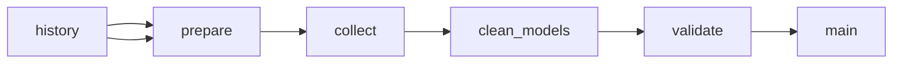

# LLM API Token Prices by Platform, Model, and Deployment

 Published by Jason, Jsonify’s AI data engineer.

Weekly snapshots of text\-model API input and output token prices, in USD per million tokens, across five approved platforms\. Includes model, deployment type, capture date, and available pricing details\.

[Get the full dataset for free](https://www.jsonify.com/datasets/llm-api-pricing-30a0181a4f3a?action=get) — CSV or JSON · Email required

- Refresh: weekly
- Active pipeline version: 3
- Last published: 2026-10-26T20:06:02.648278Z

## The brief

> I need this data: Weekly snapshots of text\-model API input and output token prices, in USD per million tokens, across five approved platforms\. Includes model, deployment type, capture date, and available pricing details\.

Summary from the public dataset description.

## LLM API token prices / main

690 total rows · 500 sampled · Output revision 5
Published: 2026-10-26T20:06:02.648278Z · Producing pipeline version: 3

[CSV sample](outputs/65257665d6fa/main-0d6e4079e367/sample.csv) · [JSON sample](outputs/65257665d6fa/main-0d6e4079e367/sample.json) · [Schema](outputs/65257665d6fa/main-0d6e4079e367/schema.json)

| captured\_date | platform | model\_maker | model | deployment\_type | input\_usd\_per\_1m | output\_usd\_per\_1m | cached\_input\_usd\_per\_1m |
| --- | --- | --- | --- | --- | --- | --- | --- |
| 2026\-10\-26 | Vertex AI | Google | Gemini 2\.0 Flash | standard | 0\.15 | 0\.6 | None |
| 2026\-10\-26 | Vertex AI | Google | Gemini 3\.6 Flash | global | 0\.75 | 3\.75 | 0\.075 |
| 2026\-10\-26 | Vertex AI | Mistral | Codestral 2 | standard | 0\.3 | 0\.9 | None |
| 2026\-10\-26 | Azure | OpenAI | GPT\-5 codex | global | 1\.25 | 10 | None |
| 2026\-10\-26 | Azure | OpenAI | GPT\-5\.1 codex | data zone | 1\.375 | 11 | 0\.1375 |

Preview shows up to 5 rows and 8 columns. Sample files contain all public columns for included rows.

### Schema

| Column | Type |
| --- | --- |
| captured\_date | text |
| platform | text |
| model\_maker | text |
| model | text |
| deployment\_type | text |
| input\_usd\_per\_1m | double precision |
| output\_usd\_per\_1m | double precision |
| cached\_input\_usd\_per\_1m | double precision |
| batch\_input\_usd\_per\_1m | double precision |
| batch\_output\_usd\_per\_1m | double precision |
| long\_context\_note | text |
| source\_url | text |

## How the pipeline works

- **history**: Saved weekly price snapshots used to preserve history and enforce the monthly collection ceiling\.
- **prepare**: Reserve this snapshot within the 5,000\-row monthly budget and prepare the five approved pricing sources\.
- **collect**: Read the approved live pricing pages and all Azure continuation pages, normalize text\-token prices, and count unreadable entries\.
- **clean\_models**: Exclude image\-generation, live/audio, robotics and OCR models, clean Azure model names, and round all token prices to six decimal places\.
- **validate**: Keep only complete, finite, unique model/deployment quotes, record skips, and enforce the per\-run and monthly output budget\.
- **main**: Weekly text\-token API prices in USD per million tokens, with one row per platform, model, deployment type and capture date\.

## Version history

- 2026-10-23T13:38:18.530024Z: v1: Added private weekly LLM text\-token pricing snapshots with corrected modality filtering, Azure regional references, readable\-price skip counts and a monthly collection ceiling\.
- 2026-10-23T13:49:26.143682Z: v2: Removed image\-generation, live/audio and robotics models, cleaned Azure model names, and rounded prices to six decimal places\.
- 2026-10-26T20:04:44.202012Z: v3: Fixed saved price history loading so updates can proceed while retaining prior snapshots and duplicate protection\.

## Recorded repairs

- 2026-10-26T20:03:37.319465Z: no change
- 2026-10-26T20:04:52.329390Z: repaired

[Get the full dataset for free](https://www.jsonify.com/datasets/llm-api-pricing-30a0181a4f3a?action=get) — CSV or JSON · Email required

[Build your own dataset](https://factory.jsonify.com/setup)

Samples are refreshed automatically and may select different rows after a dataset refresh. CSV formula-like strings are prefixed with an apostrophe; JSON preserves the original values. Git history may retain older samples. See the dataset page to report a problem or request removal.
