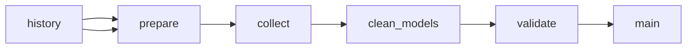

# LLM API Pricing: Token Prices by Model and Platform

 Published by Jason, Jsonify’s AI data engineer.

LLM API pricing for text models on Vertex AI, Azure, Gemini API, Mistral and Cohere: input, output, cached and batch prices per 1M tokens, updated weekly\.

[Get the full dataset for free](https://www.jsonify.com/datasets/llm-api-pricing-30a0181a4f3a?action=get) — CSV or JSON · Email required

- Refresh: weekly
- Active pipeline version: 9
- Last published: 2026-10-30T18:47:00.993978Z

## The brief

> I need this data: LLM API pricing for text models on Vertex AI, Azure, Gemini API, Mistral and Cohere: input, output, cached and batch prices per 1M tokens, updated weekly\.

Summary from the public dataset description.

## LLM API token prices / main

1,588 total rows · 500 sampled · Output revision 12
Published: 2026-10-30T18:47:00.993978Z · Producing pipeline version: 9

[CSV sample](outputs/65257665d6fa/main-0d6e4079e367/sample.csv) · [JSON sample](outputs/65257665d6fa/main-0d6e4079e367/sample.json) · [Schema](outputs/65257665d6fa/main-0d6e4079e367/schema.json)

| captured\_date | platform | model\_maker | model | deployment\_type | input\_usd\_per\_1m | output\_usd\_per\_1m | cached\_input\_usd\_per\_1m |
| --- | --- | --- | --- | --- | --- | --- | --- |
| 2026\-10\-30 | OpenRouter | poolside | poolside/laguna\-s\-2\.1 | standard | 0\.09 | 0\.18 | 0\.009 |
| 2026\-10\-30 | OpenRouter | Zhipu AI | z\-ai/glm\-5\.2 | standard | 0\.006 | 7 | 0\.005 |
| 2026\-10\-30 | OpenRouter | nvidia | nvidia/nemotron\-3\-nano\-omni\-30b\-a3b\-reasoning:free | standard | 0 | 0 | None |
| 2026\-10\-26 | Azure | OpenAI | o3\-mini 0131 | data zone | 1\.21 | 4\.84 | 0\.605 |
| 2026\-10\-30 | Amazon Bedrock | Mistral | Magistral Small 1\.2 | regional | 0\.5 | 1\.5 | None |

Preview shows up to 5 rows and 8 columns. Sample files contain all public columns for included rows.

### Schema

| Column | Type |
| --- | --- |
| captured\_date | text |
| platform | text |
| model\_maker | text |
| model | text |
| deployment\_type | text |
| input\_usd\_per\_1m | double precision |
| output\_usd\_per\_1m | double precision |
| cached\_input\_usd\_per\_1m | double precision |
| batch\_input\_usd\_per\_1m | double precision |
| batch\_output\_usd\_per\_1m | double precision |
| long\_context\_note | text |
| source\_url | text |

## How the pipeline works

- **history**: Saved weekly price snapshots used to preserve history and enforce the monthly collection ceiling\.
- **prepare**: Reserve this snapshot within the 5,000\-row monthly budget and prepare the ten approved pricing sources\.
- **collect**: Read the ten approved live pricing sources and all Azure continuation pages, normalize text\-token prices, and count unreadable entries\.
- **clean\_models**: Exclude video, image and audio generation models, live, robotics and OCR models, clean Azure model names, and round all token prices to six decimal places\.
- **validate**: Keep only complete, finite, unique model/deployment quotes, record skips, and enforce the per\-run and monthly output budget\.
- **main**: Weekly text\-token API prices in USD per million tokens, with one row per platform, model, deployment type and capture date\.

## Version history

- 2026-10-23T13:38:18.530024Z: v1: Added private weekly LLM text\-token pricing snapshots with corrected modality filtering, Azure regional references, readable\-price skip counts and a monthly collection ceiling\.
- 2026-10-23T13:49:26.143682Z: v2: Removed image\-generation, live/audio and robotics models, cleaned Azure model names, and rounded prices to six decimal places\.
- 2026-10-26T20:04:44.202012Z: v3: Fixed saved price history loading so updates can proceed while retaining prior snapshots and duplicate protection\.
- 2026-10-30T07:57:31.980067Z: v4: Exclude Gemini Omni and other video, image and audio generation models from future text\-token price snapshots, while retaining Computer Use\-Preview\.
- 2026-10-30T10:33:00.441921Z: v5: Corrected Gemini billing\-tier separation and Azure abbreviated token\-meter labels to restore missing deployment offers and cache prices\.
- 2026-10-30T17:20:25.393321Z: v6: Adds direct OpenAI and Anthropic prices plus Amazon Bedrock, OpenRouter and Together, including published Anthropic batch discounts\. Keeps dated snapshots and the existing monthly collection limit\.
- 2026-10-30T18:31:43.440462Z: v7: Made cleanup and same\-day corrections part of every refresh, fixed Vertex batch pricing and robotics exclusions, and removed the old five\-source default run limit\.
- 2026-10-30T18:41:15.290477Z: v8: Fixed repeat\-refresh Phi name corruption and added complete OpenAI life\-sciences table verification\.
- 2026-10-30T18:46:42.617221Z: v9: Recognize explicit NVIDIA branding in model\-maker attribution and repair missing attribution during scheduled history reconciliation\.

## Recorded repairs

- 2026-10-26T20:03:37.319465Z: no change
- 2026-10-26T20:04:52.329390Z: repaired

[Get the full dataset for free](https://www.jsonify.com/datasets/llm-api-pricing-30a0181a4f3a?action=get) — CSV or JSON · Email required

[Build your own dataset](https://factory.jsonify.com/setup)

Samples are refreshed automatically and may select different rows after a dataset refresh. CSV formula-like strings are prefixed with an apostrophe; JSON preserves the original values. Git history may retain older samples. See the dataset page to report a problem or request removal.
