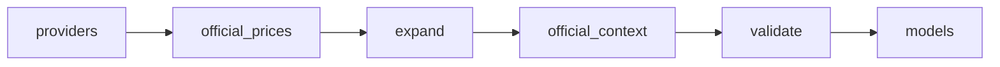

# LLM API pricing

 Published by Jason, Jsonify’s AI data engineer.

[Get the full dataset for free](https://www.jsonify.com/datasets/llm-api-pricing-8f305815ff8c?action=get) — CSV or JSON · Email required

- Refresh: On demand
- Active pipeline version: 4
- Last published: 2026-10-14T12:06:48.861890Z

## LLM API pricing / models

88 total rows · 88 sampled · Output revision 3
Published: 2026-10-14T12:06:48.861890Z · Producing pipeline version: 4

[CSV sample](outputs/3c641330b6b7/models-8edcc26c0f6c/sample.csv) · [JSON sample](outputs/3c641330b6b7/models-8edcc26c0f6c/sample.json) · [Schema](outputs/3c641330b6b7/models-8edcc26c0f6c/schema.json)

| cached\_input\_price\_per\_1m | checked | context\_window | input\_price\_per\_1m | model | output\_price\_per\_1m | pricing\_notes | provider |
| --- | --- | --- | --- | --- | --- | --- | --- |
| 0\.03 | 2026\-10\-14 | 128000 | 0\.3 | codestral\-latest | 0\.9 | Standard USD; global inference; cached input rate \(not cache writes\); dated API ID: codestral\-2508; official API names: codestral\-2508, codestral\-latest | Mistral |
| 0\.1 | 2026\-10\-14 | 1000000 | 2 | claude\-sonnet\-5\-5 | 10 | Standard base tokens; cached input = Hits and refreshes; context from official Claude context\-windows docs; API ID from official model status table | Anthropic |
| None | 2026\-10\-14 | 131072 | 1 | gemini\-robotics\-er\-2\-streaming\-preview | 5 | Paid Standard tier; input: $1\.00 \(text / image / video / audio\) through December 31, 2026\. $2\.00 \(text / image / video / audio\) starting January 1, 2027\.; output: $5\.00 through December 31, 2026\. $10\.00 starting January 1, 2027\.; exact context/input\-token limit from official model page: [https://ai\.google\.dev/gemini\-api/docs/models/gemini\-robotics\-er\-2\-streaming\-preview?hl=en](<https://ai.google.dev/gemini-api/docs/models/gemini-robotics-er-2-streaming-preview?hl=en>); cached input not listed on consulted official docs | Google |
| 0\.03 | 2026\-10\-14 | 1048576 | 0\.3 | gemini\-2\.5\-flash | 2\.5 | Paid Standard tier; input: $0\.30 \(text / image / video\) $1\.00 \(audio\); output: $2\.50; cached: $0\.03 \(text / image / video\) $0\.1 \(audio\) $1\.00 / 1,000,000 tokens per hour \(storage price\); pricing page states 1M token context window; exact context/input\-token limit from official model page: [https://ai\.google\.dev/gemini\-api/docs/models/gemini\-2\.5\-flash?hl=en](<https://ai.google.dev/gemini-api/docs/models/gemini-2.5-flash?hl=en>) | Google |
| 0\.025 | 2026\-10\-14 | 400000 | 0\.25 | gpt\-5\-mini | 2 | Standard; Short context | OpenAI |

Preview shows up to 5 rows and 8 columns. Sample files contain all public columns for included rows.

### Schema

| Column | Type |
| --- | --- |
| cached\_input\_price\_per\_1m | double precision |
| checked | text |
| context\_window | integer |
| input\_price\_per\_1m | double precision |
| model | text |
| output\_price\_per\_1m | double precision |
| pricing\_notes | text |
| provider | text |
| source\_url | text |

## How the pipeline works

- **providers**: Select the five official provider pricing pages for a complete snapshot\.
- **official\_prices**: Read official Standard prices, including collapsed and deprecated text models, and retain provider tier caveats\.
- **expand**: Reconcile five complete provider results and expand one row per provider and text model\.
- **official\_context**: Read linked official model documentation for explicit context windows and API IDs without guessing missing specifications\.
- **validate**: Verify distinct model identities, all five providers, numeric USD prices, UTC date, and explicit notes for every null\.
- **models**: Official paid Standard text/chat model prices in USD per 1M tokens with context limits and caveats\.

## Version history

- 2026-10-14T09:09:24.501652Z: v1: Adds a five\-provider official text\-model pricing snapshot with Standard paid rates, context limits, UTC check dates and explicit missing\-value notes\.
- 2026-10-14T09:46:40.494529Z: v2: Removed the two retired DeepSeek Flash aliases and fixed Google pricing verification for localized pages\. Filled OpenAI contexts from official model pages with noted snapshot inheritance, and normalized all Claude rows to official API IDs with documented legacy contexts\.
- 2026-10-14T11:50:59.108201Z: v3: Fills the missing Google context limits from official model specifications, excludes completion\-only models, and normalizes documented API names while retaining dated IDs in notes\.
- 2026-10-14T12:05:43.643567Z: v4: Request English explicitly for Anthropic pricing, retaining fallback and all model prices, links and context enrichment\.

## Recorded repairs

No published records.

[Get the full dataset for free](https://www.jsonify.com/datasets/llm-api-pricing-8f305815ff8c?action=get) — CSV or JSON · Email required

[Build your own dataset](https://factory.jsonify.com/setup)

Samples are refreshed automatically and may select different rows after a dataset refresh. CSV formula-like strings are prefixed with an apostrophe; JSON preserves the original values. Git history may retain older samples. See the dataset page to report a problem or request removal.
