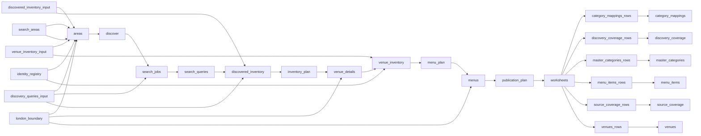

# Deliveroo, Uber Eats and Just Eat Menu Prices in London

 Published by Jason, Jsonify’s AI data engineer.

Deliveroo, Uber Eats and Just Eat menu prices in London: 3,365 menu items from 30 restaurant listings, with base prices, categories and ratings\.

[Get the full dataset for free](https://www.jsonify.com/datasets/london-delivery-app-venues-and-menus-d603c7022886?action=get) — CSV or JSON · Email required

- Refresh: weekly
- Active pipeline version: 8
- Last published: 2026-11-01T13:26:30.960098Z

## The brief

> I need this data: Deliveroo, Uber Eats and Just Eat menu prices in London: 3,365 menu items from 30 restaurant listings, with base prices, categories and ratings\.

Summary from the public dataset description.

## London delivery app venues and menus / menu\_items

3,365 total rows · 50 sampled · Output revision 4
Published: 2026-11-01T13:26:30.960098Z · Producing pipeline version: Unknown

[CSV sample](outputs/7f457be47ed7/menu-items-3a06a1b2c7ba/sample.csv) · [JSON sample](outputs/7f457be47ed7/menu-items-3a06a1b2c7ba/sample.json) · [Schema](outputs/7f457be47ed7/menu-items-3a06a1b2c7ba/schema.json)

Curated sample from revision 4; saved 2026-11-02T12:38:01.992694Z. This illustrative snapshot does not refresh with the dataset.

| media | item\_name | venue\_name | description | categories | category\_context | base\_price | currency |
| --- | --- | --- | --- | --- | --- | --- | --- |
| \{"image\_url": "[https://just\-eat\-prod\-eu\-res\.cloudinary\.com/image/upload/c\_fill,q\_auto,c\_fill,f\_auto,w\_640,h\_480/v1/uk/dishes/244418/9f9011c1fb29e21cf0d7b4458890698f](<https://just-eat-prod-eu-res.cloudinary.com/image/upload/c_fill,q_auto,c_fill,f_auto,w_640,h_480/v1/uk/dishes/244418/9f9011c1fb29e21cf0d7b4458890698f>)", "status": "observed"} | BBQ Mountain Burger | Chicken Valley Holborn | A boneless breast of chicken marinated in BBQ sauce, served on a toasted sesame seed bun, complemented by a classic hash brown, crunchy lettuce, melted slice of cheese and basted with our signature BBQ sauce\. | \[\{"category\_id": "food\_type\.burgers", "dimension": "food\_type", "name": "Burgers"}\] | \{"basis": "source\_menu\_section", "mapping\_status": "mapped", "source\_labels": \["Burgers"\], "taxonomy\_version": "1\.0", "unmapped\_labels": \[\]} | 8\.99 | GBP |
| \{"image\_url": "[https://rs\-menus\-api\.roocdn\.com/images/cc666755\-f4fa\-433c\-9174\-fc32f815e2cd/image\.jpeg?width=640&amp;height=480&amp;auto=webp&amp;format=jpg&amp;fit=crop](<https://rs-menus-api.roocdn.com/images/cc666755-f4fa-433c-9174-fc32f815e2cd/image.jpeg?width=640&amp;height=480&amp;auto=webp&amp;format=jpg&amp;fit=crop>)", "status": "observed"} | Chicken Yakisoba | Maki &amp; Ramen \- Soho | Japanese fried chicken tossed in teppanyaki fried noodles, assorted vegetables and sweet soba sauce\.  | \[\{"category\_id": "food\_type\.noodles", "dimension": "food\_type", "name": "Noodles"}\] | \{"basis": "source\_menu\_section", "mapping\_status": "mapped", "source\_labels": \["🥢Yakisoba🥢"\], "taxonomy\_version": "1\.0", "unmapped\_labels": \[\]} | 16 | GBP |
| \{"image\_url": "[https://rs\-menus\-api\.roocdn\.com/images/d6b84f0d\-8c9b\-4d21\-9700\-96445097df23/image\.jpeg?width=640&amp;height=480&amp;auto=webp&amp;format=jpg&amp;fit=crop](<https://rs-menus-api.roocdn.com/images/d6b84f0d-8c9b-4d21-9700-96445097df23/image.jpeg?width=640&amp;height=480&amp;auto=webp&amp;format=jpg&amp;fit=crop>)", "status": "observed"} | Tokyo Sushi Box \(16 Pieces\) | Gourmet Sushi \- Southampton Row | 4 salmon nigiri, 6 salmon uramaki, 6 california uramaki\. | \[\{"category\_id": "food\_type\.sushi", "dimension": "food\_type", "name": "Sushi"}\] | \{"basis": "source\_menu\_section", "mapping\_status": "mapped", "source\_labels": \["Sushi Boxes"\], "taxonomy\_version": "1\.0", "unmapped\_labels": \[\]} | 16\.45 | GBP |
| \{"image\_url": "[https://just\-eat\-prod\-eu\-res\.cloudinary\.com/image/upload/c\_fill,f\_auto,w\_640,h\_480/v1/uk/dishes/brg\_je\-uk\-pizza\-hut\-restaurants/243e3610068f13fe20132f4bc99cd00b](<https://just-eat-prod-eu-res.cloudinary.com/image/upload/c_fill,f_auto,w_640,h_480/v1/uk/dishes/brg_je-uk-pizza-hut-restaurants/243e3610068f13fe20132f4bc99cd00b>)", "status": "observed"} | Medium Create Your Own: any 2 toppings | Pizza Hut Restaurants \- Strand | Includes Mozzarella\. Simply choose your sauce and add any 2 toppings\. \(Serves:1\) | \[\{"category\_id": "food\_type\.pizza", "dimension": "food\_type", "name": "Pizza"}\] | \{"basis": "source\_menu\_section", "mapping\_status": "mapped", "source\_labels": \["Medium Pizza"\], "taxonomy\_version": "1\.0", "unmapped\_labels": \[\]} | 17\.99 | GBP |
| \{"image\_url": "[https://tb\-static\.uber\.com/prod/image\-proc/processed\_images/125e56e2e304506f38b3d3cc3bae0cd3/70aa2a4db7f990373ca9c376323e3dea\.jpeg](<https://tb-static.uber.com/prod/image-proc/processed_images/125e56e2e304506f38b3d3cc3bae0cd3/70aa2a4db7f990373ca9c376323e3dea.jpeg>)", "status": "observed"} | Scaloppa Di Vitello Alla Milanese | Da Paolo Restaurant | Deep fried veal escalope served with sautéed potatoes and green leaves salad or spaghetti with tomato sauce\. | \[\{"category\_id": "food\_type\.meat", "dimension": "food\_type", "name": "Meat"}\] | \{"basis": "source\_menu\_section", "mapping\_status": "mapped", "source\_labels": \["Meat"\], "taxonomy\_version": "1\.0", "unmapped\_labels": \[\]} | 39\.95 | GBP |

Preview shows up to 5 rows and 8 columns. Sample files contain all public columns for included rows.

### Schema

| Column | Type |
| --- | --- |
| media | jsonb |
| item\_name | text |
| venue\_name | text |
| description | text |
| categories | jsonb |
| category\_context | jsonb |
| base\_price | double precision |
| currency | text |
| availability | jsonb |
| variant | jsonb |
| customization | jsonb |
| price\_details | jsonb |
| app\_name | text |
| source\_url | text |

## London delivery app venues and menus / venues

30 total rows · 10 sampled · Output revision 4
Published: 2026-11-01T13:26:30.960098Z · Producing pipeline version: Unknown

[CSV sample](outputs/7f457be47ed7/venues-bc318ecbb352/sample.csv) · [JSON sample](outputs/7f457be47ed7/venues-bc318ecbb352/sample.json) · [Schema](outputs/7f457be47ed7/venues-bc318ecbb352/schema.json)

| acquisition\_method | app\_name | categories | category\_context | collected\_at | delivery | delivery\_context | hours |
| --- | --- | --- | --- | --- | --- | --- | --- |
| android\_app\_api | Deliveroo | \[\{"name": "Chicken", "dimension": "food\_type", "category\_id": "food\_type\.chicken"}, \{"name": "Burgers", "dimension": "food\_type", "category\_id": "food\_type\.burgers"}, \{"name": "Chicken Wings", "dimension": "food\_type", "category\_id": "food\_type\.chicken\_wings"}\] | \{"basis": "source\_category", "source\_labels": \["Chicken", "Burgers", "Wings"\], "mapping\_status": "mapped", "unmapped\_labels": \[\], "taxonomy\_version": "1\.0"} | 2026\-11\-01T13:20:26\.762434\+00:00 | \{"eta": \{"status": "not\_provided", "max\_minutes": null, "min\_minutes": null}, "fe… | \{"latitude": 51\.5033395, "postcode": "SW1A 2AA", "longitude": \-0\.1275662} | \{"status": "partial", "schedule": \[\], "current\_notice": "Closes at 22:45", "delivery\_date\_schedule": \[\]} |
| android\_app\_api | Deliveroo | \[\{"name": "Italian", "dimension": "cuisine", "category\_id": "cuisine\.italian"}, \{"name": "Vegan Options", "dimension": "venue\_attribute", "category\_id": "venue\_attribute\.vegan\_options"}, \{"name": "Pasta", "dimension": "food\_type", "category\_id": "food\_type\.pasta"}\] | \{"basis": "source\_category", "source\_labels": \["Italian", "Vegan Friendly", "Pasta"\], "mapping\_status": "mapped", "unmapped\_labels": \[\], "taxonomy\_version": "1\.0"} | 2026\-11\-01T13:20:26\.619730\+00:00 | \{"eta": \{"status": "not\_provided", "max\_minutes": null, "min\_minutes": null}, "fee": \{"bands": null, "amount": 4\.99, "status": "observed", "currency": "GBP"}, "available": true, "source\_data": \{"header\_lines": \["Italian", "·", "Vegan Friendly", "Pasta", "1\.90 miles away", "£14\.00 minimum", "£4\.99 delivery fee", "Info", "Map, allergens and hygiene rating", "4\.7 Excellent", "\(500\+\)", "'Authentic food'"\]}, "minimum\_order": \{"amount": 14\.0, "status": "observed", "currency": "GBP"}} | \{"latitude": 51\.5033395, "postcode": "SW1A 2AA", "longitude": \-0\.1275662} | \{"status": "not\_collected", "schedule": \[\], "current\_notice": null, "delivery\_date\_schedule": \[\]} |
| android\_app\_api | Deliveroo | \[\{"name": "Chicken Wings", "dimension": "food\_type", "category\_id": "food\_type\.chicken\_wings"}, \{"name": "Chicken", "dimension": "food\_type", "category\_id": "food\_type\.chicken"}, \{"name": "Halal Options", "dimension": "venue\_attribute", "category\_id": "venue\_attribute\.halal\_options"}\] | \{"basis": "source\_category", "source\_labels": \["Wings", "Chicken", "Halal"\], "mapping\_status": "mapped", "unmapped\_labels": \[\], "taxonomy\_version": "1\.0"} | 2026\-11\-01T13:20:27\.127583\+00:00 | \{"eta": \{"status": "not\_provided", "max\_minutes": null, "min\_minutes": null}, "fee": \{"bands": null, "amount": 1\.29, "status": "observed", "currency": "GBP"}, "available": true, "source\_data": \{"header\_lines": \["Wings", "·", "Chicken", "Halal", "0\.70 miles away", "Closes at 22:30", "£8\.00 minimum", "£1\.29 delivery fee", "Info", "Map, allergens and hygiene rating", "4\.7 Excellent", "\(500\+\)", "'Bold flavours'"\]}, "minimum\_order": \{"amount": 8\.0, "status": "observed", "currency": "GBP"}} | \{"latitude": 51\.5033395, "postcode": "SW1A 2AA", "longitude": \-0\.1275662} | \{"status": "partial", "schedule": \[\], "current\_notice": "Closes at 22:30", "delivery\_date\_schedule": \[\]} |
| android\_app\_api | Deliveroo | \[\{"name": "Gluten Free Options", "dimension": "venue\_attribute", "category\_id": "venue\_attribute\.gluten\_free\_options"}, \{"name": "Chicken", "dimension": "food\_type", "category\_id": "food\_type\.chicken"}, \{"name": "Salads", "dimension": "food\_type", "category\_id": "food\_type\.salads"}\] | \{"basis": "source\_category", "source\_labels": \["Gluten Free", "Chicken", "Salads"\], "mapping\_status": "mapped", "unmapped\_labels": \[\], "taxonomy\_version": "1\.0"} | 2026\-11\-01T13:20:27\.005377\+00:00 | \{"eta": \{"status": "not\_provided", "max\_minutes": null, "min\_minutes": null}, "fee": \{"bands": null, "amount": 1\.99, "status": "observed", "currency": "GBP"}, "available": true, "source\_data": \{"header\_lines": \["Gluten Free", "·", "Chicken", "Salads", "1\.30 miles away", "Closes at 21:30", "£8\.00 minimum", "£1\.99 delivery fee", "Info", "Map, allergens and hygiene rating", "4\.9 Excellent", "See all 500 reviews"\]}, "minimum\_order": \{"amount": 8\.0, "status": "observed", "currency": "GBP"}} | \{"latitude": 51\.5033395, "postcode": "SW1A 2AA", "longitude": \-0\.1275662} | \{"status": "partial", "schedule": \[\], "current\_notice": "Closes at 21:30", "delivery\_date\_schedule": \[\]} |
| android\_app\_api | Deliveroo | \[\{"name": "Korean", "dimension": "cuisine", "category\_id": "cuisine\.korean"}\] | \{"basis": "source\_category", "source\_labels": \["Korean"\], "mapping\_status": "mapped", "unmapped\_labels": \[\], "taxonomy\_version": "1\.0"} | 2026\-11\-01T13:20:27\.997859\+00:00 | \{"eta": \{"status": "not\_provided", "max\_minutes": null, "min\_minutes": null}, "fee": \{"bands": null, "amount": 1\.49, "status": "observed", "currency": "GBP"}, "available": true, "source\_data": \{"header\_lines": \["Korean", "1\.00 mile away", "·", "Closes at 20:30", "£8\.00 minimum", "£1\.49 delivery fee", "Info", "Map, allergens and hygiene rating", "4\.3 Very good", "See all 11 reviews"\]}, "minimum\_order": \{"amount": 8\.0, "status": "observed", "currency": "GBP"}} | \{"latitude": 51\.5033395, "postcode": "SW1A 2AA", "longitude": \-0\.1275662} | \{"status": "partial", "schedule": \[\], "current\_notice": "Closes at 20:30", "delivery\_date\_schedule": \[\]} |

Preview shows up to 5 rows and 8 columns. Sample files contain all public columns for included rows.

### Schema

| Column | Type |
| --- | --- |
| acquisition\_method | text |
| app\_name | text |
| categories | jsonb |
| category\_context | jsonb |
| collected\_at | text |
| delivery | jsonb |
| delivery\_context | jsonb |
| hours | jsonb |
| menu\_counts | jsonb |
| menu\_scope | text |
| rating | jsonb |
| source\_url | text |
| venue\_id | text |
| venue\_key | text |
| venue\_name | text |
| location | jsonb |

## How the pipeline works

- **venue\_inventory\_input**: Optional saved London venue inventory for resuming menus\.
- **discovered\_inventory\_input**: Optional saved discovery stage for resuming venue work\.
- **identity\_registry**: Previously published venue identities to preserve across refreshes\.
- **london\_boundary**: Greater London Authority geographic boundary\.
- **discovery\_queries\_input**: Optional saved discovery query worklist for resuming or rechecking source discovery without repeating area searches\.
- **search\_areas**: Overlapping Greater London search locations\.
- **areas**: Prepare overlapping searches across the Greater London boundary for all three apps\.
- **discover**: Collect each area from the app APIs, following Uber browse pagination and retaining search coverage evidence\.
- **search\_jobs**: Expand all source\-provided restaurant categories into independently resumable Uber search jobs\.
- **search\_queries**: Checkpoint each restaurant\-category search independently and exhaust its native pagination\.
- **discovered\_inventory**: Save the deduplicated app venue IDs and their successful discovery locations before venue detail calls\.
- **inventory\_plan**: Reject limits that would truncate discovered venue detail work\.
- **venue\_details**: Resolve venue addresses and coordinates without collecting menus, keeping only venues inside Greater London\.
- **venue\_inventory**: Save the full discovered London venue inventory with conservative, stable cross\-app venue identities before menus begin\.
- **menu\_plan**: Require the complete saved inventory before menu collection; reject truncating run limits\.
- **menus**: Collect and normalize every saved venue menu independently, preserving completed venue work for recovery\.
- **publication\_plan**: Reject limits that would truncate expanded menu or venue publication\.
- **worksheets**: Separate venues, menu entries, the shared category dictionary, mappings and coverage into worksheets\.
- **venues\_rows**: Publish each normalized venues record without collecting the whole table in memory\.
- **venues**: Venues with consistent shared definitions\.
- **menu\_items\_rows**: Publish each normalized menu\_items record without collecting the whole table in memory\.
- **menu\_items**: Menu items with consistent shared definitions\.
- **master\_categories\_rows**: Publish master categories from the unified snapshot\.
- **master\_categories**: Master categories with consistent shared definitions\.
- **category\_mappings\_rows**: Publish category mappings from the unified snapshot\.
- **category\_mappings**: Category mappings with consistent shared definitions\.
- **source\_coverage\_rows**: Publish source coverage from the unified snapshot\.
- **source\_coverage**: Source coverage with consistent shared definitions\.
- **discovery\_coverage\_rows**: Publish discovery coverage and pickup\-only additions for each app\.
- **discovery\_coverage**: Geographic and fulfillment\-mode discovery checks, with residual uncertainty\.

## Version history

- 2026-11-01T12:34:59.589042Z: v1: Added a London venue and menu collection across Deliveroo, Uber Eats and Just Eat using their Android app services\. The saved workbook separates restaurant details from GBP menu prices and available choices\.
- 2026-11-01T13:19:59.013817Z: v2: Unified categories and nested fields across the three apps, with a master dictionary and coverage report\. Refreshes the same saved venues and recovers additional metadata and bundle choices\.
- 2026-11-01T13:26:07.902046Z: v3: Corrects postcode formatting and labels incomplete source postcodes\. Uses a complete postcode from the app address when available\.
- 2026-11-01T14:45:00.394165Z: v4: Adds delivery and pickup discovery across London with resumable stages and shared venue identities\. Publishes discovery coverage checks and structured menus while fixing premature Uber search termination\.
- 2026-11-01T17:03:46.644320Z: v5: Temporary Uber Eats connection failures are retried before an update stops, giving slow responses more time to finish\. Required searches and saved data remain unchanged\.
- 2026-11-01T18:15:31.046918Z: v6: Uber Eats category searches retrieve larger cumulative batches, reducing repeated downloads while retaining selected locations, modes and categories\. Completed searches remain reusable when resuming\.
- 2026-11-02T08:52:11.892486Z: v7: Temporary Uber Eats request timeouts now use the same limited retries as other temporary connection failures\. Completed searches remain reusable\.
- 2026-11-02T20:28:41.120502Z: v8: Store new discovery results more compactly without dropping venue details, and keep earlier saved searches compatible with recovery\.

## Recorded repairs

- 2026-11-01T16:08:29.167419Z: no change
- 2026-11-01T16:09:09.679814Z: repaired

[Get the full dataset for free](https://www.jsonify.com/datasets/london-delivery-app-venues-and-menus-d603c7022886?action=get) — CSV or JSON · Email required

[Build your own dataset](https://factory.jsonify.com/setup)

Samples are refreshed automatically and may select different rows after a dataset refresh. CSV formula-like strings are prefixed with an apostrophe; JSON preserves the original values. Git history may retain older samples. See the dataset page to report a problem or request removal.
