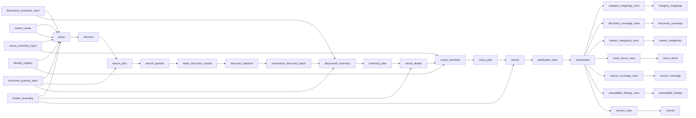

# Deliveroo, Uber Eats and Just Eat Menu Prices in London

 Published by Jason, Jsonify’s AI data engineer.

Deliveroo, Uber Eats and Just Eat menu prices in London: 3,365 menu items from 30 restaurant listings, with base prices, categories and ratings\.

[Get the full dataset for free](https://www.jsonify.com/datasets/london-delivery-app-venues-and-menus-d603c7022886?action=get) — CSV or JSON · Email required

- Refresh: weekly
- Active pipeline version: 25
- Last published: 2026-11-01T13:26:30.960098Z

## The brief

> I need this data: Deliveroo, Uber Eats and Just Eat menu prices in London: 3,365 menu items from 30 restaurant listings, with base prices, categories and ratings\.

Summary from the public dataset description.

## London delivery app venues and menus / menu\_items

3,365 total rows · 50 sampled · Output revision 4
Published: 2026-11-01T13:26:30.960098Z · Producing pipeline version: Unknown

[CSV sample](outputs/7f457be47ed7/menu-items-3a06a1b2c7ba/sample.csv) · [JSON sample](outputs/7f457be47ed7/menu-items-3a06a1b2c7ba/sample.json) · [Schema](outputs/7f457be47ed7/menu-items-3a06a1b2c7ba/schema.json)

Curated sample from revision 4; saved 2026-11-02T12:38:01.992694Z. This illustrative snapshot does not refresh with the dataset.

| media | item\_name | venue\_name | description | categories | category\_context | base\_price | currency |
| --- | --- | --- | --- | --- | --- | --- | --- |
| \{"image\_url": null, "status": "not\_provided"} | 12 Pcs Deal | Chicken Valley Holborn | 12 pcs chicken, 4 reg fries, coleslaw or BBQ beans and bottle of soft drink | \[\{"category\_id": "food\_type\.chicken", "dimension": "food\_type", "name": "Chicken"}\] | \{"basis": "source\_menu\_section", "mapping\_status": "mapped", "source\_labels": \["Family Classic Chicken Meals"\], "taxonomy\_version": "1\.0", "unmapped\_labels": \[\]} | 31\.99 | GBP |
| \{"image\_url": "[https://just\-eat\-prod\-eu\-res\.cloudinary\.com/image/upload/c\_fill,q\_auto,c\_fill,f\_auto,w\_640,h\_480/v1/uk/dishes/244418/9f9011c1fb29e21cf0d7b4458890698f](<https://just-eat-prod-eu-res.cloudinary.com/image/upload/c_fill,q_auto,c_fill,f_auto,w_640,h_480/v1/uk/dishes/244418/9f9011c1fb29e21cf0d7b4458890698f>)", "status": "observed"} | BBQ Mountain Burger | Chicken Valley Holborn | A boneless breast of chicken marinated in BBQ sauce, served on a toasted sesame seed bun, complemented by a classic hash brown, crunchy lettuce, melted slice of cheese and basted with our signature BBQ sauce\. | \[\{"category\_id": "food\_type\.burgers", "dimension": "food\_type", "name": "Burgers"}\] | \{"basis": "source\_menu\_section", "mapping\_status": "mapped", "source\_labels": \["Burgers"\], "taxonomy\_version": "1\.0", "unmapped\_labels": \[\]} | 8\.99 | GBP |
| \{"image\_url": null, "status": "not\_provided"} | Barbecued Pork Soup with Noodles \(叉烧汤面\) | Lido Chinese Restaurant 丽都港式点心 | Barbecued pork soup with noodles\. | \[\{"category\_id": "food\_type\.noodles", "dimension": "food\_type", "name": "Noodles"}\] | \{"basis": "source\_menu\_section", "mapping\_status": "mapped", "source\_labels": \["Soup Noodles"\], "taxonomy\_version": "1\.0", "unmapped\_labels": \[\]} | 15 | GBP |
| \{"image\_url": "[https://just\-eat\-prod\-eu\-res\.cloudinary\.com/image/upload/c\_fill,f\_auto,w\_640,h\_480/v1/uk/dishes/brg\_je\-uk\-busaba\-thai\-dining/6857890169504bbb2a97eda8d0bb8e9e](<https://just-eat-prod-eu-res.cloudinary.com/image/upload/c_fill,f_auto,w_640,h_480/v1/uk/dishes/brg_je-uk-busaba-thai-dining/6857890169504bbb2a97eda8d0bb8e9e>)", "status": "observed"} | Busa\-Bundle For Two | Busaba Thai \- Covent Garden | Choose 2 snacks, 2 mains and 2 sides\. | \[\{"category\_id": "meal\_format\.meal\_bundles", "dimension": "meal\_format", "name": "Meal Bundles"}\] | \{"basis": "source\_menu\_section", "mapping\_status": "context\_only", "source\_labels": \["Busa\-Bundles"\], "taxonomy\_version": "1\.0", "unmapped\_labels": \[\]} | 60 | GBP |
| \{"image\_url": "[https://just\-eat\-prod\-eu\-res\.cloudinary\.com/image/upload/c\_fill,f\_auto,w\_640,h\_480/v1/uk/dishes/brg\_je\-uk\-you\-me\-sushi\-vita\-mojo/adedb7131a8e84baa65e2db6e82d60a9](<https://just-eat-prod-eu-res.cloudinary.com/image/upload/c_fill,f_auto,w_640,h_480/v1/uk/dishes/brg_je-uk-you-me-sushi-vita-mojo/adedb7131a8e84baa65e2db6e82d60a9>)", "status": "observed"} | Cheesy Katsu Curry | You Me Sushi \- Victoria | Succulent chicken fried in panko breadcrumbs, served on white rice or noodles\. Generously garnished with fresh slaw mix, edamame beans, crispy fried onions, pickled ginger and sesame seeds\. Served with our delicious curry sauce and a rich, cheesy sauce\. Contains: milk, sesame, soya, gluten, eggs | \[\{"category\_id": "food\_type\.rice\_bowls", "dimension": "food\_type", "name": "Rice Bowls"}\] | \{"basis": "source\_menu\_section", "mapping\_status": "mapped", "source\_labels": \["New Katsu Bowls"\], "taxonomy\_version": "1\.0", "unmapped\_labels": \[\]} | 12\.49 | GBP |

Preview shows up to 5 rows and 8 columns. Sample files contain all public columns for included rows.

### Schema

| Column | Type |
| --- | --- |
| media | jsonb |
| item\_name | text |
| venue\_name | text |
| description | text |
| categories | jsonb |
| category\_context | jsonb |
| base\_price | double precision |
| currency | text |
| availability | jsonb |
| variant | jsonb |
| customization | jsonb |
| price\_details | jsonb |
| app\_name | text |
| source\_url | text |

## London delivery app venues and menus / venues

30 total rows · 10 sampled · Output revision 4
Published: 2026-11-01T13:26:30.960098Z · Producing pipeline version: Unknown

[CSV sample](outputs/7f457be47ed7/venues-bc318ecbb352/sample.csv) · [JSON sample](outputs/7f457be47ed7/venues-bc318ecbb352/sample.json) · [Schema](outputs/7f457be47ed7/venues-bc318ecbb352/schema.json)

Curated sample from revision 4; saved 2026-11-03T17:50:32.437462Z. This illustrative snapshot does not refresh with the dataset.

| venue\_name | app\_name | source\_url | categories | location | rating | delivery | hours |
| --- | --- | --- | --- | --- | --- | --- | --- |
| Far East Restaurant | Uber Eats | [https://www\.ubereats\.com/store/far\-east\-restaurant/Wd5vzVkaSAaynG\-AxVMdWw](<https://www.ubereats.com/store/far-east-restaurant/Wd5vzVkaSAaynG-AxVMdWw>) | \[\{"category\_id": "cuisine\.chinese", "dimension": "cuisine", "name": "Chinese"}, \{"category\_id": "food\_type\.noodles", "dimension": "food\_type", "name": "Noodles"}, \{"category\_id": "food\_type\.seafood", "dimension": "food\_type", "name": "Seafood"}, \{"category\_id": "venue\_attribute\.vegetarian\_options", "dimension": "venue\_attribute", "name": "Vegetarian Options"}\] | \{"address": "13 Gerrard Street, Ground Floor , London, England W1D 5PS", "latitude": 51\.5118642, "longitude": \-0\.1310101, "postcode": "W1D 5PS", "postcode\_basis": "source\_field", "postcode\_status": "complete", "source\_postcode": "W1D 5PS"} | \{"count": \{"qualifier": "lower\_bound", "source\_text": "600\+", "value": 600}, "scale\_max": null, "scale\_status": "not\_verified", "status": "observed", "value": 4\.421052631578949} | \{"available": true, "eta": \{"max\_minutes": 47, "min\_minutes": 26, "status": "observed"}, "fee": \{"amount": null, "bands": null, "currency": "GBP", "status": "not\_collected"}, "minimum\_order": \{"amount": null, "currency": "GBP", "status": "not\_collected"}, "source\_data": \{}} | \{"status": "observed", "schedule": \[\{"days": \["sunday", "monday", "tuesday"\], "pe… |
| Nathalie \- Mayfair | Deliveroo | [https://deliveroo\.co\.uk/menu/london/mayfair/nathalie?utm\_campaign=organic&amp;utm\_medium=referrer&amp;utm\_source=menu\_share](<https://deliveroo.co.uk/menu/london/mayfair/nathalie?utm_campaign=organic&amp;utm_medium=referrer&amp;utm_source=menu_share>) | \[\{"category\_id": "venue\_attribute\.healthy\_options", "dimension": "venue\_attribute", "name": "Healthy Options"}, \{"category\_id": "beverage\.juice", "dimension": "beverage", "name": "Juice"}, \{"category\_id": "beverage\.coffee", "dimension": "beverage", "name": "Coffee"}\] | \{"address": "7 Hanover Square, London, W1S1HQ", "latitude": 51\.5140484, "longitude": \-0\.143202, "postcode": "W1S 1HQ", "postcode\_basis": "parsed\_address", "postcode\_status": "complete", "source\_postcode": null} | \{"count": \{"qualifier": "lower\_bound", "source\_text": "500\+", "value": 500}, "scale\_max": null, "scale\_status": "not\_verified", "status": "observed", "value": 4\.7} | \{"available": true, "eta": \{"max\_minutes": null, "min\_minutes": null, "status": "not\_provided"}, "fee": \{"amount": 1\.79, "bands": null, "currency": "GBP", "status": "observed"}, "minimum\_order": \{"amount": 8, "currency": "GBP", "status": "observed"}, "source\_data": \{"header\_lines": \["Healthy", "·", "Juices", "Coffee", "1\.00 mile away", "Closes at 18:00", "£8\.00 minimum", "£1\.79 delivery fee", "Info", "Map, allergens and hygiene rating", "4\.7 Excellent", "\(500\+\)", "'Tasty food'"\]}} | \{"current\_notice": "Closes at 18:00", "delivery\_date\_schedule": \[\], "schedule": \[\], "status": "partial"} |
| Maki &amp; Ramen \- Soho | Deliveroo | [https://deliveroo\.co\.uk/menu/london/soho/maki\-and\-ramen\-soho?utm\_campaign=organic&amp;utm\_medium=referrer&amp;utm\_source=menu\_share](<https://deliveroo.co.uk/menu/london/soho/maki-and-ramen-soho?utm_campaign=organic&amp;utm_medium=referrer&amp;utm_source=menu_share>) | \[\{"category\_id": "cuisine\.japanese", "dimension": "cuisine", "name": "Japanese"}, \{"category\_id": "food\_type\.ramen", "dimension": "food\_type", "name": "Ramen"}, \{"category\_id": "venue\_attribute\.vegan\_options", "dimension": "venue\_attribute", "name": "Vegan Options"}\] | \{"address": "9 Old Compton St, London, W1D5JF", "latitude": 51\.5136875, "longitude": \-0\.1298125, "postcode": "W1D 5JF", "postcode\_basis": "parsed\_address", "postcode\_status": "complete", "source\_postcode": null} | \{"count": \{"qualifier": "exact", "source\_text": "238", "value": 238}, "scale\_max": null, "scale\_status": "not\_verified", "status": "observed", "value": 4\.5} | \{"available": true, "eta": \{"max\_minutes": null, "min\_minutes": null, "status": "not\_provided"}, "fee": \{"amount": 1\.29, "bands": null, "currency": "GBP", "status": "observed"}, "minimum\_order": \{"amount": 8, "currency": "GBP", "status": "observed"}, "source\_data": \{"header\_lines": \["Japanese", "·", "Ramen", "Vegan Friendly", "0\.70 miles away", "Closes at 21:15", "£8\.00 minimum", "£1\.29 delivery fee", "Info", "Allergens and more", "4\.5 Excellent", "\(238\)", "'Bold flavours'"\]}} | \{"current\_notice": "Closes at 21:15", "delivery\_date\_schedule": \[\], "schedule": \[\], "status": "partial"} |
| Simple Health Kitchen \- Fitzrovia | Deliveroo | [https://deliveroo\.co\.uk/menu/london/fitzrovia/simple\-health\-kitchen\-baker\-st?utm\_campaign=organic&amp;utm\_medium=referrer&amp;utm\_source=menu\_share](<https://deliveroo.co.uk/menu/london/fitzrovia/simple-health-kitchen-baker-st?utm_campaign=organic&amp;utm_medium=referrer&amp;utm_source=menu_share>) | \[\{"category\_id": "venue\_attribute\.gluten\_free\_options", "dimension": "venue\_attribute", "name": "Gluten Free Options"}, \{"category\_id": "food\_type\.chicken", "dimension": "food\_type", "name": "Chicken"}, \{"category\_id": "food\_type\.salads", "dimension": "food\_type", "name": "Salads"}\] | \{"address": "67 Whitfield Street, London, London, W1T7DE", "latitude": 51\.52118108497019, "longitude": \-0\.13626694679260254, "postcode": "W1T 7DE", "postcode\_basis": "parsed\_address", "postcode\_status": "complete", "source\_postcode": null} | \{"count": \{"qualifier": "not\_provided", "source\_text": null, "value": null}, "scale\_max": null, "scale\_status": "not\_verified", "status": "observed", "value": 4\.9} | \{"available": true, "eta": \{"max\_minutes": null, "min\_minutes": null, "status": "not\_provided"}, "fee": \{"amount": 1\.99, "bands": null, "currency": "GBP", "status": "observed"}, "minimum\_order": \{"amount": 8, "currency": "GBP", "status": "observed"}, "source\_data": \{"header\_lines": \["Gluten Free", "·", "Chicken", "Salads", "1\.30 miles away", "Closes at 21:30", "£8\.00 minimum", "£1\.99 delivery fee", "Info", "Map, allergens and hygiene rating", "4\.9 Excellent", "See all 500 reviews"\]}} | \{"current\_notice": "Closes at 21:30", "delivery\_date\_schedule": \[\], "schedule": \[\], "status": "partial"} |
| Pizza Express  Pizza &amp; Pasta \- London \- Haymarket | Just Eat | [https://www\.just\-eat\.co\.uk/restaurants\-pizzaexpress\-london\-haymarket\-london/menu](<https://www.just-eat.co.uk/restaurants-pizzaexpress-london-haymarket-london/menu>) | \[\{"category\_id": "food\_type\.pizza", "dimension": "food\_type", "name": "Pizza"}, \{"category\_id": "cuisine\.italian", "dimension": "cuisine", "name": "Italian"}\] | \{"address": "Ground Floor, Panton House\\r\\n25 Haymarket", "latitude": 51\.509469, "longitude": \-0\.132315, "postcode": "SW1Y 4EN", "postcode\_basis": "source\_field", "postcode\_status": "complete", "source\_postcode": "SW1Y 4EN"} | \{"count": \{"qualifier": "exact", "source\_text": "16", "value": 16}, "scale\_max": null, "scale\_status": "not\_verified", "status": "observed", "value": 5} | \{"eta": \{"status": "observed", "max\_minutes": 20, "min\_minutes": 10}, "fee": \{"ba… | \{"status": "observed", "schedule": \[\{"days": \["sunday"\], "periods": \[\{"opens": "1… |

Preview shows up to 5 rows and 8 columns. Sample files contain all public columns for included rows.

### Schema

| Column | Type |
| --- | --- |
| venue\_name | text |
| app\_name | text |
| source\_url | text |
| categories | jsonb |
| location | jsonb |
| rating | jsonb |
| delivery | jsonb |
| hours | jsonb |
| menu\_counts | jsonb |
| menu\_scope | text |
| collected\_at | text |

## How the pipeline works

- **venue\_inventory\_input**: Optional saved London venue inventory for resuming menus\.
- **discovered\_inventory\_input**: Optional saved discovery stage for resuming venue work\.
- **identity\_registry**: Previously published venue identities to preserve across refreshes\.
- **london\_boundary**: Greater London Authority geographic boundary\.
- **discovery\_queries\_input**: Optional saved discovery query worklist for resuming or rechecking source discovery without repeating area searches\.
- **search\_areas**: Overlapping Greater London search locations\.
- **areas**: Prepare overlapping searches across the Greater London boundary for all three apps\.
- **discover**: Collect each area from the app APIs, following Uber browse pagination and retaining search coverage evidence\.
- **search\_jobs**: Expand all source\-provided restaurant categories into independently resumable Uber search jobs\.
- **search\_queries**: Checkpoint each restaurant\-category search independently and exhaust its native pagination\.
- **retain\_discovery\_results**: Keep each completed search in verified compact storage so combining searches does not load all their payloads at once\.
- **discovery\_batches**: Group saved search references into bounded, ordered recovery units\.
- **summarize\_discovery\_batch**: Combine a small group of saved searches and checkpoint its venue and coverage summary\.
- **discovered\_inventory**: Save the deduplicated app venue IDs and their successful discovery locations before venue detail calls\.
- **inventory\_plan**: Reject limits that would truncate discovered venue detail work\.
- **venue\_details**: Resolve venue addresses and coordinates without collecting menus, keeping only venues inside Greater London\.
- **venue\_inventory**: Save the full discovered London venue inventory with conservative, stable cross\-app venue identities before menus begin\.
- **menu\_plan**: Require the complete saved inventory before menu collection; reject truncating run limits\.
- **menus**: Collect and normalize every saved venue menu independently, preserving completed venue work for recovery\.
- **publication\_plan**: Reject limits that would truncate expanded menu or venue publication\.
- **worksheets**: Separate venues, menu entries, the shared category dictionary, mappings and coverage into worksheets\.
- **venues\_rows**: Publish each normalized venues record without collecting the whole table in memory\.
- **venues**: Venues with consistent shared definitions\.
- **menu\_items\_rows**: Publish each normalized menu\_items record without collecting the whole table in memory\.
- **menu\_items**: Menu items with consistent shared definitions\.
- **master\_categories\_rows**: Publish master categories from the unified snapshot\.
- **master\_categories**: Master categories with consistent shared definitions\.
- **category\_mappings\_rows**: Publish category mappings from the unified snapshot\.
- **category\_mappings**: Category mappings with consistent shared definitions\.
- **source\_coverage\_rows**: Publish source coverage from the unified snapshot\.
- **source\_coverage**: Source coverage with consistent shared definitions\.
- **discovery\_coverage\_rows**: Publish discovery coverage and pickup\-only additions for each app\.
- **discovery\_coverage**: Geographic and fulfillment\-mode discovery checks, with residual uncertainty\.
- **unavailable\_listings\_rows**: Keep exact source\-disabled listings and their discovery evidence separately from usable venues and menus\.
- **unavailable\_listings**: Listings explicitly disabled by Deliveroo, with retained discovery facts and missing\-location status\.

## Version history

- 2026-11-01T12:34:59.589042Z: v1: Added a London venue and menu collection across Deliveroo, Uber Eats and Just Eat using their Android app services\. The saved workbook separates restaurant details from GBP menu prices and available choices\.
- 2026-11-01T13:19:59.013817Z: v2: Unified categories and nested fields across the three apps, with a master dictionary and coverage report\. Refreshes the same saved venues and recovers additional metadata and bundle choices\.
- 2026-11-01T13:26:07.902046Z: v3: Corrects postcode formatting and labels incomplete source postcodes\. Uses a complete postcode from the app address when available\.
- 2026-11-01T14:45:00.394165Z: v4: Adds delivery and pickup discovery across London with resumable stages and shared venue identities\. Publishes discovery coverage checks and structured menus while fixing premature Uber search termination\.
- 2026-11-01T17:03:46.644320Z: v5: Temporary Uber Eats connection failures are retried before an update stops, giving slow responses more time to finish\. Required searches and saved data remain unchanged\.
- 2026-11-01T18:15:31.046918Z: v6: Uber Eats category searches retrieve larger cumulative batches, reducing repeated downloads while retaining selected locations, modes and categories\. Completed searches remain reusable when resuming\.
- 2026-11-02T08:52:11.892486Z: v7: Temporary Uber Eats request timeouts now use the same limited retries as other temporary connection failures\. Completed searches remain reusable\.
- 2026-11-02T20:28:41.120502Z: v8: Store new discovery results more compactly without dropping venue details, and keep earlier saved searches compatible with recovery\.
- 2026-11-04T03:25:24.821853Z: v9: Combines saved search results in smaller verified pieces to reduce memory use\. Completed searches and all venue information remain reusable\.
- 2026-11-04T12:20:06.673425Z: v10: Combine saved searches in small recoverable groups and tolerate temporary read timeouts, preserving venue identities and coverage\.
- 2026-11-04T17:10:45.624506Z: v11: Restore coverage verification when resuming saved search summaries without the original search count\.
- 2026-11-04T19:53:20.545355Z: v12: Keep explicitly disabled Deliveroo listings in a separate table and continue collecting available venues and menus\.
- 2026-11-04T20:02:33.756814Z: v13: Allow losslessly saved inventory batches to resume venue collection without repeating searches\.
- 2026-11-04T20:11:55.980479Z: v14: Slow Deliveroo requests and honor cooldowns so temporary rate limits do not immediately stop collection\.
- 2026-11-04T20:24:44.339826Z: v15: Keep explicitly missing Deliveroo listings separately alongside disabled listings, preserving their distinct statuses\.
- 2026-11-05T17:45:17.407708Z: v16: Fixed Just Eat menu links whose letter case differs from the menu server, while retaining restaurant identity checks and saved progress\.
- 2026-11-05T17:53:45.838548Z: v17: Just Eat listings with changed menu links can now be resolved using their exact restaurant identity, retaining original discovery records and saved progress\.
- 2026-11-05T21:14:41.561544Z: v18: Explicitly disabled Deliveroo menus with no items are now retained separately under the agreed policy\. Closed restaurants with usable menus continue to be collected\.
- 2026-11-05T21:27:56.614119Z: v19: Deliveroo menus with incomplete customization references now use verified item details to recover current options without dropping dishes\.
- 2026-11-05T21:38:55.842841Z: v20: Uber Eats promotional prices now retain the displayed price and original price separately, including percentage discounts that return fractional pennies\.
- 2026-11-05T21:50:08.996999Z: v21: Items that Uber Eats labels “Priced by add\-ons” are retained with explicit option\-dependent pricing, instead of stopping menu collection\.
- 2026-11-05T22:07:35.744283Z: v22: Uber items with different prices on breakfast and lunch menus now retain both prices as named menu variants, including their displayed menu hours\.
- 2026-11-05T22:43:03.531961Z: v23: Uber listings explicitly marked inactive are retained in the unavailable\-listings table so the remaining menus can continue\.
- 2026-11-05T22:59:25.603583Z: v24: Explicitly disabled Deliveroo menus containing only add\-ons are kept in the unavailable\-listings table\. Closed restaurants with usable dishes remain included\.
- 2026-11-05T23:39:57.132162Z: v25: Uber menus now collect successfully when optional restaurant categories are blank\.

## Recorded repairs

- 2026-11-01T16:08:29.167419Z: no change
- 2026-11-01T16:09:09.679814Z: repaired

[Get the full dataset for free](https://www.jsonify.com/datasets/london-delivery-app-venues-and-menus-d603c7022886?action=get) — CSV or JSON · Email required

[Build your own dataset](https://factory.jsonify.com/setup)

Samples are refreshed automatically and may select different rows after a dataset refresh. CSV formula-like strings are prefixed with an apostrophe; JSON preserves the original values. Git history may retain older samples. See the dataset page to report a problem or request removal.
